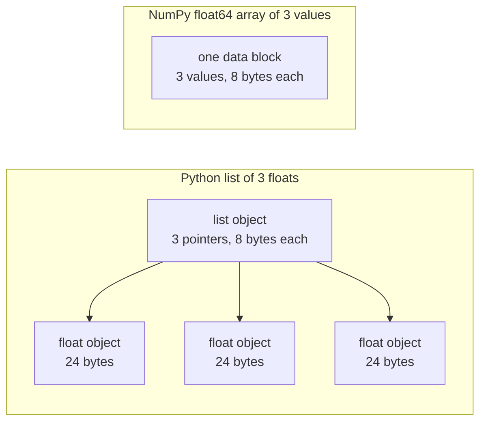

# 面向 AI 工程的 Python

> معظم الكود في هذا البرنامج يستخدم نفس مجموعة من Python 习惯用法. قبل أن تعتمد على هذه الكود في الدروس اللاحقة في الرياضيات والنماذج، يجب أن تتعلمها أولاً.

**Type:** Build
**Languages:** Python
**Prerequisites:** 开发环境、Python 环境
**Time:** ~120 分钟

## 學习目标

- 阅读课程代码中最常见的习惯用法,从解包和f字符串到数据类与推导式──
- 找出三种不会报错但会产生错误结果的Python 问题:共享列表、可变默认值和已耗尽的生成器──
- استخدام المقاييس فقط، بناء CSV مع JSON حاملات، وتقسيم البيانات من خلال البذور، وكذلك مولد الكتلة الصغيرة.
- باستخدام بيثون النقيّة، أكتب النقاط، والقيمة المتوسطة، والحسابات المعايير، ويقيس السرعة، والحفظات المحفوظة.
- شرح لماذا تتدفق دورات Python البحتة من خلال قيمة العدد، وكذلك كيف سيتم نقل دورة NumPy إلى الكود بعد التدوين.

## 问题

في هذه المرحلة بعد ذلك، يتم استخدام Python العادي لتنفيذ عمليات النموذج والمعايير الرياضية.`dataclasses`إضافة إلى ذلك، 187 文件调用 `random.seed`أو أنشئ`random.Random`إذا كنت غير مألوف بهذه الممارسات، سوف تكون مشغولة في فهم لغة الفكرية عندما تحاول فهم الرياضيات.

هناك بعض العناصر في بايثون التي لن توفر معلومات خاطئة، ولكن تؤدي إلى نتائج خاطئة. يمكن أن تشير اثنين من الأسماء إلى نفس القائمة، وبالتالي من خلال تعديل اسم للكائمة، سوف تغير أيضا المحتوى الذي يرى اسم آخر.

آخر مشكلة هي السرعة. في أجهزة الكمبيوتر المحمولة التي أجريت فيها اختبارنا، تحتاج دورة بيثون النقي إلى 30 ملين ثانية تقريباً، وبالنسبة لعدد النقاط التي يتم تحديدها، تحتاج إلى 30 ملين ثانية تقريباً.

## 概念

### 课程代码 استخدام أي كتابة

نحن نستخدم`ast`模块解析了 `phases/*/*/code/`في الوسط جميع 541  Python 文件── 下表统计至少 استخدام مرة واحدة عدد الملفات من الهيكل التناظر── 统计来自编写本课当天,会随着新课程加入而变化──

| 结构 | 文件数 | 占比 |
|-----------|-------|-------|
| 函数定义 | 541 | 100% |
| `if __name__ == "__main__":` | 529 | 98% |
| f 字符串 | 517 | 96% |
| 元组解包 | 448 | 83% |
| 类 | 379 | 70% |
| 列表推导式 | 375 | 69% |
| 函数类型标注 | 342 | 63% |
| 生成器表达式 | 326 | 60% |
| 切片 | 314 | 58% |
| `lambda` | 175 | 32% |
| `try` 与 `except` | 120 | 22% |
| `with` 语句 | 96 | 18% |
| 字典推导式 | 93 | 17% |
| 使用 `yield` 的生成器函数 | 14 | 3% |

تمثل حالة الاستيراد أهم طرق المعيار في 541 وثيقة، و340 منها`from __future__ import annotations`أبدأ، 276 个导入`dataclasses`.`math`.`random`和 `json`模块分别出现在187、175 和 126 文件中──`collections`في 70 ملفاً`itertools`فقط ظهر في 4 وثائق

没有课程调用 `map()`أو`filter()`؛ تمت إشرافها على هذه الأعمال.`sorted`.`min`.`max`أو`.sort`时使用了 `key=`函数──本课会将最多时间花在这些列表中排名上了前的习惯用法──

### 名称引用对象

في بايثون، التغير هو استناد إلى اسم الكائن. تمنح قيمة أن يكون الاسم مقيدًا على الكائن، لا ينسخ الكائن. عندما ينسخ اثنان من الأسماء على نفس القائمة، من خلال إصدار تعديل لسم واحد، يمكن رؤية كلتا الأسماء.

### 列表保存指针,数组保存数值

ليست قائمة Python مباشرة قيمة تخزين، ولكن مؤشر تخزين، كل مؤشر يقتبس على كائن Python كامل. في 64 موقع CPython، كل مؤشر يشكل 8 字节، لكل `float`العضو يمثل 24 字节──NumPy `float64`عدد الحسابات سيتم تخزين قيمة 8 字节 الأصلية في كتلة من الذاكرة.



يجب القيام بالكثير من العمل عند معالجة كل عنصر. المفسر يقوم بتنفيذ تعليمات الكود.

NumPy لتنفيذ عملية التنفيذ بعد التنفيذ ، إنجاز نفس العملية. فإنه فقط يفتش نوع البيانات مرة واحدة على الجمعية بأكملها ، لن يخلق كود قياسي للكويتون لكل عنصر.`(x - mean) / std`، من خلال الدورة التنفيذية. تابع وظيفة اليموتور في هذا الصف أيضا هذا المبدأ: كل وظيفة فقط ينجح في عملية حجم واحد، ثم يمكن أن تستبدلها مرة واحدة NumPy 调用.

### 列表保存全部元素,生成器每次保存一个

يقوم الإدراج في القائمة بتكوين جميع العناصر قبل تنفيذ الصف التالي. عندما يقوم المولّد بتكوين العناصر التالية في كل طلب من المستخدم، يتمّ بناء عنصر واحد. يزداد استخدام الاحتياطي في القائمة مع ارتفاع عدد العناصر. مهما كان عدد العناصر، فإن استخدام الاحتياطي في المولّد لا يتغير بشكل كبير.

يمكن أن يمر الجهاز مرة واحدة فقط بعد العنصر الأخير ، كل طلب سيتم تشغيله`StopIteration`، لذلك الثانية من خلالها`for`الدورة لا تحصل على أي عنصر. كل دورة من المواد التدريبية تقرأ مجموعة بيانات واحدة، لذلك يجب أن تخلق مولد جديد لكل دور.

في كود الدورة يظهر وظيفة المولد في الغالب، ولكن محركات تحميل البيانات التي تستخدم في الدورات المتعلقة بالتعلم العميق هي كائنات قابلة للتنفيذ لتوفير البيانات على حد سواء، لذلك هذه الفكرة موجودة في كل دورة تدريبية.

```figure
s0-list-vs-generator
```

## تحتاج إلى معرفة كيفية استخدام العادات

كل قطعة من هذه القسم يمكن أن تعمل بشكل مستقل.`python3`运行──代码块需要 Python 3.11 أو إصدار جديد، وهذا هو أيضا الإصدار الذي نقوم بتثبيته في دروس تطوير البيئة──

### 1. √ الحاويات و التفريغ

Python لديه أربعة محطات متضمنة، يرجى فهم كل من المواقع الملائمة لها.

| 类型 | 示例 | 有序 | 可变 | 在课程中的典型用途 |
|------|---------|---------|------------|---------------------------|
| `list` | `[0.5, 1.2]` | 是 | 是 | 样本、损失、权重 |
| `tuple` | `(32, 784)` | 是 | 否 | 形状、固定记录、字典键 |
| `dict` | `{"lr": 0.01}` | 按插入顺序 | 是 | 配置、词表、JSON 行 |
| `set` | `{"cat", "dog"}` | 否 | 是 | 唯一 token、重叠检查 |

يظهر الكود التالي أن القيمة الممنوحة لن تكرر قائمة:

```python
weights = [0.5, -1.2, 3.0]
alias = weights
alias[0] = 99.0
print(weights)

independent = list(weights)
independent[1] = 0.0
print(weights, independent)

grid = [[0] * 3] * 2
grid[0][0] = 1
print(grid)

grid = [[0] * 3 for _ in range(2)]
grid[0][0] = 1
print(grid)
```

```text
[99.0, -1.2, 3.0]
[99.0, -1.2, 3.0] [99.0, 0.0, 3.0]
[[1, 0, 0], [1, 0, 0]]
[[1, 0, 0], [0, 0, 0]]
```

الإعلان`[[0] * 3] * 2`إنشاء قائمة خارجية، يُشار إليها اثنان من نفس قائمة داخلها.

解包在一行中将序列元素赋予多个名称──带星号的名称收集剩余元素──f 字符串将表达的值嵌入字符串,也可以在冒号之后指定格式──

```python
shape = (32, 784)
batch_size, n_features = shape
first, *middle, last = [1, 2, 3, 4, 5]
x, y = 1.0, 3.0
x, y = y, x

config = {"lr": 0.01, "epochs": 5}
config["seed"] = 7
tokens = ["the", "cat", "sat", "on", "the", "mat"]
vocab = set(tokens)

print(batch_size, n_features, first, middle, last, x, y)
print(config.get("momentum", 0.9), "cat" in vocab, len(vocab))
print(f"lr={config['lr']:.0e} loss={0.123456:.3f} n={60_000:,} {batch_size=}")
```

```text
32 784 1 [2, 3, 4] 5 3.0 1.0
0.9 True 5
lr=1e-02 loss=0.123 n=60,000 batch_size=32
```

لا يوجد وقت`dict.get`返回默认值── مهما كانت الكتيبة كبيرة، على الكتيبة `in`المراقبة المطلوبة في الوقت نفسه`{batch_size=}`形式同时印名称和值,有助调试──

切片 `a[start:stop:step]`包含 `start`, لا يحتوي`stop`                                                                                                                                                                                                                                                                    

```python
tokens = ["<s>", "the", "cat", "sat", "on", "the", "mat", "</s>"]
print(tokens[1:-1])
print(tokens[:3], tokens[-3:])
print(tokens[::2])
print(tokens[::-1][:2])
windows = [tokens[i:i + 3] for i in range(len(tokens) - 2)]
print(len(windows), windows[0])
```

```text
['the', 'cat', 'sat', 'on', 'the', 'mat']
['<s>', 'the', 'cat'] ['the', 'mat', '</s>']
['<s>', 'cat', 'on', 'mat']
['</s>', 'mat']
6 ['<s>', 'the', 'cat']
```

### 2. 推导式

推导式通过一个表达式,从可代对象构建列表、字典或集合──它的读法接近其描述的数学运算──

```python
scores = [0.91, 0.42, 0.77, 0.15, 0.66]
labels = [1 if s >= 0.5 else 0 for s in scores]
high = [s for s in scores if s > 0.6]
squares = {i: i * i for i in range(4)}
lengths = {len(word) for word in ["a", "bb", "cc", "ddd"]}
sum_sq = sum(s * s for s in scores)

matrix = [[1, 2, 3], [4, 5, 6]]
transposed = [list(column) for column in zip(*matrix)]
flat = [v for row in matrix for v in row]

print(labels, high, squares, lengths, round(sum_sq, 4))
print(transposed, flat)
```

```text
[1, 0, 1, 0, 1] [0.91, 0.77, 0.66] {0: 0, 1: 1, 2: 4, 3: 9} {1, 2, 3} 2.0555
[[1, 4], [2, 5], [3, 6]] [1, 2, 3, 4, 5, 6]
```

末尾的 `if`فقط احتفظوا ببعض العناصر`for`يمكن أن يكون الإعلان السابق إعلانًا مشروطًا ، أي`a if condition else b` اثنان `for`تسلسل عمل الحلقة، مع نفس الحلقة المثبتة.

圆括号创建生成器表达式──在 `sum(s * s for s in scores)`في وسط`sum`كل مرة تُقرأ فيها قيمة مربعة، فـ (بايتون) لن يُبني قائمة`zip(*matrix)`كل صف سيكون كعامل مستقل`zip`ستعمل نفس الموقع العناصر المقابلة

### 3. 函数、参数与闭包

默认值让参数变为可选. 关键字实参在调用时明确指定形参名称. 参数列表中单独的.`*`، سوف يتم تعيين العناصر اللاحقة فقط من خلال المفاتيح المقدمة.

```python
def clip(value, low=0.0, high=1.0):
    return max(low, min(high, value))


def train(data, *, lr=0.01, epochs=3):
    return f"{len(data)} samples, lr={lr}, epochs={epochs}"


def make_scaler(factor):
    def scale(values):
        return [v * factor for v in values]
    return scale


print(clip(1.7), clip(-3.0, low=-1.0), clip(0.4, high=0.3))
print(train([1, 2, 3], lr=0.1))
to_percent = make_scaler(100)
print(to_percent([0.25, 0.5]))
```

```text
1.0 -1.0 0.3
3 samples, lr=0.1, epochs=3
[25.0, 50.0]
```

استخدام فقط العنصرات المفتاحية،`train(data, 0.1, 3)`هذا هو التطبيق الذي ستقوم بتشغيل`TypeError`◊ المستخدم يجب أن يكتب`lr=0.1`، لذلك لا تعني اثنين من القيم العددية تغيير الموقع الدولي.

内部函数 `scale`استخدام إنشاءها من وظائف `factor`-لا، لا، لا`scale`لا يزال موجوداً، (بايتون) لا يزال موجوداً`factor` الحفاظ على وظيفة متغيرات المبدعين تسمى closed.

`lambda`ليس هناك اسم، يحتوي فقط على وظيفة تعبير.`key=`函数,第 8 部分会介绍这种用法──

Python في تنفيذ`def`语句时, فقط حساب مرة واحدة القيمة الم默认. في كل مرة استخدام القيمة الم默认, تحصل على نفس العبارة.

```python
def add_bad(item, bucket=[]):
    bucket.append(item)
    return bucket


def add_good(item, bucket=None):
    if bucket is None:
        bucket = []
    bucket.append(item)
    return bucket


add_bad("a")
print(add_bad("b"))
add_good("a")
print(add_good("b"))
```

```text
['a', 'b']
['b']
```

列表、字典或集合的默认值应使用 `None`, وخلق أجهزة جديدة داخل الوظيفة

### 4. 类与数据类

`@dataclass`装饰器根据带类型标注的字段,生成 `__init__`.`__repr__`和 `__eq__` إعداد`frozen=True`بعد، لا يمكن تغيير الكتب بعد إنشاءها، يمكن استخدامها ككتابة أو إدخالها في المجموعة.

```python
from dataclasses import dataclass, field


@dataclass(frozen=True)
class Example:
    features: tuple[float, ...]
    label: int


@dataclass
class TrainConfig:
    lr: float = 0.01
    epochs: int = 5
    hidden: list[int] = field(default_factory=lambda: [64, 32])

    def describe(self):
        return f"lr={self.lr} epochs={self.epochs} hidden={self.hidden}"


ex = Example((1.5, 2.0), 1)
print(ex)
print(ex == Example((1.5, 2.0), 1), len({ex, Example((1.5, 2.0), 1)}))
print(TrainConfig(epochs=10).describe())
try:
    ex.label = 0
except AttributeError as err:
    print(type(err).__name__)
```

```text
Example(features=(1.5, 2.0), label=1)
True 1
lr=0.01 epochs=10 hidden=[64, 32]
FrozenInstanceError
```

`field(default_factory=...)`وذلك من أجل كل حالة توفير قائمة جديدة.

特殊方法将类与 Python 语法连接起来──`len(ds)`调用 `__len__`،`ds[2]`调用 `__getitem__`.

```python
class SquaresDataset:
    def __init__(self, n):
        self.n = n

    def __len__(self):
        return self.n

    def __getitem__(self, index):
        if not 0 <= index < self.n:
            raise IndexError(index)
        return index, index * index


ds = SquaresDataset(4)
print(len(ds), ds[2])
print(list(ds))
```

```text
4 (2, 4)
[(0, 0), (1, 1), (2, 4), (3, 9)]
```

حتى حتى لا يوجد`__iter__`طريقة`list(ds)`内部 `for`循环也能工作── Python حسب التالي باستخدام 0、1、2 等索引调用 `__getitem__`حتى تصل`IndexError` مجموعة بيانات المخططات في PyTorch تستخدم نفس الطرق:`__len__`和 `__getitem__`.

### 5. 代器 و مولد

المُجرد هو أيّ شيء يمكن أن يُصطدم به`for`الوصول إلى المواد المحتملة`iter()`من المحركات`next()`إلى الجهاز طلب عنصر واحد.`StopIteration`.`for`循环替你调用 `next()`و قد تلقيت`StopIteration`توقّف

```python
numbers = [10, 20, 30]
it = iter(numbers)
print(next(it), next(it), next(it))
try:
    next(it)
except StopIteration:
    print("no more items")


def countdown(n):
    while n > 0:
        yield n
        n -= 1


gen = countdown(3)
print(type(gen).__name__)
print(list(gen))
print(list(gen))
```

```text
10 20 30
no more items
generator
[3, 2, 1]
[]
```

函数体中包含 `yield`والعمل هو عمل المولد. لا ينفذ أي كود في جسم الموظف، بل يعود إلى جسم المولد.`next()`ستعمل المجموعة المفيدة إلى القادم`yield`, لم يتوقف هناك`list(gen)`لأنها ليست هناك لأول مرة

أجهزة التكوين يمكن أن تقرأها بشكل متفرق.

```python
import os
import tempfile


def read_rows(path):
    with open(path, encoding="utf-8") as fh:
        header = fh.readline().rstrip("\n").split(",")
        for line in fh:
            yield dict(zip(header, line.rstrip("\n").split(",")))


with tempfile.TemporaryDirectory() as tmp:
    path = os.path.join(tmp, "rows.csv")
    with open(path, "w", encoding="utf-8") as fh:
        fh.write("x,label\n")
        fh.writelines(f"{i * 0.5},{i % 2}\n" for i in range(5))
    rows = read_rows(path)
    print(next(rows))
    print(sum(1 for _ in rows))
```

```text
{'x': '0.0', 'label': '0'}
4
```

`read_rows`كل مرة فقط في الذاكرة الصفحة التي تم الحفاظ عليها في الصورة`read_rows` لجعلها مثالية قصيرة، هنا مباشرة على المقاطعة                                                                                                                                                                                                                                                                        `csv`模块‬

```python
import sys

as_list = [i * i for i in range(1_000_000)]
as_generator = (i * i for i in range(1_000_000))
print(sys.getsizeof(as_list), sys.getsizeof(as_generator))
print(sum(as_list) == sum(as_generator))
```

في 64 موقع CPython 上, قائمة تقرير حوالي 8 MB, المولّد حوالي 200 字节。`sys.getsizeof`فقط إحصائيات قائمة نفسها المؤشر، عدد الكائنات أيضا سوف تستغرق إضافية النقد.`tracemalloc`قياس القمة الحقيقية، نحن استخدمتها في دروس التجربة وتحليل الأداء.

### 6. 上下文 إدارة مع عادة

`with`语句先执行准备代码,再运行语句体,最后执行清理代码──即使语句体抛出异常,清理也会执行──`open()`الملفات المرجعة هي عبارة عن مدير الملفات المرجعة على الصفحة التالية.

في دروس التحليل والتحليل، كتبنا شريط`__enter__`和 `__exit__``Timer`类。`contextlib.contextmanager`يمكن أن يُنشئ الديكورات من المولّد نفس النوع من الأشياء.`yield`之前的代码负责准备,`finally`块 مسئول التنظيف

```python
import time
from contextlib import contextmanager


@contextmanager
def timer(label):
    start = time.perf_counter()
    try:
        yield
    finally:
        print(f"{label}: {(time.perf_counter() - start) * 1000:.1f} ms")


def parse_label(text):
    try:
        return int(text)
    except ValueError:
        raise ValueError(f"label must be an integer, got {text!r}") from None


with timer("sum of squares"):
    total = sum(i * i for i in range(200_000))

print(parse_label("3"))
try:
    parse_label("cat")
except ValueError as err:
    print("rejected:", err)
```

```text
sum of squares: 9.4 ms
3
rejected: label must be an integer, got 'cat'
```

الوقات التي تُقيسها جهازك مختلفة`except`句中, كتابة 预期的具体异常,例如 `ValueError`أو`KeyError` غير محددة نوع غير طبيعي`except:`أيضاً سيتم القبض عليه`KeyboardInterrupt`، لذلك قد لا يمكن لـ Ctrl + C أن تتوقف عن احتواء دورةها. عندما يتم إدخال خطأ، يجب أن يتم إلقاء مع معلومات واضحة. إذا كانت رسالتك قد استبدلت المعلومات الأصلية، ثم أضيف`from None`.

### 7. تصفيقات 模块 والحماية من البرامج الرئيسية

类标告诉读者函数接受什么、返回什么──Python 运行代码时不会检查这些标签──mypy 等类标查器会在代码运行前读取它们──

```python
from __future__ import annotations

from collections.abc import Iterable, Sequence


def mean(values: Sequence[float]) -> float:
    if not values:
        raise ValueError("mean() needs at least one value")
    return sum(values) / len(values)


def count_tokens(docs: Iterable[str]) -> int:
    return sum(len(doc.split()) for doc in docs)


def main() -> None:
    print(mean([1.0, 2.0, 4.0]))
    print(count_tokens(["the cat sat", "on the mat"]))
    print(mean.__annotations__)


if __name__ == "__main__":
    main()
```

```text
2.3333333333333335
6
{'values': 'Sequence[float]', 'return': 'float'}
```

استخدام `from __future__ import annotations`عندما، سيتم حفظ كل علامة على الخط، كما هو موضح في آخر صفحة.`Sequence`أظهري أي دعم`len()`و أجهزة المؤشر، مثل القائمة أو المجموعة`Iterable`أظهري أي شيء يمكن أن يكون`for`循环接受对象── العديد من المستندات من`typing`导入这些相同名称,也同样有效.

كل واحد`.py`الملفات كلها من خلالها`python3 file.py`运行文件时,بايتون 将其 `__name__`设置为 `"__main__"`وثيقة أخرى تم إدخالها`__name__`则是模块名称──保护条件只在第一种情况下调用 `main()`لذا،`code/tests/`يمكن استيراد الاختبار`main.py`و لا يبدأ العرض

### 8. 文件、JSON、CSV و排序

`pathlib.Path`استخدام`/`拼接路径,并能通过一次调用读取或写入整个文件──请始终指定 `encoding="utf-8"`، لأن التعريف المميز يعتمد على النظام التشغيلي

```python
import csv
import json
import tempfile
from pathlib import Path

rows = [
    {"text": "great movie", "label": 1, "score": 0.93},
    {"text": "boring plot", "label": 0, "score": 0.12},
    {"text": "fine acting", "label": 1, "score": 0.58},
]

with tempfile.TemporaryDirectory() as tmp:
    json_path = Path(tmp) / "reviews.json"
    json_path.write_text(json.dumps(rows, indent=2), encoding="utf-8")
    from_json = json.loads(json_path.read_text(encoding="utf-8"))

    csv_path = Path(tmp) / "reviews.csv"
    with csv_path.open("w", newline="", encoding="utf-8") as fh:
        writer = csv.DictWriter(fh, fieldnames=["text", "label", "score"])
        writer.writeheader()
        writer.writerows(rows)
    with csv_path.open(newline="", encoding="utf-8") as fh:
        from_csv = list(csv.DictReader(fh))

print(from_json == rows)
print(from_csv[0])

by_score = sorted(rows, key=lambda r: r["score"], reverse=True)
print([r["text"] for r in by_score])
print(max(rows, key=lambda r: r["score"])["text"])
print([r["text"] for r in sorted(rows, key=lambda r: (-r["label"], r["text"]))])
```

```text
True
{'text': 'great movie', 'label': '1', 'score': '0.93'}
['great movie', 'fine acting', 'boring plot']
great movie
['fine acting', 'great movie', 'boring plot']
```

JSON سوف تحافظ على العدد على العدد. كل حلقة من CSV تعود هي خيط، لذلك يجب عليك تحويل كل حلقة.`csv`文档的要求,打开 CSV文件时应指定 `newline=""`.

`key=`函数返回 Python 用来比较每个元素的值──`sorted`.`min`和 `max`يُقبل كل وظيفة مثل هذه. يُقبل كل عنصر على أول قيمة، ويستخدم الثانية فقط في فازات أخرى. يُسمح للنسبة السلبية بتصنيف العلامات الكبيرة في المواجهة.

### 9. أدوات الحساب

هذه الوحدات توفر قائمة عادية بدون لغات وهيكل بيانات ووسائل التطور.

```python
from collections import Counter, defaultdict, deque
from itertools import chain, islice, product

labels = ["cat", "dog", "cat", "bird", "cat", "dog"]
counts = Counter(labels)
print(counts.most_common(2))

positions = defaultdict(list)
for i, label in enumerate(labels):
    positions[label].append(i)
print(dict(positions))

recent = deque(maxlen=3)
for loss in [2.0, 1.5, 1.2, 1.1, 0.9]:
    recent.append(loss)
print(list(recent), round(sum(recent) / len(recent), 3))

print(list(product([0.1, 0.01], [16, 32])))
print(list(chain([1, 2], [3], [4, 5])))
print(list(islice(range(100), 5, 10)))
```

```text
[('cat', 3), ('dog', 2)]
{'cat': [0, 2, 4], 'dog': [1, 5], 'bird': [3]}
[1.2, 1.1, 0.9] 1.067
[(0.1, 16), (0.1, 32), (0.01, 16), (0.01, 32)]
[1, 2, 3, 4, 5]
[5, 6, 7, 8, 9]
```

`Counter`统计标签、代币等可哈希元素──首次使用新键时,`defaultdict(list)`سوف تتم إنشاء قائمة فارغة، لذلك لا حاجة إلى تحليل وجود كيبات المجموعة.`deque(maxlen=3)`عندما يضيف العنصر الرابع، فإنه سوف يزيل العنصر القديم، مما يشكّل نافذة متحركة للحفاظ على قيمة الخسارة الأخيرة.`enumerate`كل عنصر يقدم دليل

`product`. . . . . . . . . . . . . . . . . . . . . . . . . . . . . . . . . . . . . . . . . . . . . . . . . . . . . . . . . . . . . . . . . . . . . . . . . . . . . . . . . . . . . . . . . . . . . . . . . . . . . . . . . . . . . . . . . . . . . . . . . . . . . . . . . . . . . . . . . . . . . . . . . . . . . . . . . . . . . . . . . . . . . . . . . . . . . . . . . . . . . . . . . . . . . . . . . . . . . . . . . . . . . . . . . . . . . . . . . . . . . . . . . . . . . . . . . . . . . . . . . . . . . . . . . . . . . . . . . . . . . . . . . . . . . . . . . . . . . . . . . . . . . . . . . . . . . . . . . . . . . . . . . . . . . . . . . . . . . . . . . . . . . . . . . . . . . . . . . . . . . . . . . . . . . . . . . . . . . . . . . . . . . . . . . . . . . . . . . . . . . . . . . . . . . . . . . . . . . . . . . . . . . . . . . . . . . . . . . . . . . . . . . . . . . . . . . . . . . . . . . . . . . . . . . . . . . . . . . . . . . . . . . . . . . . . . . . . . . . . . . . . . . . . . . . . . . . . . . . . . . . . . . . . . . .`chain`سوف تُمكن من تغيير المُجردة`islice`يمكن استخدام أي مُنتج، بما في ذلك المُنتج.`islice`.

### 10. لماذا دورة القيمة بطيئة

`dis`模块打印解释器 تنفيذ بعض الوظائف عندما تعمل

```python
import dis


def dot(a, b):
    total = 0.0
    for x, y in zip(a, b):
        total += x * y
    return total


dis.dis(dot)
```

من`FOR_ITER`إلى القفز إلى إرشاداتها، سوف يتم تنفيذ كل عنصر مرة واحدة.

كلما قل خطوات التنفيذ في الدورة، يتسارع السرعة.`sum`.`map`和 `zip`等内置函数用C 编写──动手构建部分会在纯Python中测量这种效果;使用现成工具部分则将整个循环转移到NumPy──

## 动手构建

现在构建后续课程需要的组件──完整版本位于 `code/main.py`، من`code/tests/test_main.py`测试──下方 كل كود بلوك يمكن أن تعمل بشكل مستقل──

### الخطوة الأولى: نوع السجلات ومحمول مجموعات البيانات

سيتم قراءة CSV أو JSON 文件 لوصفاتها على نفس النوع من الهيكل:浮点特征元组,加一个整数标签.

```python
import csv
import json
import tempfile
from dataclasses import dataclass
from pathlib import Path


@dataclass(frozen=True)
class Record:
    features: tuple[float, ...]
    label: int


def row_to_record(row, names, label_field="label"):
    if label_field not in row:
        raise ValueError(f"row has no {label_field!r} field: {row}")
    if set(row) != {*names, label_field}:
        raise ValueError(f"row fields {list(row)} do not match {[*names, label_field]}")
    return Record(tuple(float(row[name]) for name in names), int(row[label_field]))


def load_records(path, label_field="label"):
    path = Path(path)
    if path.suffix == ".json":
        rows = json.loads(path.read_text(encoding="utf-8"))
    elif path.suffix == ".csv":
        with path.open(newline="", encoding="utf-8") as fh:
            rows = list(csv.DictReader(fh))
    else:
        raise ValueError(f"unsupported file type: {path.suffix!r}")
    if not rows:
        return []
    names = [key for key in rows[0] if key != label_field]
    return [row_to_record(row, names, label_field) for row in rows]


with tempfile.TemporaryDirectory() as tmp:
    csv_path = Path(tmp) / "data.csv"
    csv_path.write_text("x1,x2,label\n1.5,60,1\n1.8,82.5,0\n", encoding="utf-8")
    json_path = Path(tmp) / "data.json"
    json_path.write_text('[{"x1": 1.5, "x2": 60, "label": 1}]', encoding="utf-8")
    print(load_records(csv_path))
    print(load_records(json_path))
```

```text
[Record(features=(1.5, 60.0), label=1), Record(features=(1.8, 82.5), label=0)]
[Record(features=(1.5, 60.0), label=1)]
```

الأول: تحديد اسم الميزات وتسلسلها`DictReader`和 `json.loads`حفظ تسلسل المفاتيح في الملفات، والكتابة أيضا حفظ تسلسل المفاتيح الإدخال.`row_to_record`按照第一行确定的顺序,按名称读取每一行. 标签缺失,特征缺失或多余,或文件类型未知,将抛出带消息的`ValueError`، فان لا يمكن للملفات أن تعمل في البداية`main.py`أيضاً`save_records`، للكتابة نفس النماذج

### الخطوة الثانية: تقسيم مجموعات التدريب والاختبار

```python
import random


def train_test_split(items, test_fraction=0.2, seed=0):
    if not 0.0 < test_fraction < 1.0:
        raise ValueError(f"test_fraction must be between 0 and 1, got {test_fraction}")
    if len(items) < 2:
        raise ValueError(f"need at least 2 items to split, got {len(items)}")
    order = list(range(len(items)))
    random.Random(seed).shuffle(order)
    n_test = min(max(1, round(len(items) * test_fraction)), len(items) - 1)
    test = [items[i] for i in order[:n_test]]
    train = [items[i] for i in order[n_test:]]
    return train, test


items = list(range(10))
print(train_test_split(items, seed=1))
print(train_test_split(items, seed=1) == train_test_split(items, seed=1))
print(train_test_split(items, seed=2)[1])
print(items)
```

```text
([9, 7, 5, 3, 0, 4, 1, 2], [6, 8])
True
[5, 9]
[0, 1, 2, 3, 4, 5, 6, 7, 8, 9]
```

`random.Random(seed)`إنشاء مولد أرقام متزايد خاصة`random.seed(seed)`إعادة وضع كل وحدات المشتركة في مولد المجموعة الكاملة، لذلك استخدام واحد في المكتبات الأخرى يمكن أن يغير ترتيبك.`random.seed`96 个创建 `random.Random`新代码中应使用私有生成器──

函数打乱 هي قائمة المؤشر، لذلك فإن إدخال القائمة يبقى ثابتة.`ValueError` قبل أي حاجة من مراحل التعلم البيانات مثل القياس، أولاً تقسيم البيانات. في دروس التدريب والتحليل الأداء، رأينا بالفعل أن تعدد البيانات التدريبية والبيانات التجريبية يتسبب في ارتفاع عدد النقاط التجريبية.

### 第3 步: مولد الكتلة الصغيرة

```python
from itertools import islice


def batches(items, batch_size, drop_last=False):
    if batch_size < 1:
        raise ValueError(f"batch_size must be at least 1, got {batch_size}")
    return _batch_iter(iter(items), batch_size, drop_last)


def _batch_iter(iterator, batch_size, drop_last):
    while True:
        batch = list(islice(iterator, batch_size))
        if not batch or (drop_last and len(batch) < batch_size):
            return
        yield batch


print(list(batches(range(10), 4)))
print(list(batches(range(10), 4, drop_last=True)))
squares = (i * i for i in range(7))
print([len(b) for b in batches(squares, 3)])

for epoch in range(2):
    sizes = [len(b) for b in batches(range(10), 4)]
    print(f"epoch {epoch}: {sizes}")
```

```text
[[0, 1, 2, 3], [4, 5, 6, 7], [8, 9]]
[[0, 1, 2, 3], [4, 5, 6, 7]]
[3, 3, 1]
epoch 0: [4, 4, 2]
epoch 1: [4, 4, 2]
```

`islice`أخرج أكثر من الجهاز`batch_size`العناصر`batches`فقط أحتاج`iter()`، لذلك تقبل القائمة، الملفات وغيرها من المولدات. عندما يكون طول الإجمالي ليس عدد كامل من الكتائب الكبيرة، فإن الكتيبة الأخيرة ستكون أصغر.`drop_last=True`سأقوم بتحويل هذه المجموعة

هذا سوف يعمل في مزدوج وظائف، لأن وظيفة المولّد في المرة الأولى `next()`قبل ذلك لن تنفذ أي كود... إذا وضعت المراقبة داخل المولد،`batches(data, 0)`لا يمكن إرجاعها ، يجب أن يظهر خطأ إلى الدائرة التدريبية فقط داخلها.`batches()`لأن المولّد يقدم عنصرًا واحدًا فقط

### 第4 步: الرياضيات والمعايير

```python
import math


def dot(a, b):
    return sum(x * y for x, y in zip(a, b, strict=True))


def mean(values):
    if not values:
        raise ValueError("mean() needs at least one value")
    return sum(values) / len(values)


def std(values):
    mu = mean(values)
    return math.sqrt(sum((v - mu) ** 2 for v in values) / len(values))


def make_standardizer(rows):
    columns = list(zip(*rows))
    means = [mean(c) for c in columns]
    scales = [s if s > 0 else 1.0 for s in (std(c) for c in columns)]

    def standardize(row):
        return [(v - m) / s for v, m, s in zip(row, means, scales, strict=True)]

    return standardize


print(dot([1.0, 2.0, 3.0], [4.0, 5.0, 6.0]))
values = [2.0, 4.0, 4.0, 4.0, 5.0, 5.0, 7.0, 9.0]
print(mean(values), std(values))

train_rows = [(1.0, 100.0), (2.0, 300.0), (3.0, 500.0)]
standardize = make_standardizer(train_rows)
print([[round(v, 3) for v in standardize(r)] for r in train_rows])
print([round(v, 3) for v in standardize((4.0, 700.0))])
```

```text
32.0
5.0 2.0
[[-1.225, -1.225], [0.0, 0.0], [1.225, 1.225]]
[2.449, 2.449]
```

 إعداد `strict=True`بعد، اثنين من طول مختلفة`zip`سأخرج`ValueError`لا يوجد بها`zip`سوف يتوقف عند انتهاء النقل، ولم يعد هناك أي رد فعل خاطئ.`strict`参数需要 Python 3.10 أو إصدار جديد.

`std`إضافة إلى`n`، لذلك أعطى الاختلافات المعتدلة، مع`statistics.pstdev`1- تُستخدم النموذج لتقدير درجة الانفصال الكاملة الأكبر،`n - 1`.

`make_standardizer`هو مغلق. انه فقط من التدريبات الحساب مرة واحدة متوسط القيمة والمعيار الفارق، مرة أخرى.`standardize`保存这些统计量──将同一个函数应用于测试行,测试数据就不会影响统计量──常量列的标准差为0,因此标准化器对它使用1作为缩放因子──

### 第5 步: كامل运行

`code/main.py`يُصنع 400 رِيكورد من اثنين، يتم حفظه لـ CSV و JSON، ثم يتم تحميل الملفين مرة أخرى. ثم يتم تقسيم الرِيكورد، ويتم تطبيقه على مجموعة التدريب على المعياريات، ويتم استخدام 48 نوع من الحسابات الجماعية.

Recent质心分类器保存每个类别的平均特征向量,并预测平均值距离输入最近类别的`fit_centroids`كلّ مجموعة تتراكم في كلّ خطّة، لذا لا حاجة إلى وضع مجموعة التدريبات الكاملة في الذاكرة.`predict`استخدام `key=`函数 من `min()`, وجدت الاخيرة

```bash
python3 phases/00-setup-and-tooling/13-python-for-ai-engineering/code/main.py
```

```text
Python for AI engineering: a standard-library toolkit
data     400 records, CSV and JSON load back unchanged: True
split    320 train, 80 test, records in both: 0
batches  size 48: [48, 48, 48, 48, 48, 48, 32]
scale    train feature means after standardizing: [0.0, 0.0]
model    nearest-centroid test accuracy: raw 0.86, standardized 0.89
speed    dot product of 200,000 floats, best of 5:
           index loop         6.60 ms
           zip generator      5.93 ms
           map + mul          2.89 ms
memory   peak bytes to sum 100,000 squares:
           list              4,000,616
           generator               472
```

الاختلاف في مقياس الميزتين كبير. الاختلاف في الاختلاف في الاختلاف في الميزان الثاني هو عشرة أضعاف الاختلاف في الميزان الأول، وبالتالي يتحكم المسافة الأصلية، مما يجعل منخفضة معدلات الدقة في وقت غير المعياري.

### 第6 步: قياس السرعة والحفظ

```python
import operator
import random
import time
import tracemalloc


def dot_index_loop(a, b):
    total = 0.0
    for i in range(len(a)):
        total += a[i] * b[i]
    return total


def dot_zip(a, b):
    return sum(x * y for x, y in zip(a, b, strict=True))


def dot_map(a, b):
    return sum(map(operator.mul, a, b))


def best_time(fn, *args, repeat=5):
    times = []
    for _ in range(repeat):
        start = time.perf_counter()
        fn(*args)
        times.append(time.perf_counter() - start)
    return min(times)


def peak_bytes(fn):
    tracemalloc.start()
    try:
        fn()
        return tracemalloc.get_traced_memory()[1]
    finally:
        tracemalloc.stop()


rng = random.Random(0)
a = [rng.random() for _ in range(1_000_000)]
b = [rng.random() for _ in range(1_000_000)]
for fn in (dot_index_loop, dot_zip, dot_map):
    print(f"{fn.__name__:15} {best_time(fn, a, b) * 1000:7.2f} ms")

print(peak_bytes(lambda: sum([i * i for i in range(100_000)])))
print(peak_bytes(lambda: sum(i * i for i in range(100_000))))
```

`best_time`報告多次运行中最快一次──其他 البرامج على الجهاز سوف تزيد فقط من الوقت، وبالتالي فإن الحد الأدنى من القيمة أقرب إلى التكلفة الفعلية──`timeit`المستندات أيضاً تعطينا نفس النصيحة.

في تثبيت Python 3.11 على الحاسوب المحمول، دورة المؤشر تستغرق حوالي 33 ms، نسخة زيب  حوالي 30 ms،`map`版本 حوالي 14 ms──三者完成相同运算──`map`版本更快,是因为 `map`和 `operator.mul`استخدام C 编写, كل عنصر تنفيذ字节码指令更少──内存结果也与图表一致:列表大约4 MB,生成器不到1 KB──

## استخدام الحالي

### 标准库版本

تمّ بناء معظم المكونات، في المعدات المعيارية، هناك نسخة اختبارية.

| 自己构建的组件 | 标准库 | 说明 |
|-----------|------------------|------|
| `mean`、`std` | `statistics.fmean`、`statistics.pstdev` | 测试会与这些函数比较 |
| `dot` | `math.sumprod` | Python 3.12 或更新版本 |
| `batches` | `itertools.batched` | Python 3.12 或更新版本，返回元组 |
| `best_time` | `timeit.repeat` | 运行期间还会关闭垃圾回收 |
| `peak_bytes` | `tracemalloc` | 相同模块，支持快照和逐行统计 |

```python
import statistics
import sys

values = [2.0, 4.0, 4.0, 4.0, 5.0, 5.0, 7.0, 9.0]
print(statistics.fmean(values), statistics.pstdev(values))

if sys.version_info >= (3, 12):
    import math
    from itertools import batched

    print(math.sumprod([1.0, 2.0, 3.0], [4.0, 5.0, 6.0]))
    print(list(batched(range(10), 4)))
```

```text
5.0 2.0
32.0
[(0, 1, 2, 3), (4, 5, 6, 7), (8, 9)]
```

课程支持 Python 3.11, لذلك `main.py`استخدام أنفسك لتحقيق ذلك`dot`和 `batches`في Python 3.11، فإن هذه الكود ستطبق فقط الخط الأول

### استخدام مجموعة من بعد المعدل لتنفيذ نفس النظام الرياضي

في Python  بيئة دراسة تم إنشاء NumPy في بيئة افتراضية، على سبيل المثال استخدام `uv pip install numpy`◊ درجة التدريبات والاختبارات لا تحتاج إليها.

```python
import time

import numpy as np

n = 1_000_000
rng = np.random.default_rng(0)
a = rng.random(n)
b = rng.random(n)
a_list, b_list = a.tolist(), b.tolist()

start = time.perf_counter()
slow = sum(x * y for x, y in zip(a_list, b_list))
python_ms = (time.perf_counter() - start) * 1000

start = time.perf_counter()
fast = float(a @ b)
numpy_ms = (time.perf_counter() - start) * 1000

print(f"pure Python {python_ms:8.2f} ms")
print(f"NumPy       {numpy_ms:8.2f} ms")
print(f"difference  {abs(slow - fast):.1e}")
print(a.dtype, a.itemsize, a.nbytes)
```

في اختبار الحاسوب، تستخدم عدد البيانات في أقل من 1 ms، النسخة الطاهرة Python  حوالي 30 ms.

هناك ثلاثة أسباب:

- عدد المستخدمين`float64`值保存在在同一块内存中,每个值占 8 字节──浮点数列表的每个值则需要一个8 字节指针和一个24 字节浮点对象──
- 循环在编译后的代码中运行──NumPy فقط لتحقيق مجموعة كاملة من النوعات البيانية مرة واحدة، وليس لإنشاء كل عنصر ل Python على كائن──
- في الذاكرة القيمة المتقاربة من العدد يسمح NumPy بإستخدام SIMD(单指令多数据) أوامر،一条命令处理多个值──

بالنسبة لعدد صغير جدا، يمكن أن يتجاوز عدد البيانات المثبتة التي تستخدمها NumPy ‬‬‬‬‬‬‬‬‬‬‬‬‬‬‬‬‬‬‬‬‬‬‬‬‬‬‬‬‬‬‬‬‬‬‬‬‬‬‬‬‬‬‬‬‬‬‬‬‬‬‬‬‬‬‬‬‬‬‬‬‬‬‬‬‬‬‬‬‬‬‬‬‬‬‬‬‬‬‬‬‬‬‬‬‬‬‬‬‬‬‬‬‬‬‬‬‬‬‬‬‬‬‬‬‬‬‬‬‬‬‬‬‬‬‬‬‬‬‬‬‬‬‬‬‬‬‬‬‬‬‬‬‬‬‬‬‬‬‬‬‬‬‬‬‬‬‬‬‬‬‬‬‬‬‬‬‬‬‬‬‬‬‬‬‬‬‬‬‬‬‬‬‬‬‬‬‬‬‬‬‬‬‬‬‬‬‬‬‬‬‬‬‬‬‬‬‬‬‬‬‬‬‬‬‬‬‬‬‬‬‬‬‬‬‬‬‬‬‬‬‬‬‬‬‬‬‬‬‬‬‬‬‬‬‬‬‬‬‬‬‬‬‬‬‬‬‬‬‬‬‬‬‬‬‬‬‬‬‬‬‬‬‬‬‬‬‬‬‬‬‬‬‬‬‬‬‬‬‬‬‬‬‬‬‬‬‬‬‬‬‬‬‬‬‬‬‬‬‬‬‬‬‬‬‬‬‬‬‬‬‬‬‬‬‬‬‬‬‬‬‬‬‬‬‬‬‬‬‬‬‬‬‬‬‬‬‬‬‬‬‬‬‬‬‬‬‬‬‬‬‬‬‬‬‬‬‬‬‬‬‬‬‬‬‬‬‬‬‬‬‬‬‬‬‬‬‬‬‬‬‬‬‬‬‬‬‬‬‬‬‬‬‬‬‬‬‬‬‬‬‬‬‬‬‬‬‬‬‬‬‬‬‬‬‬‬‬‬‬‬‬‬‬‬‬‬‬‬‬‬‬‬‬‬‬‬‬‬‬‬‬‬‬‬‬‬‬‬‬‬‬‬‬‬‬‬‬‬‬‬‬‬‬‬‬‬‬‬‬‬‬‬‬‬‬‬‬‬‬‬‬‬

### 广播

广播让NumPy 能够组合不同形状的数组,而无需在你的代码中写循环――这个代码块完成工作,与第4步的`make_standardizer`مثله

```python
import numpy as np

X = np.array([[1.0, 100.0], [2.0, 300.0], [3.0, 500.0]])
mu = X.mean(axis=0)
sigma = X.std(axis=0)
Z = (X - mu) / sigma
print(X.shape, mu.shape, Z.shape)
print(Z.round(3))

norms = np.sqrt((X ** 2).sum(axis=1, keepdims=True))
print(norms.shape, (X / norms).shape)
```

```text
(3, 2) (2,) (3, 2)
[[-1.225 -1.225]
 [ 0.     0.   ]
 [ 1.225  1.225]]
(3, 1) (3, 2)
```

عدد البيانات من الامتعدات الأخيرة إلى الأمام مقارنة شكلين.

| `X` 的形状 | 另一个数组的形状 | 结果 |
|--------------|--------------------------|--------|
| `(3, 2)` | `(2,)`，各列均值 | `(3, 2)` |
| `(3, 2)` | `(3, 1)`，使用 `keepdims=True` 的各行范数 | `(3, 2)` |
| `(3, 2)` | `(3,)`，未使用 `keepdims` 的各行范数 | `ValueError` |

آخر خط هو خطأ شائع. عدد مقارنة آخر 2 و 3، والتي ليست 1. بعد إعادة التأثير، إذا كان هناك حاجة إلى أن تكون النتيجة مع مجموعة الأعداد الأصلية، يرجى الاحتفاظ بها.`keepdims=True`                                                                                                                                                                                                                                                              

## 交付 it

本课产出 `outputs/prompt-python-review.md` هو وجهة للذكاء الاصطناعي ومشروع البيانات Python 代码  لتقديم الملفات أو الاختلافات، فإنه سوف تحقق من الممارسات المعتادة في تعريف هذا المرحلة والخطأ الصامت:

- 共享引用与可变默认参数
- الجولة الثانية من القراءة المنتهية من المولدات
- غير المحددة، أو استخدام عدد عشوائي من البذور الكاملة
- الإحصائيات من مجموعات التجربة
-  عبر حلقة Python المميزة من عدد القيم

سوف تقرير كل مشكلة وجدت وضعها، وضاحطة المشكلة وإجراءات إصلاحها.

## التدريب

1. 运行 `main.py`وسط`run_demo(seed=8)` معرفة ما هي التغيرات المخرجة ‬ ما هي التي لا تتغير، و شرح لماذا تغيرات بعد التقسيم ‬
2. باستخدام Python فقط`median(values)` استخدام قائمة الدرجات العشوائية والعدد المتكرر`statistics.median`لمراقبة اختبار
3. 编写 `stream_records(path)`، كجهاز توليد من CSV  الملفات كل مرة تنتج`Record`إعداد ملف يحتوي على 200 ألف صفحة`tracemalloc`تقارير`stream_records`和 `load_records`. . . . . . . . . . . . . . . . . . . . . . . . . . . . . . . . . . . . . . . . . . . . . . . . . . . . . . . . . . . . . . . . . . . . . . . . . . . . . . . . . . . . . . . . . . . . . . . . . . . . . . . . . . . . . . . . . . . . . . . . . . . . . . . . . . . . . . . . . . . . . . . . . . . . . . . . . . . . . . . . . . . . . . . . . . . . . . . . . . . . . . . . . . . . . . . . . . . . . . . . . . . . . . . . . . . . . . . . . . . . . . . . . . . . . . . . . . . . . . . . . . . . . . . . . . . . . . . . . . . . . . . . . . . . . . . . . . . . . . . . . . . . . . . . . . . . . . . . . . . . . . . . . . . . . . . . . . . . . . . . . . . . . . . . . . . . . . . . . . . . . . . . . . . . . . . . . . . . . . . . . . . . . . . . . . . . . . . . . . . . . . . . . . . . . . . . . . . . . . . . . . . . . . . . . . . . . . . . . . . . . . . . . . . . . . . . . . . . . . . . . . . . . . . . . . . . . . . . . . . . . . . . . . . . . . . . . . . . . . . . . . . . . . . . . . . . . . . . . . . . . . . . . . . . . .
4. 分別使用纯 Python 和 NumPy 编写 `matvec(matrix, vector)`استخدام`best_time`测量大小为4、64和1024 时的两个实现, 找出NumPy 在你的机器上开始更快的规模──
5. 编写概念部分所述的语法结构扫描机──对 `phases/*/*/code/*.py`中的每文件使用 `ast.parse`和 `ast.walk`, الإحصاءات`ast.ListComp`.`ast.Yield`和 `ast.With`عدد الملفات،并与表格比较──

### 提示

**练习 1。**من`code/main.py`导入 `run_demo`,分別使用 `seed=7`和 `seed=8`调用,再通过 `format_report`طبع نتائج اثنتين. تغير قيمة البيانات تغير بشكل متزايد.`n`和 `test_fraction`، لذلك لا تتغير

**练习 2。**نسخة من قائمة التسلسل الأول، العدد العادي عندما تأخذ العنصر الوسطى، العدد العادي عندما تأخذ متوسط القيمة بين العنصرين.`[3, 1, 2]`.`[4, 1, 3, 2]`                                            `statistics.median`مقارنة، يجب أن يعطي كل منهما نفس القيمة العددية.

**练习 3。**阅读 `code/main.py`وسط`load_records`, احتفظ بالخطوات المحددة , لكن لا تُحاول`Record`إضافة إلى قائمة، بدلاً من استخدام`yield`أخرجها`make_dataset(200_000)`配合 `save_records`创建文件,再比较 `peak_bytes(lambda: load_records(path))`和 `peak_bytes(lambda: sum(1 for _ in your_generator(path)))`يجب أن يكون في محركات استهلاك المواد الداخلية المستخدمة في الإرسال، وإلا`peak_bytes`量只是生成器的创建──生成器版本应报告小得多的峰值──

**练习 4。**纯 Python 版本以 `dot`فان باين، على كل خطة تدوين مرة واحدة؛`np.array(matrix) @ np.array(vector)`. . .`best_time`في وقتٍ مُختلف، يتم طباعة صفحةٍ واحدةٍ لكلّ حجمٍ. قبل أن ينفذ الوقت المُقارن، يجب أن تكون النتائج متطابقة.

**练习 5。**استخدام`Path.read_text`读取 كل الملف، من خلال `ast.parse`解析,再用 `any(isinstance(node, ast.ListComp) for node in ast.walk(tree))`检测一种结构── كل ملف يعد فقط مرة واحدة، لأن شكل جزء مفهوم يعد عدد الملفات──

## 关键术语

| 术语 | 人们常说 | 含义 |
|------|----------------|----------------------|
| 可迭代对象 | “可以循环遍历的东西” | `iter()` 接受的对象，例如列表、文件或生成器 |
| 迭代器 | “游标” | `__next__` 方法每次调用返回一个元素，并在结束时抛出 `StopIteration` 的对象 |
| 生成器 | “惰性列表” | 来自 `yield` 函数或生成器表达式的迭代器，按需生成每个元素，且只能遍历一次 |
| 推导式 | “单行循环” | 从可迭代对象构建列表、字典或集合的表达式，可以附带筛选条件 |
| 闭包 | “函数里的函数” | 保留创建它的函数中变量的函数 |
| 数据类 | “结构体” | Python 根据带类型标注的字段，生成 `__init__`、`__repr__` 和 `__eq__` 方法的类 |
| 上下文管理器 | “with 块” | 在 `with` 块开始时运行准备代码、结束时运行清理代码的对象，即使发生异常也会清理 |
| 种子 | “随机数” | 伪随机生成器的起始值；相同种子产生相同序列 |
| 向量化代码 | “快速代码” | 将一个操作应用于整个数组，由编译后的代码执行循环的代码 |
| 广播 | “自动形状匹配” | NumPy 通过重复使用大小为 1 的维度、无需复制数据，来组合不同形状数组的规则 |

## 延伸阅读

- [Python 教程：数据结构](https://docs.python.org/3/tutorial/datastructures.html):列表、元组、集合、字典与推导式──
- [Python 教程：类](https://docs.python.org/3/tutorial/classes.html):作用域、类、代器与生成器──
- [dataclasses](https://docs.python.org/3/library/dataclasses.html): جميع اختيارات المعدات، بما في ذلك`frozen`和 `field`.
- [collections](https://docs.python.org/3/library/collections.html):`Counter`.`defaultdict`.`deque`及其他 نوع الحاويات
- [itertools](https://docs.python.org/3/library/itertools.html):`islice`.`chain`.`product`.`batched`، وتركيبها
- [排序技巧](https://docs.python.org/3/howto/sorting.html): تابع أساسي ٬ تسلسل ثابت و多键排序٬
- [timeit](https://docs.python.org/3/library/timeit.html)كيفية قياس الحجم الصغير، ولماذا يجب تقديم الحد الأدنى للقيمة
- [random](https://docs.python.org/3/library/random.html):全局生成器`random.Random`مثلة مع قابلية التأثير
- [PEP 255：简单生成器](https://peps.python.org/pep-0255/): إدخال`yield`مقترحاتها وأسباب تصميمها
- [NumPy：广播](https://numpy.org/doc/stable/user/basics.broadcasting.html): كاملة شكل قواعد و رسومات
- [Harris 等，Array programming with NumPy，Nature 585，2020](https://doi.org/10.1038/s41586-020-2649-2): سبب تصميم عدد الأجهزة وسرعةها
