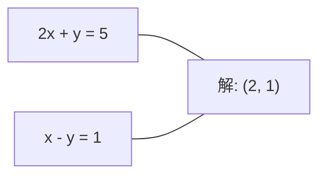
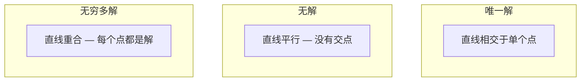

# الأنظمة الخطية

> 求解 $Ax = b$إنها واحدة من أقدم المشاكل في الرياضيات، وهي ما زالت تعمل على شبكة عصبية

**Type:** Build
**Language:**بايثون
**前置要求：**المرحلة الأولى: الدروس 01 (الجهاب الخطية) ،02 (المتنقلات والمصفوفات) ،03 (تحول المصفوفات)
**Time:** ~120 minutes

## 學习目标
- استخدام带 محور جزئي و استبدال الظهر$Ax = b$
- استخدام LU、QR 和 تشولسكي التفكيكات تفصل المصفوفة، ومفسرة كل طريقة مناسبة المشهد
- 推导最小 مربع من المعادلات الطبيعية،并将其与线性回归和脊回归 联系起来
- استخدام رقم حالة  تشخيص أنظمة سيئة الحالة,并 تطبيق التنظيم لتحقيق استقرارها

## 问题
كل مرة تدرب فيها على التراجع الخطى , كنت في محاولة لتحديد نظام خطى . كل مرة حساب أقل مربعات تناسب , كنت في محاولة لتحديد نظام خطى . كل مرة طبقة الشبكة العصبية`y = Wx + b`عندما، فإنه في تقييم الجانب الآخر من النظام الخطى. عندما تشارك في التنظيم، أنت في تغيير هذا النظام. عندما تستخدم عمليات غوسيان، أنت في حل ماتريكس.

方程 $Ax = b$لا يوجد مكان$A$هي المصفوفة التي يُعدّها عدد المعروف$b$هو معروف الناتج المكونات المتجهة.$x$هو كنت ترغب في العثور على المتجهات غير المعروفة في العودة على الإنترنت،$A$هو ماتريسك البيانات،$b$هو متجه الهدف الخاص بك،$x$يمثل المتجه الوزن. يمكن أن يختتم النموذج بأكمله:$x$,使 $Ax$أقرب ما يمكن$b$.

سوف يفهم هذا الدروس جميع الطرق الرئيسية لحل هذه المعادلة من الصفر. سوف تفهم لماذا بعض الطرق أسرع وأخرى أكثر استقرارًا ، لماذا بعض الطرق تطبق فقط على الأنظمة المربعة بينما يمكن للآخرين معالجة الأنظمة المبالغ فيها ، وكذلك لماذا عدد حالة المصفوفة يقرر ما إذا كان هناك معنى في إجابتك.

## 概念
### ماذا يعني هذا في العلم

نظام معادلات خطية 具有几何解释── كل معادلة 定义一个超级平面──解就是所有超级平面相交的点(或点集)──

```
2x + y = 5          2D 中的两条直线。
x - y  = 1          它们相交于 x=2, y=1。
```



قد تكون هناك ثلاثة حالات:



في ماتريكس 形式中، "حل واحد" يعني $A$هو قابل للتعديل. "لا حلا" يعني أن النظام غير متسق.$A$معظم ML 问题都属于没有精确解的类别, لأن معادلاتك ((بقع البيانات)) أكثر من المعروفات ((علمات)) المزيد。 هذا هو المكان الذي يعد فيه أقل مربعات 发挥作用。

### صورة العمود مقابل صورة الصف

هناك طريقتان للتفاهم$Ax = b$.

**Row picture.** $A$كل خط يحدد معادلة. كل معادلة هي طائرة فائقة.

**Column picture.** $A$كل صف واحد هو متجه واحد.$A$أي مزيج خطي من الأعمدة يمكن أن ينتج$b$- ماذا ؟

```
A = | 2  1 |    b = | 5 |
    | 1 -1 |        | 1 |

Row picture: 同时求解 2x + y = 5 和 x - y = 1。

Column picture: 找到 x1, x2，使得：
  x1 * [2, 1] + x2 * [1, -1] = [5, 1]
  2 * [2, 1] + 1 * [1, -1] = [4+1, 2-1] = [5, 1]   check.
```

صورة عمود 更根本──如果 $b$位于 $A$في مساحة العمود، النظام يحصل على حل$b$في هذه النقاط، يمكنك العثور على مساحة عمودية في وسط نقطة قريبة منها.

### القضاء على غوسيان

القضاء على غوسيان$Ax = b$转换为 نظام المثلث العلوي $Ux = c$ثم استخدموا البديل العكسي للحصول على الحل

算法:

```
1. 对每一列 k（pivot column）：
   a. 在第 k 行及其下方，找到 column k 中最大的 entry（partial pivoting）。
   b. 将该行与第 k 行交换。
   c. 对 k 下方的每一行 i：
      - 计算 multiplier m = A[i][k] / A[k][k]
      - 从第 i 行中减去 m 倍的第 k 行。
2. Back substitute：从最后一个 equation 向上求解。
```

نموذج:

```
Original:
| 2  1  1 | 8 |       R2 = R2 - (2)R1     | 2  1   1 |  8 |
| 4  3  3 |20 |  -->  R3 = R3 - (1)R1 --> | 0  1   1 |  4 |
| 2  3  1 |12 |                            | 0  2   0 |  4 |

                       R3 = R3 - (2)R2     | 2  1   1 |  8 |
                                       --> | 0  1   1 |  4 |
                                           | 0  0  -2 | -4 |

Back substitute:
  -2 * x3 = -4    -->  x3 = 2
  x2 + 2  = 4     -->  x2 = 2
  2*x1 + 2 + 2 = 8 --> x1 = 2
```

تكلفة حساب القضاء على غوسيان$O(n^3)$ ‬$1000 \times 1000$نظام، هذا حوالي مليارات مرات العمليات نقطة عائمة.$A$أبحث عن حل لعدة أنظمة، ويمكنك أن تفعل ذلك بشكل أفضل

### التحول الجزئي: لماذا مهم

 بدون محور، القضاء على غوسيان قد يفشل أو ينتج نتائج قمامة‬‬‬‬‬‬‬‬‬‬‬‬‬‬‬‬‬‬‬‬‬‬‬‬‬‬‬‬‬‬‬‬‬‬‬‬‬‬‬‬‬‬‬‬‬‬‬‬‬‬‬‬‬‬‬‬‬‬‬‬‬‬‬‬‬‬‬‬‬‬‬‬‬‬‬‬‬‬‬‬‬‬‬‬‬‬‬‬‬‬‬‬‬‬‬‬‬‬‬‬‬‬‬‬‬‬‬‬‬‬‬‬‬‬‬‬‬‬‬‬‬‬‬‬‬‬‬‬‬‬‬‬‬‬‬‬‬‬‬‬‬‬‬‬‬‬‬‬‬‬‬‬‬‬‬‬‬‬‬‬‬‬‬‬‬‬‬‬‬‬‬‬‬‬‬‬‬‬‬‬‬‬‬‬‬‬‬‬‬‬‬‬‬‬‬‬‬‬‬‬‬‬‬‬‬‬‬‬‬‬‬‬‬‬‬‬‬‬‬‬‬‬‬‬‬‬‬‬‬‬‬‬‬‬‬‬‬‬‬‬‬‬‬‬‬‬‬‬‬‬‬‬‬‬‬‬‬‬‬‬‬‬‬‬‬‬‬‬‬‬‬‬‬‬‬‬‬‬‬‬‬‬‬‬‬‬‬‬‬‬‬‬‬‬‬‬‬‬‬‬‬‬‬‬‬‬‬‬‬‬‬‬‬‬‬‬‬‬‬‬‬‬‬‬‬‬‬‬‬‬‬‬‬‬‬‬‬‬‬‬‬‬‬‬‬‬‬‬‬‬‬‬‬‬‬‬‬‬‬‬‬‬‬‬‬‬‬‬‬‬‬‬‬‬‬‬‬‬‬‬‬‬‬‬‬‬‬‬‬‬‬‬‬‬‬‬‬‬‬‬‬‬‬‬‬‬‬‬‬‬‬‬‬‬‬‬‬‬‬‬‬‬‬‬‬‬‬‬‬‬‬‬‬‬‬‬‬‬‬‬‬‬‬‬‬‬‬‬‬‬‬‬‬‬‬‬‬‬‬‬‬‬‬‬‬‬‬‬‬‬‬‬‬‬‬‬‬‬‬‬‬‬‬‬‬‬‬‬

```
Bad pivot:                       With partial pivoting:
| 0.001  1 | 1.001 |            先交换行：
| 1      1 | 2     |            | 1      1 | 2     |
                                 | 0.001  1 | 1.001 |
m = 1/0.001 = 1000              m = 0.001/1 = 0.001
R2 = R2 - 1000*R1               R2 = R2 - 0.001*R1
| 0.001  1     | 1.001   |      | 1      1     | 2     |
| 0     -999   | -999.0  |      | 0      0.999 | 0.999 |

x2 = 1.000（正确）              x2 = 1.000（正确）
x1 = (1.001 - 1)/0.001          x1 = (2 - 1)/1 = 1.000（正确）
   = 0.001/0.001 = 1.000        稳定，因为 multiplier 很小。
```

في الحسابات المحدودة للنقطة المتحركة في الدقة، يمكن أن تفقد إصدارات غير المحور الأرقام الهامة.

### تدهور LU

تدهور LU$A$分解为 المصفوفة الثلاثية السفلى $L$和 المصفوفة الثلاثية العليا $U$:$A = LU$.$L$المصفوفة تخزين القضاء على غوسيا وسط مضاعفاتها$U$المصفوفة هي نتيجة القضاء

```
A = L @ U

| 2  1  1 |   | 1  0  0 |   | 2  1   1 |
| 4  3  3 | = | 2  1  0 | @ | 0  1   1 |
| 2  3  1 |   | 1  2  1 |   | 0  0  -2 |
```

لماذا يجب أن يكون عامل وليس القضاء مباشرة؟$L$和 $U$، على أي شيء جديد $b$求解 $Ax = b$فقط أحتاج$O(n^2)$:

```math
\begin{aligned}
Ax &= b \\
LUx &= b \\
&\text{令 } y = Ux\text{:} \\
Ly &= b \quad \text{（前代，} O(n^2)\text{）} \\
Ux &= y \quad \text{（回代，} O(n^2)\text{）}
\end{aligned}
```

$O(n^3)$تكلفة فقط في الفاكتورات دفع مرة واحدة.$O(n^2)$ إذا كنت بحاجة إلى استخدام نفس $A$مختلفة$b$المتجهات طلب حل 1000 系统,LU 会让总工作量节省大约1000/3 倍

استخدام محور جزئي 时, تَحْصلُ على $PA = LU$، من بينهم$P$هو سجل المصفوفة المتحولات لتبادل الصفوف

### تدمير QR

تدمير القرارات$A$分解为 المصفوفة المتحركة$Q$和 المصفوفة الثلاثية العليا $R$:$A = QR$.

المصفوفة المُتَوَكِّلَة 具有 $Q^T Q = I$نوعيتها. عموداتها هي متجهات طبيعية.$Q$سأحافظ على الطول و الزوايا

```
A = Q @ R

Q has orthonormal columns: Q^T Q = I
R is upper triangular

To solve Ax = b:
  QRx = b
  Rx = Q^T b    (只需乘以 Q^T，不需要 inversion)
  Back substitute to get x.
```

في محاولة لحل مشاكل أقل مربعات 时,QR比 LU في الاستقرار الرقمي 上更好── عملية غرام-شميدت 逐列构建 $Q$:

```
Given columns a1, a2, ... of A:

q1 = a1 / ||a1||

q2 = a2 - (a2 . q1) * q1        (减去到 q1 上的 projection)
q2 = q2 / ||q2||                (normalize)

q3 = a3 - (a3 . q1) * q1 - (a3 . q2) * q2
q3 = q3 / ||q3||

R[i][j] = qi . aj    for i <= j
```

كل خطوة ستنتقل من قبل$q$مكونات المتجهات، فقط تركنا اتجاهاً متناظراً جديداً

### تدمير تشوليسكي

عندما$A$هو متماثل$A = A^T$) ومؤكد إيجابي ((كل القيم الخاصة كانت صحيحة) ، يمكنك أن تقوم بتقسيمها إلى$A = L L^T$، من بينهم$L$هو مثلث أدناه.

```
A = L @ L^T

| 4  2 |   | 2  0 |   | 2  1 |
| 2  5 | = | 1  2 | @ | 0  2 |

L[i][i] = sqrt(A[i][i] - sum(L[i][k]^2 for k < i))
L[i][j] = (A[i][j] - sum(L[i][k]*L[j][k] for k < j)) / L[j][j]    for i > j
```

تشوليسكي 快两倍比 لو ، ويستغرق فقط نصف مساحة التخزين.

- المصفوفات التناغمية هي شبه محددة إيجابية متماثلة (من خلال التنظيم 可变为 مثبت محدد)
- ماتريكس النواة في وسط عمليات غوسيان هي محادثة مثبتة محددة
- وظيفة مخروطة في الحد الأدنى 处 من هيسيان هي التوافق الجانبي المحدد.
- $A^T A$总是 متماثل الإيجابي شبه محدد

في عمليات غوسيان، تستخدم تشولسكي لتفريق ماتريكس النواة$K$ثم طلب التفسر$K \alpha = y$والحصول على معنى تنبؤي. عامل تشوليسكي أيضا يعطي الحد الأقصى من الاحتمالات:$\log \det(K) = 2 \sum \log(\mathop{\mathrm{diag}}(L))$.

### أقل مربعات:当 Ax = b 没有精确解时

إذا$A$نعم$m \times n$و$m > n$(المعادلات 多于未知), النظام هو أكثر من حدة.

```
minimize ||Ax - b||^2

这是 squared residuals 的总和：
  sum((A[i,:] @ x - b[i])^2 for i in range(m))
```

الحد الأدنى 满足 المعادلات الطبيعية:

```math
A^T A x = A^T b
```

推导:展开 $\lVert Ax - b \rVert^2 = (Ax - b)^T (Ax - b) = x^T A^T A x - 2 x^T A^T b + b^T b$على$x$求 درجة،并令其为零:$2 A^T A x - 2 A^T b = 0$.

```
Original system (overdetermined, 4 equations, 2 unknowns):
| 1  1 |         | 3 |
| 1  2 | x     = | 5 |       没有精确的 x 能满足全部 4 个 equations。
| 1  3 |         | 6 |
| 1  4 |         | 8 |

Normal equations:
A^T A = | 4  10 |    A^T b = | 22 |
        | 10 30 |            | 63 |

Solve: x = [1.5, 1.7]

这就是 linear regression。x[0] 是 intercept，x[1] 是 slope。
```

### المعادلات الطبيعية = التراجع الخطى

هذه النوع من الاتصال هو دقيقة. في التراجع الخطى, المصفوفة البيانات$X$كل صف يتعامل مع عينة، كل صف يتعامل مع ميزة.$y$كل مدخل على عينة$w$满足:

```math
\begin{aligned}
X^T X w &= X^T y \\
w &= (X^T X)^{-1} X^T y
\end{aligned}
```

هذا هو حل في شكل مغلق للعودة الخطية.`sklearn.linear_model.LinearRegression.fit()`مدينة حساب هذا النتيجة ((أو من خلال QR أو SVD  حساب نتائج السعر)

إلى المصفوفة 添加 تنظيم المفهوم $\lambda I$، أنت حصلت على رجعة القمة:

```math
\begin{aligned}
(X^T X + \lambda I) w &= X^T y \\
w &= (X^T X + \lambda I)^{-1} X^T y
\end{aligned}
```

تنظيم سوف يجعل تكييف المصفوفة أفضل (أسهل تصحيحه على العكس) ، ومع ذلك تمر وزنها إلى التكترث إلى الصفر لمنع الإفراط في التكيف.$\lambda > 0$时, ماتريكس $X^T X + \lambda I$总是对称正确, لذلك يمكن استخدام تشولسكي 求解。

### الاختلاف السوداني (مور-بينروز)

التحول الخبيث$A^+$سوف تغير المصفوفة 推广到 غير مربع 和 المصفوفات الفردية ∙$A$:

```math
\begin{aligned}
x &= A^+ b \\[4pt]
\text{其中 } A^+ &= V \Sigma^+ U^T \quad \text{（通过 SVD 计算）}
\end{aligned}
```

$\Sigma^+$通過 لكل قيمة فردية غير صفر 取 متبادلة و 转置结果构成──如果$A = U \Sigma V^T$، إذاً$A^+ = V \Sigma^+ U^T$.

```
A = U Sigma V^T        (SVD)

Sigma = | 5  0 |       Sigma+ = | 1/5  0  0 |
        | 0  2 |                | 0  1/2  0 |
        | 0  0 |

A+ = V Sigma+ U^T
```

الاختلاف السوداني  اعطى الحل الحد الأدنى من المعايير
- 唯一解:$A^+ b$أعطني هذا الحل
- 无解:$A^+ b$أعطني حل لأقل مربعات
- 无穷多解:$A^+ b$إعطائي$\lVert x \rVert$أحدث حل

عدد`np.linalg.lstsq`和 `np.linalg.pinv`内部都使用 SVD。

### رقم الحالة

عدد الحالة  قياس الحل للتغيرات الصغيرة في المدخلات  حساسة جدا ً$A$رقم الشروط هو:

```math
\kappa(A) = \lVert A \rVert \cdot \lVert A^{-1} \rVert = \frac{\sigma_{\max}}{\sigma_{\min}}
```

من بينهم$\sigma_{\max}$和 $\sigma_{\min}$分别是最大和最小单数值──

```
Well-conditioned (kappa ~ 1):        Ill-conditioned (kappa ~ 10^15):
b 中的小变化 -->                    b 中的小变化 -->
x 中的小变化                         x 中的巨大变化

| 2  0 |   kappa = 2/1 = 2          | 1   1          |   kappa ~ 10^15
| 0  1 |   safe to solve            | 1   1+10^(-15) |   solution is garbage
```

经验法则:
- $\kappa < 100$:安全,الحل 准确。
- $\kappa \approx 10^k$: أنت تقريبا من نقطة عائمة الحسابات$k$位精度‬
- $\kappa \approx 10^{16}$(بالنسبة للطائرة64):الحل 没有意义──ماتريكس 实际上是单一──

في المادة الثانية، يحدث التشغيل المزعج في الميزات تقريبا التقاطعية.$\lambda I$) سيصبح رقم الحالة من $\sigma_{\max} / \sigma_{\min}$ تحسين $(\sigma_{\max} + \lambda) / (\sigma_{\min} + \lambda)$.

### الأساليب المتكررة:تراجع المشترك

بالنسبة للأنظمة النادرة جداً ((ملايين من المجهولات) ، أساليب مباشرة مثل LU أو Cholesky 成本过高──.

التراجع المشترك (CG)$A$هو مثالي مثالي محدد 时求解 $Ax = b$انها في الحسابات الدقيقة$n$بعد ذلك، سوف نجد الحل المحدد، ولكن إذا$A$قيمة ذاتية  جمع، عادة سوف تكون أسرع 收🏼

```
Algorithm sketch:
  x0 = initial guess (often zero)
  r0 = b - A x0           (residual)
  p0 = r0                 (search direction)

  For k = 0, 1, 2, ...:
    alpha = (rk . rk) / (pk . A pk)
    x_{k+1} = xk + alpha * pk
    r_{k+1} = rk - alpha * A pk
    beta = (r_{k+1} . r_{k+1}) / (rk . rk)
    p_{k+1} = r_{k+1} + beta * pk
    if ||r_{k+1}|| < tolerance: stop
```

CG استخدام:
- التحسين على نطاق واسع ((طريقة نيوتون-سي جي)
- 求解 تخفيفات PDE
- أساليب النواة، من بينها ماتريكس النواة 太大无法因素
- كـ "مُحَلِّلَاتٍ متكررةٍ أخرى "

معدل التقارب يعتمد على عدد الحالات.

### الصورة الكاملة:何时使用哪种方法

| Method | Requirements | Cost | Use case |
|--------|-------------|------|----------|
| Gaussian elimination | Square, nonsingular $A$ | $O(n^3)$ | 对 square system 的一次性求解 |
| LU decomposition | Square, nonsingular $A$ | $O(n^3)$ factor + $O(n^2)$ solve | 使用相同 $A$ 的多次求解 |
| QR decomposition | Any $A$ ($m \ge n$) | $O(mn^2)$ | Least squares，numerically stable |
| Cholesky | Symmetric positive definite $A$ | $O(n^3/3)$ | Covariance matrices，Gaussian processes，ridge regression |
| Normal equations | Overdetermined ($m > n$) | $O(mn^2 + n^3)$ | Linear regression（小 $n$） |
| SVD / pseudoinverse | Any $A$ | $O(mn^2)$ | Rank-deficient systems，minimum-norm solutions |
| Conjugate gradient | Symmetric positive definite, sparse $A$ | $O(n \cdot k \cdot \text{nnz})$ | Large sparse systems，$k$ = iterations |

### اتصال مع ML

كل طريقة في هذا الدراسة تظهر في درجة الإنتاج ML:

**Linear regression.**حل في الشكل المغلق 求解 المعادلات الطبيعية $X^T X w = X^T y$يمكن أن يمر هذا من خلال (شولسكي) إذا$n$很小)、QR(إذا استقرار الرقمية 很重要) أو SVD(إذا ماتريكس ربما ناقص في الرتبة)完成。

**Ridge regression.**إلى$X^T X$إضافة$\lambda I$نظام تنظيمي$(X^T X + \lambda I) w = X^T y$يمكن أن يُمكنك أن تُحصل على حلّ من خلال (تشولسكي) ، لأنّكِ الآن$\lambda > 0$时،$X^T X + \lambda I$هو محتملاً إيجابياً متماثل

**Gaussian processes.**المتوسط التنبؤي 需要求解 $K \alpha = y$، من بينهم$K$هو ماتريكس النواة$K$فعل تشوليسكي العاملة هو الطريقة القياسية.$\log \det(K) = 2 \sum \log(\mathop{\mathrm{diag}}(L))$.

**Neural network initialization.**التبديل المُستقيم باستخدام تدمير QR إنشاء أعمدة لأجل ماتريص الوزن المُعتادة، مما يمنع انهيار الإشارة في الشبكات العميقة.

**Preconditioning.**المتحفسين على نطاق واسع استخدام تشولسكي غير كامل أو غير كامل LU 作为 conjugate gradient solvers的预条件──

**Feature engineering.** $X^T X$رقم الحالة  أخبرك الميزات نعم أو لا التقاطع $\kappa$很大, إزالة الميزات أو إضافة التنظيم


```figure
linear-system-conditioning
```

## بناءها
### 步骤 1: القضاء على غوسيان مع محور جزئي

```python
import numpy as np

def gaussian_elimination(A, b):
    n = len(b)
    Ab = np.hstack([A.astype(float), b.reshape(-1, 1).astype(float)])

    for k in range(n):
        max_row = k + np.argmax(np.abs(Ab[k:, k]))
        Ab[[k, max_row]] = Ab[[max_row, k]]

        if abs(Ab[k, k]) < 1e-12:
            raise ValueError(f"Matrix is singular or nearly singular at pivot {k}")

        for i in range(k + 1, n):
            m = Ab[i, k] / Ab[k, k]
            Ab[i, k:] -= m * Ab[k, k:]

    x = np.zeros(n)
    for i in range(n - 1, -1, -1):
        x[i] = (Ab[i, -1] - Ab[i, i+1:n] @ x[i+1:n]) / Ab[i, i]

    return x
```

### الخطوة الثانية: تدهور ال LU

```python
def lu_decompose(A):
    n = A.shape[0]
    L = np.eye(n)
    U = A.astype(float).copy()
    P = np.eye(n)

    for k in range(n):
        max_row = k + np.argmax(np.abs(U[k:, k]))
        if max_row != k:
            U[[k, max_row]] = U[[max_row, k]]
            P[[k, max_row]] = P[[max_row, k]]
            if k > 0:
                L[[k, max_row], :k] = L[[max_row, k], :k]

        for i in range(k + 1, n):
            L[i, k] = U[i, k] / U[k, k]
            U[i, k:] -= L[i, k] * U[k, k:]

    return P, L, U

def lu_solve(P, L, U, b):
    n = len(b)
    Pb = P @ b.astype(float)

    y = np.zeros(n)
    for i in range(n):
        y[i] = Pb[i] - L[i, :i] @ y[:i]

    x = np.zeros(n)
    for i in range(n - 1, -1, -1):
        x[i] = (y[i] - U[i, i+1:] @ x[i+1:]) / U[i, i]

    return x
```

### الخطوة الثالثة: تدمير تشولسكي

```python
def cholesky(A):
    n = A.shape[0]
    L = np.zeros_like(A, dtype=float)

    for i in range(n):
        for j in range(i + 1):
            s = A[i, j] - L[i, :j] @ L[j, :j]
            if i == j:
                if s <= 0:
                    raise ValueError("Matrix is not positive definite")
                L[i, j] = np.sqrt(s)
            else:
                L[i, j] = s / L[j, j]

    return L
```

### 步骤 4: أقل مربعات من خلال المعادلات الطبيعية

```python
def least_squares_normal(A, b):
    AtA = A.T @ A
    Atb = A.T @ b
    return gaussian_elimination(AtA, Atb)

def ridge_regression(A, b, lam):
    n = A.shape[1]
    AtA = A.T @ A + lam * np.eye(n)
    Atb = A.T @ b
    L = cholesky(AtA)
    y = np.zeros(n)
    for i in range(n):
        y[i] = (Atb[i] - L[i, :i] @ y[:i]) / L[i, i]
    x = np.zeros(n)
    for i in range(n - 1, -1, -1):
        x[i] = (y[i] - L.T[i, i+1:] @ x[i+1:]) / L.T[i, i]
    return x
```

### الخطوة 5: رقم الحالة

```python
def condition_number(A):
    U, S, Vt = np.linalg.svd(A)
    return S[0] / S[-1]
```

## استخدمها
لتجميع هذه الأجزاء، إجراء الرجوع الخطي و الرجوع القلع على البيانات الحقيقية:

```python
np.random.seed(42)
X_raw = np.random.randn(100, 3)
w_true = np.array([2.0, -1.0, 0.5])
y = X_raw @ w_true + np.random.randn(100) * 0.1

X = np.column_stack([np.ones(100), X_raw])

w_ols = least_squares_normal(X, y)
print(f"OLS weights (ours):    {w_ols}")

w_np = np.linalg.lstsq(X, y, rcond=None)[0]
print(f"OLS weights (numpy):   {w_np}")
print(f"Max difference: {np.max(np.abs(w_ols - w_np)):.2e}")

w_ridge = ridge_regression(X, y, lam=1.0)
print(f"Ridge weights (ours):  {w_ridge}")

from sklearn.linear_model import Ridge
ridge_sk = Ridge(alpha=1.0, fit_intercept=False)
ridge_sk.fit(X, y)
print(f"Ridge weights (sklearn): {ridge_sk.coef_}")
```

## 交付 it
本课产出:
- `code/linear_systems.py`، يتضمن من صفر تحقيق القضاء الغوسيانية  تدهور LU  تدهور تشولسكي  أقصى مربعات و تراجع التلال
- عرض قابل للتنفيذ، عرض المعادلات الطبيعية و التراجع الخطي للخيارات

## التدريب
1. استخدم حلول غوسيان الخاص بك`np.linalg.solve`نظام طلب الحل`[[1,2,3],[4,5,6],[7,8,10]] x = [6, 15, 27]` تجربة: 3 شخص في تسامح نقطة عائمة

2. 生成 50x5 المصفوفة عشوائية X 和 الهدف y = X @ w_true + ضجيج──分别使用正常方程式、QR(通过 `np.linalg.qr`(、SVD(مرافقة `np.linalg.svd`) و `np.linalg.lstsq`求解 w―比较四个解决方案―测量 $X^T X$رقم الحالة،并 شرح كيف يؤثر على ثقتك في أي طريقة.

3. 通過 جعل الصفيان تقريبا نفسها لإنشاء ماتريكس شبه فردية ((على سبيل المثال، العمود 2 = العمود 1 + 1e-10 * ضجيج)  حساب عدد الحالة لها $Ax = b$(إضافة $0.01 I$■ ■ مقارنة الحلول و البقايا ■ شرح لماذا التنظيم مفيد

4. ل 100 × 100 عشوائية التوافق المصفوفة المثبتة المحددة المصفوفة لتحقيق خوارزمية تراجيع المواطنات 统计它收到容忍 1e-8 需要多少次 التكرارات 与$n$أقصى قيمة نظرية للتكرار

5. في غضون 10 50 200 500 المصفوفات المحددة الإيجابية التوافقية فوق، لحلولك تشولسكي`np.linalg.solve`计时――绘制结果――验证 تشوليسكي 大约比 LU 快 2倍――

### 提示

**练习 1。**调用 `gaussian_elimination(A, b)`, إعادة استخدام`lu_decompose(A)`واصلت التعبير`lu_solve(P, L, U, b)`, أخير المستخدم`np.linalg.solve(A, b)`استخدام`np.allclose(A @ x, b)`检查每个解,并用 `np.allclose`مقارنة هذه الثلاثة

**练习 2。**للمعادلات الطبيعية`least_squares_normal`، بقية الطرق باستخدام الثلاثة من عدد الموظفين.`w_true` تقارير `condition_number(X.T @ X)`和 `condition_number(X)`: الأول هو مربع الأخير، لذلك المعادلات الطبيعية  فقدان دقة الأكثر 

**练习 3。**预期 شرط رقم 会超过 $10^{9}$分別使用`np.linalg.solve`和 `ridge_regression(A, b, 0.01)`求解,再比较各自 `np.linalg.norm(x)`و النظام المتبقية. قد يكون النظام المتبقية صغيرًا، ولكن عادة ما يتضمن حلول غير منتظمة كمية كبيرة.

**练习 4。**استخدام `B @ B.T + n * np.eye(n)`بناء المصفوفة المحددة الإيجابية التوافقية، ضمان كل قيمة خاصة تمتلك الصواب.`conjugate_gradient`إدراج الحاسب في الدورة، ثم فحص المعيار المتبقية النهائية هل هو أقل من 1e-8, إذا كان عدد المرات لا يتجاوز 100‬

**练习 5。**ثلاثة حلول استخدام نفس `B @ B.T + n * np.eye(n)`矩阵,并用 `time.perf_counter`قياس كل مرة تستغرق فيها عملية تحليل، وتحصل على أفضل النتائج من العديد من عمليات التشغيل.

## 关键术语
| Term | What people say | What it actually means |
|------|----------------|----------------------|
| Linear system | "Solve for x" | 一组 linear equations $Ax = b$。找到 $x$ 意味着找到在 transformation $A$ 下产生 output $b$ 的 input。 |
| Gaussian elimination | "Row reduce" | 使用 row operations 系统性地将 diagonal 下方的 entries 置零，产生可通过 back substitution 求解的 upper triangular system。$O(n^3)$。 |
| Partial pivoting | "Swap rows for stability" | 在 column $k$ 中进行 elimination 前，将该 column 中 absolute value 最大的行交换到 pivot 位置。防止除以很小的数。 |
| LU decomposition | "Factor into triangles" | 写成 $A = LU$，其中 $L$ 是 lower triangular（存储 multipliers），$U$ 是 upper triangular（eliminated matrix）。将 $O(n^3)$ 成本摊销到多次求解中。 |
| QR decomposition | "Orthogonal factorization" | 写成 $A = QR$，其中 $Q$ 的 columns 是 orthonormal，$R$ 是 upper triangular。对于 least squares，比 LU 更稳定。 |
| Cholesky decomposition | "Square root of a matrix" | 对 symmetric positive definite $A$，写成 $A = LL^T$。成本是 LU 的一半。用于 covariance matrices、kernel matrices 和 ridge regression。 |
| Least squares | "Best fit when exact is impossible" | 当 system overdetermined（equations 多于 unknowns）时，最小化 squared residuals 的总和 $\lVert Ax - b \rVert^2$。 |
| Normal equations | "The calculus shortcut" | $A^T A x = A^T b$。将 $\lVert Ax - b \rVert^2$ 的 Gradient 设为零。这就是 linear regression 的 closed-form solution。 |
| Pseudoinverse | "Inversion for non-square matrices" | $A^+ = V \Sigma^+ U^T$ via SVD。对于任意 Matrix，无论 square 或 rectangular、singular 与否，给出 minimum-norm least-squares solution。 |
| Condition number | "How trustworthy is this answer" | $\kappa = \sigma_{\max} / \sigma_{\min}$。衡量对 input perturbations 的敏感性。大约损失 $\log_{10}(\kappa)$ 位精度。 |
| Ridge regression | "Regularized least squares" | 求解 $(X^T X + \lambda I) w = X^T y$。添加 $\lambda I$ 改善 conditioning，并将 weights 向零收缩。防止 overfitting。 |
| Conjugate gradient | "Iterative Ax=b for big matrices" | 用于 symmetric positive definite systems 的 iterative solver。最多 $n$ 步收敛。适合 factorization 成本过高的大型 sparse systems。 |
| Overdetermined system | "More data than parameters" | 在 $m\text{-by-}n$ system 中 $m > n$。不存在精确解。Least squares 找到最佳近似。这就是每个 regression problem。 |
| Back substitution | "Solve from the bottom up" | 给定 upper triangular system，先求解最后一个 equation，然后向后 substitute。$O(n^2)$。 |
| Forward substitution | "Solve from the top down" | 给定 lower triangular system，先求解第一个 equation，然后向前 substitute。$O(n^2)$。用于 LU solves 中的 L step。 |

## 延伸阅读
- [MIT 18.06: Linear Algebra](https://ocw.mit.edu/courses/18-06-linear-algebra-spring-2010/)(غيلبرت سترانغ) --  حول الأنظمة الخطية و المصفوفات المصفوفة
- [Numerical Linear Algebra](https://people.maths.ox.ac.uk/trefethen/text.html)(تريفثن و باو) -- فهم الاستقرار العددي والتكييف والخوارزميات لماذا يفشل المعيار المرجح
- [Matrix Computations](https://www.cs.cornell.edu/cv/GolubVanLoan4/golubandvanloan.htm)(Golub & Van Loan) -- تغطي كل أنواع خوارزميات المصفوفة
- [3Blue1Brown: Inverse Matrices](https://www.3blue1brown.com/lessons/inverse-matrices)- للمطالبة$Ax = b$几何意义的可见化直觉
