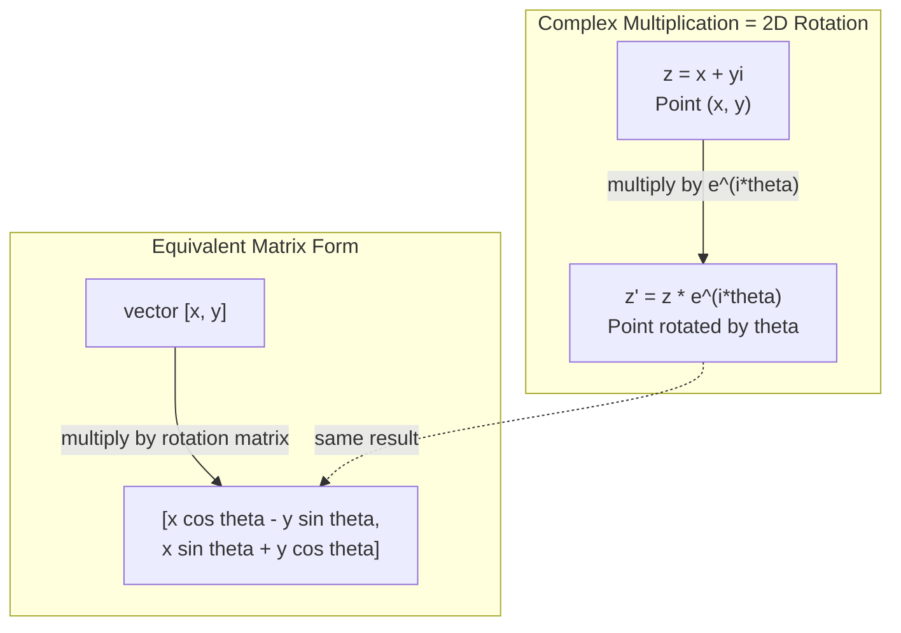
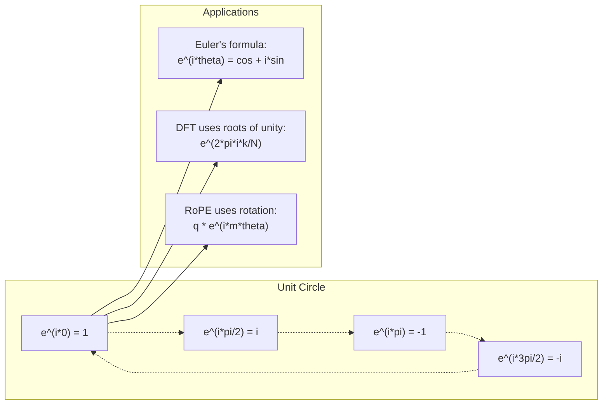

# عدد عدد الـ

> الجذر التربيعي للـ -1 ليس كلياً. إنه مفتاح في مجال التدوير والتكثيف والنصف من مجال معالجة الإشارات.

**Type:** Learn
**Language:**بايثون
**Prerequisites:** Phase 1, Lessons 01-04（linear algebra, calculus）
**Time:** ~60 分钟

## 學习目标
- في صيغة مستقيمة واصطناعية كبيرة تنفيذ عدد عمليات الحسابات
-  تطبيق صيغة أولي في الثلاثة نقاط
- استخدام عدد الوحدات لتحقيق تحويل فوريه متواضع
-  شرح عدد المتحول كيفية تشكيل المحول 中 RoPE 和正弦位置编码的基础

## 问题
أنت تفتح مقال حول تحويلات فوريير، كل شيء في كل مكان`i`✿你查看 محول 位置编码, انظر مختلف التردد تحت `sin`和 `cos` 也就是复指数的实部和虚部──你读量子计算,又发现一切都用复向 空间来表达──

يبدو عدد الـ 复数 مجردة. نظام عدد مبني على الجذر التربيعي من -1، يشعر مثل بعض المهارات الرياضية. لكنه ليس مهارة. إنه لغة طبيعية للتدوير والزج.

إذا لم تفهم عدد النقاط، فإنك لن تفهم تحويل فوريه المميز.

هذا الدروس سوف يبدأ من خيارات التكوين والتنسيق مع الحسابات الجوهرية، ويتصل مع الجوهرات، ويدل على إظهار مكانات العدد في التعلم الآلي.

## 概念
### ما هو العدد؟

هناك قسمين: حقيقة و حقيقة

```
z = a + bi

where:
  a is the real part
  b is the imaginary part
  i is the imaginary unit, defined by i^2 = -1
```

هذا هو الحال. أنت تضع محور العدد يمتد إلى مسطح واحد. العدد الحقيقي يقع على محور واحد، والعدد الفارغ يقع على محور آخر. كل عدد مضاعف هو نقطة واحدة على هذه المسطح.

### 复数运算

**加法。**实部相加,虚部相加.

```math
\begin{aligned}
(a + bi) + (c + di) &= (a + c) + (b + d)i \\[4pt]
\text{示例：} (3 + 2i) + (1 + 4i) &= 4 + 6i
\end{aligned}
```

**乘法。**استخدام قانون التوزيع،并记住 $i^2 = -1$.

```math
\begin{aligned}
(a + bi)(c + di) &= ac + adi + bci + bdi^2 \\
&= ac + adi + bci - bd \\
&= (ac - bd) + (ad + bc)i \\[8pt]
\text{示例：} (3 + 2i)(1 + 4i) &= 3 + 12i + 2i + 8i^2 \\
&= 3 + 14i - 8 \\
&= -5 + 14i
\end{aligned}
```

**共轭。**翻转虚部的符号──

```math
(a + bi)\text{ 的共轭} = a - bi
```

عدد واحد مضاعف مع عدد واحد هو عدد حقيقي:

```math
(a + bi)(a - bi) = a^2 + b^2
```

**除法。**分子和分母同时乘以分母的共──

```math
\frac{a + bi}{c + di} = \frac{(a + bi)(c - di)}{c^2 + d^2}
```

هذا سوف يزيل الجزء الخالي من المجموعة، الحصول على عدد نظيف من المعدلات.

### 复平面

复平面把每个复数映射到一个2D点──水平轴是实轴,垂直轴是虚轴──

```
z = 3 + 2i  corresponds to the point (3, 2)
z = -1 + 0i corresponds to the point (-1, 0) on the real axis
z = 0 + 4i  corresponds to the point (0, 4) on the imaginary axis
```

复数同时是一点,也是从原点出发的向量. هذا التفسير الثنائي هو السبب المفيد في عدد العدد في الهندسة.

### 极坐标形式

يمكن استخدام أي نقطة في المسطح لوصفها على مسافة نقطة الأصل، وكذلك لوصفها من زاوية المحور الحقيقي نسبيا.

```math
\begin{aligned}
z &= r (\cos\theta + i \sin\theta) \\[4pt]
\text{其中：} r &= |z| = \sqrt{a^2 + b^2} \quad \text{（magnitude，即模）} \\
\theta &= \mathop{\mathrm{atan2}}(b, a) \quad \text{（phase，即辐角）}
\end{aligned}
```

على سبيل المثال$(a + bi)$适合加法──极坐标形式 $(r, \theta)$适合乘法。

**极坐标形式下的乘法。**模长相乘, زاوية相加.

```math
\begin{aligned}
z_1 &= r_1 e^{i\theta_1} \\
z_2 &= r_2 e^{i\theta_2} \\[4pt]
z_1 z_2 &= (r_1 r_2) \, e^{i(\theta_1 + \theta_2)}
\end{aligned}
```

هذا هو السبب في أن عدد العدد مناسب جدا لتعبير الدوران.

### صيغة أولر

الجسر بين 复指数 و三角函数:

```math
e^{i\theta} = \cos\theta + i \sin\theta
```

هذه هي أهم الصيغة في هذا الصف$\theta = \pi$时:

```math
\begin{aligned}
e^{i\pi} &= \cos\pi + i \sin\pi = -1 + 0i = -1 \\[4pt]
\text{因此：} e^{i\pi} + 1 &= 0
\end{aligned}
```

五个基本常数 (أساسي عدد)$e$،$i$،$\pi$، 1 ، 0) تم ربطها معاً

### لماذا صيغة أولر بالنسبة لـ ML مهمة جداً

صيغة (أولير) تظهر$e^{i\theta}$سأذهب معك$\theta$变化描绘单位圆──当 $\theta = 0$时, أنت في $(1, 0)$۞ الآن$\theta = \pi/2$时, أنت في $(0, 1)$۞ الآن$\theta = \pi$时, أنت في $(-1, 0)$۞ الآن$\theta = 3\pi/2$时, أنت في $(0, -1)$ كامل الدور يدور$\theta = 2\pi$.

هذا يعني أن المعدل الثاني هو التدوير، والدوار لا يوجد في معالجة الإشارات والإم إل.

### الاتصال مع 2D دوار

ستعدّد$(x + yi)$乘以 $e^{i\theta}$سأضعها$(x, y)$حول النقطة الأصلية$\theta$角──

```math
\begin{aligned}
&\text{通过复数乘法旋转：} \\
&\quad (x + yi)(\cos\theta + i \sin\theta) = (x \cos\theta - y \sin\theta) + (x \sin\theta + y \cos\theta)i \\[8pt]
&\text{通过矩阵乘法旋转：} \\
&\quad \begin{bmatrix} \cos\theta & -\sin\theta \\ \sin\theta & \cos\theta \end{bmatrix} \begin{bmatrix} x \\ y \end{bmatrix} = \begin{bmatrix} x \cos\theta - y \sin\theta \\ x \sin\theta + y \cos\theta \end{bmatrix}
\end{aligned}
```

تُنتج نفس النتائج تماما ً.



### الفازور و إشارة التحول

复指数 $e^{i\omega t}$هو واحد في المعدل$\omega$حول نقطة حلقة$t$زيادة، هذا النقطة سوف تظهر

هذا هو الجزء الحقيقي من نقطة التحول$\cos(\omega t)$虚部是 $\sin(\omega t)$正弦信号就是旋转复数投下的影子──

```math
\begin{aligned}
e^{i\omega t} &= \cos(\omega t) + i \sin(\omega t) \\[4pt]
\text{实部：} & \cos(\omega t) \quad \text{，即 cosine wave} \\
\text{虚部：} & \sin(\omega t) \quad \text{，即 sine wave}
\end{aligned}
```

هذا هو الفازور يعبر عن طريقة. أنت لم تعد تتبع موجة الصدرية المرتفعة، بل تتبع شريحة من المدار المُسطح.

### 单位根

$N$الجذر التالي هو الجذر المتفصل على الجذر المتفصل$N$个点:

```math
w_k = e^{2\pi i k/N} \quad \text{其中 } k = 0, 1, 2, \ldots, N-1
```

عندما$N = 4$时,根是:$1, i, -1, -i$(توارى الأطراف)
عندما$N = 8$عندما تحصل على أربعة اتجاهات، اضف أربعة اتجاهات ضد

وحدة الجذر هي أساس تحويل فوريه المفصلة.$N$个等间隔频率上的分量──

### الاتصال مع DFT

 إشارة $x[0], x[1], \ldots, x[N-1]$صيغة فوريه المختلفة هي:

```math
X[k] = \sum_{n=0}^{N-1} x[n] \, e^{-2\pi i k n/N}
```

كل واحد$X[k]$衡量信号与第 $k$个单位根的相关程度,也就是与频率 $k$处一个复正弦波的相关程度──DFT 将信号分解为 $N$个旋转phasor,并告诉你每个振幅和相位.

### لماذا أنا لستُ كاذبة

خيالية هذا الكلمة هي صدفة تاريخية‬‬‬‬‬‬‬‬‬‬‬‬‬‬‬‬‬‬‬‬‬‬‬‬‬‬‬‬‬‬‬‬‬‬‬‬‬‬‬‬‬‬‬‬‬‬‬‬‬‬‬‬‬‬‬‬‬‬‬‬‬‬‬‬‬‬‬‬‬‬‬‬‬‬‬‬‬‬‬‬‬‬‬‬‬‬‬‬‬‬‬‬‬‬‬‬‬‬‬‬‬‬‬‬‬‬‬‬‬‬‬‬‬‬‬‬‬‬‬‬‬‬‬‬‬‬‬‬‬‬‬‬‬‬‬‬‬‬‬‬‬‬‬‬‬‬‬‬‬‬‬‬‬‬‬‬‬‬‬‬‬‬‬‬‬‬‬‬‬‬‬‬‬‬‬‬‬‬‬‬‬‬‬‬‬‬‬‬‬‬‬‬‬‬‬‬‬‬‬‬‬‬‬‬‬‬‬‬‬‬‬‬‬‬‬‬‬‬‬‬‬‬‬‬‬‬‬‬‬‬‬‬‬‬‬‬‬‬‬‬‬‬‬‬‬‬‬‬‬‬‬‬‬‬‬‬‬‬‬‬‬‬‬‬‬‬‬‬‬‬‬‬‬‬‬‬‬‬‬‬‬‬‬‬‬‬‬‬‬‬‬‬‬‬‬‬‬‬‬‬‬‬‬‬‬‬‬‬‬‬‬‬‬‬‬‬‬‬‬‬‬‬‬‬‬‬‬‬‬‬‬‬‬‬‬‬‬‬‬‬‬‬‬‬‬‬‬‬‬‬‬‬‬‬‬‬‬‬‬‬‬‬‬‬‬‬‬‬‬‬‬‬‬‬‬‬‬‬‬‬‬‬‬‬‬‬‬‬‬‬‬‬‬‬‬‬‬‬‬‬‬‬‬‬‬‬‬‬‬‬‬‬‬‬‬‬‬‬‬‬‬‬‬‬‬‬‬‬‬‬‬‬‬‬‬‬‬‬‬‬‬‬‬‬‬‬‬‬‬‬‬‬‬‬‬‬‬‬‬‬‬‬‬‬‬‬‬‬‬‬‬‬‬‬‬‬‬‬‬‬‬‬‬‬‬‬‬‬‬‬‬‬‬‬‬‬$i$ليس بي بي سكس عدد更虚── ردة السلبية هي: من 3 خفض ماذا تحصل على 5؟ 虚数单位 ردة السلبية هي: 什么 عدد مربع بعد تحصل على -1؟

أكثر فائدة هو فهم:$i$هو محاسبة تدور 90 درجة.$i$مرة واحدة، أنت تدور 90 درجة إلى المحور الحقيقي.$i$أحياناً$i^2$،أنت تدور مرة أخرى 90 درجة ، الآن في الاتجاه إلى المحور الحقيقي$i^2 = -1$ انها ليست غامضة‬‬‬‬‬‬‬‬‬‬‬‬‬‬‬‬‬‬‬‬‬‬‬‬‬‬‬‬‬‬‬‬‬‬‬‬‬‬‬‬‬‬‬‬‬‬‬‬‬‬‬‬‬‬‬‬‬‬‬‬‬‬‬‬‬‬‬‬‬‬‬‬‬‬‬‬‬‬‬‬‬‬‬‬‬‬‬‬‬‬‬‬‬‬‬‬‬‬‬‬‬‬‬‬‬‬‬‬‬‬‬‬‬‬‬‬‬‬‬‬‬‬‬‬‬‬‬‬‬‬‬‬‬‬‬‬‬‬‬‬‬‬‬‬‬‬‬‬‬‬‬‬‬‬‬‬‬‬‬‬‬‬‬‬‬‬‬‬‬‬‬‬‬‬‬‬‬‬‬‬‬‬‬‬‬‬‬‬‬‬‬‬‬‬‬‬‬‬‬‬‬‬‬‬‬‬‬‬‬‬‬‬‬‬‬‬‬‬‬‬‬‬‬‬‬‬‬‬‬‬‬‬‬‬‬‬‬‬‬‬‬‬‬‬‬‬‬‬‬‬‬‬‬‬‬‬‬‬‬‬‬‬‬‬‬‬‬‬‬‬‬‬‬‬‬‬‬‬‬‬‬‬‬‬‬‬‬‬‬‬‬‬‬‬‬‬‬‬‬‬‬‬‬‬‬‬‬‬‬‬‬‬‬‬‬‬‬‬‬‬‬‬‬‬‬‬‬‬‬‬‬‬‬‬‬‬‬‬‬‬‬‬‬‬‬‬‬‬‬‬‬‬‬‬‬‬‬‬‬‬‬‬‬‬‬‬‬‬‬‬‬‬‬‬‬‬‬‬‬‬‬‬‬‬‬‬‬‬‬‬‬‬‬‬‬‬‬‬‬‬‬‬‬‬‬‬‬‬‬‬‬‬‬‬‬‬‬‬‬‬‬‬‬‬‬‬‬‬‬‬‬‬‬‬‬‬‬‬‬‬‬‬‬‬‬‬‬‬‬‬‬‬‬‬‬‬‬‬‬‬‬‬‬‬‬‬‬‬‬‬‬‬‬‬‬‬‬‬‬‬‬‬‬‬‬‬‬‬‬‬‬‬‬‬‬‬‬‬‬‬‬‬‬

هذا هو السبب في وجود الكمبيوتر في المهندسة. أي شيء يتناوب: الطائرات الكهرومغناطيسية، الحالة الكمية، التذبذب الإشاراتي، وضعية التدوين.

### 复指数 vs 三角函数

قبل صيغة (أويلر) ، قام المهندس بتصميم إشارة$A \cos(\omega t + \phi)$ 振幅 $A$、تكرار $\omega$、相位 $\phi$هذا ممكن، لكن سيجعل الحساب يصبح مؤلم.

بعد استخدام العدد الثاني، يمكن أن تكتب نفس الإشارة$A e^{i(\omega t + \phi)}$△相加两个信号只是相加两个复数──相乘(调制) فقط模长相乘、角度相加──相位偏移变成角度加法──频率偏移变成乘乘相节──

تحول كل مجال معالجة الإشارات إلى إعدادات الحسابات، لأن الرياضيات أكثر نقاهة.

### الاتصال مع Transformer

**正弦位置编码**(أصلى تحويلات:

```math
\begin{aligned}
PE(pos, 2i) &= \sin\left(pos / 10000^{2i/d}\right) \\
PE(pos, 2i+1) &= \cos\left(pos / 10000^{2i/d}\right)
\end{aligned}
```

و مع ذلك، فإنها تظهر على نحو مختلف، وهي جزء حقيقي و افتراضي من المعدلات التالية. كل من هذه المعدلات تُقدّم موقعاً محدداً لتقديم طريقة مختلفة للتحديد.

**RoPE（Rotary Position Embedding）**علاوة على ذلك، فإنه يستخدم بشكل واضح ثنائي المصفوفة المتحركة ضربة السؤال ومركز مفتاح.

| Operation | Algebraic Form | Geometric Meaning |
|-----------|---------------|-------------------|
| 加法 | $(a+c) + (b+d)i$ | 平面中的 Vector 加法 |
| 乘法 | $(ac-bd) + (ad+bc)i$ | 旋转并缩放 |
| 共轭 | $a - bi$ | 关于实轴反射 |
| 模长 | $\sqrt{a^2 + b^2}$ | 到原点的距离 |
| 相位 | $\mathop{\mathrm{atan2}}(b, a)$ | 相对正实轴的角度 |
| 除法 | multiply by conjugate | 反向旋转并重新缩放 |
| 幂 | $r^n e^{in\theta}$ | 旋转 $n$ 次，按 $r^n$ 缩放 |




```figure
roots-of-unity
```

## بناءها
### الخطوة 1: المشكلة

بناء مجموعة من الأرقام المعقدة، دعم عمليات الحساب، والطول، والمرحلة، والتحويل بين النموذج المباشر والمناسبة.

```python
import math

class Complex:
    def __init__(self, real, imag=0.0):
        self.real = real
        self.imag = imag

    def __add__(self, other):
        return Complex(self.real + other.real, self.imag + other.imag)

    def __mul__(self, other):
        r = self.real * other.real - self.imag * other.imag
        i = self.real * other.imag + self.imag * other.real
        return Complex(r, i)

    def __truediv__(self, other):
        denom = other.real ** 2 + other.imag ** 2
        r = (self.real * other.real + self.imag * other.imag) / denom
        i = (self.imag * other.real - self.real * other.imag) / denom
        return Complex(r, i)

    def magnitude(self):
        return math.sqrt(self.real ** 2 + self.imag ** 2)

    def phase(self):
        return math.atan2(self.imag, self.real)

    def conjugate(self):
        return Complex(self.real, -self.imag)
```

### 步骤 2: 极坐标转换 مع صيغة أولر

```python
def to_polar(z):
    return z.magnitude(), z.phase()

def from_polar(r, theta):
    return Complex(r * math.cos(theta), r * math.sin(theta))

def euler(theta):
    return Complex(math.cos(theta), math.sin(theta))
```

验证:`euler(theta).magnitude()`يجب أن تكون في نهاية المطاف 1.0`euler(0)`应给出 (1, 0)`euler(pi)`应给出 (-1, 0)

### 步骤 3: تحويل

سأقوم$(x, y)$旋转 $\theta$角, فقط تحتاج مرة واحدة

```python
point = Complex(3, 4)
rotated = point * euler(math.pi / 4)
```

模长保持不变──只有角度发生变化──

### الخطوة 4: DFT على أساس عمليات عدد عديدة

```python
def dft(signal):
    N = len(signal)
    result = []
    for k in range(N):
        total = Complex(0, 0)
        for n in range(N):
            angle = -2 * math.pi * k * n / N
            total = total + Complex(signal[n], 0) * euler(angle)
        result.append(total)
    return result
```

هذا هو$O(N^2)$كل إصدار$X[k]$كل هذه هي نموذج الإشارة ضرب مجموع الجذور بعد الوحدة

### 步骤 5: DFT العكسية

عكس DFT سوف يعيد تشكيل الإشارات الأصلية من المجموعة المترددة. مقارنة مع DFT الصريحة، التغير الوحيد هو:$N$.

```python
def idft(spectrum):
    N = len(spectrum)
    result = []
    for n in range(N):
        total = Complex(0, 0)
        for k in range(N):
            angle = 2 * math.pi * k * n / N
            total = total + spectrum[k] * euler(angle)
        result.append(Complex(total.real / N, total.imag / N))
    return result
```

هذا سوف يمنح إعادة التكوين الكامل. أولا تطبيق DFT، وإعادة تطبيق IDFT، سوف تحصل على الإشارة الأصلية في حدود دقة الآلة.

### الخطوة 6: الوحدة

```python
def roots_of_unity(N):
    return [euler(2 * math.pi * k / N) for k in range(N)]
```

الاختبار ذو نوعين:
- كل أصل من أصل ما كان صارمًا
- جميع$N$个根的和为零 它们因对称性相互抵消)

هذه الصفات تجعل DFT قابل للتعديل.

## استخدمها
Python 内置支持复数──字面量 `j`أظهرت عدد الوحدات

```python
z = 3 + 2j
w = 1 + 4j

print(z + w)
print(z * w)
print(abs(z))

import cmath
print(cmath.phase(z))
print(cmath.exp(1j * cmath.pi))
```

对于数组,numpy 原生支持复数:

```python
import numpy as np

z = np.array([1+2j, 3+4j, 5+6j])
print(np.abs(z))
print(np.angle(z))
print(np.conj(z))
print(np.real(z))
print(np.imag(z))

signal = np.sin(2 * np.pi * 5 * np.linspace(0, 1, 128))
spectrum = np.fft.fft(signal)
freqs = np.fft.fftfreq(128, d=1/128)
```

## 交付 it
运行 `code/complex_numbers.py`لإنتاج`outputs/skill-complex-arithmetic.md`.

## التدريب
1. **手算复数运算。**计算 $(2 + 3i)(4 - i)$,并用代码验证──然后计算 $(5 + 2i) / (1 - 3i)$ ضع النتائج على الصفحة المعدنية، ومراجعة ما إذا كان المعدل يتحرك ويتم تجميعه في رقم واحد

2. **旋转序列。**من نقطة$(1, 0)$بدأت...$e^{i\pi/6}$12 مرات تكرار بعد ذلك ستعودين$(1, 0)$طبع كل خطوة من المعالم، واكتشف أنها رسمها على شكل صحيح 12 边形

3. **已知信号的 DFT。**إنشاء إشارة، إنها في 32 نقطة على شكل$\sin(2\pi \cdot 3t)$مع$0.5 \sin(2\pi \cdot 7t)$之和──运行你的DFT──验证幅度频谱在频率 3 和 7 处有峰值,并且频率 7 处的峰值高度是频率 3 处的一半──

4. **单位根可视化。**計算 8 次单位根──验证它们的和为零──验证任意根乘以本原根 $e^{2\pi i/8}$سأحصل على الجذر التالي

5. **旋转 Matrix 等价性。**على 10 زاوية عشرة و 10 نقاط عشرة، فإن نتائج تجربة ضرب العدد المقدمة هي نفسها باستخدام 2x2  تحويل المصفوفة  إجراء المصفوفة- المتجهة  ضرب المصفوفة ‬‬‬‬‬‬‬‬‬‬‬‬‬‬‬‬‬‬‬‬‬‬‬‬‬‬‬‬‬‬‬‬‬‬‬‬‬‬‬‬‬‬‬‬‬‬‬‬‬‬‬‬‬‬‬‬‬‬‬‬‬‬‬‬‬‬‬‬‬‬‬‬‬‬‬‬‬‬‬‬‬‬‬‬‬‬‬‬‬‬‬‬‬‬‬‬‬‬‬‬‬‬‬‬‬‬‬‬‬‬‬‬‬‬‬‬‬‬‬‬‬‬‬‬‬‬‬‬‬‬‬‬‬‬‬‬‬‬‬‬‬‬‬‬‬‬‬‬‬‬‬‬‬‬‬‬‬‬‬‬‬‬‬‬‬‬‬‬‬‬‬‬‬‬‬‬‬‬‬‬‬‬‬‬‬‬‬‬‬‬‬‬‬‬‬‬‬‬‬‬‬‬‬‬‬‬‬‬‬‬‬‬‬‬‬‬‬‬‬‬‬‬‬‬‬‬‬‬‬‬‬‬‬‬‬‬‬‬‬‬‬‬‬‬‬‬‬‬‬‬‬‬‬‬‬‬‬‬‬‬‬‬‬‬‬‬‬‬‬‬‬‬‬‬‬‬‬‬‬‬‬‬‬‬‬‬‬‬‬‬‬‬‬‬‬‬‬‬‬‬‬‬‬‬‬‬‬‬‬‬‬‬‬‬‬‬‬‬‬‬‬‬‬‬‬‬‬‬‬‬‬‬‬‬‬‬‬‬‬‬‬‬‬‬‬‬‬‬‬‬‬‬‬‬‬‬‬‬‬‬‬‬‬‬‬‬‬‬‬‬‬‬‬‬‬‬‬‬‬‬‬‬‬‬‬‬‬‬‬‬‬‬‬‬‬‬‬‬‬‬‬‬‬‬‬‬‬‬‬‬‬‬‬‬‬‬‬‬‬‬‬‬‬‬‬‬‬‬‬‬‬‬‬‬‬‬‬‬‬‬‬‬‬‬‬‬‬‬‬‬‬‬‬‬

### 提示

**练习 1。**استخدام $i^2 = -1$展开乘积;做除法时,将分子和分母同时乘以合并 $1 + 3i$استخدام`Complex(2, 3) * Complex(4, -1)`检查乘积:其 `magnitude()`يجب أن يكون مساوياً لعدد من الكبيرة`phase()`يجب أن يكون مساوياً لفترتين

**练习 2。**استخدام `euler(math.pi / 6)`إنشاء كل خطوة من الدوران، ومسلسلة 12 مرات. كل خطوة من المراقبة حجم ما إذا كان يبقى لـ 1 زاوية أو ما إذا كان يزيد 30 درجة.

**练习 3。**استخدام $t = n/32$构造时间点,并调用 `dft`◊ فقط انظر إلى القمامة 0 إلى 15, لأن الجزء العلوي هو صورة.$A$موجة السينوس، بن$k$حجم الـ 处 هو $AN/2$، لذلك توقعات بن 3 处约为 16,bin 7 处约为 8.

**练习 4。**调用 `roots_of_unity(8)`و سوف يكون كل جذور في المجموع: يجب أن يكون حجم التركيب قريب من 0.`euler(2 * math.pi / 8)`.

**练习 5。**المصفوفة الدورانية هي [cos t، -sin t، [sin t، cos t]]。对每个角度 和点,计算 `euler(t) * Complex(x, y)`و المعدلات المعدلة، والإعادة تسجيل أكبر الفرق المطلق.$10^{-15}$.

## 关键术语
| Term | What it means |
|------|---------------|
| 复数 | 形如 $a + bi$ 的数，其中 $a$ 是实部，$b$ 是虚部，并且 $i^2 = -1$ |
| 虚数单位 | 数 $i$，定义为 $i^2 = -1$。它在哲学意义上并不“虚”——它是一个旋转算子 |
| 复平面 | x 轴为实轴、y 轴为虚轴的 2D 平面。也称为 Argand plane |
| 模长（模） | 到原点的距离：$\sqrt{a^2 + b^2}$。写作 $\lvert z \rvert$ |
| 相位（辐角） | 相对正实轴的角度：$\mathop{\mathrm{atan2}}(b, a)$。写作 $\arg(z)$ |
| 共轭 | 关于实轴的镜像：$a + bi$ 的共轭是 $a - bi$ |
| 极坐标形式 | 将 $z$ 表示为 $r e^{i\theta}$，而不是 $a + bi$。让乘法变得容易 |
| Euler's formula | $e^{i\theta} = \cos\theta + i \sin\theta$。连接指数函数与三角函数 |
| Phasor | 表示正弦信号的旋转复数 $e^{i\omega t}$ |
| 单位根 | $k = 0$ 到 $N-1$ 时的 $N$ 个复数 $e^{2\pi i k/N}$。单位圆上等间隔的 $N$ 个点 |
| DFT | Discrete Fourier Transform。使用单位根将信号分解为复正弦分量 |
| RoPE | Rotary Position Embedding。使用复数乘法在 Transformer Attention 中编码相对位置 |

## 延伸阅读
- [Visual Introduction to Euler's Formula](https://betterexplained.com/articles/intuitive-understanding-of-eulers-formula/)- إقامة إدراك في حالة عدم استخدام الصحافة الثقيلة
- [Su et al.: RoFormer (2021)](https://arxiv.org/abs/2104.09864)-  طرح استخدام عدد عدة من الدورانات المتحركات المتحركة وضع إضافة
- [Vaswani et al.: Attention Is All You Need (2017)](https://arxiv.org/abs/1706.03762)-  طرح موقع الصور 编码的原始变压器 论文
- [3Blue1Brown: Euler's formula with introductory group theory](https://www.youtube.com/watch?v=mvmuCPvRoWQ)- لمَ ؟$e^{i\pi} = -1$تفسير
- [Needham: Visual Complex Analysis](https://global.oup.com/academic/product/visual-complex-analysis-9780198534464)- حول أفضل تفسير مرئي للعدد، مليء بالفهم
- [Strang: Introduction to Linear Algebra, Ch. 10](https://math.mit.edu/~gs/linearalgebra/)- العدد والمعايير في الحالة
