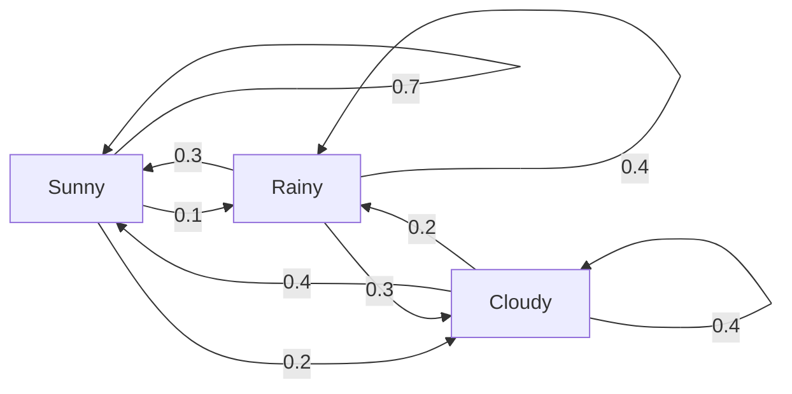
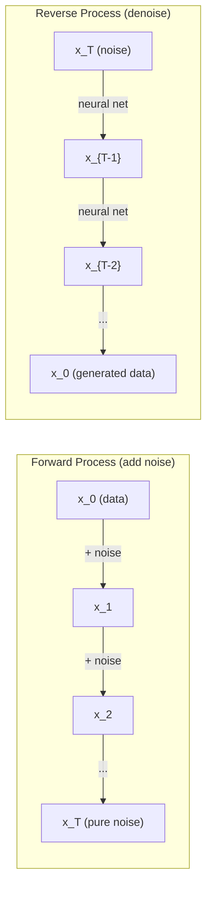

# العمليات الستوكاستية

> 具有结构的随机性──随机走行、马尔科夫链 和 انتشار النماذج 背后的数学──

**Type:** Learn
**Language:**بايثون
**Prerequisites:** Phase 1, Lessons 06-07（probability, Bayes）
**Time:** ~75 分钟

## 學习目标
- 模拟 1D 和 2D عشوائية المشي،并验证位移的 $\sqrt{n}$缩放规律
- 构建 Markov chain 模拟器,并通过自身组合 计算其静止分布
- 实现 متروبوليس-هاستينغز MCMC و لنجفين الديناميكيات، للاستخدام من الهدف التوزيع
- سوف نصل إلى عملية التوزيع إلى الأمام مع حركة براونية، ونفس عملية العكس كيفية توليد البيانات

## 问题
العديد من أنظمة الذكاء الاصطناعي تتعلق بالشكل التطوري مع مرور الوقت، وليس بالشكل الحالي، بل بالشكل المهيكلي، والتي تعتمد كل خطوة على ما حدث من قبل.

نموذج اللغة أحياناً تخلق رمز. كل رمز يعتمد على السياق المباشر. النموذج يخرج توزيع احتمالي، من بين الاستخدام، ثم يستمر.

نماذج الانتشار  تدريجيا نحو الصورة إضافة الضجيج، حتى يصبح صوتاً صريحاً.

وكلاء التعلم المُعزز يتخذون إجراءات في البيئة. كل إجراء يؤدي إلى حالة جديدة باحتمالٍ ما. وكيل في عالمٍ متوافق يتبع سياسة متوافقة.

العينات MCMC هي ركيزة استنتاج بايزي، وهي تشكل سلسلة ماركوف، وتوزيعها الثابت هو

كل هذا مبني على أربعة أفكار أساسية:
1. المشي عشوائي  أسهل عملية استوكاستية
2. سلسلة ماركوف  带有过渡矩阵的结构化随机性
3. ديناميكيّة لانجفين  带噪声的渐进下降
4. "ميتروبوليس-هستنغز"

## 概念
### المشي العشوائي

من موقع 0 开始── كل خطوة،抛一枚公平硬币──正面:向右移动(+1)──反面:向左移动(-1)──

عبر$n$بعد ذلك، موقعك هو$n$个随机 $\pm 1$值的总和──期望位置是0(هذا المشي غير متحيزة)──لكن المسافة من النقطة الأصلية$\sqrt{n}$增长‬

هذا هو المشي المباشر، لا يوجد أي ضغط في الاتجاهين، ولكن مع مرور الوقت، سوف يزول بعيداً عن نقطة الوقوع.$n$الاختلاف القياسي في القدم$\sqrt{n}$.

```
Step 0:  Position = 0
Step 1:  Position = +1 or -1
Step 2:  Position = +2, 0, or -2
...
Step 100: Expected distance from origin ~ 10 (sqrt(100))
Step 10000: Expected distance from origin ~ 100 (sqrt(10000))
```

**在 2D 中**,المشي إلى الصفحات مثل احتمال ارتفاع  إلى أسفل  إلى اليسار أو إلى اليمين $\sqrt{n}$缩放规律──路径会描绘出类似碎形的模式──

**为什么是 $\sqrt{n}$？**كل خطوة تتراوح مع خطوة على نحو واحد أو واحد.$n$步后, موقع $S_n = X_1 + X_2 + \cdots + X_n$، كل واحد منهم$X_i$مدينة$\pm 1$كل خطوة تغير 1 وكل خطوة مستقلة عن بعضها البعض$\mathop{\mathrm{Var}}(S_n) = n$الاختلاف القياسي =$\sqrt{n}$ وفقا لنظرية الحد المركزي،$S_n / \sqrt{n}$收到 تقسيم طبيعي قياسي

هذا النوع$\sqrt{n}$缩放在 ML 中随处可见──SGD 噪声按1/sqrt(batch_size) 缩放──Embedding 维度按 $\sqrt{d}$缩放──平方根是独立随机加和的标志──

**与 Brownian motion 的联系。**خذ حجم خطوة$1/\sqrt{n}$、 في كل وحدة من الوقت $n$قدم من المشي عشوائية.$n$في الوقت الذي يمر فيه هذا المشي سوف يتواصل مع حركة براون$B(t)$عملية متواصلة في الوقت ، من بينها$B(t)$服从平均值为 0 变量 为$t$التوزيع الطبيعي

حركة براون هي الأساس الرياضي للتوزيع. إنها ترسم حركة حركة الجسيمات في الجسم، وتغيرات أسعار الأسهم، وكذلك عملية الضجيج في نماذج التوزيع.

**Gambler's ruin。**المشي عشوائي من موقعك$k$开始,在 0 和 $N$هناك حاجز امتصاص$N$ما هو احتمال الوصول إلى 0؟$P(\text{到达 } N) = k/N$ هذا بسيط جدا و جميل.  انها متصلة إلى المارتينغال  نظرية  المشي العادي العادل هو المارتينغال

### سلاسل ماركوف

سلسلة ماركوف هي نظام، وهي تتحرك حسب احتمالات ثابتة بين الولايات.

```math
P(X_{t+1} = j \mid X_t = i, X_{t-1} = \ldots) = P(X_{t+1} = j \mid X_t = i)
```

هذا هو خاصية ماركوف. يعني أنه يمكنك استخدام ماتريكس انتقالية.$P$وصف الديناميكية بأكملها:

```math
P[i][j] = \text{从状态 } i \text{ 转移到状态 } j \text{ 的概率}
```

$P$كل خط من طلباتنا و 1 ((أنت يجب أن تذهب إلى مكان ما))

**示例 —— Weather：**

```
States: Sunny (0), Rainy (1), Cloudy (2)

P = [[0.7, 0.1, 0.2],    (if sunny: 70% sunny, 10% rainy, 20% cloudy)
     [0.3, 0.4, 0.3],    (if rainy: 30% sunny, 40% rainy, 30% cloudy)
     [0.4, 0.2, 0.4]]    (if cloudy: 40% sunny, 20% rainy, 40% cloudy)
```

من أي دولة 开始──经过多次过渡 之后,الولايات 的分布会收到静止分布 $\pi$، من بينهم$\pi P = \pi$هذا هو$P$قيمة خاصة 为 1 من الجهاز الخاص اليسرى

بالنسبة لسلسلة الطقس، التوزيع الثابت ربما يكون [0.53، 0.18, 0.29]  长期来看، مهما كانت الحالة الابتدائية هي ما، 53٪ من الوقت هو مشمس.



**计算 stationary distribution。**هناك طريقتان:

1. **Power method**: سوف يكون التوزيع الأولية المتعددة$P$بعد أن تمت الكثير من التكرارات، سوف تصل
2. **Eigenvalue method**:找到 $P$قيمة خاصة = 1 من الجهاز الخاص اليسرى.$P^T$قيمة خاصة 为 1 من المتجهات الخاصة

两种方法都要求链 满足收条件――

**收敛条件。**إذا سلسلة ماركوف  تلبي الشروط التالية، فإنها سوف تتلقى إلى التوزيع الثابت الوحيد:
- **Irreducible**كل ولاية يمكنها الوصول من أي ولاية أخرى
- **Aperiodic**: السلسلة لن تكون دورة دورية ثابتة

معظم السلاسل التي تواجهها في مجال التكنولوجيا الإلكترونية تلبي هذه الشروط

**Absorbing states。**إذا دخلت إلى دولة ما لن تغادر أبداً$P[i][i] = 1$), هذا الحالة هو امتصاص ∙ امتصاص سلسلة ماركوف يمكن استخدامها في بناء مع دولة محطة  عملية ∙ نهاية لعبة ∙ a churn of client、 a fate-of-text token token sequence‬

**Mixing time。**需要多少步,chain 才会接近stationary distribution?形式化地说,就是 المسافة الإجمالية للتغيرات ومسافة الثباتات انخفضت إلى عدد الخطوات المطلوبة تحت قيمة $P$模) التحكم في وقت الاختلاط.

### علاقات مع نماذج اللغة

نموذج اللغة 中的代币生成 近似是一个马科夫过程──给定当前文本,模型输出下一个代币 上的分布──温度 控制敏度:

```math
P(\text{token}_i) = \frac{\exp(\text{logit}_i / \text{temperature})}{\sum_j \exp(\text{logit}_j / \text{temperature})}
```

- درجة الحرارة = 1.0:
- درجة الحرارة < 1.0:更尖(更确定)
- درجة الحرارة > 1.0:更平坦(更随机)
- درجة الحرارة$\to 0$:argmax(طموح)

أعلى ك عينة قطع إلى احتمال أعلى $k$个代币──أعلى-p(النواة) العينة 截断到累积概率 超过 $p$集合──两者都会修改 احتمالات انتقال ماركوف──

### الحركة البروونية

الحد المتواصل للوقت المقصود للمشي عشوائية$B(t)$لديها ثلاثة طابع:
1. $B(0) = 0$
2. $B(t) - B(s)$服从平均值为 0 变量 为$t - s$التوزيع الطبيعي$t > s$)
3. الزيادات على منطقة غير متكلفة

حركة براونية هي متواصلة، ولكن في كل مستوى من الأبعاد هي في كل مستوى من الأبعاد.

في الحركة الانفصالية، يمكنك أن تقترب من حركة براون:

```math
B(t + dt) = B(t) + \sqrt{dt} \, z, \quad \text{其中 } z \sim \mathcal{N}(0, 1)
```

$\sqrt{dt}$缩放很重要── انها من النظرية المركزية الحد من المشيات العشوائية ‬

### ديناميكيات لانجفين

التراجع الدرجي 寻找最小值的函数── ديناميكا لانجفين 寻找与 $\exp(-U(x)/T)$وتوزيع الاحتمالات من بينها$U$هي وظيفة الطاقة$T$هو درجة الحرارة

```math
x_{t+1} = x_t - dt \, \nabla U(x_t) + \sqrt{2 T \, dt} \, z_t
```

هناك نوعان من النشاطات في الجسيمات:
1. **Gradient force**($-dt \cdot \nabla U$):推向低能量(类似 تدريجي هبوط)
2. **Random force**($\sqrt{2T dt} \cdot z$): تطور إلى اتجاهات

عندما درجة الحرارة$T = 0$时, هذا هو النزول البحتة. درجة الحرارة العالية. أسفل، انها تقريباً مشاة عشوائية. في درجة الحرارة المناسبة. أسفل، الجسيم سوف تستكشف المشهد الطاقة، وتوقف في مناطق الطاقة المنخفضة.

**与 diffusion models 的联系。**عملية التوسع المستقبلية لنموذج التوزيع هي:

```math
x_t = \sqrt{\alpha_t} \, x_{t-1} + \sqrt{1 - \alpha_t} \cdot \text{noise}
```

هذا هو سلسلة ماركوف تدريجياً لتخليط البيانات مع الضجيج بعد خطوات كافية$x_T$هذا هو الضجيج الغاسياني

عملية عكسية  من الضجيج للعودة إلى البيانات  هو أيضا سلسلة ماركوف، ولكن احتمالات انتقالها من قبل شبكة العصبية تعلم الحصول على‬‬‬‬‬‬‬‬‬‬‬‬‬‬‬‬‬‬‬‬‬‬‬‬‬‬‬‬‬‬‬‬‬‬‬‬‬‬‬‬‬‬‬‬‬‬‬‬‬‬‬‬‬‬‬‬‬‬‬‬‬‬‬‬‬‬‬‬‬‬‬‬‬‬‬‬‬‬‬‬‬‬‬‬‬‬‬‬‬‬‬‬‬‬‬‬‬‬‬‬‬‬‬‬‬‬‬‬‬‬‬‬‬‬‬‬‬‬‬‬‬‬‬‬‬‬‬‬‬‬‬‬‬‬‬‬‬‬‬‬‬‬‬‬‬‬‬‬‬‬‬‬‬‬‬‬‬‬‬‬‬‬‬‬‬‬‬‬‬‬‬‬‬‬‬‬‬‬‬‬‬‬‬‬‬‬‬‬‬‬‬‬‬‬‬‬‬‬‬‬‬‬‬‬‬‬‬‬‬‬‬‬‬‬‬‬‬‬‬‬‬‬‬‬‬‬‬‬‬‬‬‬‬‬‬‬‬‬‬‬‬‬‬‬‬‬‬‬‬‬‬‬‬‬‬‬‬‬‬‬‬‬‬‬‬‬‬‬‬‬‬‬‬‬‬‬‬‬‬‬‬‬‬‬‬‬‬‬‬‬‬‬‬‬‬‬‬‬‬‬‬‬‬‬‬‬‬‬‬‬‬‬‬‬‬‬‬‬‬‬‬‬‬‬‬‬‬‬‬‬‬‬‬‬‬‬‬‬‬‬‬‬‬‬‬‬‬‬‬‬‬‬‬‬‬‬‬‬‬‬‬‬‬‬‬‬‬‬‬‬‬‬‬‬‬‬‬‬‬‬‬‬‬‬‬‬‬‬‬‬‬‬‬‬‬‬‬‬‬‬‬‬‬‬‬‬‬‬‬‬‬‬‬‬‬‬‬‬‬‬‬‬‬‬‬‬‬‬‬‬‬‬‬‬‬‬‬‬‬‬‬‬‬‬‬‬‬‬‬‬‬‬‬‬‬‬‬‬‬‬‬‬‬‬‬‬‬‬



### MCMC: سلسلة ماركوف مونتي كارلو

أحياناً تحتاج إلى قدر يمكن طلبه ولكن لا يمكنك الحصول على توزيع مباشر$p(x)$النموذج البايسي: النموذج الخلفي هو مثال كلاسيكي.

**Metropolis-Hastings**بناء توزيع ثابت$p(x)$سلسلة ماركوف:

1. من مكان ما$x$开始
2. من توزيع الاقتراحات$Q(x' \mid x)$提议 مكان جديد $x'$
3. 计算 تناسب قبول:$a = p(x') Q(x \mid x') / (p(x) Q(x' \mid x))$
4.     $\min(1, a)$ قبول $x'$否则留在 $x$.
5. -أرجوك

إذا$Q$هو متماثل$Q(x' \mid x) = Q(x \mid x') = \mathcal{N}(x, \sigma^2){}$), النسبة 可简化为 $a = p(x') / p(x)$ تحتاج فقط إلى نسبة احتمال  تطبيع ثابت 会相互抵消

في ظروف حرارة ومتوافقة، هذه السلسلة ضمانات$p(x)$ولكن إذا كان الاقتراح 太小(random walk) أو 太大(高拒绝),收可能很慢──调节 الاقتراح هو MCMC 的艺术──

**为什么它有效。**نسبة قبول  ضمان التوازن التفصيلي:$x$لم يتحرك إلى$x'$احتمالية، على قدم المساواة$x'$لم يتحرك إلى$x$احتمالات التوازن التفصيلي يعني$p(x)$وذلك بعد خضوع العديد من الخطوات،$p(x)$.

**实践注意事项：**
- **Burn-in**: ضائع $N$个样本──链 需要时间从起点到静止分布──
- **Thinning**: كل قسم$k$个样本保留一个,以减少自相相性.
- **Multiple chains**: من نقاط مختلفة تنطلق سلسلة متعددة. إذا تمتهم نفس التوزيع، هناك دليل على وصولهم.
- **Acceptance rate**: للـ$d$维 مقترحات غوسيان، أفضل معدل قبول 大约是 23% ((روبرتس و روزنتال، 2001)                                                                                                                                                                                                                                                 

### العمليات الاستوكاستية في الذكاء الاصطناعي

| Process | AI Application |
|---------|---------------|
| Random walk | RL 中的 exploration、Node2Vec embeddings |
| Markov chain | Text generation、MCMC sampling |
| Brownian motion | Diffusion models（forward process） |
| Langevin dynamics | Score-based generative models、SGLD |
| Markov decision process | Reinforcement learning |
| Metropolis-Hastings | Bayesian inference、posterior sampling |


```figure
random-walk-diffusion
```

## بناءها
### الخطوة 1: محاكاة المشي عشوائية

```python
import numpy as np

def random_walk_1d(n_steps, seed=None):
    rng = np.random.RandomState(seed)
    steps = rng.choice([-1, 1], size=n_steps)
    positions = np.concatenate([[0], np.cumsum(steps)])
    return positions


def random_walk_2d(n_steps, seed=None):
    rng = np.random.RandomState(seed)
    directions = rng.choice(4, size=n_steps)
    dx = np.zeros(n_steps)
    dy = np.zeros(n_steps)
    dx[directions == 0] = 1   # right
    dx[directions == 1] = -1  # left
    dy[directions == 2] = 1   # up
    dy[directions == 3] = -1  # down
    x = np.concatenate([[0], np.cumsum(dx)])
    y = np.concatenate([[0], np.cumsum(dy)])
    return x, y
```

1D المشي  تخزين المبالغ المتراكمة ∙ كل خطوة هي +1 أو -1 ∙$n$步后,位置就是总和──变化随 随 随$n$线性增长، لذلك الانحراف القياسي 按 $\sqrt{n}$增长‬

### 步骤 2: سلسلة ماركوف

```python
class MarkovChain:
    def __init__(self, transition_matrix, state_names=None):
        self.P = np.array(transition_matrix, dtype=float)
        self.n_states = len(self.P)
        self.state_names = state_names or [str(i) for i in range(self.n_states)]

    def step(self, current_state, rng=None):
        if rng is None:
            rng = np.random.RandomState()
        probs = self.P[current_state]
        return rng.choice(self.n_states, p=probs)

    def simulate(self, start_state, n_steps, seed=None):
        rng = np.random.RandomState(seed)
        states = [start_state]
        current = start_state
        for _ in range(n_steps):
            current = self.step(current, rng)
            states.append(current)
        return states

    def stationary_distribution(self):
        eigenvalues, eigenvectors = np.linalg.eig(self.P.T)
        idx = np.argmin(np.abs(eigenvalues - 1.0))
        stationary = np.real(eigenvectors[:, idx])
        stationary = stationary / stationary.sum()
        return np.abs(stationary)
```

التوزيع الثابت هو $P$قيمة خاصة = 1 من الجهاز الخاص اليسرى.$P^T$نُقل نُقل الخليويات إلى نُقل الخليويات إلى نُقل الخليويات إلى نُقل الخليويات إلى نُقل الخليويات إلى نُقل الخليويات إلى نُقل الخليويات إلى نُقل الخليويات إلى نُقل الخليويات إلى نُقل الخليويات إلى نُقل الخليويات إلى نُقل الخليويات إلى نُقل الخليويات إلى نُقل الخليويات إلى نُقل الخليويات إلى نُقل الخليويات إلى نُقل الخليويات إلى نُقل الخليويات إلى نُقل الخليويات إلى نُقل الخليويات إلى نُقل الخليويات إلى نُقل الخليويات.

### الخطوة 3: ديناميكي لنجفين

```python
def langevin_dynamics(grad_U, x0, dt, temperature, n_steps, seed=None):
    rng = np.random.RandomState(seed)
    x = np.array(x0, dtype=float)
    trajectory = [x.copy()]
    for _ in range(n_steps):
        noise = rng.randn(*x.shape)
        x = x - dt * grad_U(x) + np.sqrt(2 * temperature * dt) * noise
        trajectory.append(x.copy())
    return np.array(trajectory)
```

المُستمر$x$推向低能量──噪声 防止它陷入局部停滞──在平衡时,样本分布与$\exp(-U(x)/\text{temperature})$.أصيبك

### الخطوة الرابعة: "ميتروبوليس"

```python
def metropolis_hastings(target_log_prob, proposal_std, x0, n_samples, seed=None):
    rng = np.random.RandomState(seed)
    x = np.array(x0, dtype=float)
    samples = [x.copy()]
    accepted = 0
    for _ in range(n_samples - 1):
        x_proposed = x + rng.randn(*x.shape) * proposal_std
        log_ratio = target_log_prob(x_proposed) - target_log_prob(x)
        if np.log(rng.rand()) < log_ratio:
            x = x_proposed
            accepted += 1
        samples.append(x.copy())
    acceptance_rate = accepted / (n_samples - 1)
    return np.array(samples), acceptance_rate
```

يقدم هذا الخوارزمي نقطة جديدة، فانظر ما إذا كان لديه احتمالات أعلى (أو على النسب مع احتمالات النسب المثالي) ، ثم أكررها.

## استخدمها
في الممارسة العملية، ستستخدم المكتبات الكبيرة لتنفيذ هذه الخوارزميات. ولكن فهم الآلية للتحليل والتحديد مهم جدا.

```python
import numpy as np

rng = np.random.RandomState(42)
walk = np.cumsum(rng.choice([-1, 1], size=10000))
print(f"Final position: {walk[-1]}")
print(f"Expected distance: {np.sqrt(10000):.1f}")
print(f"Actual distance: {abs(walk[-1])}")
```

### باستخدام المصفوفات الانتقالية

```python
import numpy as np

P = np.array([[0.7, 0.1, 0.2],
              [0.3, 0.4, 0.3],
              [0.4, 0.2, 0.4]])

distribution = np.array([1.0, 0.0, 0.0])
for _ in range(100):
    distribution = distribution @ P

print(f"Stationary distribution: {np.round(distribution, 4)}")
```

ستبدأ التوزيع$P$بعد تكرار كافٍ، فإنه سيحصل على التوزيع الثابت، مهما كنت تبدأ من هنا.

### مع الإطار الحقيقي

- **PyTorch diffusion：**العناق في الوجه`diffusers`وسط`DDPMScheduler`实现了 للأمام و العكس سلاسل ماركوف
- **NumPyro / PyMC：**باستخدام MCMC(NUTS عينات، انها تحسينات على متروبوليس-هستنغز) إجراء استنتاج بايزيان
- **Gymnasium (RL)：**وظيفة خطوة البيئة  حدد عملية قرار ماركوف

### 验证 التقارب في سلسلة ماركوف

```python
import numpy as np

P = np.array([[0.9, 0.1], [0.3, 0.7]])

eigenvalues = np.linalg.eigvals(P)
spectral_gap = 1 - sorted(np.abs(eigenvalues))[-2]
print(f"Eigenvalues: {eigenvalues}")
print(f"Spectral gap: {spectral_gap:.4f}")
print(f"Approximate mixing time: {1/spectral_gap:.1f} steps")
```

الفجوة الطيفية  أخبرك سلسلة  نسيت السرعة في حالتها الأولية── الفجوة 0.2 يعني حوالي 5 خطوات即可混合── الفجوة 0.01 يعني حوالي 100 خطوة──

## 交付 it
本课产出:
- `outputs/prompt-stochastic-process-advisor.md` إشارة سريعة لمساعدة في تحديد المشكلة المحددة تطبق على أي إطار عمل استوتشستيكي

## العلاقات

| Concept | Where it shows up |
|---------|------------------|
| Random walk | Node2Vec graph embeddings、RL 中的 exploration |
| Markov chain | LLMs 中的 Token generation、MCMC sampling |
| Brownian motion | DDPM 中的 forward diffusion process、SDE-based models |
| Langevin dynamics | Score-based generative models、stochastic gradient Langevin dynamics (SGLD) |
| Stationary distribution | MCMC convergence target、PageRank |
| Metropolis-Hastings | Bayesian posterior sampling、simulated annealing |
| Temperature | LLM sampling、RL 中的 Boltzmann exploration、simulated annealing |
| Mixing time | MCMC 的 convergence speed、spectral gap analysis |
| Absorbing state | End-of-sequence token、RL 中的 terminal states |
| Detailed balance | MCMC samplers 的 correctness guarantee |

نماذج الانتشار 值得特别关注──DDPM(Ho et al., 2020) حددت سلسلة ماركوف متقدمة:

```math
q(x_t \mid x_{t-1}) = \mathcal{N}\left(x_t; \sqrt{1-\beta_t} \, x_{t-1}, \beta_t I\right)
```

من بينهم$\beta_t$إنه جدول ضجيج$T$بعد$x_T$تقريباً$\mathcal{N}(0, I)$العملية العكسية من قبل أحد الجهات التنبؤية للضوضاء

```math
p_\theta(x_{t-1} \mid x_t) = \mathcal{N}\left(x_{t-1}; \mu_\theta(x_t, t), \sigma_t^2 I\right)
```

كل خطوة من التوليد هي خطوة تعلمت من سلسلة ماركوف. فهم سلسلة ماركوف يعني فهم نماذج التوزيع كيف ولماذا قادرة على توليد البيانات.

SGLD(Stochastic Gradient Langevin Dynamics) سوف تقوم بتحديد الحزمة الصغيرة من التراجع الدرجي مع ضجيج لنجفين 结起来──你不计算完整 gradient,而是使用 stochastic estimate 并添加校化的 الضجيج──随着学习率 衰退,SGLD 会从优化 过渡到采样  你几乎免费得到近似的贝叶斯后样品──这是从神经网络 获得不确定性估算的最简单方式之一──

穿穿 these links 见见的关键洞见是:العمليات الاستوائية ليست مجرد أدوات نظرية. إنها آلية حسابية في داخل النظام الحديث AI. عندما تقوم بتنظيم درجة حرارة LLM.

## التدريب
1. **模拟 1000 条 10000 步的 random walks。**رسم التوزيع للمواقع النهائية.$\sqrt{10000} = 100$غوسيانية

2. **使用 Markov chain 构建 text generator。**في فئة صغيرة 上 тренинг: على كل كلمة،统计到下一个词的过渡――بناء ماتريكيس الانتقال──通过从链中采样生成新句子──

3. **使用 Metropolis-Hastings 实现 simulated annealing。**من درجة الحرارة العالية 开始(تقريباً تقبل كل شيء) ، ثم تدريجياً降温(تقبل فقط التحسين) ―― باستخدامها البحث عن الحد الأدنى من وظائف مع العديد من الحد الأدنى المحلية‬

4. **比较不同 temperatures 下的 Langevin dynamics。**من إمكانات البئر المزدوج$U(x) = (x^2 - 1)^2$في حالة درجة حرارة منخفضة، تجمع العينات في بئر واحد في حالة درجة حرارة عالية، وتتوزع إلى اثنين من البئرات في حفرة درجة حرارة حرجة في الخليط بين البئرات.

5. **实现 forward diffusion process。**من إشارة 1D (مثل موجة السينوس) البدء في استخدام جدول ضوضاء خطي، في 100 خطوة تدريجيا إضافة الضوضاء.

### 提示

**练习 1。**لـ 1000 بذرة مختلفة`random_walk_1d(10000, seed=i)`،并保留 كل مرة من الموقع النهائي. يعني التفتيش ما إذا كان يقترب من 0، الانحراف القياسي ما إذا كان يقترب من 100، وكذلك ما إذا كان الموقع النهائي حوالي 68٪ يقع بين -100 إلى 100.

**练习 2。**统计每次出现对相邻单词的次数,再将每行除以该行总和,使每行之和为1――将矩阵传入 统计每行之和为1――将矩阵传入 统计每行对相邻单词出现的次数,再将每行除以该行总和,使每行之和为1――将矩阵传入 统计每行的次数,将矩阵传入`MarkovChain(transition_matrix, state_names)`,并调用 `simulate`◊ تحقق إن كان كل كلمة في المجموعة موجودة في المجموعة

**练习 3。**$\exp(-\Delta / T)$احتمالية قبول نقطة أقل، و بعد كل خطوة$T$ضرب في عنصر، على سبيل المثال 0.99‬ على وظيفة أدنى معروفة، ومع ذلك، نتائج البحث في الشبكة الصغيرة تُعتبر.

**练习 4。**درجة$4x(x^2 - 1)$، سوف نقلها لنا`langevin_dynamics(grad_U, x0, dt, temperature, n_steps)`.$x = 0$الحاجز في ارتفاع 1، لذلك في درجات الحرارة مختلفة من 0.05 إلى 1،$x$‬ ‬ ‬ ‬ ‬ ‬ ‬ ‬ ‬ ‬ ‬ ‬ ‬ ‬ ‬ ‬ ‬ ‬ ‬ ‬ ‬ ‬ ‬ ‬ ‬ ‬ ‬ ‬ ‬ ‬ ‬ ‬ ‬ ‬ ‬ ‬ ‬ ‬ ‬ ‬ ‬ ‬ ‬ ‬ ‬ ‬ ‬ ‬ ‬ ‬ ‬ ‬ ‬ ‬ ‬ ‬ ‬ ‬ ‬ ‬ ‬ ‬ ‬ ‬ ‬ ‬ ‬ ‬ ‬ ‬ ‬ ‬ ‬ ‬ ‬ ‬ ‬ ‬ ‬ ‬ ‬ ‬ ‬ ‬ ‬ ‬ ‬ ‬ ‬ ‬ ‬ ‬ ‬ ‬ ‬ ‬ ‬ ‬ ‬ ‬ ‬ ‬ ‬ ‬ ‬ ‬ ‬ ‬ ‬ ‬ ‬ ‬ ‬ ‬ ‬ ‬ ‬ ‬ ‬ ‬ ‬ ‬ ‬ ‬ ‬ ‬ ‬ ‬ ‬ ‬ ‬ ‬ ‬ ‬ ‬ ‬ ‬ ‬ ‬ ‬ ‬ ‬ ‬ ‬ ‬ ‬ ‬ ‬ ‬ ‬ ‬ ‬ ‬ ‬ ‬ ‬ ‬ ‬ ‬ ‬ ‬ ‬ ‬ ‬ ‬ ‬ ‬ ‬ ‬ ‬ ‬ ‬ ‬ ‬ ‬ ‬ ‬ ‬ ‬ ‬ ‬ ‬ ‬ ‬ ‬ ‬ ‬ ‬ ‬ ‬ ‬ ‬ ‬ ‬ ‬ ‬ ‬ ‬ ‬ ‬ ‬ ‬ ‬ ‬ ‬ ‬ ‬ ‬ ‬ ‬ ‬ ‬ ‬ ‬ ‬ ‬ ‬ ‬ ‬ ‬ ‬ ‬ ‬ ‬ ‬ ‬ ‬ ‬ ‬ ‬ ‬ ‬ ‬ ‬ ‬ ‬ ‬ ‬ ‬ ‬ ‬ ‬ ‬ ‬ ‬ ‬ ‬ ‬ ‬ ‬ ‬ ‬ ‬ ‬ ‬

**练习 5。**调用 `diffusion_forward(signal, 100)`,并将所有 $(1 - \beta_t)$-إذاً، أحصل على الخطوة الأخيرة$\bar{\alpha}$إذا$\bar{\alpha}$لا يزال بعيدا عن 0، الإشارة ليست مجرد ضجيج، تحتاج إلى زيادة`beta_end`✿先使用真实噪音 测试 denoiser:此时 $(x_t - \sqrt{1 - \bar{\alpha}_t} \epsilon)/\sqrt{\bar{\alpha}_t}$يجب أن تحدد مرة أخرى

## 关键术语
| Term | What people say | What it actually means |
|------|----------------|----------------------|
| Random walk | “抛硬币式移动” | 一个 position 在每一步按随机 increments 改变的过程 |
| Markov property | “无记忆性” | future 只依赖当前 state，而不依赖 history |
| Transition matrix | “概率表” | $P[i][j]$ = 从 state $i$ 移动到 state $j$ 的概率 |
| Stationary distribution | “长期平均” | 满足 $\pi P = \pi$ 的分布 $\pi$ —— chain 的 equilibrium |
| Brownian motion | “随机抖动” | random walk 的 continuous-time limit，$B(t) \sim \mathcal{N}(0, t)$ |
| Langevin dynamics | “带噪声的 Gradient Descent” | 结合 deterministic Gradient 与 random perturbation 的 update rule |
| MCMC | “向目标行走” | 构造一个 stationary distribution 为你想要的分布的 Markov chain |
| Metropolis-Hastings | “提议并接受/拒绝” | 使用 acceptance ratios 来确保收敛的 MCMC algorithm |
| Temperature | “随机性旋钮” | 控制 exploration 与 exploitation 之间权衡的参数 |
| Diffusion process | “噪声进，噪声出” | Forward：逐渐添加 noise。Reverse：逐渐移除 noise。生成 data。 |

## 延伸阅读
- **Ho, Jain, Abbeel (2020)**  إدانة النماذج المحتملة للتنشر.  افتتاح نموذج التنشر 革命的 DDPM 论文──清晰推导了前和逆马尔科夫链──
- **Song & Ermon (2019)**  النمذجة الجينارية من خلال تقدير درجات توزيع البيانات. استخدام ديناميكي لنجفين  إجراء أخذ العينات 方法基于得点──
- **Roberts & Rosenthal (2004)** الوضع العام الفضاء سلسلة ماركوف وخوارزميات MCMC.   حول MCMC 何時以及为什么有效的理论──
- **Norris (1997)**  ماركوف سلسلة. 标准教材──涵盖 التقارب、تقسيمات ثابتة 和 ضربات الأوقات──
- **Welling & Teh (2011)** التعلم البايسي عن طريق ديناميكة لانجفين التدريجية الستوكاستية. سوف يتم دمج SGD مع ديناميكة لانجفين 结合,用于可扩展推理ة بايسي.
