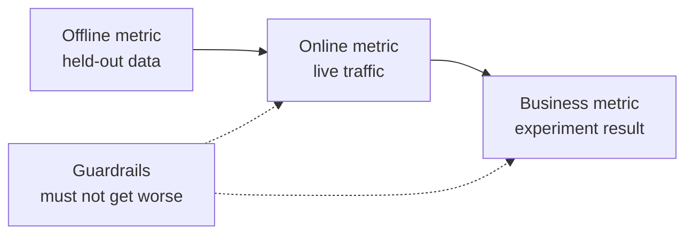

# 机器学习系统设计: من المشكلة إلى النموذج المُنشر

> النموذج هو جزء من النظام. تصميم يقرر النموذج التنبؤ ماذا. من يتنبأ في التنبؤ على العمل.

**Type:** Build
**Languages:** Python
**Prerequisites:** 阶段 2，第 09 课（模型评估）和第 13 课（ML 流水线）
**Time:** 约 110 分钟

## 學习目标

- تحديد مشاكل الأعمال إلى مهام ML، وتحديد محتوى التنبؤات، واستخدام القرارات المتوقعة، وكذلك أسباب عدم وجود قواعد لحل المشاكل
- التمييز بين الإنترنت والعمل والحفاظ على المؤشر، ومقارنة كل نموذج مع الخط الأساسي البسيط والخط الأساسي المبدئي
- وفقاً لتقديرات التدفقات، تكلفة اليومية والتأخير ومدى التقدم في البيانات
- 选择发布方式(影子、金丝雀、A/B 测试),并为每种故障模式选择安全默认行为
- كيفية تحديد النموذج من خلال القرار تغيير النسخة التالية
- 编写 ML 设计文档,并按固定检查清单评分

## 问题

طلب شركة إشتراكية أن تقوم بـ流失预测模型── تدرب علماء البيانات على درجة تحسين التقسيمات، وبلغت AUC ٠.٩١── بعد ثلاثة أشهر، ولم يستخدمها أحد‬‬‬‬‬‬‬‬‬‬‬‬‬‬‬‬‬‬‬‬‬‬‬‬‬‬‬‬‬‬‬‬‬‬‬‬‬‬‬‬‬‬‬‬‬‬‬‬‬‬‬‬‬‬‬‬‬‬‬‬‬‬‬‬‬‬‬‬‬‬‬‬‬‬‬‬‬‬‬‬‬‬‬‬‬‬‬‬‬‬‬‬‬‬‬‬‬‬‬‬‬‬‬‬‬‬‬‬‬‬‬‬‬‬‬‬‬‬‬‬‬‬‬‬‬‬‬‬‬‬‬‬‬‬‬‬‬‬‬‬‬‬‬‬‬‬‬‬‬‬‬‬‬‬‬‬‬‬‬‬‬‬‬‬‬‬‬‬‬‬‬‬‬‬‬‬‬‬‬‬‬‬‬‬‬‬‬‬‬‬‬‬‬‬‬‬‬‬‬‬‬‬‬‬‬‬‬‬‬‬‬‬‬‬‬‬‬‬‬‬‬‬‬‬‬‬‬‬‬‬‬‬‬‬‬‬‬‬‬‬‬‬‬‬‬‬‬‬‬‬‬‬‬‬‬‬‬‬‬‬‬‬‬‬‬‬‬‬‬‬‬‬‬‬‬‬‬‬‬‬‬‬‬‬‬‬‬‬‬‬‬‬‬‬‬‬‬‬‬‬‬‬‬‬‬‬‬‬‬‬‬‬‬‬‬‬‬‬‬‬‬‬‬‬‬‬‬‬‬‬‬‬‬‬‬‬‬‬‬‬‬‬‬‬‬‬‬‬‬‬‬‬‬‬‬‬‬‬‬‬‬‬‬‬‬‬‬‬‬‬‬‬‬‬‬‬‬‬‬‬‬‬‬‬‬‬‬‬‬‬‬‬‬‬‬‬‬‬‬‬‬‬‬‬‬‬‬‬‬‬‬‬‬‬‬‬‬‬‬‬‬‬‬‬‬‬‬‬‬‬‬‬‬‬‬‬‬‬‬‬‬‬‬‬‬‬‬‬‬‬‬‬‬‬

原因与算法无关――没有人决定分数应触发什么行动――分数每周才更新一次,但客户挽留团队每天都打电话――标签来自取消订阅表,而该表还存储取消原因,因此某特征直接包含答案――也没有人把模型与客户团队原始规则比较:给连续两周不活跃的客户打电话――

هذه الفشل في التدريب قد دفن قبل بداية. إنها كلها فشل التصميم، ويمكن تصميم الملفات على الصفحة التالية على كل سؤال.

## مفهوم الأساسي

### من أهداف العمل إلى مهام المهام

 business goal لا يساوي ML 任务                                                                                                                                                                                                                                                           

1. 模型具体预测什么,预测对象是什么实体(用户、支付、门店、商品)?
2. أيّة قرارات تستخدم التنبؤ، من قبل من أو من نظام اتخاذ القرارات؟
3. ما هي المعلومات المتاحة في ذلك الوقت؟
4. كيف تحسن في اتخاذ القرارات؟

| 业务目标 | 预测 | 使用预测的决策 | ML 任务 |
|---|---|---|---|
| 减少流失 | 用户未来 30 天取消订阅的概率 | 每晚向风险最高的 5% 用户发送挽留优惠 | 二分类 |
| 减少欺诈损失 | 一笔支付属于欺诈的概率 | 在 100 ms 内批准、送审或阻止 | 二分类 |
| 保持货架有货 | 下周各门店每天的销售件数 | 各门店订货量 | 预测 |
| 展示相关商品 | （用户，商品）对的相关性分数 | 信息流中的商品顺序 | 排序 |

ثانياً: لا يوجد وقت محدد للعمل والعمل، لا يوجد وقت محدد للعمل والعمل، لا يوجد وقت محدد للعمل والعمل، لا يوجد وقت محدد للعمل والعمل، لا يوجد وقت محدد للعمل والعمل، لا يوجد وقت محدد للعمل، لا يوجد وقت محدد للعمل، لا يوجد وقت محدد للعمل.

### 何时不应使用 ML

قواعد التعلم الآلي قاعدة 1                                                                                                                                                                                                                                                                                                                                                                                                                                                                                                                     

- 简短规则可以达到目标,并能持续保持正确.
- لا يوجد علامة، ولا يوجد طريقة عمليّة لجمعها.
- لا يوجد أحد يتصرف على أساس التنبؤ، لذلك التنبؤات أكثر دقة لن تؤدي إلى تغيير.
- 预测时可用数据不含所需信号──
- خطأ لا يمكن قبوله، لا أحد يستطيع التحقق من الخروج
- تكلفة بناء ونشاط النظام أعلى من القيمة التي تأتي من اتخاذ قرارات أفضل.

عندما تصبح القواعد طويلة و ضعيفة، فإن ML تبدأ في الاستفادة منها. نفس القاعدة 3 ، يوصي باستخدام ML أولاً بدلاً من القواعد المُعقدة المُبتكرة ، لأن النموذج الذي يتم التعلم به يسهل تحديثه وصيانته.

### ثلاثة مستويات

في ثلاثة مستويات قياس ML 系统، في نفس الوقت وضع مجموعة الحد:

| 层面 | 何时能测量 | 流失预测示例 |
|---|---|---|
| 离线指标 | 上线前，在留出的历史数据上 | 优惠阈值处的 F1、风险最高 5% 中的精确率 |
| 在线指标 | 上线期间，在真实流量上 | 优惠接受率、已评分用户比例、分数分布 |
| 业务指标 | 上线数周后，通过实验 | 干预组与保留对照组的 30 天流失率 |
| 护栏指标 | 始终监测 | 每挽留一名用户的优惠成本、退订率、p99 延迟 |



يقدم المستويات المختلفة استنتاجات مختلفة. يُقدّر المؤشر عبر الإنترنت بيانات تاريخية، بينما الماضي ليس لديه نموذج.

اختيار مؤشر خارج الخط يتناسب مع القرارات. إذا كانت المهمة تتصل بأعلى 5% من المستخدمين، فمن ثم قياس معدل الدقة في هذا 5%.

### 基线

لا معنى له. إذا كان أفضل البديل هو 0.30 فقط، ف1 يصل إلى 0.56 يكون جيدًا. إذا كان القاعدة يمكن أن يصل إلى 0.60, فهي مختلفة جدا.

- **简单基线。**始终预测多数类别,或始终预测训练集平均值──模型评估课使用过这种检查──
- **启发式基线。**من قواعد المعرفة في المجال، أو خصائص واحدة مناسبة على بيانات التدريب.
- **现有系统。**طريقة اتخاذ القرارات في وقت سابق، حتى لو كان مجرد شخص يستخدم الشكل الإلكتروني.

升级量是模型分数减下最强基线分数―― قبل النظر في النتيجة، وضع الحد الأدنى لتحسين المتطلبات، وضمان أنه كاف لتغطية تكاليف النظام الإضافية―― 简单基线通常很弱، إنشاء基线才是真正难以击败对手――

### طلبات البيانات والعلامات

训练前回答这些问题:

- **标签来源。**من هو المسؤول عن أيّة أحداث؟
- **标签延迟。**预测后多久才知道真实结果? الغش رفض دفع قد يظهر بعد أسابيع من الدفع;流失标签 يجب أن تنتظر 30 天
- **标签质量。**من يعلن، أنّ ارتفاع معدّل الخطأ؟
- **预测时的可用性。**هل كل سمة موجودة في التنبؤ؟ النتائج التي تحدث بعد أن تكتب السمات سوف تفشّل في التدريب.
- **各类样本量。**كم نموذج حقيقي؟ هناك 200 نموذج حقيقي فقط، وعادة ما يمكن استخدام نموذج بسيط فقط.
- **时间切分。**留出最近一段时间──序列时间课时分类数据也是出于同样的原因──

### التأخير 、 التكلفة والمدخل

ثلاث رقميات لكل نوع من الخدمات

- **延迟预算。**p99 التأخير هو 99 من 100 طلب أقل من الوقت المطلوب.
- **峰值吞吐量。**按最忙一分钟而非日均流量配置系统──峰值 QPS(每秒请求数)往往是平均值的数倍──
- **成本预算。**معدل تكلفة الدولار اليومي أو تكلفة الدولار المتنبأ 1000 مرة، من السهل مقارنة الحلول.

القوانين القليلة سترتبط بين الاثنين: عدد الطلبات في المعالجة يساوي حجم الانتاج ضرب التأخير. إذا كان كل ثانية 400 طلبات، كل ساعة تستغرق 50 ms، في المتوسط هناك 20 طلبات في المعالجة.

### التقييمات الجماعية والتقييمات عبر الإنترنت

هناك طريقتان أساسيتين:

- **批量推理。**定时任务为每实体评分,将分数写入表或键值存储――应用在收到请求时读取已存分――
- **在线推理。**應用在请求到到达时把特征发送给模型服务,等分数回来──

| 属性 | 批量 | 在线 |
|---|---|---|
| 新鲜度 | 距离上次运行的时间，加上运行耗时 | 使用当前请求的数据 |
| 请求延迟 | 一次键值读取，几毫秒 | 特征获取时间加模型耗时 |
| 成本驱动因素 | 实体数乘以每天运行次数 | 按峰值 QPS 配置的副本数 |
| 新实体 | 下一次运行前没有分数 | 第一次请求时即可评分 |
| 故障时 | 旧分数仍可读取 | 请求失败或超时 |

هذا المجموعة من الأدوات تقييم كل من تكاليفها. تكاليف الجملة مع نمو عدد المواد والمرات التي يتم تشغيلها يوميا. تسمح الوقت القديم بالانخفاض، والتشغيل بشكل متكرر. تكاليف الإنترنت مع زيادة حركة القمة، لأن نسخة من الفراغات بين القمم العالية يجب أن تدفع.

混合设计很常见: مهمات الجمع الليلية تُعطى مستخدميّين بالفعل تقييمات، وطرق على الإنترنت لمعالجة طلبات المستخدمين الجدد والحاجة إلى بيانات جديدة.

### 部署模式

النموذج الجديد

1. **影子运行（Shadow）。**النموذج الجديد يتلقى نسخة من التدفق الحقيقي. سجل النظام التوقعات، ولكن لا تستخدمها. مقارنة مع النموذج الجديد التأخير والخطأ وتوزيع التوقعات.
2. **金丝雀发布（Canary）。**النموذج الجديد يتخذ قرارات حقيقية في جزء صغير من التدفق، عادةً ما يبدأ من 1% إلى 5% 
3. **A/B 测试。**يستخدم المستخدمون بشكل منفصل نماذج مختلفة. باستخدام مؤشر الأعمال الإحصائية، تحتاج إلى حركة كافية وقتاً لتحديد الفرق.

كل مرحلة تحتاج إلى الانتهاء من التداول في غضون دقائق قليلة. الحفاظ على النسخة القديمة من النموذج المُنشر، من خلال تخصيص التغييرات في التدفقات.[影子与金丝雀发布课](../../../17-infrastructure-and-production/20-shadow-canary-progressive/docs/en.md)和 [A/B 测试课](../../../17-infrastructure-and-production/21-ab-testing-llm-features/docs/en.md)سوف تتمثل في ثلاثة أنماط نفسها.

### الدورة

عندما يتغير قرار النموذج في إصدار التدريب التالي، تظهر الدورة المضادة.

- **干预隐藏标签。**流失模型发送优惠,挽留了部分用户──下个月,高风险用户看起来很忠诚,重新训练的模型便学到这些特征不能预测流失──
- **被阻止的行动没有结果。**نموذج الاحتيال يمنع دفع، وهذا الدفع لن يخلق أبداً علامة رفض الائتمان.
- **曝光限制反馈。**排序模型 فقط يظهر التصنيف على السلع السابقة ، لذلك فقط هذه السلع تحصل على النقرة.

الفكرة المشتركة في طريقة التعديل هي الاحتفاظ ببعض البيانات التي لم تتأثر بها النموذج. الاحتفاظ بالتزامن مع مجموعة من المستخدمين الذين لا يقبلون أبداً بالتدخل.

### نموذج الاضطرابات والسلوكيات الامانية

كل جزء من النظام يفشل في وقت متأخر. يجب أن يحدد في مرحلة التصميم بدلا من الحادث خلال تصرفات الاختلالات:

| 故障 | 没有预案时的结果 | 安全默认行为 |
|---|---|---|
| 模型服务超时 | 请求失败 | 使用启发式基线 |
| 夜间批任务失败 | 分数缺失或过旧 | 在固定期限内提供最近的正常分数，之后使用规则 |
| 特征缺失或越界 | 模型对坏输入评分 | 使用文档规定的默认值，并记录事件 |
| 新实体没有历史 | 没有分数 | 使用规则或总体均值 |
| 分数分布突然变化 | 大规模错误决策 | 暂停自动行动，并通知人工处理 |

إن الإعدادات المُقدمة للجزء المُحدد هي أيضاً المُختلفة في معظم الحالات، لذا يجب أن يتم ذلك أولاً.

### 设计文档

设计文档在训练开始前集中记录上述决策──本课检查器为其 JSON 版本评分──其中六项检查具有阻塞性,因为任一缺失都会使系统不安全或无用:

| 章节 | 回答的问题 | 阻塞条件 |
|---|---|---|
| 问题 | 预测什么，哪项决策使用它，为什么规则不够？ | 必须明确决策 |
| 指标 | 适用哪些离线、在线、业务和护栏指标？ | 必须明确业务指标 |
| 基线 | 适用哪些简单、启发式和现有系统基线？ | 必须有启发式或现有系统基线 |
| 数据 | 标签来自哪里、延迟多久，每个特征预测时是否可用？ | 不得泄露标签 |
| 预算与服务 | 有哪些延迟、峰值 QPS、成本和陈旧时间限制，哪种模式满足它们？ | 无 |
| 发布 | 使用哪些影子、金丝雀及 A/B 阶段，如何回滚？ | 必须有影子或金丝雀阶段，以及回滚 |
| 反馈循环 | 模型如何改变未来数据，如何保留干净数据？ | 无 |
| 故障模式 | 每种故障的默认行动是什么？ | 每种故障都必须有默认行为 |
| 监控 | 上线后观察什么？ | 无 |

```figure
mlprod-serving-cost
```

## من التكوين

`code/main.py`استعمال المستندات المحددة فقط، يتضمن ثلاثة أدوات: نموذج تكلفة الخدمة موازنة القيود والفحص المستندات التصميمية‬

### 第1 步: وصف العمل والحمل والسعر

工作负载保存流量和预算数字,成本模型保存价格── هذه الأسعار هي أمثلة على التعددية الكاملة المستخدمة في التدريب، وليس أسعار الموردين──

```python
@dataclass(frozen=True)
class Workload:
    name: str
    entities: int
    requests_per_day: int
    peak_qps: float
    max_staleness_hours: float
    latency_budget_ms: float


@dataclass(frozen=True)
class CostModel:
    batch_dollars_per_million: float = 0.40
    batch_job_hours: float = 1.0
    lookup_dollars_per_million: float = 0.25
    lookup_latency_ms: float = 4.0
    replica_dollars_per_hour: float = 0.50
    replica_qps: float = 200.0
    min_replicas: int = 2
    online_latency_ms: float = 35.0
```

### الخطوة الثانية: الحسابات والتكاليف على الإنترنت

يجب أن يتم إتمام المهام في الحد الأقصى من الوقت القديم. فترات عمليتين تساوي الحد الأقصى من وقت المهام. بغض النظر عن ما إذا كان هناك طلباً أو لا، سيتم تقييم كل عملية لكل مؤسسة.

```python
def batch_plan(workload: Workload, costs: CostModel) -> ServingPlan:
    refresh_hours = workload.max_staleness_hours - costs.batch_job_hours
    if refresh_hours <= 0:
        return ServingPlan(
            "batch", False, math.inf, costs.lookup_latency_ms, math.inf, 0.0,
            "staleness limit is shorter than one batch job",
        )
    runs_per_day = 24.0 / refresh_hours
    predictions = workload.entities * runs_per_day
    dollars = (
        predictions / 1e6 * costs.batch_dollars_per_million
        + workload.requests_per_day / 1e6 * costs.lookup_dollars_per_million
    )
    ...
```

خدمة على الإنترنت تحتاج إلى دفع تكاليف للحفاظ على كميات كافية من النسخة التي يمكن تحملها، ويحافظ على اثنين على الأقل من النسخة لضمان إمكانية الاستخدام:

```python
def online_plan(workload: Workload, costs: CostModel) -> ServingPlan:
    replicas = max(costs.min_replicas, math.ceil(workload.peak_qps / costs.replica_qps))
    dollars = replicas * costs.replica_dollars_per_hour * 24.0
    feasible = costs.online_latency_ms <= workload.latency_budget_ms
    ...
```

`choose_serving`اختر تلبية التأخير والحظر في الوقت القديم، عودة لأكثر الرخصة.`None`،أخبرك أنك بحاجة إلى تعديل الميزانية

### 第3 步: مقارنة النموذج مع القاعدة

مقارنة مع أداة نفس المؤشر تقييم النموذج وجميع القواعد.

```python
def compare_to_baselines(
    y_true: list,
    model_pred: list,
    baselines: dict[str, list],
    metric,
    metric_name: str,
    higher_is_better: bool = True,
    min_lift: float = 0.02,
) -> BaselineReport:
    if not baselines:
        raise ValueError("a model needs at least one baseline")
    scores = {name: metric(y_true, pred) for name, pred in baselines.items()}
    pick = max if higher_is_better else min
    best_name = pick(scores, key=scores.get)
    model_score = metric(y_true, model_pred)
    lift = model_score - scores[best_name] if higher_is_better else scores[best_name] - model_score
    return BaselineReport(metric_name, {"model": model_score, **scores}, best_name, lift, min_lift)
```

启发式基线是单特征规则──`fit_rule`في بيانات التدريب، قم بتحديد كل قيمة من هذه الصفات على التوالي كـمية، واحتفظ بـ F1 أفضلمية.

### 第4 步:为设计文档评分

كل عملية فحص تحتوي على كلمات الأساسية والوزن والعلامات والرسائل والعملات الفحصية والوزن للعمليات المثقلة هو 2

```python
CheckItem("decision", 2, True, "name the action that uses each prediction", lambda d: _text(d, "problem.decision")),
CheckItem("baselines", 2, True, "add a heuristic or current-system baseline", check_baselines),
CheckItem("no_leakage", 2, True, "confirm every feature exists at prediction time",
          lambda d: get_path(d, "data.features_available_at_prediction_time") is True),
CheckItem("serving_fit", 1, False, "pick a serving mode that meets the staleness, latency, and cost budgets",
          check_serving_fit),
```

`check_serving_fit`复用成本模型,从文档读取负载数字,并估算选定模式的成本. 如果模式不能满足旧时间上限,延迟预算或每天成本预算,检查就失败. 声明采用批但只允许三分钟旧时间的文档无法通过.

`review_design_doc`سوف يمر المشاريع إلى الوزن، وإعادة تقسيمها إلى الوزن الإجمالي.

### 第5 步:运行

```bash
python3 code/main.py
```

```console
nightly churn scores
  ok batch        $0.91/day      4 ms  1.0 runs per day over 2,000,000 entities
  ok online      $24.00/day     35 ms  2 replicas sized for 40 peak QPS
  choose: batch

feed ranking, 2-hour freshness
  ok batch       $48.50/day      4 ms  24.0 runs per day over 5,000,000 entities
  ok online      $24.00/day     35 ms  2 replicas sized for 120 peak QPS
  choose: online

=== Model versus baselines (churn, metric F1) ===
  model                    0.564
  days_idle > 12.8688      0.500
  random at base rate      0.232
  majority class           0.000
  model beats the strongest baseline (days_idle > 12.8688) by +0.064
```

ف1 من الأقسام الرئيسية الأكبر هو 0، لأنه لا يتوقع التهرب. القواعد التي تتمكن من التوصل إليها هي فقط المتنافس الحقيقي. النموذج أعلى منه 0.064. لذلك هناك أسباب لاستخدام النموذج. إذا كانت الخصائص أضعف، القواعد قد تفوز، في هذه الحالة القواعد هي فقط النظام الذي ينبغي نشرها.

设计文档评审会印印缺少六阻塞项的薄弱文档,以及 1.00 分的完整文档──传入路径可评审您自己的文档:

```bash
python3 code/main.py my_design_doc.json
```

## استخدام الحالي

المعدات المعدات المعدات المعدات المعدات المعدات المعدات المعدات المعدات المعدات المعدات المعدات المعدات المعدات المعدات المعدات المعدات المعدات المعدات المعدات المعدات المعدات المعدات المعدات المعدات المعدات المعدات المعدات المعدات المعدات المعدات المعدات المعدات المعدات المعدات المعدات المعدات المعدات المعدات المعدات المعدات المعدات المعدات المعدات المعدات المعدات المعدات المعدات المعدات المعدات المعدات المعدات المعدات المعدات المعدات المعدات المعدات المعدات المعدات المعدات المعدات المعدات المعدات المعدات المعدات المعدات المعدات المعدات المعدات المعدات المعدات

**基线。**سيتم تنفيذ القواعد البسيطة للوصول إلى جهاز التقييم، بحيث يمكن وضعها مع النموذج في نفس التيار:

```python
from sklearn.dummy import DummyClassifier, DummyRegressor
from sklearn.metrics import f1_score

majority = DummyClassifier(strategy="most_frequent").fit(X_train, y_train)
base_rate = DummyClassifier(strategy="stratified", random_state=0).fit(X_train, y_train)
mean_value = DummyRegressor(strategy="mean").fit(X_train, y_reg_train)

print(f1_score(y_test, majority.predict(X_test)))
```

`most_frequent`على`majority_baseline`،`stratified`على`base_rate_baseline`✿ Little-learn 没有启发式基线, لأن قواعد الابتدائية تأتي من مجال محدد الخاص بك‬‬

**批量服务。**أباتشي Airflow、Dagster وغيرها من عمليات تدريب المعدات

**在线服务。**KServe、BentoML、NVIDIA Triton、TorchServe وغيرها من الخدمات النموذجية سوف تكون الموديل مغلفة على HTTP أو gRPC 端点后── بالنسبة للموديل الصغير، تحميل الموديل العادي الويب  خدمة يمكن أيضا القيام بها──

**发布。**أدوات Argo Rollouts وغيرها من Kubernetes  أدوات لـ金丝雀 إصدار分流── GrowthBook、Statsig وغيرها من منصات التجربة تقسيم المستخدمين إلى A/B 分组并计算统计量──

**设计评审。**بريك  وغيرها من النتائج التي نشرتها على اختبار ML  يتضمن 28 متطلبات اختبار ومراقبة مطلوبة لإنتاج نظام ML ‬‬‬‬‬‬‬‬‬‬‬‬‬‬‬‬‬‬‬‬‬‬‬‬‬‬‬‬‬‬‬‬‬‬‬‬‬‬‬‬‬‬‬‬‬‬‬‬‬‬‬‬‬‬‬‬‬‬‬‬‬‬‬‬‬‬‬‬‬‬‬‬‬‬‬‬‬‬‬‬‬‬‬‬‬‬‬‬‬‬‬‬‬‬‬‬‬‬‬‬‬‬‬‬‬‬‬‬‬‬‬‬‬‬‬‬‬‬‬‬‬‬‬‬‬‬‬‬‬‬‬‬‬‬‬‬‬‬‬‬‬‬‬‬‬‬‬‬‬‬‬‬‬‬‬‬‬‬‬‬‬‬‬‬‬‬‬‬‬‬‬‬‬‬‬‬‬‬‬‬‬‬‬‬‬‬‬‬‬‬‬‬‬‬‬‬‬‬‬‬‬‬‬‬‬‬‬‬‬‬‬‬‬‬‬‬‬‬‬‬‬‬‬‬‬‬‬‬‬‬‬‬‬‬‬‬‬‬‬‬‬‬‬‬‬‬‬‬‬‬‬‬‬‬‬‬‬‬‬‬‬‬‬‬‬‬‬‬‬‬‬‬‬‬‬‬‬‬‬‬‬‬‬‬‬‬‬‬‬‬‬‬‬‬‬‬‬‬‬‬‬‬‬‬‬‬‬‬‬‬‬‬‬‬‬‬‬‬‬‬‬‬‬‬‬‬‬‬‬‬‬‬‬‬‬‬‬‬‬‬‬‬‬‬‬‬‬‬‬‬‬‬‬‬‬‬‬‬‬‬‬‬‬‬‬‬‬‬‬‬‬‬‬‬‬‬‬‬‬‬‬‬‬‬‬‬‬‬‬‬‬‬‬‬‬‬‬‬‬‬‬‬‬‬‬‬‬‬‬‬‬‬‬‬‬‬‬‬‬‬‬‬‬‬‬‬‬‬‬‬‬‬‬‬‬‬‬‬‬‬‬‬‬‬‬‬‬‬‬‬‬‬‬‬‬‬‬‬‬‬‬‬‬‬‬‬‬‬‬‬‬‬

## 交付成果

本课产出 `outputs/skill-ml-design-review.md` تقييم المهارات على حدة على الملفات المخططة، وتحديد النقاط المثيرة للقلق، ومستخدمة مجموعة من هذه الدروس ومخيار خدمات التفتيش على الإنترنت.

## التدريب

1. لأجل`choose_serving`إضافة مخطط مختلط: الجملة للاستفادة المستخدمة، على الإنترنت للاستفادة المستخدمة الجديدة.
2. 修改流失数据,直到模型不再胜过规则――报告使提升消失的最小系数变动――
3. في چک چک清单添加 `budgets.max_dollars_per_1k_predictions`项,并编写缺少项时会失败的测试──
4. لدفع فحص الاحتيال إصدار JSON  تصميم الملفات.
5. 模拟流失反循环: إزالة تدوينات المستخدمين المفيدين، إعادة التدريب، ومقياس تغيرات الفوركس 1.

## 关键术语

| 术语 | 常见说法 | 实际含义 |
|------|----------------|----------------------|
| ML 任务 | “做一个流失模型” | 预测目标、实体、时间窗口，以及使用预测的决策 |
| 离线指标 | “模型分数” | 上线前在留出的历史数据上计算的指标 |
| 在线指标 | “实时数据” | 模型运行时在真实流量上测量的指标 |
| 业务指标 | “目标” | 决策必须改变、通过实验测量的公司业务结果 |
| 护栏指标 | “不要造成损害” | 新模型上线时不能变差的指标 |
| 基线 | “简单模型” | 模型必须以规定幅度超越的简单、启发式或现有系统预测器 |
| 批量推理 | “预先算好的分数” | 定时任务为每个实体评分并存储结果，供查询使用 |
| 在线推理 | “实时模型” | 每个请求到达时由模型评分 |
| 影子部署 | “暗发布” | 新模型对真实流量评分，但无人使用输出 |
| 金丝雀发布 | “逐步上线” | 新模型为逐渐扩大的小部分流量决策，同时备好回滚 |
| 反馈循环 | “模型训练自己” | 模型决策改变下一版本的训练数据 |

## 延伸阅读

- [Sculley et al., Hidden Technical Debt in Machine Learning Systems (NeurIPS 2015)](https://papers.nips.cc/paper/2015/hash/86df7dcfd896fcaf2674f757a2463eba-Abstract.html): ضـدـة الدورة التـواليـة ، وكلّ التكلفة النظامية حول النموذج
- [Google, Rules of Machine Learning](https://developers.google.com/machine-learning/guides/rules-of-ml): أول نموذج ▌معايير وتعليمات التنفيذية للاتفاق مع الخدمة
- [Breck et al., The ML Test Score (IEEE Big Data 2017)](https://research.google/pubs/the-ml-test-score-a-rubric-for-ml-production-readiness-and-technical-debt-reduction/): قياس 28 تجربة
- [Kohavi, Tang, and Xu, Trustworthy Online Controlled Experiments (Cambridge University Press, 2020)](https://experimentguide.com/)كيفية عمل قادرة على الحصول على استنتاجات موثوقة
- [Sato, Wider, and Windheuser, Continuous Delivery for Machine Learning (2019)](https://martinfowler.com/articles/cd4ml.html): إصدارات بيانات 模型 و部署流水线
- [Google Cloud, MLOps: Continuous delivery and automation pipelines in machine learning](https://cloud.google.com/architecture/mlops-continuous-delivery-and-automation-pipelines-in-machine-learning): ثلاثة مستويات من التدريب والخدمة التلقائية
