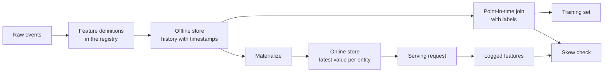

# خصائص الاحتفاظ والتدريب

> تمتلك صفة واحدة فقط تعريف واحد، ولكن هناك طريقتين للقراءة.

**Type:** Build
**Languages:** Python
**Prerequisites:** Phase 2，第 08 课（特征工程）、第 13 课（机器学习流水线）、第 15 课（时间序列）和第 19 课（机器学习系统设计）
**Time:** ~100 分钟

## 學习目标

- شرح معنى تخزين غير متصل، تخزين عبر الإنترنت، وقت الحدث، و TTL ومسؤولياتها
- 实现时点正确的关联,并展示简单关联 如何将未来值复制到训练数据中
- 列出训练服务偏差的四个原因: 两条代码路径、特征陈旧、默认值不同和时间穿越
-  بناء صفات التسجيل، جعل نفس المفهوم في نفس الوقت لطرق التدريب وطرق الخدمة
- في أيام الماضية، تعيد ملء الخصائص الجديدة، دون قراءة البيانات التي تظهر بعد كل يوم
- على نفس الكائن والحظة، مقارنة الخصائص في تاريخ الخدمة والخصائص التي تنشأ عن طريق التدريب، بحيث يتم فحص التباين

## 问题

تم بناء فريق على نموذج "تبيع المستخدمين" كل علامة تعبر عن عدم وجود عملية شراء للمستخدم خلال 30 يومًا بعد يوم التسجيل.`user_id`                                                                                                                                                                                                                                                              `days_since_last_purchase`訓練一条规则──離線准确率 0.948──

في التدفق الحقيقي، هذا النموذج لا يشبه الإصدار القديم أو الأبسط. يتم حفظ جدول الميزات أحدث قيمة لكل مستخدم، وقتها متأخر عن يوم العلامة أسابيع قليلة. يتم وضع آخر عملية شراء للمستخدم في السنة 115، حتى السنة 175، لذلك يتم احتواء الميزات نفسها على الإجابة. وفي الوقت نفسه، قام فريق آخر في خدمات مختلفة بإعادة كتابة منطق حساب الميزات عبر الإنترنت.

السبب الوحيد للانقصان هما: تمتدّين وخدمة الإنترنت باستخدام طريقتين مختلفتين لحساب نفس الخصائص. سيتم إعادة تشكيل كل جزء من مخزن الخصائص من الصفر. سوف تكتب بطاقة تسجيل.

## 概念

### نفس الصفة من اثنين من القراءة

التدريب والخدمة عبر الإنترنت على الخصائص مختلفة عن النوع:

| 属性 | 训练（离线） | 服务（在线） |
|---|---|---|
| 问题 | “一千万个（实体，时间）组合各自对应的值是什么？” | “这个实体现在的值是什么？” |
| 时间 | 过去的多个时点 | 当前 |
| 数据量 | 每个任务数百万行 | 每次请求一行 |
| 延迟 | 可以接受数分钟 | 几毫秒 |
| 存储 | 离线存储：在列式文件或数据仓库中保存带时间戳的完整历史 | 在线存储：在键值数据库中保存每个实体的最新值 |

خصائص الاحتفاظ وفقا للفئة ذاتية من الخصائص تعريف ملء هذه الفئات المختلفة من الاحتفاظ.



### 实体、时间  مع TTL

كل صفة من الخصائص يمكن أن تكون مع أربع تعبيرات:

- **实体（Entity）。**خصائص تصف أساسية العنصر، على سبيل المثال`user_id`أو`card_id`.
- **事件时间戳（Event timestamp）。**وقت تأسيس القيمة. 截至 14 天的购买次数,其事件时间就是 14 天.
- **创建时间戳（Created timestamp）。**系统写入该行的时刻──今日执行的回填会写入事件时间早些时候、创建时间为当前时间的行──
- **TTL（time to live，生存时间）。**يُعتبر قيمة تتل أكثر من السن المسموح به بالوصول إليها مفقودة، لذلك يستخدم القراء قيمة افتراضية.

مع نفس الكيانات 、 مصدر البيانات و مجموعة من الخصائص TTL ، عادة ما تسمى خصائص 图片 图片 图片 图片 图片 图片 图片 图片 图片 图片 图片 图片 图片 图片 图片 图片 图片 图片 图片 图片 图片 图片 图片 图片 图片 图片 图片 图片 图片 图片 图片 图片 图片 图片 图片 图片 图片 图片 图片 图片 图片 图片 图片 图片 图片 图片 图片 图片 图片 图片 图片 图片 图片 图片 图片 图片 图片 图片 图片 图片 图片 图片 图片 图片 图片 图片 图片 图片 图片 图片 图片 图片 图片 图片 图片 图片 图片 图片 图片 图片 图片 图片 图片 图片 图片 图片 图片 图片 图片 图片 图片 图片 图片 图片 图片 图片 图片 图片 图片 图片 图片 图片 图片 图片 图片 图片 图片 图片 图片 图片 图

### 时点正确的关联

يجب أن تكون علامة مع علامة على حد سواء قيمة الميزات الموجودة في الوقت الحالي.

1. 找到同一实体的特征行程──
2. فقط الحفاظ على وقت الحدث 不晚于标签时间 的行行.
3. خذوا آخر خط منها
4. إذا كان الوقت المحدد لخفض وقت الحدث يفوق TTL، فلن نترك هذا الطريق.

أظهر أدناه علامة مستخدم، والعلامة التي تم إنشاؤها أسبوعياً:

| 特征行日期 | `purchases_30d` | 时点关联 | 仅按 `user_id` 进行朴素关联 |
|---|---|---|---|
| 7 | 4 | | |
| 14 | 3 | 选中 | |
| 21 | 1 | 未来 | |
| 28 | 0 | 未来 | 选中 |

يظهر العلامة أن عدد المشترين هو 0، لأن المستخدم توقف عن الشراء، وهذا هو واقع قياس العلامة البيانية، وبساطة، يُنسخ الإجابة إلى الإدخال.

时间序列一课按时间分分数据,也是出于同样的原因──时点关联将这条规则应用于每一行,而不是只是一个分时点──

###  تدريب  سبب اختلاف الخدمة

قواعد تعلم الآلة في جوجل تعرّف اختلافات الخدمة في التدريب على اختلافات الأداء خلال التدريب على خدمة الإنترنت، وتصف ثلاثة أسباب: تغيرات في طريقة معالجة البيانات على خطوط المياه المتدفقة بين التدريب والخدمة، وكذلك تغيرات في المعلومات بين الطرق المتدفقة على المياه المتدفقة على المياه المتدفقة على المياه المتدفقة على المياه المتدفقة على المياه المتدفقة على المياه المتدفقة على المياه المتدفقة على المياه المتدفقة على المياه المتدفقة على المياه المتدفقة على المياه المتدفقة على المياه المتدفقة على المياه المتدفقة على المياه المتدفقة على المياه المتدفقة على المياه المتدفقة على المياه المتدفقة على المياه المتدفقة على المياه المتدفقة على المياه المتدفقة على المياه المتدفقة على المياه المتدفقة على المياهات المتدفقة على المياهمة:

| 原因 | 发生的情况 | 演示中的例子 |
|---|---|---|
| 两条代码路径 | 训练与服务使用不同代码计算特征 | 服务窗口包含 `now - 30` 这一天，训练窗口却不包含 |
| 特征陈旧 | 服务读取的值与训练所用值的年龄不同 | 训练读取每周快照，而新服务计算实时的新值 |
| 默认值不同 | 两条路径对缺失值的填充方式不同 | 对“尚未购买”，训练使用 365，服务使用 -1 |
| 时间穿越 | 训练读取了标签时刻之后的值 | 朴素关联为每个标签读取最新快照 |

كما يطلب قانون المادة 32 من الاتحاد أن يتم إعادة استخدام الكود قدر الإمكان بين تدريبات التدريب والخدمات.

### الميزات المرجعية

فهرسة الـرجستير هي قائمة محددة للخصائص. كل مقالة تحتوي على اسم، كيان، مصدر بيانات، تغيير، نافذة، قيمة افتراضية، TTL، المسؤول، الإصدار والوصف.

两条规则可以保证其安全性:

- 两条路径都从注册表读取定义――任何服务都不能自维护变换逻辑的副本――
- 修改定义时创建新版本──旧版本继续保留,让旧模型仍然可以使用训练时的特征──

### 回填

لا يوجد تاريخ في هذه الصفحة، ولكن التدريب يتطلب أن يتم تعديلها في كل علامة تاريخية.

تكلفة الحسابات المكتوبة مع زيادة عدد الكيانات وعدد الأيام. يمكن أن تجلب أيضا تسريبات مخفية: اليوم تنفيذ الردوم على الرغم من كتابة وقت سابق من الأحداث، ولكن يمكن أن تقرأ البيانات المتأخرة أو البيانات التي تم تعديلها لاحقا.

### 检测偏差

كما يتطلب القواعد في المادة 29 من الاتحاد الأوروبي تسجيل الخصائص المستخدمة عند الخدمة، وتستخدمها للتدريب. حتى لو سجل عدد قليل من العينات، يمكن أيضًا فحص التوافق.

为了定位原因,比较以下三组结果:

1. في محفظة الوقائع على الانترنت نتائج القراءة و التدريبات
2. نتائج إعادة الحساب في الوقت الحقيقي مرتبطة بالنتائج التدريبية.
3. المادة الثانية: طريقة الكود والنتيجة التي يتم إعادة حسابها في الوقت الحقيقي.

```figure
mlprod-pit-join
```

## 动手构建

`code/main.py`يستخدم الكود الوسطى فقط المقاييس. وقت مع عدد من أيام.

### الخطوة الأولى: الميزة المحددة مع المرجس

`FeatureDefinition`سوف تغير تعبير البيانات: طريقة جمع  النوافذ والقيمة المتضمنة`compute`方法绝不会读取 `as_of`بعد الحادث

```python
@dataclass(frozen=True)
class FeatureDefinition:
    name: str
    entity: str
    aggregate: str
    window_days: int | None
    default: float
    version: int = 1
    owner: str = "growth-team"
    description: str = ""

    def compute(self, events: list[Event], as_of: int) -> float:
        visible = [e for e in events if e.day <= as_of]
        if self.window_days is not None:
            visible = [e for e in visible if e.day > as_of - self.window_days]
        if self.aggregate == "count":
            return float(len(visible))
        if self.aggregate == "sum":
            return round(sum(e.amount for e in visible), 2)
        if self.aggregate == "days_since_last":
            return float(as_of - max(e.day for e in visible)) if visible else self.default
        raise ValueError(f"unknown aggregate {self.aggregate!r}")
```

`FeatureRegistry.register`يسمح بإعادة التسجيل نفس التعريف، ولكن يرفض اسمها ونسخة نفسها، لكن المحتويات مختلفة تعريفها.`fill_defaults`يوفر قيمة غياب الطرق نفس القيمة المتبنية.

模型通过 `spend_30d@1`هذا هو المفهوم المثبت`compute`和 `fill_defaults`会解析引用,不含 `@`نسمة: نسمة: نسمة: نسمة: نسمة: نسمة: نسمة: نسمة: نسمة: نسمة: نسمة: نسمة: نسمة: نسمة: نسمة: نسمة: نسمة: نسمة: نسمة: نسمة: نسمة: نسمة: نسمة: نسمة: نسمة: نسمة: نسمة: نسمة: نسمة: نسمة: نسمة: نسمة: نسمة: نسمة: نسمة: نسمة: نسمة: نسمة: نسمة: نسمة: نسمة: نسمة: نسمة: نسمة: نسمة: نسمة: نسمة: نسمة: نسمة: نسمة: نسمة: نسمة: نسمة: نسمة: نسمة: نسمة: نسمة: نسمة: نسمة: نسمة: نسمة: نسمة: نسمة: نسمة: نسمة: نسمة: نسمة: نسمة: نسمة: نسمة: نسمة: نسمة: نسمة: نسمة: نسمة: نسمة: نسمة: نسمة: نسمة: نسمة: نسمة: نسمة: نسمة: نسمة: نسمة: نسمة: نسمة: نسمة: نسمة: نسمة: نسمة: نسمة: نسمة: نسمة: نسمة: نسمة: نسمة: نسمة: نسمة: نسمة: نسمة: نسمة: نسمة: نسمة: نسمة: نسمة: نسمة: نسمة: نسمة: نسمة: نسمة: نسمة: نسمة: نسمة: نسمة: نسمة: نسمة: نسمة: نسمة: نسمة: نسمة: نسمة: نسمة: نسمة: نسمة: نسمة: نسمة: نسم`@`لكن لا يوجد نسخة من المقالة`ValueError`، لذلك لا يُرجح أن يُقرأ الأخطاء في الإصدار الأخير دون تحذير.

### الخطوة الثانية: إعادة ملء مخزن

```python
def backfill(registry: FeatureRegistry, names: list[str], events: list[Event], days: list[int]) -> list[FeatureRow]:
    rows = []
    for entity, entity_events in sorted(group_events(events).items()):
        for day in days:
            rows.append(FeatureRow(entity, day, registry.compute(names, entity_events, day)))
    return rows
```

عرض لمستخدمين 299 في 25 个快照日回填三个特征,共生成 7475 行──

### 步骤 3: 时点关联

أولاً حسب التاريخ للكل من الكائنات ترتيبًا مرة واحدة.`bisect_right`找到标签日当天或之前的最后一行.

```python
def point_in_time_join(labels: list[LabelRow], rows: list[FeatureRow], ttl_days: int | None = None) -> list[JoinedRow]:
    by_entity: dict[str, list[FeatureRow]] = defaultdict(list)
    for row in rows:
        by_entity[row.entity].append(row)
    days_index = {}
    for entity, entity_rows in by_entity.items():
        entity_rows.sort(key=lambda r: r.day)
        days_index[entity] = [r.day for r in entity_rows]
    joined = []
    for label in labels:
        days = days_index.get(label.entity, [])
        pos = bisect.bisect_right(days, label.day) - 1
        match = by_entity[label.entity][pos] if pos >= 0 else None
        if match is not None and ttl_days is not None and label.day - match.day > ttl_days:
            match = None
        joined.append(JoinedRow(
            label.entity, label.day, label.label,
            match.day if match else None, match.values if match else None,
        ))
    return joined
```

### الخطوة 4: قياس الصفحات التي تسببها

`naive_latest_join`فقط حسب المادة المرتبطة ، لذلك عود إلى كل علامة على أحدث الصفحات. العرض في المادة 100、120 و140 بناء علامة ، وتصميم قواعد واحدة على كل مجموعة تدريب.

```console
  naive join used a snapshot from after the label day for 100% of rows
  offline accuracy, naive join: 0.948 (rule: idle > 53 days)
  offline accuracy, PIT join:   0.893 (rule: idle > 19 days)
  accuracy on day 145, trained with naive join: 0.763
  accuracy on day 145, trained with PIT join:   0.876
```

أداء الانفصال من الجوالات أفضل: 0.948 مقابل 0.893 ولكن في البيانات الجديدة أسوأ: 0.763 مقابل 0.876، سيتم تكييف خصائص التسريب من أعداد التسريبات من 19 إلى 53 

### الخطوة 5: تخزين على الإنترنت والتجسيد

في التخزين على الإنترنت للكل الفرد الحفاظ على صف واحد، ومرفض تجاوز صف TTL.`materialize`فقط اكتب في يوم لا تأخر من المهام

```python
class OnlineStore:
    def __init__(self, ttl_days: int):
        self.ttl_days = ttl_days
        self._latest: dict[str, FeatureRow] = {}

    def write(self, row: FeatureRow) -> None:
        current = self._latest.get(row.entity)
        if current is None or row.day >= current.day:
            self._latest[row.entity] = row

    def read(self, entity: str, now: int) -> dict[str, float] | None:
        row = self._latest.get(entity)
        if row is None or row.day > now or now - row.day > self.ttl_days:
            return None
        return dict(row.values)
```

تتل لـ 10 天时, فإن القراءة في 145 天将返回第 140 天的行. إذا لم يكن هناك أي تجسيد جديد، فإن القراءة في 160 天将返回默认值, لأن هذه الجهة لديها 20 天的历史.

### الخطوة 6: الاختلاف

`detect_skew`مقارنة بينهما`(entity, day)`تعطي الرؤية المفتاحية. فإنه يبلغ عن النسبة غير المتطابقة لكل سمة ومتوسط الفوارق المطلق، عندما يزيد قيمتها عن 1٪ عند اختلافها. إذا كان الرؤية المفتاحية في الرؤية اثنين مختلفة أو لا يوجد أي مفتاح، فإنه سوف يثير.`ValueError` عدم وجود طلب يمكن أن يخفي الاختلافات، بينما لا يمكن للتحقق من طلب أن يوضح أي مشكلة.

```python
def detect_skew(
    training: dict[tuple[str, int], dict[str, float]],
    serving: dict[tuple[str, int], dict[str, float]],
    features: list[str],
    tolerance: float = 1e-6,
    max_mismatch_rate: float = 0.01,
) -> list[SkewReport]:
    if set(training) != set(serving):
        raise ValueError(f"{len(set(training) ^ set(serving))} keys are in only one view: log and compare the same requests")
    if not training:
        raise ValueError("no requests to compare")
    keys = sorted(training)
    reports = []
    for feature in features:
        diffs = [abs(training[k][feature] - serving[k][feature]) for k in keys]
        mismatches = sum(1 for d in diffs if d > tolerance)
        rate = mismatches / len(keys)
        mean_diff = sum(diffs) / len(keys)
        reports.append(SkewReport(feature, len(keys), rate, mean_diff, rate > max_mismatch_rate))
    return reports
```

 عرض سجلات من الرقم 141 إلى 150 من الطلبات،并运行概念部分介绍的三组比较── الطلبات تتضمن 20 مستخدما جديدا دون سجل تاريخي──

```bash
python3 code/main.py
```

```console
=== Skew checks on 383 logged requests, days 141 to 150 ===
  online store read  vs  training join (one definition, same snapshots)
    ok   days_since_last_purchase   mismatch   0.0%  mean |diff|    0.00
    ok   purchases_30d              mismatch   0.0%  mean |diff|    0.00
    ok   spend_30d                  mismatch   0.0%  mean |diff|    0.00
  fresh compute      vs  training join (staleness only)
    SKEW days_since_last_purchase   mismatch  83.0%  mean |diff|    2.77
    SKEW purchases_30d              mismatch  30.5%  mean |diff|    0.38
    SKEW spend_30d                  mismatch  37.1%  mean |diff|   16.77
  second code path   vs  fresh compute (code differences only)
    SKEW days_since_last_purchase   mismatch   5.5%  mean |diff|   20.07
    SKEW purchases_30d              mismatch  12.5%  mean |diff|    0.13
    SKEW spend_30d                  mismatch  12.5%  mean |diff|    5.09
```

اقرأ هذه المجموعات الثلاث:

- **同一定义、相同快照。**المحفظة على الإنترنت والتدريبات تتوافق مع نفس الخطوط المادية، وبالتالي فإن الاختلاف هو صفر.
- **陈旧性。**في معظم الطلبات، فإن قيمة الحساب في الوقت الحقيقي تختلف عن قيمة الفحص في الأسبوع.
- **代码差异。**طريقة الكود الثانية تختلف عن حساب النوافذ في 12.5% ، لأن نافذةها تحتوي على أكثر من يوم واحد.`days_since_last_purchase`تظهر الاختلافات، ولكن الاختلاف كبير: 1 مقابل 365

## استخدام الأدوات الحالية

الاحتفال هو مفتوح المصدر خصائص الاحتفاظ.

| 从零实现 | Feast |
|---|---|
| `FeatureDefinition`、`FeatureRegistry` | 特征仓库中的 `Entity`、`FeatureView` 和 `Field`，通过 `feast apply` 注册 |
| `FeatureRow` 历史记录 | 离线存储，例如基于 Parquet 文件的 `FileSource` 或数据仓库表 |
| 带 TTL 的 `point_in_time_join` | `store.get_historical_features(entity_df=..., features=[...])` |
| `materialize` | `feast materialize-incremental <end time>` |
| `OnlineStore.read` | `store.get_online_features(features=[...], entity_rows=[...])` |
| 创建时间戳检查 | 数据源上的 `created_timestamp_column` 和 `filter_by_created_timestamp=True` |

定义如下──这些代码遵循节日快速入门指南,运行本课不需要它们──

```python
from datetime import timedelta

from feast import Entity, FeatureView, Field, FileSource
from feast.types import Float32, Int64

user = Entity(name="user", join_keys=["user_id"])

user_activity_source = FileSource(
    name="user_activity_source",
    path="data/user_activity.parquet",
    timestamp_field="event_timestamp",
    created_timestamp_column="created",
)

user_activity = FeatureView(
    name="user_activity",
    entities=[user],
    ttl=timedelta(days=10),
    schema=[
        Field(name="purchases_30d", dtype=Int64),
        Field(name="spend_30d", dtype=Float32),
        Field(name="days_since_last_purchase", dtype=Int64),
    ],
    source=user_activity_source,
)
```

بعد ذلك، التدريب مع خدمات على الإنترنت

```python
from feast import FeatureStore

store = FeatureStore(repo_path=".")

training_df = store.get_historical_features(
    entity_df=labels_df,
    features=["user_activity:purchases_30d", "user_activity:days_since_last_purchase"],
    filter_by_created_timestamp=True,
).to_df()

online = store.get_online_features(
    features=["user_activity:purchases_30d", "user_activity:days_since_last_purchase"],
    entity_rows=[{"user_id": 42}],
).to_dict()
```

`labels_df`لكل علامة حفظ صف، يحتوي على`user_id`.`event_timestamp`و 标签: 文件指出,TTL 相对实体数据框中的每时间,而不是查询时刻.`point_in_time_join`مركز TTL 检查一致──同一页还介绍了 `filter_by_created_timestamp=True`، يمكن منع إعادة التعبئة من تسريب البيانات. ليس كل مخزن خارج الإنترنت يدعم هذا الخيار.

تم تعريف نظام التحقق من البيانات في منصة التعلم الآلي التالية: التدريب على التدريبات، والتي تتمثل في التدريب على التدريبات، والتي تتمثل في التدريب على التدريبات.

## 交付成果

本课产出 `outputs/skill-feature-skew-audit.md` المهارات المراجعة المميزة في الوقت خلال وتدريبات التداخل الخدمي، ثم فحص المرتبط المنطق، التعريف، القيمة الافتراضية، والجدولية البيانات في كل من الطرق، وكذلك التاريخ المطلوب لفحص التداخل.

## التدريب

1. 将快照间隔从 7 天改为 1 天――重新运行陈旧性比较,并解释结果――
2.  وضع TTL لـ 3 أيام  احصائيات كمية التدريبات التي فقدت خصائصها  تحويل وتحويل استخدام القيمة الاصطناعية 
3. لأجل`FeatureRow`添加创建日期──让关联忽略标签日后写入的行──
4. ستعمل`spend_7d`لـ`spend_30d`الإصدار 2.. ..إملأه، ومطبوعة إصدارين من المجلة
5. 修复 `legacy_serving_features`, حتى تمر المجموعة الثالثة من المراقبة

## 关键术语

| 术语 | 常见说法 | 实际含义 |
|------|----------------|----------------------|
| 特征存储 | “存特征的数据库” | 根据同一组定义计算特征，并同时提供给训练与在线服务的系统 |
| 离线存储 | “训练数据” | 带事件时间戳的完整特征历史，由训练任务和回填任务读取 |
| 在线存储 | “特征缓存” | 每个实体的最新值，供服务路径以毫秒级延迟读取 |
| 实体 | “ID” | 特征所描述对象的键，例如用户或银行卡 |
| 事件时间戳 | “何时发生” | 特征值成立的时刻 |
| 时点关联 | “截至某时刻的关联” | 为每个标签匹配标签时刻当天或之前的最新特征行 |
| TTL | “有效期” | 特征值在被读取方视为缺失之前允许达到的最大年龄 |
| 物化 | “同步到线上” | 将最新特征值从离线存储复制到在线存储的任务 |
| 回填 | “计算历史” | 在过去的日期执行特征定义，以生成其历史记录 |
| 训练—服务偏差 | “离线时明明有效” | 训练与在线服务中的特征或行为差异 |

## 延伸阅读

- [Feast：时点关联](https://docs.feast.dev/getting-started/concepts/point-in-time-joins):TTL 语义与创建时间过
- [Feast 文档](https://docs.feast.dev/): خصائص المشاهد ✓ تخزين خارج الإنترنت ✓ تخزين عبر الإنترنت وتجسيد
- [Google：《机器学习规则》](https://developers.google.com/machine-learning/guides/rules-of-ml): من المادة 29 إلى المادة 37  قواعد التدريب 
- [Breck 等：《机器学习的数据验证》（SysML 2019）](https://research.google/pubs/data-validation-for-machine-learning/)تحقيق البيانات من جوجل، بما في ذلك التدريب
- [TensorFlow Data Validation 指南](https://www.tensorflow.org/tfx/guide/tfdv): نمط التفتيش ∆ تفتيش التفاوت والتحركات التفتيش
- [Sculley 等：《机器学习系统中隐藏的技术债》（NeurIPS 2015）](https://papers.nips.cc/paper/2015/hash/86df7dcfd896fcaf2674f757a2463eba-Abstract.html): نموذج حول البيانات تعتمد على تدفق الخطوط التكنولوجية
