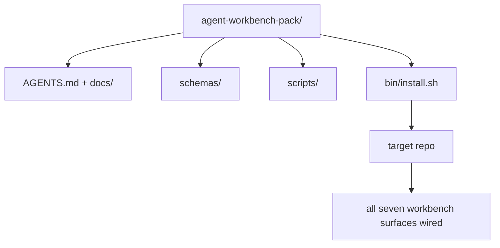

# كابستون:交付一个可复用代理工作板包

> هذه المسار الصغيره التي يمكن وضعها في أي حزمة من الاحتفاظ بها`cp -r`ثم في الصباح الباكر، دع العامل يعمل بشكل مستقر.

**类型：**بناء
**语言：**Python (stdlib)
**前置要求：**المراحل 14 · 31 إلى 14 · 41
**时间：**75 دقيقة

## 學习目标

- ستقوم بتجميع سبعة سطحات من المكتب المكتبي لتكون قائمة يمكن إدخالها مباشرة
- 固定 schema、script 和 template,让新 repo 获得已知可用基线──
- إضافة نص التثبيت، ووضع هذه الحزمة باستخدام 
- قرر ما يظل في الحزمة وما يظل في الخارج، وكل شخص يتحمل نفس الاختلاف.
- ظهور مرة واحدة من خلال وكيل  مساعدتها في الانتهاء من تغييرات المخزن، ومقدمة المراجعة قادرة على استعادة الأدلة:

## 问题

يوجد أحد أدوات Google Doc ‬ Chat ‬ History و3 أدوات مكتوبة في النص المذكور فقط، وهو أدوات مكتوبة في كل فترة. الحل هو حزمة من إصدارات: إعادة التأمين أو المجلد، الذي يحتوي على سطح، مخطط، والنص، بالإضافة إلى مرسوم إصدار يمكن تشغيله.

عندما تنتهي هذه الدورة، سوف تحصل على القرص`outputs/agent-workbench-pack/`ويمكن وضعها في أي ريبو هدف`bin/install.sh`.

## 概念



### ترتيب الحزمة

```
outputs/agent-workbench-pack/
├── AGENTS.md
├── docs/
│   ├── agent-rules.md
│   ├── reliability-policy.md
│   ├── handoff-protocol.md
│   └── reviewer-rubric.md
├── schemas/
│   ├── agent_state.schema.json
│   ├── task_board.schema.json
│   └── scope_contract.schema.json
├── scripts/
│   ├── init_agent.py
│   ├── run_with_feedback.py
│   ├── verify_agent.py
│   └── generate_handoff.py
├── bin/
│   └── install.sh
└── README.md
```

### ماذا ترك، ماذا وضع خارج

留下:

- مخطط السطح..
- أربعة نصوص أعلاه.
- أربعة أجزاء من المستندات.

وضعت خارج:

- المهام والمهام تنتمي إلى مجلس إدارة المستهدف، وليس من الحزمة.
- الموردين SDK 调用── هذا الحزمة مع الإطار 无关──
- إدخال 文案── هذا الحزمة  وضع فريق كان إدخال 旁边, بدلا من وضعها في ذلك──

### التركيب

قصيرة قصيرة`bin/install.sh`(أو `bin/install.py`):

1. لا يوجد`--force`عندما، رفض تغطية التثبيت حتى الحزمة
2. سوف نضع حزمة في غرضنا
3. إذا كان هناك`.github/workflows/`,إذا دخلت CI
4. 打印后续步骤: ملء اللوحة

### 版本管理

هذه الحزمة تحمل واحدة`VERSION`文件──需要迁移的 schema bump 和脚本 变更会出现重大突破──仅 doc 的变更会出现突破补丁──目标 repo 的 `agent_state.json`记录 it initiation وقت التجاوب مع إصدار الحزمة


```figure
wb-pack-install
```

## بناءها

`code/main.py`سأضع حزمة و أضعها في الجوار`outputs/agent-workbench-pack/`في وسط، لا تستخدم هذه المسار الصغير في المرحلة الأولى من الدروس، وكذلك المستند الذي كتبته بالفعل كنموذج.

运行它:

```
python3 code/main.py
```

هذا النص سوف يكرر ويمسك السطح، ويكتب في README، ويقوم بطبع شجرة الحزمة، ثم يخرج صفر.

## نمط في الإنتاج الحقيقي

حزمة واحدة فقط قادرة على تحمل الشوكة والتحديث والصداقة في الصعود تصل قيمةها.

**`VERSION` 是 contract，不是 marketing。**الضربة الرئيسية  تحتاج إلى الهجرة الحكومية ∙ الضربة الصغيرة  تحتاج إلى إعادة تشغيل المحقق ∙ الضربة المزيفة فقط تستخدم في الوثائق ∙ التركيب كل مرة تثبيت ∙`.workbench-version`写入目标 repo; إذا كان الهدف من قفل مع حزمة `VERSION`غير متوافق`lint_pack.py`سأرفض السحب`npm`.`Cargo`和 `pyproject.toml`يمكن أن تتحمل 10 سنوات من التأثيرات، وكيل لن يغير هذه القواعد.

**跨工具分发的单一来源。**نكس  إعطاء واحد `nx ai-setup`, من إعداد واحد وضع `AGENTS.md`.`CLAUDE.md`.`.cursor/rules/`.`.github/copilot-instructions.md`和一个MCP服务──这个包也应该这样做;安装器 输出 symlink(`ln -s AGENTS.md CLAUDE.md`), دعم واحد من الحقيقة من مصدر إلى كل وكيل التشفير ∙ ‬ ‬ ‬ ‬ ‬ ‬ ‬ ‬ ‬ ‬ ‬ ‬ ‬ ‬ ‬ ‬ ‬ ‬ ‬ ‬ ‬ ‬ ‬ ‬ ‬ ‬ ‬ ‬ ‬ ‬ ‬ ‬ ‬ ‬ ‬ ‬ ‬ ‬ ‬ ‬ ‬ ‬ ‬ ‬ ‬ ‬ ‬ ‬ ‬ ‬ ‬ ‬ ‬ ‬ ‬ ‬ ‬ ‬ ‬ ‬ ‬ ‬ ‬ ‬ ‬ ‬ ‬ ‬ ‬ ‬ ‬ ‬ ‬ ‬ ‬ ‬ ‬ ‬ ‬ ‬ ‬ ‬ ‬ ‬ ‬ ‬ ‬ ‬ ‬ ‬ ‬ ‬ ‬ ‬ ‬ ‬ ‬ ‬ ‬ ‬ ‬ ‬ ‬ ‬ ‬ ‬ ‬ ‬ ‬ ‬ ‬ ‬ ‬ ‬ ‬ ‬ ‬ ‬ ‬ ‬ ‬ ‬ ‬ ‬ ‬ ‬ ‬ ‬ ‬ ‬ ‬ ‬ ‬ ‬ ‬ ‬ ‬ ‬ ‬ ‬ ‬ ‬ ‬ ‬ ‬ ‬ ‬ ‬ ‬ ‬ ‬ ‬ ‬ ‬ ‬ ‬ ‬ ‬ ‬ ‬ ‬ ‬ ‬ ‬ ‬ ‬ ‬ ‬ ‬ ‬ ‬ ‬ ‬ ‬ ‬ ‬ ‬ ‬ ‬ ‬ ‬ ‬ ‬ ‬ ‬ ‬ ‬ ‬ ‬ ‬ ‬ ‬ ‬ ‬ ‬ ‬ ‬ ‬ ‬ ‬ ‬ ‬ ‬ ‬ ‬ ‬ ‬ ‬ ‬ ‬ ‬ ‬ ‬ ‬ ‬ ‬ ‬ ‬ ‬ ‬ ‬ ‬ ‬ ‬ ‬ ‬ ‬ ‬ ‬ ‬ ‬ ‬ ‬ ‬ ‬ ‬ ‬ ‬ ‬ ‬ ‬ ‬ ‬ ‬ ‬ 

**`uninstall.sh` 会在存在非平凡 state 时拒绝执行。** إزالة هذا الحزمة غير قادر على حذف المستخدم `agent_state.json`.`task_board.json`أو`outputs/`❖المُفصل سوف يُحذف النظام 、الوسم المخطط 、الدوك`AGENTS.md`(带 `--keep-agents-md`الامتناع عن الخروج) ، وإذا كان هناك أي تغييرات لم يتم تقديمها في ملف الدولة ، فرفض الاستمرار.

**Skill-as-publishable。SkillKit-style 分发。**هذه الحزمة كمهارة SkillKit 交付:`skillkit install agent-workbench-pack`سوف يضعها من مصدر واحد إلى 32 وكيلًا ذكيًا.

## استخدمها

الحزمة في ثلاثة أماكن:

- **作为一个你放进 repo 的目录。** `cp -r outputs/agent-workbench-pack /path/to/repo`.
- **作为一个公开 template repo。**- المفرق و التخصيص،并用 `VERSION`-تحكم في التنقل
- **作为一个 SkillKit skill。**إدخال وكيلك المنتجات، دع الأمر ينجح ووضعها

الحزمة هي وصفة.

## 交付 it

`outputs/skill-workbench-pack.md`سوف تولد حزمة للتعديل المخصصة للمشروع: القواعد سوف تتخذ من تاريخ الفريق أكثر وضوحاً، وسعة العالم سوف تتطابق مع النظام التنفيذي، وبعدها الرسمي سوف يوسع إلى نطاق محدد

## التدريب

1. قرر أي وثيقة خيارية الخامسة تستحق الترقية إلى الحزمة القنونية
2. استخدام Python 重写 التركيب،并添加 `--dry-run`العلم. ستعمل التجربة على النحو المُقارن مع البش.
3. إضافة واحدة`bin/uninstall.sh`و أمن نقل الحزمة و إرسالها إلى ملفات الدولة
4. إضافة واحدة`lint_pack.py`, كن حزمة`VERSION`时失败──把它插入包 自身 repo 的 CI──
5. كتابة كتابة من مقعد العمل المهني إلى كتابة هذه الحزمة.

## 职业实践: اثبات تغيرات في المستودع

打包演示证明组装程序能够运行并生成文件──它不能证明您的代理能完成新任务──生成的检查能够验证该任务,或已部署的系统能正常工作──请区分这些结论──

في مخزن تملكه أو تمكنه من تعديله، اختر مهمة صغيرة حقيقية. استخدم وكيل برمجة تمكنك من الوصول إليه. حتى يمكن تعديل العيوب.

وبالإضافة إلى التجربة المختلفة، سوف تقوم بتنسيق المخططات التالية إلى المخططات الخاصة بك.`learning-artifacts/`الحفاظ على الأماكن والحزمة الموجودة في المخزن كمعلومات مرجعية

### 1. 明确任务并选择自主程度

استخدام إطار المهمة في الدورة 43 وخطط الأدلة في الدورة 44. سجّل الإصدار الأولي.

اختيار نمط عمل: التوجيه التدريجي ٬ التنفيذ من نقطة التفتيش ، أو تنفيذ مستقل واضح للحدود٬ شرح عدم اليقين٬ الآثار المحتملة والعكسية لماذا يدعم هذا الخيار٬

‬ ‬ ‬ ‬ ‬ ‬ ‬ ‬ ‬ ‬ ‬ ‬ ‬ ‬ ‬ ‬ ‬ ‬ ‬ ‬ ‬ ‬ ‬ ‬ ‬ ‬ ‬ ‬ ‬ ‬ ‬ ‬ ‬ ‬ ‬ ‬ ‬ ‬ ‬ ‬ ‬ ‬ ‬ ‬ ‬ ‬ ‬ ‬ ‬ ‬ ‬ ‬ ‬ ‬ ‬ ‬ ‬ ‬ ‬ ‬ ‬ ‬ ‬ ‬ ‬ ‬ ‬ ‬ ‬ ‬ ‬ ‬ ‬ ‬ ‬ ‬ ‬ ‬ ‬ ‬ ‬ ‬ ‬ ‬ ‬ ‬ ‬ ‬ ‬ ‬ ‬ ‬ ‬ ‬ ‬ ‬ ‬ ‬ ‬ ‬ ‬ ‬ ‬ ‬ ‬ ‬ ‬ ‬ ‬ ‬ ‬ ‬ ‬ ‬ ‬ ‬ ‬ ‬ ‬ ‬ ‬ ‬ ‬ ‬ ‬ ‬ ‬ ‬ ‬ ‬ ‬ ‬ ‬ ‬ ‬ ‬ ‬ ‬ ‬ ‬ ‬ ‬ ‬ ‬ ‬ ‬ ‬ ‬ ‬ ‬ ‬ ‬ ‬ ‬ ‬ ‬ ‬ ‬ ‬ ‬ ‬ ‬ ‬ ‬ ‬ ‬ ‬ ‬ ‬ ‬ ‬ ‬ ‬ ‬ ‬ ‬ ‬ ‬ ‬ ‬ ‬ ‬ ‬ ‬ ‬ ‬ ‬ ‬ ‬ ‬ ‬ ‬ ‬ ‬ ‬ ‬ ‬ ‬ ‬ ‬ ‬ ‬ ‬ ‬ ‬ ‬ ‬ ‬ ‬ ‬ ‬ ‬ ‬ ‬ ‬ ‬ ‬ ‬ ‬ ‬ ‬ ‬ ‬ ‬ ‬ ‬ ‬ ‬ ‬ ‬ ‬ ‬ ‬ ‬ ‬ ‬ ‬ ‬ ‬ ‬ ‬ ‬ ‬ ‬ ‬ ‬ ‬ ‬ ‬ ‬ ‬ ‬ ‬ ‬ ‬

### 2.  إعداد الحد الأدنى من البيئة المفيدة

查找相关实现、调用方、测试和本地指令──记录每一个来源为什么应进入上下文,以及哪些证据可以推翻过去的笔记──不要默认加载整个仓库──

لجميع التوسعات ذات الصلة تحديد الخيار: مهارات  مهارات  تقديم عمليات قابلة للاستخدام المكرر  MCP 工具 provide access ability 子  هوك  إجراء فحص اليقين 插件  پلجن 打包提供能力── فقط الاحتفاظ بالمهام التي تحتاج إليها في التوسع،并只授予使其正常工作所需的最小权限──

记录 a new addition you were rejected will bring on below or maintenance costs.  إعادة التحقق من تذكرة أو تعليمات سابقة. إذا كان الأدلة تدعم الإلغاء أو البدلة، فمن الممكن أن يتم تنفيذها في بيئة تعلم تديرها بنفسك.

### 3. 记录基线并实现

编辑之前,运行最相关现有检查,展示现有检查,展示现有状态,保留命令,版本,结果和证据位置,还有基线:记录实际观察的反应或未支持的操作.

让代理在任务约定内实现变更. 保留干预日志,说明每次纠正,权限变化或计划调整的原因. 委派是可选的; 如果确实有用, 之前增加另一个执行人, 首先应用第 45 课程责任归属与集成约定.

### 4. 质疑证据

选择能够观察变更界面的验证方式――对于 UI,重建,并对相关视口宽度下检查实际提供服务的用户流程――对于 API,检查请求和序列化后的响应――对于 CLI,运行构建后的命令,检查退出码和输出――选择任务所需的检查,并说明它们的局限性――

وفقا للمهمة تحدد بشكل مستقل كتابة النتيجة المتوقعة ، لا تنفيذ النتائج المطلوبة من وكيل. في نسخة واحدة ، يُدخّل نتيجة خطأ محددة ، مثل قبول عدم القيمة أو الإفشال الضروري.

إذا تمت مراجعة اعتقادها، أولاً تعزيز القرار أو طريقة المراقبة، وإعادة إعتقادها، وإعادة إدارة التنفيذ، وإعادة إعادة إدارة التنفيذ إلى المراقبة، وإعادة إعادة إعادة إدارة التنفيذ إلى المراقبة، وإعادة إعادة إعادة إعادة إعادة إعادة إعادة إعادة إعادة إعادة إعادة إعادة إعادة إعادة إعادة إعادة إعادة إعادة إعادة إعادة إعادة إعادة إعادة إعادة إعادة إعادة إعادة إعادة إعادة إعادة إعادة إعادة إعادة إعادة إعادة إعادة إعادة إعادة إعادة إعادة إعادة إعادة إعادة إعادة إعادة إعادة إعادة إعادة إعادة إعادة إعادة إعادة إعادة إعادة إعادة إعادة إعادة إعادة إعادة إعادة إعادة إعادة إعادة إعادة إعادة إعادة إعادة إعادة إعادة إعادة إعادة إعادة إعادة إعادة إعادة إعادة إعادة إعادة إعادة إعادة إعادة إعادة إعادة إعادة إعادة إعادة إعادة إعادة إعادة إعادة إعادة إعادة إعادة إعادة إعادة إعادة إعادة إعادة إعادة إعادة إعادة إعادة إعادة إعادة إعادة إعادة إعادة إعادة إعادة إعادة إعادة إعادة إعادة إعادة إعادة إعادة إعادة إعادة إعادة إعادة إعادة إعادة إعادة إعادة إعادة إعادة إعادة إعادة إعادة إعادة إعادة إعادة إعادة إعادة إعادة إعادة إعادة إعادة إعادة إعادة إعادة إعادة إعادة إعادة إعادة إعادة إعادة إعادة إعادة إعادة إعادة إعادة إعادة إعادة إعادة إعادة إعادة إعادة إعادة إعادة إعادة إعادة إعادة إعادة إعادة إعادة إعادة إعادة إعادة إعادة إعادة إعادة إعادة إعادة إعادة إعادة إعادة إعادة إعادة إعادة إعادة إعادة إعادة إعادة إعادة إعادة إعادة إعادة إعادة إعادة إعادة إعادة إعادة إعادة إعادة إعادة إعادة إعادة إ إ إ إعادة إعادة إ إ إ إعادة إ إ إ إ إعادة إعادة إ إ إ إ إ إ إ إ إ إعادة إعادة إ إ إ إ إ إ إ إ

على الرغم من الأهداف الأصلية والطريق الذي يسمح بالتغيير، فإن الاختلاف النهائي في المراجعة، بما في ذلك تغييرات في الاختبار.

### 5. 演练运行 مع استعادة

وسيتم وضع علامة على كل مشاهدة على أدوات التسليم التي تم تنفيذها في بيئة محلية أو في بيئة إصدار سابقة.`local`.`staging`أو`live`,并注明确版本或交付物标识──本地演练只支持本地结论;本练不要求部署到生产环境──

选择一个任务相关的失败信号,设定值、观察窗口和责任人──说明如何应应应应应应应应应应应应应应应应应应应应应应应应应应应应应应应应应应应应应应应应应应应应应应应应应应应应应应应应应应应应应应应应应应应应应应应应应应应应应应应应应应应应应应应应应应应应应应应应应应应应应应应应应应应应应应应应应应应应应应应应应应应应应应应应应应应应应应应应应应应应应应应应应应应应应应应应应应应应应应应应应应应应应应应应应应应应应应应应应应应应应应应应应应应应应应应应应应应应应应应应应应应应应应应应应应应应应应应应应应应应应应应应应应应应应应应应应应应应应应应应应应应应应应应应应应应应应应应应应应应应应应应应应应应应应应应应应应应应应应应应应应应应应应应应应应应应应应应应应应应应应应应应应应应应应应应应应应应应应应应应应应应应应应应应应应应应应应应应应应应应应应应应应应应应应应应应应应应应应应应应应应应应应应应应应应应应应应应应应应应应应应应应应应应应应应应应应应应应应应应应应应应应应应应应应应应应应应应应应应应应应应应应应应应应应应应应应应应应应应应应应应应应应应应应应应应应应应应应应应应应应应应应应应应应应应应应应应应应应应应应应应应应应应

演练回滚到已知可用交付物件,并检查是否恢复前行为. 适用时,应考虑持久化数据:仅取代二进制文件不一定能撤销数据变更.

### 6. 改进 下一次执行并交接

ويمكن أن يظهر المهمة الواحدة ما حدث في المهمة، لا يمكن أن يثبت وكيل ما بشكل عام أسرع أو أكثر موثوقية.

 وفقا للدراسة 46 ، سيتم تحويل تصحيحات واحدة واقعة إلى اختبار ‬ الحدود الأصغر للسلطة‬ عملية تلقائية أو مثالات أكثر وضوحا‬‬‬‬‬‬‬‬‬‬‬‬‬‬‬‬‬‬‬‬‬‬‬‬‬‬‬‬‬‬‬‬‬‬‬‬‬‬‬‬‬‬‬‬‬‬‬‬‬‬‬‬‬‬‬‬‬‬‬‬‬‬‬‬‬‬‬‬‬‬‬‬‬‬‬‬‬‬‬‬‬‬‬‬‬‬‬‬‬‬‬‬‬‬‬‬‬‬‬‬‬‬‬‬‬‬‬‬‬‬‬‬‬‬‬‬‬‬‬‬‬‬‬‬‬‬‬‬‬‬‬‬‬‬‬‬‬‬‬‬‬‬‬‬‬‬‬‬‬‬‬‬‬‬‬‬‬‬‬‬‬‬‬‬‬‬‬‬‬‬‬‬‬‬‬‬‬‬‬‬‬‬‬‬‬‬‬‬‬‬‬‬‬‬‬‬‬‬‬‬‬‬‬‬‬‬‬‬‬‬‬‬‬‬‬‬‬‬‬‬‬‬‬‬‬‬‬‬‬‬‬‬‬‬‬‬‬‬‬‬‬‬‬‬‬‬‬‬‬‬‬‬‬‬‬‬‬‬‬‬‬‬‬‬‬‬‬‬‬‬‬‬‬‬‬‬‬‬‬‬‬‬‬‬‬‬‬‬‬‬‬‬‬‬‬‬‬‬‬‬‬‬‬‬‬‬‬‬‬‬‬‬‬‬‬‬‬‬‬‬‬‬‬‬‬‬‬‬‬‬‬‬‬‬‬‬‬‬‬‬‬‬‬‬‬‬‬‬‬‬‬‬‬‬‬‬‬‬‬‬‬‬‬‬‬‬‬‬‬‬‬‬‬‬‬‬‬‬‬‬‬‬‬‬‬‬‬‬‬‬‬‬‬‬‬‬‬‬‬‬‬‬‬‬‬‬‬‬‬‬‬‬‬‬‬‬‬‬‬‬‬‬‬‬‬‬‬‬‬‬‬‬‬‬‬‬‬‬‬‬‬‬‬‬‬‬‬‬‬‬‬‬‬‬‬‬‬‬‬‬‬‬‬‬

### 的人工评审标准

رجاءً فحص المُنتقدين وثائق الأدلة، ومُرجح على الأقل أضعف فحصات الإقرارات.`demonstrated`(لقد أثبت)`needs revision`(تحتاج إلى تعديل) أو `unverified`(未验证) كحالة، في الوقت نفسه إعطاء دليل على الموقف والسبب.

| 维度 | 评审者应质疑的证据 |
|---|---|
| 任务与自主程度 | 初始行为、边界明确的目标、合理的权限与预算，以及可执行的停止规则 |
| 上下文与环境 | 相关来源、合理的工具访问权限，以及经过重新核查的退役决定 |
| 验证 | 变更前后的实际行为，以及相同检查能够拒绝的、刻意引入的错误结果 |
| 评审与运行 | 已检查的差异、独立质疑、标明环境的运行观测，以及演练过的恢复流程 |
| 迭代与交接 | 一项经过验证的改进、如实说明的局限、干净的最终状态，以及可复现的下一步行动 |

قبل أن يتم إعلان المهمة، حلّ العلامة`needs revision`السؤال: لا يمكن الحصول على دليل يجب أن يتم الاحتفاظ به`unverified`ويتم تقليل نطاق النتائج. مجموعة العمل تظهر قدرتك على الحكم في مجال المهام المحددة على الحدود، لا تضمن الحصول على وظيفة أو الحصول على شروط نشر.

## 交付物

حافظ على الحزمة المستخدمة وكل ما لديك[career-agent-evidence.md](https://github.com/rohitg00/ai-engineering-from-scratch/blob/main/phases/14-agent-engineering/42-agent-workbench-capstone/outputs/career-agent-evidence.md)副本──该模板将任务框架、执行计划、运行证书、审核、恢复演练和交互整合为一个可审核的案例研究──

## 关键术语

| 术语 | 人们常说 | 它实际含义 |
|------|----------------|------------------------|
| Workbench pack | “starter kit” | 一个带版本的目录，携带全部七个 surface |
| Installer | “Setup script” | 以幂等方式放置 pack 的 `bin/install.sh` |
| Pack version | “VERSION” | schema/script 变更使用 major bump，仅 doc 变更使用 patch |
| Drop-in pack | “cp -r and go” | Pack 在第一天无需按 repo 定制即可工作 |
| Forkable template | “GitHub template” | GitHub 的 “Use this template” 可以从中 clone 的公开 repo |

## 延伸阅读

- المراحل 14 · 31 إلى 14 · 41  هذه الحزمة 打包 كل سطح
- [SkillKit](https://github.com/rohitg00/skillkit)في 32 عميل ذكاء اصطناعي يثبتون هذه المهارة
- [Nx Blog, Teach Your AI Agent How to Work in a Monorepo](https://nx.dev/blog/nx-ai-agent-skills) 跨六种工具的单一来源发电机
- [agents.md — the open spec](https://agents.md/) توجيه حزمك  يجب أن تنفيذ المحتوى
- [HKUDS/OpenHarness](https://github.com/HKUDS/OpenHarness) تعادل الحزمة
- [Augment Code, A good AGENTS.md is a model upgrade](https://www.augmentcode.com/blog/how-to-write-good-agents-dot-md-files) حزمة الأدب
- [Anthropic, Effective harnesses for long-running agents](https://www.anthropic.com/engineering/effective-harnesses-for-long-running-agents)
- [Anthropic, Harness design for long-running application development](https://www.anthropic.com/engineering/harness-design-long-running-apps)
- المرحلة 14 · 30  消费 هذا الحزمة بوابة التحقق من تطوير وكيل القيادة على التقييم
- المرحلة 14 · 41  هذه الحزمة يجب تحسينها قبل / بعد مقياس الموازنة
