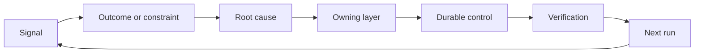

#  تكوين دورة ضدّ العقبات التي تملك آلية الانتماء والإسقاط

> إصدار الكود ينهي دورة بناء هذه الفترة، و يبدأ دورة تعلم طويلة الأمد.

**Type:** Learn + Build
**Languages:** Python (stdlib)
**Prerequisites:** Phase 14 lessons 46 and 53
**Time:** ~75 minutes

## 學习目标

- تحويل حادثات الإصابة، وتقييم البيانات، وتصرفات المستخدمين والتحديدات والتحديات إلى إجراءات ذات الخصومة المسؤولة.
- أن تكون هناك إشارات مختلفة على الطريق إلى أسفل
- تخصيص الأولويات لمخاطر الإصابة بالانفجارات المترتبة على الدرجة الزمنية والمرة المتكررة.
- لكل نظام نظام تحكم آلية تحديد ظروف الإنسحاب
- 沟通交付决策,提供证据,权衡取舍及明确负责决策者──

## و في نفسها هي أيضا البنية التحتية

يمكن لفريق واحد جمع الكثير من سلسلة النظام تتبع (تعقب) ، تقييم سجلات، دعم وحدة العمل والكوارث، ولكن لا تتعلم أي دروس إدراكية تماما من ذلك.**晋级通道（Promotion）**: أي من مشاهدة الحقائق، إلى امتلاك مسؤولية واضحة، والطريق الثابت لتغيير نظام استمرارية من الأدلة.

المرحلة الأخيرة:

1. 观测到具体实测信号؛
2. أن تكون مرتبطة بالنتائج المحددة أو الظروف المحددة أو افتراضات التوقعات
3. التعرف على أساسية مستوى النظام على تحمل المسؤولية عن هذا التحفيز
4. تنفيذ تحسينات مستمرة
5. 验证 تم تقليل احتمالية ارتفاع الوفيات
6. هل يجب أن يستمر المراجعة المنتظمة في إطار الجهاز المالي للسيطرة؟

## 精准路由至应对责任层级

| 信号类型 | 归属目的地 |
|---|---|
| 误报、功能倒退、错误输出结果 | 评测集（Evaluation）或自动化测试 |
| 上下文缺失、重复劳动、过时事实 | 上下文数据源或检索路由策略 |
| 不安全操作或越权漏洞 | 安全策略（Policy）或权限硬边界 |
| 超时、重试风暴、依赖服务不可用 | 运行时控制（Runtime Control） |
| 新的产品需求或尚未决断的权衡取舍 | 经过规范成型（Shaped）的待办项 |

عندما تكون القيود الآلية أو القاسية كافية لجعلها غير ممكنة تماما، لا تحتاج إلى إضافة نصيحة أخرى في المفاوضات.



## المسؤولية هي جزء من آلية التحكم

كل عملية محورية يجب أن تكون واضحة:

- 唯一的人类责任人 (مالك)
- التركيز على التركيز على التركيز على التركيز على التركيز على التركيز على التركيز على التركيز على التركيز على التركيز على التركيز على التركيز على التركيز على التركيز على التركيز على التركيز على التركيز على التركيز على التركيز على التركيز على التركيز على التركيز على التركيز على التركيز على التركيز على التركيز على التركيز على التركيز على التركيز على التركيز على التركيز على التركيز على التركيز على التركيز على التركيز على التركيز على التركيز على التركيز على التركيز على التركيز على التركيز على التركيز على التركيز على التركيز على التركيز على التركيز على التركيز على التركيز على التركيز على التركيز على التركيز على التركيز على التركيز على التركيز على الجهة.
- 拟修改的目标系统组件 (المصنوع) ؛
- إثبات أن إصلاح نظام التحقق من التحقق من التحقق من التحقق من التحقق من التحقق من التحقق من التحقق من التحقق من التحقق من التحقق من التحقق من التحقق من التحقق من التحقق من التحقق من التحقق من التحقق من التحقق من التحقق من التحقق من التحقق من التحقق من التحقق من التحقق من التحقق من التحقق من التحقق من التحقق من التحقق من التحقق من التحقق من التحقق من التحقق من التحقق من التحقق من التحقق من التحقق من التحقق من التحقق من التحقق من التحقق من التحقق من التحقق من التحقق من التحقق من التحقق من التحقق من التحقق من التحقق.
- نافذة إعادة النظر أو إغلاق التأثيرات الذاتية
- 明确的退役条件(شروط التقاعد)

ويتمّ إصدارها على نحوٍ ما، ويتمّ إصدارها على نحوٍ ما.

## 果断退役过时的控制机制

في هذه الحالات، يجب أن يكون هناك إطار فعال لمراجعة وإعادة إعلانات للسيطرة:

- تغيرات أساسية في بنية النظام أو عمليات العمل
- لقد استبدل الجهاز غير المتغير في المستوى السفلي إرشادات الكلمات في المستوى العلوي بشكل كامل.
- في نافذة الوقت المحددة، لم يظهر إعاقة محمية مرة أخرى.
- قواعد التحكم التي تعيق تردد تنفيذ الأعمال العادية، تجاوزت فوائدها المترتبة على الحماية من المخاطر.

كما يحتاج الهيئة إلى إثبات أنّه لا يمكن أن يُزيلها فقط لأنّها تبدو طويلة جداً.

## 打通 المنتجات بناء مع وكيل التشفير

ويمكن أن يكون هناك نفس الجهاز المحرك في خدمة العمل المنتج والتنمية الذكية على نفس الوقت:

- 產品业务实证驱动预期产出框架、假设图谱、最小切片或量度计划的演化;
- تحسين عملية إصلاح وكيل التشفير أو تحريك اختبار التلقائيات
- يمكن أن يؤدي إصابة الفشل الحقيقي على الخط إلى تعديل حدود وظائف المنتج، ويمكن أيضاً أن يؤدي إلى تعزيز الوكيل.

وهذا هو السبب في أن إطار المهمة لا يصل إلى مرحلة الإعلان قبل التدوين، بل يمر عبر كل تغيير يتم قبوله في النظام.

## 动手实现

هذا التجربة على إشارات التحقق من التفرقة، إنشاء دورة عمل من التأثيرات المرتبطة بالمسؤولية، حسب الترتيب الأولوي، والمخرج`outputs/feedback-backlog.json`.

```bash
python3 code/main.py
python3 -m unittest discover code/tests -v
```

尝试添加一个运行时超时信号,验证它将被正确路由到运行时控制层,而不是泛化混入通用需求待机列表.

## 实践实验: مسؤولة عن اتخاذ القرارات بعد الإصابة

من خلال مسار التعلم المهني الخاص بك، من بين المشاريع المكتوبة، اختر تدفق العمل. حولها، قم بإنجاز قرار، تجربة صغيرة، ومراجعة واحدة.[职业交付模板](https://github.com/rohitg00/ai-engineering-from-scratch/blob/main/phases/14-agent-engineering/54-build-the-feedback-ratchet/outputs/career-delivery-evidence.md)في الوسط

Python  تجربة تخلق مثالات انتظار عمل. انها لن تلاحظ المستخدم. لا تقيس نتائج الانتقال. ولا تثبت أنك تمتلك القدرة على المهنة.

### 1. من الواضح ما حدث

记录用户、任务、当前工作流,以及你希望改进的结果──链接到经过同意观察记录、已脱敏的支持记录,或可复制任务轨迹──区分你直接观察的事实、他人报告情况,以及你的推断──

找出一次挫折: افتراضات فشل 无法使用的结果 意外成本,或延误的交往―― شرح أدلة تغير فهمك

إذا لم تتمكن من التواصل مع المستخدم، فمن فضلكم قموا بتشغيل الملاحظات الموضحة، أو بناء على المشهد الموضح لتشغيل الملاحظات الموضحة.

### 2. في حدود السلطة

列出未知项目,选择成本最低,可逆,且有望解决影响最重大未知项目行动――说明哪些事可以由你决定,哪些选择受到既有约束,哪些操作需要获得授权才能执行――

على سبيل المثال، أثناء انتظار إذن استخدام بيانات العملاء، يمكنك أن تستعد أولاً لإعادة الإرسال غير المتواصلة المجهولة. الإستمرار الإجراءي يعني إتمام العمل المفروض، ويتم إيقاف القرارات التي سيتم اتخاذها.

### 3. مقارنة المخططات والتحديدات

لم يكن هناك حاجة لمعرفة التفاصيل، كتب شخصياً تقرير مختصر للقرار، ويشمل:

- مشاكل المستخدم، وكذلك دليل على التغييرات التي تمت
- على الأقل نوعان من الحلول؛ عندما يكون ذلك ممكناً بشكل معقول، إدراج الحلول الإنسانية الأقل تكلفة أو غير المطلوبة للتطوير؛
- الوزن على الجودة والتفاعل التصميم والعمل والتكلفة التشغيلية والخطر
- اقتراحاتك ̇ عدم اليقين المتبقي، وكذلك الحاجة لاتخاذ قرارات
- ‬المسؤولون عن اتخاذ القرار‬المصلحة المتأثرة، وموعد اتخاذ القرار‬‬‬‬‬‬‬‬‬‬‬‬‬‬‬‬‬‬‬‬‬‬‬‬‬‬‬‬‬‬‬‬‬‬‬‬‬‬‬‬‬‬‬‬‬‬‬‬‬‬‬‬‬‬‬‬‬‬‬‬‬‬‬‬‬‬‬‬‬‬‬‬‬‬‬‬‬‬‬‬‬‬‬‬‬‬‬‬‬‬‬‬‬‬‬‬‬‬‬‬‬‬‬‬‬‬‬‬‬‬‬‬‬‬‬‬‬‬‬‬‬‬‬‬‬‬‬‬‬‬‬‬‬‬‬‬‬‬‬‬‬‬‬‬‬‬‬‬‬‬‬‬‬‬‬‬‬‬‬‬‬‬‬‬‬‬‬‬‬‬‬‬‬‬‬‬‬‬‬‬‬‬‬‬‬‬‬‬‬‬‬‬‬‬‬‬‬‬‬‬‬‬‬‬‬‬‬‬‬‬‬‬‬‬‬‬‬‬‬‬‬‬‬‬‬‬‬‬‬‬‬‬‬‬‬‬‬‬‬‬‬‬‬‬‬‬‬‬‬‬‬‬‬‬‬‬‬‬‬‬‬‬‬‬‬‬‬‬‬‬‬‬‬‬‬‬‬‬‬‬‬‬‬‬‬‬‬‬‬‬‬‬‬‬‬‬‬‬‬‬‬‬‬‬‬‬‬‬‬‬‬‬‬‬‬‬‬‬‬‬‬‬‬‬‬‬‬‬‬‬‬‬‬‬‬‬‬‬‬‬‬‬‬‬‬‬‬‬‬‬‬‬‬‬‬‬‬‬‬‬‬‬‬‬‬‬‬‬‬‬‬‬‬‬‬‬‬‬‬‬‬‬‬‬‬‬‬‬‬‬‬‬‬‬‬‬‬‬‬‬‬‬‬‬‬‬‬‬‬‬‬‬‬‬‬‬‬‬‬‬‬‬‬‬‬‬‬‬‬‬‬‬‬‬‬‬‬‬‬‬‬‬‬‬‬‬‬‬‬‬‬‬‬‬‬‬‬‬‬‬‬‬‬‬‬‬‬‬‬‬‬‬‬‬‬‬‬‬‬‬‬‬‬‬‬

يرجى أن يكون زميلك يمثل أحد المصلحة المتأثرين، يشكّل في أحد هذه الوزنات.

### 4.  تنفيذ تجربة محددة

 وفقاً للطلبات التي يجيبها على السؤال، اختيار النوع الأولي أو المرحلة التجريبية أو المرحلة الإنتاجية للعمل.

من بداية المستخدم إلى إتمام المهمة ، فحص عملية التواصل بأكملها. أدخل في حالة خطأ في إصدار أو فقدان البيانات. لاحظ ما إذا كان المستخدم قادرًا على اكتشاف الفشل.

أن يتم حساب الوقت المُضي في المراجعة والتصحيح الإداري في جميع عمليات العمل.

### 5. مقارنة النتائج مع الاقتصادية

باستخدام نفس المؤشر تعريفات مجموعة المهام، وسيلة الاستخدام والنظرية المقارنة، وسجلات الأساسية والنتائج اللاحقة.

 إدراج نتائج المستخدم  مؤشر الجودة أو السلامة ، وكذلك إجمالي حجم المراجعة الإجمالية  حتى لو لم تصل النتائج إلى الهدف، يجب أن تكون في السجل الحقيقي  الاختبار أو المثابة فقط تدعم نطاق محدود من النتائج التعلمية، لا يمكن إثبات تأثير الأعمال 

 تقييم تكلفة كل مهمة تنجح في إنجازها، وتحديد استخدام النموذج، وإعادة التجربة، والخدمات المكافئة والتحقق الاصطناعي، وتوضيح فرضية القوة البشرية، وتمييز القيمة الفعلية والقيمة التقديرية، وتقارن هذه التكلفة مع خطة بديلة اصطناعية، أو فرضية القيمة الخلفية للمشروع،

من خلال ما هو موجود[LLM FinOps 课程](https://aiengineeringfromscratch.com/lesson?path=phases/17-infrastructure-and-production/27-finops-llms)، تعزيز التعلم التكلفة المرتبطة بقدرة الاقتصادية الوحيدة. النموذج المبدل هو فقط واحد من الطرق المحتملة للتعامل معه.

### 6. 完成闭环

وفقاً للمعايير المعلنة مسبقاً، فإن النصيحة تستمر، وتصلح أو تتوقف، إذا كان الأدلة لا تزال غير محددة، وتشير إلى عدم وجود مشاهدة، فضلاً عن الاختبار الواضح التالي، فانسجل رد فعل القرار الذي يتحمل المسؤولية؛ وإذا لم يتم اتخاذ قرار، فانسجل في حالة انتظار.

اختيار تحسينات في عملية التسليم نفسها: إطار مهم أكثر وضوحاً ✓ تغييرات مستخدمية أوائل ✓ تغييرات أفضل ✓ تغييرات أقل ✓ تغييرات أقل ✓ تغييرات أكثر أو أكثر

في المراجعة، قرر الاحتفاظ بالتحديث أو إيقاف التغييرات.

## 交付物

ستعمل[career-delivery-evidence.md](https://github.com/rohitg00/ai-engineering-from-scratch/blob/main/phases/14-agent-engineering/54-build-the-feedback-ratchet/outputs/career-delivery-evidence.md)复制到自己的项目,并使用证据链接填写. 让仓库中的模板保持可复制. 将决策简报,交互走查,量度比较,以及有明确责任归属后续行动,一并纳入你的职业作品集交付物品.

## 验证

مع زملاء استخدام المعايير الاصطناعية التالية.**met**(لقد تم)**needs work**(حاجة إلى تحسين) أو **not observed**(ليست مشاهدة) ،并提供证据链接或具体缺失的观测──填好了字段,并不能证明判断合理──

| 检查项 | 满足标准的证据 |
|---|---|
| 工作流有事实依据 | 可追溯的观测支持问题定义；他人报告、推断和模拟均有标记。 |
| 遵守授权边界 | 下一项可逆工作明确，任何受限操作都等待真正的决策责任人授权。 |
| 权衡沟通清晰 | 记录可信的替代方案、利益相关方的异议、建议，以及明确的决策请求。 |
| 交互经过测试 | 走查覆盖成功、失败、恢复，以及人工审核工作量。 |
| 结果经过比较 | 基线与后续度量的定义一致；样本、护栏指标、成本和比较局限清晰可见。 |
| 对挫折承担责任 | 证据改变了继续、调整或停止的决策，并导向一项有明确责任人的后续行动。 |
| 流程得到改进 | 一项工作流改进具备责任人、复审日期，以及基于证据的保留、修改或退役决定。 |

حتى لو تمت كل خطوة مُثلى، فإن سلوك المستخدم الحقيقي الذي لم يُشاهد لا يزال يحتوي على نقص في الأدلة.

## 课后练习

1. لنقل إلى إصابة قصيرة الأجل ومرجعية حقيقية للمستخدم، على حد سواء إلى تحويل إلى تحركات محورية محددة.
2. التعرف على أنّه قادر على منع إعادة ظهورها من الأساس إلى الأساس على مستوى النظام الأساسيّ.
3. لتحقيق التجارب المنتجة إضافة إلى إرشادات التحقق الآلي المطبقة أو إشارات المراقبة.
4. لـ قواعد استراتيجية الأمن القائمة وضع شروط واضحة للإسحاب من الخدمة
5. أن تكون المهام المُتعلقة بالتحديد والتحديد التي يتم قبولها من قبل النظام، والمتابعة المُعكسة، وترتبط في إطار المهمة التالي.

## 延伸阅读

- [Basili, Caldiera, and Rombach, The Goal Question Metric Approach](https://www.cs.toronto.edu/~sme/CSC444F/handouts/GQM-paper.pdf)، استكشاف كيفية تحقيق مستمرة التعرف على مستوى المنظمة من خلال آلية قياسية موجهة للأهداف.
- [Fagerholm et al., Building Blocks for Continuous Experimentation](https://doi.org/10.1145/2601248.2601276)، والتحليل سوف يثبت أن الأدلة الحقيقية والموارد المتواصلة والتنمية المتصلة مع المنتجات هي التقنية والتنظيمية.
- [Nuseibeh and Easterbrook, Requirements Engineering: A Roadmap](https://www.cs.toronto.edu/~sme/papers/2000/ICSE2000.pdf)، وضح الحاجة إلى النظر في وجهة نظر التطوير عبر كل نظام دورة حياة حركات التطور.

## 交付物沉

حافظ`outputs/feedback-backlog.json`كنموذج من الطريق،并保留你完成的职业交付证据,记录自己的决策──两者共同为产品判断力与交付(产品判断和交付)学习路径结尾,并为下一个预期产出框架提供依据──
