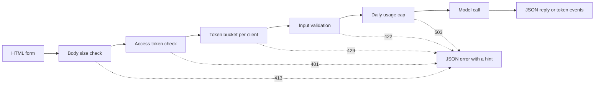

# 模型演示界面: من وظيفة إلى تطبيق قابل للمشاركة

> 模型演示有一个约定:输入、模型调用和输出──在分享链接之前,先为每部分设定限制──

**Type:** Build
**Languages:** Python
**Prerequisites:** Phase 11 · 13（构建生产级 LLM 应用）、Phase 17 · 08（推理指标）、Phase 17 · 19（AI 网关）
**Time:** ~90 分钟

## 學习目标

- 写出演示的输入、模型调用和输出约定,并设定限制为每部分──
- استخدام القاعدة المعيارية بناء تطبيق HTTP، يحتوي على صفحة HTML، نقطة JSON، ونقطة إرسال الحدث للخدم.
- 按成本 من أدنى إلى عالية التحقق إدخال،并返回 قادرة على إخبار المستخدم الخطوة التالية من عملية JSON 错误──
- استخدام كل بطاقة طلبات العملاء، الحد الأقصى من الكمية اليومية والمرسومات المتاحة للزيارة، حماية العروض العامة.
- 编写不保留输入文本和客户端地址的请求日志──
- مقارنة عرض المرجعية مع إصدارين من الإطار، وأشار إلى أن عرض يجب تحسينه إلى إشارة للمنتج.

## 问题

نموذجك قد تم تشغيله في دفتر الملاحظات. الآن، أحد المراجعين يريد أن يحاول إدخال 10 إدخالات، أحد العملاء يريد أن يرى النتيجة مرة واحدة على الهاتف.

المذكرة 单元格 بدون قيود إدخال، ولا يوجد تقدم يظهر.

- المستخدم يعلق على ملف 40،000 حرف.
- كتاب واحد يرسل 500 طلب في دقيقة واحدة. كل طلب يبدأ في إرسال نموذج دفع واحد.
- 页面八秒没有显示任何内容,于是用户又点击了四次按──
-                                                                                                                                                                                                                                                                                                                                                                                                                                                                                                                              

‬‬‬‬‬‬‬‬‬‬‬‬‬‬‬‬‬‬‬‬‬‬‬‬‬‬‬‬‬‬‬‬‬‬‬‬‬‬‬‬‬‬‬‬‬‬‬‬‬‬‬‬‬‬‬‬‬‬‬‬‬‬‬‬‬‬‬‬‬‬‬‬‬‬‬‬‬‬‬‬‬‬‬‬‬‬‬‬‬‬‬‬‬‬‬‬‬‬‬‬‬‬‬‬‬‬‬‬‬‬‬‬‬‬‬‬‬‬‬‬‬‬‬‬‬‬‬‬‬‬‬‬‬‬‬‬‬‬‬‬‬‬‬‬‬‬‬‬‬‬‬‬‬‬‬‬‬‬‬‬‬‬‬‬‬‬‬‬‬‬‬‬‬‬‬‬‬‬‬‬‬‬‬‬‬‬‬‬‬‬‬‬‬‬‬‬‬‬‬‬‬‬‬‬‬‬‬‬‬‬‬‬‬‬‬‬‬‬‬‬‬‬‬‬‬‬‬‬‬‬‬‬‬‬‬‬‬‬‬‬‬‬‬‬‬‬‬‬‬‬‬‬‬‬‬‬‬‬‬‬‬‬‬‬‬‬‬‬‬‬‬‬‬‬‬‬‬‬‬‬‬‬‬‬‬‬‬‬‬‬‬‬‬‬‬‬‬‬‬‬‬‬‬‬‬‬‬‬‬‬‬‬‬‬‬‬‬‬‬‬‬‬‬‬‬‬‬‬‬‬‬‬‬‬‬‬‬‬‬‬‬‬‬‬‬‬‬‬‬‬‬‬‬‬‬‬‬‬‬‬‬‬‬‬‬‬‬‬‬‬‬‬‬‬‬‬‬‬‬‬‬‬‬‬‬‬‬‬‬‬‬‬‬‬‬‬‬‬‬‬‬‬‬‬‬‬‬‬‬‬‬‬‬‬‬‬‬‬‬‬‬‬‬‬‬‬‬‬‬‬‬‬‬‬‬‬‬‬‬‬‬‬‬‬‬‬‬‬‬‬‬‬‬‬‬‬‬‬‬‬‬‬‬‬‬‬‬‬‬‬‬‬‬‬‬‬‬‬‬‬‬‬‬‬‬‬‬‬‬‬‬‬‬‬‬‬‬‬‬‬‬‬‬‬‬‬‬‬‬

## 概念

### العرض هو عقد

كل عرض له ثلاثة أجزاء. الإدخال هو المحتوى الذي يمكن للمستخدم إرساله. النموذج المستخدم سوف يُدخله إلى الناتج.

قبل كتابة الصفحة، أولاً، كتابة هذا التوافق:

| 部分 | 需要回答的问题 | 本课的答案 |
|------|--------------------|-----------------------|
| 输入 | 什么类型、多大、允许哪些字符？ | 长度为 1 到 500 个字符的字符串，不含控制字符 |
| 模型调用 | 一次调用需要多久、成本多少？ | 一个不到一毫秒即可运行完毕、没有调用费用的玩具关键词模型 |
| 输出 | 成功和失败时，用户分别看到什么？ | 标签、分数和回复，或带有操作提示的 JSON 错误 |

لم يحدد المذكرة أي قيود على هذه الأجزاء الثلاثة.



التفتيش على حسب التكلفة من التدبير منخفض إلى مرتفع. التفتيش لا ينفذ في أول مرة غير المرسلة، لذلك لا يستهلك تقريبا موارد الخادم.

### في نموذج النشاط قبل التحقق

يمكن للمصفح أن يفتش الإدخال قبل إرسال أي محتوى.`maxlength`和 `required`属性,无需网络调用就能向用户提供反────────────────────────────────────────────────────────────────────────────────────────────────────────────────────────────────────────────────────────────────────────────────────────────────────────────────────────────────────────────────────────────────────────────────────────────────────────────────────────────────────────────────────────────────────────────────────────────────────────────────────────────────────────────────────────────────────────────────────────────────────────────────────────────────────────────────────────────────────────────────────────────────────────────────────────────────────────────────────────────────────────────────────────────────────────────────────────────────────────────────────────────────────────────────────────────────────────────────────────────────────────────────────────────────────────────────────────────────────────────────────────────────────────────────────────────────────────────────────────────────────────────────────────────

لتحقيق الخادم حسب التكلفة من القليل إلى القليل:

1. 读取 `Content-Length`الطلبة الأولى: قبل أن تتلقى الطلبة، رفض تجاوز الحد المحدد للطلبة.
2. 解析 JSON 请求体──拒绝不是 JSON对象的请求体──
3. 检查字段──拒绝空文本、超长文本和控制字符──
4. فقط من خلال كل طلبات التفتيش، لكي تستهلك نموذج واحد

| 未通过的检查 | HTTP 状态 | 错误代码 |
|--------------|-------------|------------|
| 没有 `Content-Length` 请求头 | 411 Length Required（需要长度） | `length_required` |
| `Content-Length` 不是数字 | 400 Bad Request（错误请求） | `bad_length` |
| 请求体超过 4,096 字节 | 413 Content Too Large（内容过大） | `body_too_large` |
| 尚未收到 `Content-Length` 指定的字节数，请求体就停止传输 | 408 Request Timeout（请求超时） | `request_timeout` |
| 内容类型不是 JSON | 415 Unsupported Media Type（不支持的媒体类型） | `unsupported_media_type` |
| 请求体不是 JSON 对象 | 400 Bad Request（错误请求） | `bad_json` |
| 文本缺失、为空、过长或含有控制字符 | 422 Unprocessable Content（无法处理的内容） | `missing_text`、`empty_text`、`text_too_long`、`control_characters` |

RFC 9110 حدد هذه الحالات والإسمها

مثال هو جزء من تصميم الإدخال. مثال يظهر للمستخدم ما هو الإدخال المناسب، ويحتاج المراجع فقط إلى النقر مرة واحدة على أن يتم إجراء الاختبار.

### 让用户知道模型正在工作

模型调用可能需要几秒钟──如果没有反,用户无法区分模型缓慢和页面损坏──看不到变化用户可能再次点击,服务器就会收到第二个付费请求──

هذه الصفحة تُقدم أربعة أنواع:

- الطلبات ممنوعة خلال عملية التسجيل
- يظهر الوقت المستخدم، كل 100 مل ثانية يُجدد مرة واحدة.
- أول رمز وصل، أظهر أول رمز 时间
- رجاءً، إظهري كل الوقت

في تعلم[推理指标](../../08-inference-metrics-goodput/)时,首代币 时间(TTFT) هو مؤشر الخادم.

### إصدار إصدار

语言模型个别代币 生成回复. إذا كان الخادم ينتظر حتى آخر رمز 才发送، يجب على المستخدم الانتظار في عملية إنتاج كاملة.

服务器发送事件(Server-Send Events,SSE) هي النموذج المعيار لهذا النموذج`text/event-stream`كل حدث من مجموعة`event:`和 `data:`行组成,并以一个空行结束──WHATWG HTML 标准定义了这个格式──

```text
event: token
data: {"index":0,"text":"Label:"}

event: token
data: {"index":1,"text":" positive."}

event: done
data: {"label":"positive","score":1.0,"tokens":11}
```

浏览器提供用于 SSE 的 `EventSource`接口,但它只发送 GET 请求.GET 请求会将输入放入URL,而Web 服务器和代理会将URL 写入访问日志.`fetch()`和 `response.body.getReader()`读取响应,并自行解析事件格式──

流式响应存在单次 JSON 回复 没有问题: الخادم في التوكن الأول 之前就发送状态码 200。 إذا فشل النموذج في وقت لاحق، لا يمكن للخادم إعادة تغيير الحالة كود。 لذلك، الخادم سوف يرسل في التواريخ `error`حدث، من الصفحة ستظهر هذا الحدث على خطأ

في البناء[生产级 LLM 应用](../../../11-llm-engineering/13-production-app/)时,框架替你通过SSE 发送代币――本课写同协议,让你能够看到服务器发送的每一行――

###  كتابة المستخدم قادر على إصدار معلومات خاطئة عن هذه العملية

المعلومات الخاطئة لديها مهمتين: إخبار المستخدم ما حدث، وإخبار المستخدم التالي بما يجب فعله. بالنسبة لأولئك الذين لا يعرفون النظام، فإن التتبع لا يمكن إنجاز أي من هذه الأمور.

كل خطأ في هذا المظهر يستخدم نفس بنية JSON:

```json
{
  "error": {
    "code": "text_too_long",
    "message": "The text has 812 characters. The limit is 500.",
    "hint": "Shorten the text to 500 characters or fewer.",
    "request_id": "a8f3c2b435e3"
  }
}
```

- `code`هو اسم ثابت، و كود و اختبار استخدامه مقارنة.
- `message`陈述事实,并附上用户需要的数值──
- `hint`إعطاء مستخدم يمكن أن تنفيذ العملية.
- `request_id`将用户报告关联到一日志记录──

RFC 9457  حدد شكل الخطأ القياسي لـ API HTTP، يُطلق عليه تفصيل المشكلة (تفاصيل المشكلة)  هذا المقال يستخدم بنية أكثر تحديدا لتحقيق نفس الغرض  إذا كان فريق آخر سيستخدم API الخاص بك، فاستخدم RFC 9457‬‬‬‬‬‬‬‬‬‬‬‬‬‬‬‬‬‬‬‬‬‬‬‬‬‬‬‬‬‬‬‬‬‬‬‬‬‬‬‬‬‬‬‬‬‬‬‬‬‬‬‬‬‬‬‬‬‬‬‬‬‬‬‬‬‬‬‬‬‬‬‬‬‬‬‬‬‬‬‬‬‬‬‬‬‬‬‬‬‬‬‬‬‬‬‬‬‬‬‬‬‬‬‬‬‬‬‬‬‬‬‬‬‬‬‬‬‬‬‬‬‬‬‬‬‬‬‬‬‬‬‬‬‬‬‬‬‬‬‬‬‬‬‬‬‬‬‬‬‬‬‬‬‬‬‬‬‬‬‬‬‬‬‬‬‬‬‬‬‬‬‬‬‬‬‬‬‬‬‬‬‬‬‬‬‬‬‬‬‬‬‬‬‬‬‬‬‬‬‬‬‬‬‬‬‬‬‬‬‬‬‬‬‬‬‬‬‬‬‬‬‬‬‬‬‬‬‬‬‬‬‬‬‬‬‬‬‬‬‬‬‬‬‬‬‬‬‬‬‬‬‬‬‬‬‬‬‬‬‬‬‬‬‬‬‬‬‬‬‬‬‬‬‬‬‬‬‬‬‬‬‬‬‬‬‬‬‬‬‬‬‬‬‬‬‬‬‬‬‬‬‬‬‬‬‬‬‬‬‬‬‬‬‬‬‬‬‬‬‬‬‬‬‬‬‬‬‬‬‬‬‬‬‬‬‬‬‬‬‬‬‬‬‬‬‬‬‬‬‬‬‬‬‬‬‬‬‬‬‬‬‬‬‬‬‬‬‬‬‬‬‬‬‬‬‬‬‬‬‬‬‬‬‬‬‬‬‬‬‬‬‬‬‬‬‬‬‬‬‬‬‬‬‬‬‬‬‬‬‬‬‬‬‬‬‬‬‬‬‬‬‬‬‬‬‬‬‬‬‬‬‬‬‬‬

### السلامة وتشارك العرض العام

Public links will change the population of people who can send requests.

| 风险 | 本演示中的控制措施 | 面向更多受众的控制措施 |
|------|----------------------|-------------------------------|
| 单个客户端发送过多请求 | 每客户端一个令牌桶，配合 429 和 `Retry-After` | 登录后按用户限流 |
| 陌生人发现链接 | `Authorization` 请求头中的可选访问令牌 | 通过身份提供方实现单点登录 |
| 总成本无限增长 | 每日用量上限，配合 503 和 `Retry-After` | 模型提供方的支出限制和告警 |
| 输入非常大或异常 | 请求体大小限制、文本长度限制、控制字符检查 | 输入与输出的内容审核 |
| 日志保留私人输入 | 只记录输入长度和客户端的带密钥哈希 | 日志保留期限与访问控制 |

جعل بطاقة استخدام اثنين من القيم. القدرة تحديد واحد من المستخدمين الأكثر قدرة على إرسال الطلبات. سرعة الإضافة تحديد طول المدة الطلبات. كل طلب استهلاك واحد من الأوراق، بطاقة إضافة مستمرة، ولكن لا تتجاوز القدرة:

```text
tokens = min(capacity, tokens + refill_rate * seconds_since_last_request)
accept the request if tokens >= 1, then subtract 1
```

桶为空时, الخادم يعود `429 Too Many Requests`RFC 6585 定义了状态码 429,并允许服务器附带 `Retry-After`响应头──本演示始终添加该响应头,给出距离下一个令牌可用还需要等待的数秒──页面读取响应头,并在此期间禁用按──

演示 استخدام عنوان IP المستخدم كمفتاح للقنبلة. في الخلفية المتجهة للوكيل، كل طلب من عنوان الوكيل، لذلك جميع المستخدمين سوف تشارك قنبلة واحدة.

في تعلم [AI 网关](../../19-ai-gateways/)عندما، تتطلب النظام التنفيذي للعملاء نفس التحكم، فقط الحجم الأصغر. الحد من التحكم في كل من العملاء، ولكن لا يتحكم في الحجم الكلي. حتى لو لم يتجاوز كل من المستخدمين الحد المحدد، فإنه لا يزال من الممكن أن يستهلك كل الميزانية.

اليوميات والإدخال أيضاً تحتاج إلى معالجة حذرة.`http.server`يكتب المعالج عنوان IP المستخدم وطلبها إلى خطأ قياسي. إذا كان الإدخال في عنوان URL، فإن الإدخال سيذهب إلى日志. هذا العرض يبدل هذا النشرة. كل طلب يكتب فقط سجلًا واحدًا، يحتوي على طريق، رمز الحالة، رمز الخطأ والتأخير وطول الإدخال.

 أخبر المستخدم ما الذي تحتفظ به ‬‬‬‬‬‬‬‬‬‬‬‬‬‬‬‬‬‬‬‬‬‬‬‬‬‬‬‬‬‬‬‬‬‬‬‬‬‬‬‬‬‬‬‬‬‬‬‬‬‬‬‬‬‬‬‬‬‬‬‬‬‬‬‬‬‬‬‬‬‬‬‬‬‬‬‬‬‬‬‬‬‬‬‬‬‬‬‬‬‬‬‬‬‬‬‬‬‬‬‬‬‬‬‬‬‬‬‬‬‬‬‬‬‬‬‬‬‬‬‬‬‬‬‬‬‬‬‬‬‬‬‬‬‬‬‬‬‬‬‬‬‬‬‬‬‬‬‬‬‬‬‬‬‬‬‬‬‬‬‬‬‬‬‬‬‬‬‬‬‬‬‬‬‬‬‬‬‬‬‬‬‬‬‬‬‬‬‬‬‬‬‬‬‬‬‬‬‬‬‬‬‬‬‬‬‬‬‬‬‬‬‬‬‬‬‬‬‬‬‬‬‬‬‬‬‬‬‬‬‬‬‬‬‬‬‬‬‬‬‬‬‬‬‬‬‬‬‬‬‬‬‬‬‬‬‬‬‬‬‬‬‬‬‬‬‬‬‬‬‬‬‬‬‬‬‬‬‬‬‬‬‬‬‬‬‬‬‬‬‬‬‬‬‬‬‬‬‬‬‬‬‬‬‬‬‬‬‬‬‬‬‬‬‬‬‬‬‬‬‬‬‬‬‬‬‬‬‬‬‬‬‬‬‬‬‬‬‬‬‬‬‬‬‬‬‬‬‬‬‬‬‬‬‬‬‬‬‬‬‬‬‬‬‬‬‬‬‬‬‬‬‬‬‬‬‬‬‬‬‬‬‬‬‬‬‬‬‬‬‬‬‬‬‬‬‬‬‬‬‬‬‬‬‬‬‬‬‬‬‬‬‬‬‬‬‬‬‬‬‬‬‬‬‬‬‬‬‬‬‬‬‬‬‬‬‬‬‬‬‬‬‬‬‬‬‬‬‬‬‬‬‬‬‬‬‬‬‬‬‬‬‬‬‬‬‬‬‬‬‬‬‬‬‬‬‬‬‬‬‬‬‬‬‬‬‬‬‬‬‬‬‬‬‬‬‬‬‬‬‬

### 演示何时成为产品

الاحتفال من خلال عملية توفير الخدمة، وتوجيه إلى مجموعة من الناس المعروفين والتفاصيل.

- كل شخص خارج الفريق يستخدمها كل أسبوع
- قد أُقترح شخص ما أهداف قابلة للتطبيق أو تقرير خدمة التقطيع.
- مستخدم طلب الدخول أو حفظ النتائج أو مشاهدة التاريخ
- تكلفة النموذج الأسبوعي تصبح مشروعًا في الميزانية.
- المعلومات المحتملة تحت العقد أو القانون

| 属性 | 演示 | 产品 |
|----------|------|---------|
| 用户 | 已知人群，短时会话 | 未知人群，每日使用 |
| 状态 | 无 | 账户、历史、已保存的结果 |
| 可用性 | 尽力而为，单进程 | 书面目标、副本、值班责任人 |
| 成本控制 | 一个每日用量上限 | 每用户配额和计费 |
| 可观测性 | 每请求一条日志 | 链路跟踪、指标和告警 |

عندما نرى هذه الإشارات، يجب أن تنتقل المثار إلى التكنولوجيا الإنتاجية في درجة الإنتاج LLM التطبيقات في الدورات التدريبية.

```figure
demo-token-bucket
```

## 动手构建

كود فقط وثيقة واحدة`code/main.py`, لا تحتاج إلى أي اعتماداً خارج المقاييس

```bash
python3 code/main.py
```

تتحقق نفسها من المحققات، وتحديد النموذج، فضلا عن اتصال HTTP حقيقي للعودة إلى الوراء.

```bash
python3 code/main.py --serve
```

في المتصفحات مفتوح`http://127.0.0.1:8000` على كترل+س 停止服务器‬

### 第1 步:模型调用

النموذج هو جهاز حاسبة الكلمات الرئيسية، وسوف يتم تسجيل النص على الصورة الصالحة أو السلبية أو الوسطى.

```python
def classify(text):
    words = WORD_RE.findall(text.lower())
    positive = sum(1 for word in words if word in POSITIVE)
    negative = sum(1 for word in words if word in NEGATIVE)
    score = (positive - negative) / max(1, positive + negative)
    if score > 0:
        label = "positive"
    elif score < 0:
        label = "negative"
    else:
        label = "neutral"
    return {"label": label, "score": round(score, 3), "positive_cues": positive,
            "negative_cues": negative, "words": len(words)}


def generate(text):
    result = classify(text)
    reply = (
        f"Label: {result['label']}. Positive cues: {result['positive_cues']}. "
        f"Negative cues: {result['negative_cues']}. Words read: {result['words']}."
    )
    parts = reply.split(" ")
    yield parts[0]
    for part in parts[1:]:
        yield " " + part
```

换成真实模型时,只需要换成 `generate` في إدخال API 调用或本地模型──保持函数签名不变:输入字符串,输出代币──验证器、限制和页面都保持不变──

### الثاني: التحقق والإجابة الخاطئة

فالمجموعة غير المعتادة تحمل جميع الأخطاء. تحتوي على HTTP  الحالة كود  ثابتة خطأ كود 消息 操作提示 可选的响应头.

```python
class DemoError(Exception):
    def __init__(self, status, code, message, hint, headers=None):
        super().__init__(message)
        self.status = status
        self.code = code
        self.message = message
        self.hint = hint
        self.headers = dict(headers or {})


def validate_text(payload, max_chars=MAX_CHARS):
    if "text" not in payload:
        raise DemoError(422, "missing_text", 'The field "text" is missing.', 'Add a "text" field with your input.')
    text = payload["text"]
    if not isinstance(text, str):
        raise DemoError(422, "text_not_string", 'The field "text" is not a string.', "Send the input as a string.")
    text = text.strip()
    if not text:
        raise DemoError(422, "empty_text", "The text is empty.", "Type a sentence or pick an example.")
    if len(text) > max_chars:
        raise DemoError(422, "text_too_long", f"The text has {len(text)} characters. The limit is {max_chars}.",
                        f"Shorten the text to {max_chars} characters or fewer.")
    if CONTROL_RE.search(text):
        raise DemoError(422, "control_characters", "The text contains control characters.",
                        "Remove the hidden characters, then send the text again.")
    return text
```

الاختبار أولاً يزيل الأول الأول الأول الفارغ. يحتوي فقط على الفارغ.`check_body_size`和 `parse_json_body`411 413 415 و 400 حالة استخدام نفس النموذج`error_body`سأقوم بأي شيء`DemoError`转换为概念部分展示的 JSON 结构──

### 第3 步:令牌桶

```python
class TokenBucket:
    def __init__(self, capacity, refill_per_second, now):
        if capacity < 1:
            raise ValueError("capacity must be at least 1")
        if refill_per_second <= 0:
            raise ValueError("refill_per_second must be positive")
        self.capacity = float(capacity)
        self.refill_per_second = float(refill_per_second)
        self.tokens = float(capacity)
        self.updated = now

    def take(self, now, cost=1.0):
        elapsed = max(0.0, now - self.updated)
        self.tokens = min(self.capacity, self.tokens + elapsed * self.refill_per_second)
        self.updated = now
        if self.tokens >= cost:
            self.tokens -= cost
            return 0.0
        return (cost - self.tokens) / self.refill_per_second
```

`take` قبول الطلب عند العودة 0.0; وإلا، عودة المسافة من السلة  کافی أيضا تحتاج إلى الانتظار من الثواني  الخادم سوف تأخذ هذا القيمة إلى الأعلى، ووضعها `Retry-After`.

`RateLimiter`في`OrderedDict`في كل موظف حفظ واحد.`ThreadingHTTPServer`في إطار إدارة كل طلب، لذلك لاستخدام الحماية هذه الكتب.`max_clients`عندما، الحدّ من المستخدمين سوف يحذف أطول طلب لم يُصدَر.`max_clients`وضع أعلى من عدد العملاء النشطين المتوقع ‬

限流器 قبول واحد `clock`参数──测试传入 `FakeClock`، لذلك لا حاجة إلى انتظار حقيقي، على أن يكون قادر على دفع الوقت إلى الأمام عشرة ثوانٍ`UsageCap`باستخدام نفس النموذج الساعة معالجة اليومية الإجمالية: باستخدام 86,400 ثانية في النوافذ الثابتة، عدد المرات التي تستخدمها للعودة إلى المسافة من النافذة التالية و تحتاج إلى انتظار عدد الثواني.

### 第4 步: حوادث

```python
def sse_event(event, data):
    payload = json.dumps(data, separators=(",", ":"), ensure_ascii=False)
    return f"event: {event}\ndata: {payload}\n\n".encode("utf-8")


def stream_events(text, generate_fn=generate, delay=0.0, sleep=time.sleep):
    count = 0
    try:
        for token in generate_fn(text):
            yield sse_event("token", {"index": count, "text": token})
            count += 1
            if delay:
                sleep(delay)
    except Exception:
        yield sse_event("error", MODEL_ERROR)
        return
    result = classify(text)
    yield sse_event("done", {"label": result["label"], "score": result["score"], "tokens": count})
```

`json.dumps`سأقوم بتغيير الخطوط`\n`هذه العلامات. لذلك، كل حدث يحتوي على صف واحد فقط من البيانات، ولا يحتوي على الصيغة الأصلية للصيغة.

生成器捕获模型故障,并发送 `error`الحادث، لأن الخادم قد أرسلت حالة عمل`delay`和 `sleep`يمكن للمعايير إبطاء السرعة في عرض المتصفح، في حين أن يجعل الاختبار يبقى سريع.

### 第5 步: طلب المعالج

`DemoHandler`继承自 `BaseHTTPRequestHandler` POST  المعالجة حسب مفهوم جزء من المذكور:

```python
def do_POST(self):
    app = self.server.app
    request_id = uuid.uuid4().hex[:12]
    client_id = self.client_address[0]
    started = time.perf_counter()
    route = self.path if self.path in self.routes else "other"
    status, code, chars = 200, None, 0
    try:
        declared = self.headers.get("Content-Length")
        try:
            if route == "other":
                raise DemoError(404, "not_found", "This endpoint does not exist.",
                                "Send requests to /api/predict or /api/stream.")
            size = check_body_size(declared, app.config.max_body_bytes)
        except DemoError:
            self.drain(int(declared) if declared and declared.isdigit() else 0)
            raise
        try:
            body = self.rfile.read(size)
        except TimeoutError:
            self.close_connection = True
            raise DemoError(408, "request_timeout", "The request body did not arrive in time.",
                            "Send the request again with the full body.") from None
        app.admit(client_id, self.headers.get("Authorization"))
        text = app.read_text(self.headers.get("Content-Type"), body)
        chars = len(text)
        app.charge()
        if route == "/api/predict":
            self.send_json(200, predict(text), request_id)
        else:
            code = self.send_stream(text, request_id)
    except DemoError as err:
        status, code = err.status, err.code
        self.send_error_json(err, request_id)
    except TimeoutError:
        status, code = 408, "request_timeout"
        self.close_connection = True
    except Exception:
        status, code = 500, "internal_error"
        self.send_error_json(DemoError(500, "internal_error", "The server failed on this request.",
                                       "Try again. Quote the request id if you report the problem."), request_id)
    finally:
        latency_ms = (time.perf_counter() - started) * 1000
        app.log.record(request_id, route, client_id, status, chars, latency_ms, code)
```

`admit`检查访问令牌和令牌桶。`charge`التحقق من الحد الأقصى يومياً، ويتم تنفيذها في النهاية، لذلك لا يوجد سوى طلب فعال للدخول إلى الحد الأقصى.`finally`كتب في المقطع في المقال، بما في ذلك طلب رفضها.`route`، ليس بطريقًا أساسيًا ، لأن الطرق قد تتضمن حروف استفسار من نص المستخدم.

أربعة تفاصيل قادرة على منع الوصول إلى الوصول إلى الوصول إلى الوصول إلى الوصول إلى الوصول إلى الوصول إلى الوصول إلى الوصول إلى الوصول إلى الوصول إلى الوصول إلى الوصول إلى الوصول إلى الوصول إلى الوصول إلى الوصول إلى الوصول إلى الوصول إلى الوصول إلى الوصول إلى الوصول إلى الوصول إلى الوصول إلى الوصول إلى الوصول إلى الوصول إلى الوصول إلى الوصول إلى الوصول إلى الوصول إلى الوصول إلى الوصول إلى الوصول إلى الوصول إلى الوصول إلى الوصول إلى الوصول إلى الوصول إلى الوصول إلى الوصول إلى الوصول إلى الوصول إلى الوصول إلى الوصول إلى الوصول إلى الوصول إلى الوصول إلى الوصول إلى الوصول إلى الوصول إلى الوصول إلى الوصول إلى الوصول إلى الوصول إلى الوصول إلى الوصول إلى الوصول إلى الوصول إلى الوصول إلى الوصول إلى الوصول إلى الوصول إلى الوصول إلى الوصول إلى الوصول إلى الوصول إلى الوصول إلى الوصول إلى الوصول إلى الوصول إلى الوصول إلى الوصول إلى الوصول إلى الوصول إلى.

-           `timeout = 10`سوف يتوقف المستخدم عن إرسالها عند إغلاق الاتصال. بدونها، ستقوم إعلان إرسال 100 حرف ولكن فقط إرسال 10 حرف إلى المستخدم، وستحتل بشكل دائم على خط الخادم.
- `log_message`直接返回,不输出内容── هذا سوف يحذف يتضمن عنوان المستخدم والمسجل المخصص للطلبات──
- `drain`أرفق المطار 1122 أنه عندما يتم إغلاق المجهول الرئيسي لا يزال هناك اتصال لم يتم قراءته ، سيتم إرسال TCP لإعادة إرسالها ؛ لذلك قد لا يحصل المستخدم على 413 回复.
- `send_stream` القبض `BrokenPipeError`لم يغلق المولد. عندما يغلق المستخدم صفحة العلامات، توقف النموذج، هذا الطلب أيضا لم يعد يزيد من التكلفة.

`BaseHTTPRequestHandler`默认使用HTTP/1.0──因此، فإن الخادم يغلق عند اتصال على الانترنت على إشارة إلى أن عملية الاستجابة قد انتهت── استخدام خادم HTTP/1.1 من خلال إرسال رمز الإرسال عبر كتلة إرسال الإرسال، لتحقيق نفس الغرض──

### 第6 步: الصفحة

`render_page`返回一个HTML文档,其中内嵌样式和脚本──页面不载任何外部脚本、字体或图片──脚本按以下方式读取流:

```javascript
const reader = response.body.getReader();
const decoder = new TextDecoder();
let buffer = "";
while (true) {
  const chunk = await reader.read();
  if (chunk.done) { break; }
  buffer += decoder.decode(chunk.value, { stream: true });
  let cut = buffer.indexOf("\n\n");
  while (cut >= 0) {
    const frame = parseFrame(buffer.slice(0, cut));
    buffer = buffer.slice(cut + 2);
    cut = buffer.indexOf("\n\n");
    if (frame.event === "token") { output.textContent += frame.data.text; }
  }
}
```

网络数据块可能在事件中结束.`buffer`في وسط، حتى تتلقى الفضاء.

 الصفحة استخدام `textContent`写入模型输出,绝不使用 `innerHTML` النموذج المخرج هو غير قابل للاعتقاد.`onerror`عنصر الصفات، هذا الصفات على المحتمل تنفيذ الكود في المتصفح المستخدم.

 الخادم أيضاً سيسلم`default-src 'none'``Content-Security-Policy`响应头                                                                                                                                                                                                                                                             

```python
def csp_hash(source):
    digest = hashlib.sha256(source.encode("utf-8")).digest()
    return "'sha256-" + base64.b64encode(digest).decode("ascii") + "'"
```

### الخطوة السابعة: إنجازها، ومحاولة جعلها خارج الخطأ

 إطلاق الخادم ، ثم استخدام من المحطة الثانية `curl` إرسال مستمرة من الخادم إلى البدء السريع 7 طلبات.

```bash
for i in 1 2 3 4 5 6 7; do
  curl -s -o /dev/null -w '%{http_code} ' -X POST http://127.0.0.1:8000/api/predict \
    -H 'Content-Type: application/json' -d '{"text": "ok"}'
done
```

```text
200 200 200 200 200 429 429
```

إنتظر 10 ثوان ثم ارسل

```bash
curl -s -X POST http://127.0.0.1:8000/api/predict \
  -H 'Content-Type: application/json' -d '{"text": ""}'
```

```json
{"error": {"code": "empty_text", "message": "The text is empty.", "hint": "Type a sentence or pick an example.", "request_id": "e3e3599feaea"}}
```

استخدام关闭输出缓冲的 `curl -N`观察事件流:

```bash
curl -N -X POST http://127.0.0.1:8000/api/stream \
  -H 'Content-Type: application/json' -d '{"text": "The screen is bright."}'
```

إذا كنت تريد طلب طلب للحصول على الوصول ، قم بتعيينه قبل تشغيل الخادم`DEMO_ACCESS_TOKEN`△ الصفحة بعد ذلك سوف تظهر إمرأة

```bash
export DEMO_ACCESS_TOKEN="$(python3 -c 'import secrets; print(secrets.token_urlsafe(24))')"
echo "$DEMO_ACCESS_TOKEN"
python3 code/main.py --serve
```

运行测试:

```bash
python3 -m unittest discover -s code/tests -v
```

HTTP 测试在端口 0 上启动服务器,由操作系统选择空端口──`tearDown`توقف الخادم، ومراجعة إن كان خطته قد انتهت.

## استخدام الإطار

دراديو و ستريمليت هذان الإطارين Python يمكن استخدام أقل من كود بناء مثل هذه المثليات.`main.py`导入约定، لذلك الاختبار والنموذج يبقى ثابتة.`main.py`أو اختبار، لا حاجة لتثبيت أي من الإطارات

### حول مجموعة من المكونات

دراديو 为一个Python 函数包装 网界面──输入和输出组件描述约定,生成器函数发送部分输出──

```python
import os

import gradio as gr

from main import EXAMPLES, MAX_CHARS, DemoError, classify, generate, validate_text


def label_text(text):
    try:
        clean = validate_text({"text": text})
    except DemoError as err:
        raise gr.Error(f"{err.message} {err.hint}")
    label = classify(clean)["label"]
    reply = ""
    for token in generate(clean):
        reply += token
        yield reply, label


demo = gr.Interface(
    fn=label_text,
    inputs=gr.Textbox(label="Text to label", lines=5, max_length=MAX_CHARS),
    outputs=[gr.Textbox(label="Reply"), gr.Textbox(label="Label")],
    examples=list(EXAMPLES),
    flagging_mode="never",
)

if __name__ == "__main__":
    demo.queue(max_size=20).launch(auth=("demo", os.environ["DEMO_PASSWORD"]))
```

كل مرة`yield`ستبدل قيمة الناتج بأكملها. لذلك، يتم إنتاج هذه الوظيفة في كل خطوة حتى الان.

في مشاركة قبل,明确设置 `flagging_mode` الوضع الاختياري سوف يظهر العلامات على المستخدم على المستخدم على المستخدم على الموقع، ستقوم Gradio بإدخال وإخراج الملفات CSV على الخادم  القيمة `"never"`سأحرك هذا

`queue(max_size=20)`الحد من عدد الطلبات المتوقعة. المتوقع أن يتم إصدار الحد من كل حدث فقط لتنفيذ عرض واحد. قبل تحديد الحد، يجب أن يكون النموذج بطيء مرة واحدة فقط لخدمة مستخدم واحد.

### كل مرة يتم إعادة تشغيلها

عندما يقوم المستخدم بتغيير كل حكم، ستعمل ستريملت من الصفح إلى الصفح لإعادة تشغيل الكتب بأكملها. ستجمع قيمة الحكم وتقوم المستخدم بتقديمها على متن الطلب.

```python
import streamlit as st

from main import EXAMPLES, MAX_CHARS, DemoError, classify, generate, validate_text

st.title("Toy sentiment demo")
st.caption("Do not paste private data.")

example = st.selectbox("Start from an example", ["", *EXAMPLES])
with st.form("demo"):
    text = st.text_area("Text to label", value=example, max_chars=MAX_CHARS)
    submitted = st.form_submit_button("Run model")

if submitted:
    try:
        clean = validate_text({"text": text})
    except DemoError as err:
        st.error(f"{err.message} {err.hint}")
    else:
        st.write_stream(generate(clean))
        st.write(f"Label: {classify(clean)['label']}")
```

`st.write_stream`直接接受生成器, في كل بلوك البيانات حتى وصولها اكتبها.`@st.cache_resource`إضافة النموذج الحقيقي، لأن كل مرة يتم فيها إعادة تشغيل الكتاب.

### سلوك المفرد في المخططات

| 需求 | 标准库（本课） | Gradio | Streamlit |
|------|--------------------------------|--------|-----------|
| 表单、示例、结果区域 | 自己编写 HTML | `Interface` 根据组件和 `examples` 构建 | 使用 `st.text_area`、`st.selectbox` 等控件 |
| 输入长度限制 | 页面上的 `maxlength` 加服务器检查 | `Textbox` 上的 `max_length` | `st.text_area` 上的 `max_chars` |
| 部分输出 | 自己编写 SSE 和流读取器 | 使用生成器函数，每次 `yield` 替换输出 | `st.write_stream` 配合数据块生成器 |
| 进度显示 | 自己编写计时器 | 输出区域的进度显示，由 `show_progress` 设置 | `st.write_stream` 在每个数据块到达时显示它 |
| 面向用户的错误 | 带有 `code`、`message`、`hint`、`request_id` 的 JSON | `raise gr.Error(...)` 显示消息 | `st.error(...)` 显示消息 |
| 并发 | 每请求一个线程，无上限 | 队列，默认每个事件只运行一个调用 | 每次交互都会为该会话重新运行脚本 |
| 公开链接 | 自己运行服务器和管理域名 | `launch(share=True)` 提供一周后过期的链接 | 自己将应用部署到服务器 |
| 登录 | Bearer 令牌检查 | `launch(auth=...)` 使用用户名和密码 | `st.login()` 配合 OpenID Connect 提供方 |
| 限流与成本上限 | 令牌桶和每日上限 | 自己编写代码，通过请求获取客户端地址 | 自己编写代码 |
| 工具写入磁盘的输入信息 | 日志中只有输入长度 | 被标记的样本写入 CSV 文件，除非设置 `flagging_mode="never"` | 由自己的代码决定 |

框架在页面方面省省工作最多:表单,示例,进度显示和部分输出. 它们省省工作较少在公开链接风险方面. 它们省省工作较少. 它们省省省工作较少在公开链接风险方面. 它们省省省工作较少. 它们省省省工作较少. 它们省省省工作较少. 它们省省省省工作较少. 它们省省省省时间较少. 它们省省省省时间较少. 它们省省省钱较少. 它们省省钱较少. 它们省钱较少. 它们省钱较少. 它们省钱较少. 它们省钱较少. 它们省钱较少. 它们省钱较少. 它们省钱较少. 它们省钱较大. 它们省钱较大. 它们省钱较大. 它们省钱较大. 它们省钱较大. 它们省钱较大. 它们省钱. 它们省钱. 它们省钱. 它们展示这些部分, 它们让你知道使用框架时需要检查什么.

## 交付 it

本课产出 `outputs/skill-demo-interface-checklist.md` تقدم لها بيانات أو كودات لتقديم النموذج، فإنها تقوم بمراجعة التحديدات والتعديلات والخطأ، فضلا عن إجراءات التحكم في الروابط العامة، وتقدم استنتاجات تمر أو لا تمر.

## التدريب

1. ستعمل`BUCKET_CAPACITY`设置为 2,将 `REFILL_PER_SECOND`设置为 1──预测七请求循环的输出,再实际运行并比较──
2. في طلباتكم`language`字段, فقط اقبل `"en"`◊ إخطاء 422 على أي قيمة أخرى تعود مع إشارة التشغيل،并添加两个测试──
3. 找出一个玩具模型会错分类的句子,例如 "المنظور ليس جيدا".
4. على آلةك، سوف يظهر إلى الجهة الاخيرة`trust_proxy`选项,只读取来自代理地址的 `X-Forwarded-For`编写测试,证明客户端无法自行选择桶的键──
5. ستعمل`generate`替换为对流式返回代币的模型 API调调用──保持验证器、限制和事件格式不变──比较页面首代币 时间与服务器日志中的延迟──

## 关键术语

| 术语 | 人们常说 | 实际含义 |
|------|-----------------|------------------------|
| 演示约定 | “UI” | 输入限制、模型调用，以及包含错误在内的输出结构 |
| 令牌桶 | “限流器” | 每客户端一个计数器，按固定速率补充，最多达到容量上限；每个请求消耗一个令牌 |
| Retry-After | “稍后再试” | 响应头，指定客户端多久之后，或在哪个日期之后，可以再次尝试 |
| 服务器发送事件 | “流式传输” | 由 `event:` 和 `data:` 行组成的 `text/event-stream` 响应，每个事件后有一个空行 |
| 首 token 时间 | “延迟” | 从发出请求到第一个 token 显示在用户屏幕上的时间 |
| 用量上限 | “预算” | 一个时间窗口内所有客户端合计的模型调用次数上限 |
| 带密钥哈希 | “匿名 ID” | 使用秘密盐值对客户端地址计算 HMAC（基于哈希的消息认证码）；它只是化名，任何持有盐值的人都能检验某个已知地址 |
| 内容安全策略 | “CSP” | 响应头，告诉浏览器页面允许使用哪些脚本、样式和连接 |

## 延伸阅读

- [Python `http.server` 文档](https://docs.python.org/3/library/http.server.html): خادم نوع 、متميز HTTP/1.0 、متميز 日志، فضلا عن هذا المودول لا ينطبق على تحذير بيئة الإنتاج
- [WHATWG HTML 标准：服务器发送事件](https://html.spec.whatwg.org/multipage/server-sent-events.html): حدث流格式和 `EventSource`接口‬
- [MDN：使用服务器发送事件](https://developer.mozilla.org/en-US/docs/Web/API/Server-sent_events/Using_server-sent_events): نموذج من نمط الأحداث مع API براؤزر
- [MDN：使用可读流](https://developer.mozilla.org/en-US/docs/Web/API/Streams_API/Using_readable_streams)كيف تتعلمين`fetch()`响应体♪
- [MDN：使用 Fetch API](https://developer.mozilla.org/en-US/docs/Web/API/Fetch_API/Using_Fetch):带 JSON 请求体的请求及响应处理──
- [MDN：429 Too Many Requests](https://developer.mozilla.org/en-US/docs/Web/HTTP/Reference/Status/429)和 [MDN：Retry-After](https://developer.mozilla.org/en-US/docs/Web/HTTP/Reference/Headers/Retry-After): الحد من الحالة والرد على ذلك
- [MDN：内容安全策略](https://developer.mozilla.org/en-US/docs/Web/HTTP/Guides/CSP): داخل الكتابة`default-src`إرشاد
- [RFC 6585](https://www.rfc-editor.org/rfc/rfc6585.html): نُشَرَ HTTP  حالت كود، بما في ذلك 429 ‬
- [RFC 9110](https://www.rfc-editor.org/rfc/rfc9110.html):HTTP 语义, بما في ذلك 413、415 和 422。
- [RFC 9457](https://www.rfc-editor.org/rfc/rfc9457.html): مشكلة تفصيل، أي معيار JSON  خطأ في صيغة API HTTP
- [RFC 1122](https://www.rfc-editor.org/rfc/rfc1122.html): متطلبات الرئيسية، بما في ذلك إغلاق ما زال هناك بيانات غير مكتوبة في اتصال يحدث TCP إعادة إعادة الإعداد
- [Gradio：分享应用](https://gradio.app/guides/sharing-your-app): مشاركة الروابط、 تصنيف الهوية、صفحة و الحدود
- [Gradio：流式输出](https://gradio.app/guides/streaming-outputs): من خلال المولد وظيفة تُقدم جزءاً من النتائج.
- [Gradio：Interface](https://gradio.app/docs/gradio/interface):`examples`.`flagging_mode`和 `concurrency_limit`.
- [Gradio：使用标记功能](https://gradio.app/guides/using-flagging): تم وضع العلامة على نموذج في مكان تخزين على القرص
- [Streamlit：基本概念](https://docs.streamlit.io/get-started/fundamentals/main-concepts): إعادة تنفيذ بياناتها
- [Streamlit：st.write_stream](https://docs.streamlit.io/develop/api-reference/write-magic/st.write_stream)和 [Streamlit：缓存](https://docs.streamlit.io/develop/concepts/architecture/caching): جزء الناتج، وملحومة واحدة فقط من النموذج
- [Streamlit：st.login](https://docs.streamlit.io/develop/api-reference/user/st.login): عبر OpenID Connect 提供方登录。
