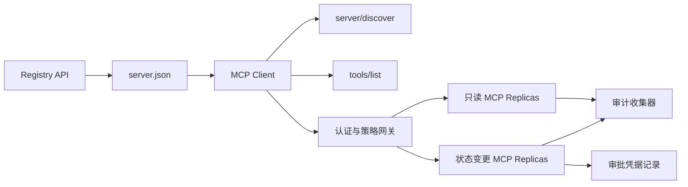

# 综合实战项目 13:带 سجل وإدارة لا حالة MCP Server

> إنتاج درجة MCP 绝对不是 مجرد عملية خادم بسيطة . انها مجموعة كاملة من الصفقات: يمكن إصدار البيانات المعدنية .

**Type:** Capstone
**Languages:** Python 与 TypeScript 参考模型；支持任何生产级编程语言
**Prerequisites:** Phase 11, Phase 13, Phase 14, Phase 17 与 Phase 18
**必修 MCP 进阶课：** [Lesson 28: Tool Contracts](../../../13-tools-and-protocols/28-mcp-tool-contracts-and-content/docs/en.md)،[Lesson 29: 可靠性与流控](../../../13-tools-and-protocols/29-mcp-reliability-cancellation-and-flow-control/docs/en.md)،[Lesson 30: Registry 供应链](../../../13-tools-and-protocols/30-mcp-registry-supply-chain-and-drift/docs/en.md)، 及 [Lesson 31: 一致性工程](../../../13-tools-and-protocols/31-mcp-conformance-versioning-and-operations/docs/en.md)
**目标协议规范：**المفوضية`2026-07-28`
**Time:** ~25 小时

## 學习目标

- 实现合规的无状态 MCP طلبات ومواصلات
- إصلاحات التسجيلات والاتفاقيات في الوقت الحقيقي في الوقت الحالي
- بناء نظام إكتشاف أدوات ذات ترتيبات محددة ومحافظة على الإدراك
- لكل أداة 调用强制执行签发发者 (): المصدر (): المُستقبل (: المُشاهد) : المجال المُستمر للعمل (: المجال) ؛ والإجراءات المُصادفة (: الإجراءات المُصادفة)
- 部署无 Session 亲和性绑定的 التسريب HTTP 集群──
- توفير شهادة كاملة على شبكة الإنترنت على الحدود بين السجل والتحقيق

## يجب أن تقوم بتعليمات

قبل أن يتم النظر في هذا المشروع على أنه جاهز للإنتاج، يجب أن يتم إكمال المرحلة 13 من المرحلة الثالثة:

1. [Lesson 28](../../../13-tools-and-protocols/28-mcp-tool-contracts-and-content/docs/en.md): تعريف هذا الخادم  يجب أن يكتشف الوسيلة الخطة المحتوى المهيكلي  الصفحات المكملات المحتوى المفروض المساعدة المساعدة المساعدة المخطط المحتوى المفروض المساعدة المساعدة المساعدة المساعدة المساعدة المساعدة المساعدة المساعدة المساعدة المساعدة المساعدة المساعدة المساعدة المساعدة المساعدة المساعدة المساعدة المساعدة المساعدة المساعدة المساعدة المساعدة المساعدة المساعدة المساعدة المساعدة المساعدة المساعدة المساعدة المساعدة المساعدة المساعدة المساعدة المساعدة المساعدة المساعدة المساعدة المساعدة المساعدة المساعدة المساعدة المساعدة المساعدة المساعدة المساعدة المساعدة المساعدة المساعدة المساعدة المساعدة المساعدة 
2. [Lesson 29](../../../13-tools-and-protocols/29-mcp-reliability-cancellation-and-flow-control/docs/en.md): تعريف取消竞争态、截止期限、等性、背压、重试与断线重连行为──
3. [Lesson 30](../../../13-tools-and-protocols/30-mcp-registry-supply-chain-and-drift/docs/en.md): definiţie命名空间归属、来源 تتبع、准入锁定、سجل 状态、漂移检测、账本记录与回滚凭证──
4. [Lesson 31](../../../13-tools-and-protocols/31-mcp-conformance-versioning-and-operations/docs/en.md): تحديد المعايير الذهبية مع حالة استخدام الالتسجيلات المضادة، والإصدار الصارم، والإصدار الصارم، والإصدار الصارم، والإصدار الصارم، والإصدار الصارم، والإصدار الصحي، والإصدار الصحي، والإصدار الصحي، والإصدار الصحي، والإصدار الصحي، والإصدار الصحي، والإصدار الصحي، والإصدار الصحي، والإصدار الصحي، والإصدار الصحي، والإصدار الصحي، والإصدار الصحي، والإصدار الصحي، والإصدار الصحي، والإصدار الصحي، والإصدار الصحي، والإصدار الصحي، والإصدار الصحي، والإصدار الصحي، والإصدار الصحي، والإصدار الصحي، والإصدار الصحي، والإصدار الصحي، والإصدار الصناعي، والإصدار الصناعية، والصناعة، والصناعة، والصناعة، والصناعة، والصناعة، والصناعة، والصناعة، والصناعة، والصناعة، والصناعة، والصناعة، والصناعة، والصناعة، والصناعة.

هذا المشروع هو المسؤول عن تركيب هذه العناصر التنفيذية بشكل وثيق، لا يمكن أن يتم إرسالها إلى مجموعة من المختبرات المتقدمة المختلفة التي تعمل بشكل بسيط.

## 问题背景

‬المساحة الداخلية للشركة تحتاج إلى مجموعة من أدوات البيانات القراءة فقط ومجموعة قليلة من أدوات التنفيذية التي تمتلك قدرة على تغيير الحالة‬‬‬‬‬‬‬‬‬‬‬‬‬‬‬‬‬‬‬‬‬‬‬‬‬‬‬‬‬‬‬‬‬‬‬‬‬‬‬‬‬‬‬‬‬‬‬‬‬‬‬‬‬‬‬‬‬‬‬‬‬‬‬‬‬‬‬‬‬‬‬‬‬‬‬‬‬‬‬‬‬‬‬‬‬‬‬‬‬‬‬‬‬‬‬‬‬‬‬‬‬‬‬‬‬‬‬‬‬‬‬‬‬‬‬‬‬‬‬‬‬‬‬‬‬‬‬‬‬‬‬‬‬‬‬‬‬‬‬‬‬‬‬‬‬‬‬‬‬‬‬‬‬‬‬‬‬‬‬‬‬‬‬‬‬‬‬‬‬‬‬‬‬‬‬‬‬‬‬‬‬‬‬‬‬‬‬‬‬‬‬‬‬‬‬‬‬‬‬‬‬‬‬‬‬‬‬‬‬‬‬‬‬‬‬‬‬‬‬‬‬‬‬‬‬‬‬‬‬‬‬‬‬‬‬‬‬‬‬‬‬‬‬‬‬‬‬‬‬‬‬‬‬‬‬‬‬‬‬‬‬‬‬‬‬‬‬‬‬‬‬‬‬‬‬‬‬‬‬‬‬‬‬‬‬‬‬‬‬‬‬‬‬‬‬‬‬‬‬‬‬‬‬‬‬‬‬‬‬‬‬‬‬‬‬‬‬‬‬‬‬‬‬‬‬‬‬‬‬‬‬‬‬‬‬‬‬‬‬‬‬‬‬‬‬‬‬‬‬‬‬‬‬‬‬‬‬‬‬‬‬‬‬‬‬‬‬‬‬‬‬‬‬‬‬‬‬‬‬‬‬‬‬‬‬‬‬‬‬‬‬‬‬‬‬‬‬‬‬‬‬‬‬‬‬‬‬‬‬‬‬‬‬‬‬‬‬‬‬‬‬‬‬‬‬‬‬‬‬‬‬‬‬‬‬‬‬‬‬‬‬‬‬‬‬‬‬‬‬‬‬‬‬‬‬‬‬‬‬

المشكلة الحقيقية ليست كتابة وظيفة Python، ولكن كيفية جعل هذه المجموعات الستة من المصادر الحقيقية تحتفظ بالارتفاع المتوافق:

1. `server.json`علن الخادم في أي مكان يتم تثبيته أو من خلال أي نقطة اتصال على شبكة الإنترنت
2. `server/discover`إعلان قدرة الدعم العملي للعمليات الحالية التي تعمل
3. كل طلب يحدد صراحة إصدار الاتفاق الذي يتم استخدامه مع بيان قدرة العميل
4. سيُستخدم نظام الاختيار مع المُصدرين القانونيين، مؤشر الموارد (مؤشر الموارد) ، ومدى التطبيق
5. هل سيجري تنفيذ تحديد ما إذا كانت عملية الإدخال والإدخال الخاصة بالجهاز الاستراتيجي جاهزة لتحديد ما إذا كانت ستتم إصدارها ؟
6. 审计日志忠实记录跨界的每次交互,且绝不泄露敏感的载荷或凭证密钥──

أية حلقة تحدث في حالة التنقل، يمكن للمنصة أن تظهر الخادم المتعرض للخطر غير المتصل العميل غير المتوافق من خلال الطريق الخطأ التي تستخدم بشكل خاطئ للبرامج الأخرى أو تنفيذ عمليات عالية الخطر غير المعتمدة

## 两层发现机制 ((طبقات الاكتشاف الثانية)

السجلات 静态索引与实时的MCP Server  يجيب على سؤال مختلف تماما عن الامتداد:

| 发现层次 | 交互契约 | 回答的核心问题 |
|---|---|---|
| 发布层 (Publication) | `server.json` 与 Registry API | 该 Server 是什么？其代码包或远程网络端点在哪里？如何进行配置？ |
| 运行时 (Runtime) | `server/discover` | 该运行进程当前实际支持哪些协议版本、能力特性、扩展及 Server 身份？ |

السجل الرسمي 采用带版本控制的 `server.json`المخططات. يمكن إصدار عنوان HTTP المباشر:

```json
{
  "$schema": "https://static.modelcontextprotocol.io/schemas/2025-12-11/server.schema.json",
  "name": "com.example/internal-readonly",
  "title": "Internal Read-Only Tools",
  "description": "Read-only incident and data lookup tools.",
  "version": "1.0.0",
  "remotes": [
    {
      "type": "streamable-http",
      "url": "https://mcp.internal.example.com/readonly"
    }
  ]
}
```

نسخة السجلات  إصدار مع MCP 协议版本 مستقلة تماما، لا تتشاجر مع الملفات. كل وثيقة يجب أن تتعامل مع اتفاقاتها الخاصة.

具备合规 Schema 不代表拥有命名空间所有权──对 `example.com`完成验证的发布者使用反向 DNS 命名空间 `com.example/*`أو أن يكون اسمك

الخادم يجب أن يتم تنفيذه`server/discover`يمكن للعميل استخدامها بشكل مباشر قبل بدء العمل:

```json
{
  "resultType": "complete",
  "supportedVersions": ["2026-07-28"],
  "capabilities": {
    "tools": {
      "listChanged": false
    }
  },
  "_meta": {
    "io.modelcontextprotocol/serverInfo": {
      "name": "com.example/internal-readonly",
      "version": "1.0.0"
    }
  },
  "ttlMs": 3600000,
  "cacheScope": "public"
}
```

## 无状态 MCP 核心(مجموعة MCP غير حكومية)

المفوضية`2026-07-28`تم إزالة الاتفاقية تماماً`initialize`يدي مع`Mcp-Session-Id`كل طلب يتوافق`params._meta`中携带协议上下文:

```json
{
  "io.modelcontextprotocol/protocolVersion": "2026-07-28",
  "io.modelcontextprotocol/clientCapabilities": {},
  "io.modelcontextprotocol/clientInfo": {
    "name": "internal-platform-client",
    "version": "1.0.0"
  }
}
```

يمكن للموازنة الحمل دون قلق إرسال طلبات متواصلة إلى نسخة صحية مختلفة ، لأن أي نسخة يمكن أن تتحقق بشكل كامل من النصوص ذاتية وتعامل طلباتها.

常规成功结果返回 `resultType: "complete"`و الخادم يجب أن يكون`_meta.io.modelcontextprotocol/serverInfo`中标明身份──协议版本非法返回 غير صالحة`-32602`؛ بالنسبة للنسخة القانونية ولكن غير المدعومة، أعدها `-32022`لم يظهر في البيانات`supported`مع`requested`.

### خدمة البحث

`tools/list`يجب أن يضمن التأكد من ترتيبها، ويتضمن النتائج:

- `ttlMs`: وجهة العميل
- `cacheScope`:`public`(المشاركة العامة) أو `private`(上下文私有)
- ترتيب أدوات ثابتة بشكل صارم، مما يجعل نفس القائمة قادرة على استخدام كاش فوركت في نهاية النموذج.
- `resultType: "complete"`مع المستخدمين

                                                                                                                                                                                                                                                                                                                                                                                                                                                                                                                             `cacheScope: "private"`لا يمكن أبداً أن تكون أدوات المستخدم المخصصة في الاحتفاظ بها في الاحتفاظ العام المشترك.

## HTTP 传输 قابل للتدفق

面向网络的服务 暴露单一的 POST 端点──每个 JSON-RPC طلب أو إشعار均为独立的 POST──

针对请求,Server 返回单个JSON 响应或针对该次请求开启的请求作用域 SSE 流――长周期的变更通知通过 `subscriptions/listen`إقامة الصفحة

الطلب يجب أن يكون مرصداً محدداً HTTP الطلب:

- `MCP-Protocol-Version`: يتوافق مع طلبات البيانات
- `Mcp-Method`: مع JSON-RPC 方法名一致
- `Mcp-Name`: في调用 `tools/call`等方法时镜像工具名;
- `Accept: application/json, text/event-stream`.

العنوان لا يتوافق مع الطلبات عندما يعود على الفور`-32020`错误码――校验 `Origin` دفاع DNS 重绑定,并将请求作用域 SSE 流的动作断视为请求取消──



```figure
cf-mcp-gate
```

## 认证与策略决策

传输层元数据绝不等于权限凭证.

1. 动态发现受保护资源元数据
2. لتحديد الموارد لتحقيق الموافقة على الخادم المفوض ؛
3. 优先使用 Client ID Metadata Documents ((CIMD)
4. في عملية الإرسال في إطار إشارة الموارد
5. 验证返回的 `iss`إمكانية إرسال المعلومات إلى الخادم
6.  حسب المصدر 隔离存储 العميل 凭据,绝不跨 المصدر 复用;
7. في MCP Server 侧验证 Token 的签发者、受众、过期时间与 Scope;
8. إدارة القرارات الاستراتيجية الثانية لتحديد أسماء الأدوات والعناصر الفعلية

### الموافقة على الصناعة هي سجل الأدلة وليس نطاق السحر

状态变更调用需要一个结构化的人工审批凭证 () ,与操作者、工具名、规范化参数哈希值 () ,目标环境、过期时间及单次/多次使用策略深度绑定──单独一条聊天消息绝不能充充当审批凭证──

Python 模型 will regulate the sequencing key JSON 计算哈希,并将该 Digest与 Token Subject、工具名、服务器 URL 和过期时间签名绑定──改哪怕是一个参数段,该审批记录均不能重放──审批记录是独立证书证书,而不是直接进入Token 里乱塞的范围──

## 动手构建步骤

1. **建模发布元数据**:编写并验证 `server.json`, ضمان أن المساحة التسمية تتوافق مع قواعد النظام الأجنبي النووي
2. **实现实时服务发现**: في معالجة أي عمل RPC الأولوية لتحقيق`server/discover`.
3. **实现无状态 Envelope**: كل طلب يجب أن يملأ النسخة مع القدرة والبيانات، تحويل جميع المستويات السفلية الجلسة  حالة
4. **构建工具集**: توفير أدوات تغيير الحالة فقط، وتجهيز مخطط JSON مغلق مع إشارات دقيقة
5. **支持缓存感知的工具列表**:输出确定性排序的工具列表,并配置 `ttlMs`مع`cacheScope`.
6. **接入认证与策略网关**: الاختبار اليدوية، ووضع الاختبار اليدوية، ووضع الاختبار اليدوية، ووضع الاختبار اليدوية، ووضع الاختبار اليدوية، ووضع الاختبار اليدوية، ووضع الاختبار اليدوية، ووضع الاختبار اليدوية، ووضع الاختبار اليدوية، ووضع الاختبار اليدوية، ووضع الاختبار اليدوية، ووضع الاختبار اليدوية، ووضع الاختبار اليدوية، ووضع الاختبار اليدوية، ووضع الاختبار اليدوية، ووضع الاختبار اليدوية، ووضع الاختبار اليدوية، ووضع الاختبار اليدوية، ووضع الاختبار اليدوية، ووضع الاختبار اليدوية، ووضع اليدوية، ووضع اليدوية، ووضع اليدوية، ووضع اليدوية، ووضع اليدوية، ووضع اليدوية، ووضع اليدوية، ووضع اليدوية، ووضع اليدوية، ووضع الادوية، و الادوية،
7. **分离静态 Registry 与运行时校验**: مقابل `server.json`مع الوقت الحقيقي`server/discover`,及时上报漂移──
8. **接入脱敏审计日志**: كامل السجل على النص التالي، ومع المعايير الحساسة تنفيذها
9. **验证水平扩展**: في تحميل الموازنة بعد التثبيت اثنين من النسخة بدون حالة، إطلاق ومطالبة التحقق من عدم الاعتماد المباشر.
10. **真实网络验证**: من خلال شبكة حقيقية للاستعراض من خلال JSON جسم، التحقق من مختلف حالات الاستخدام الصارمة والعكسية.

## ضرور备证据包(حزمة الأدلة)

يجب أن يضم الكود المقدم خمسة فئات من شهادات التصميم:

| 证据类别 | 最低验证标准 | 来源课程 |
|---|---|---|
| 网络线路 (Wire) | 正反向用例中脱敏的原始 HTTP 头与 JSON-RPC 体，覆盖类型错误、头不匹配、不支持版本等 | [Lesson 31](../../../13-tools-and-protocols/31-mcp-conformance-versioning-and-operations/docs/en.md) |
| 代理网络 (Proxy) | 直连与经过代理转发的报文对比，证明协议错误未被粗暴折叠为 500 且流式传输未被缓冲 | [Lessons 29](../../../13-tools-and-protocols/29-mcp-reliability-cancellation-and-flow-control/docs/en.md) 与 [31](../../../13-tools-and-protocols/31-mcp-conformance-versioning-and-operations/docs/en.md) |
| 准入管理 (Admission) | 已验证的发布者命名空间、不可变 Registry 记录哈希、实时 `server/discover` 观察凭证与准入账本事件 | [Lesson 30](../../../13-tools-and-protocols/30-mcp-registry-supply-chain-and-drift/docs/en.md) |
| 重试与取消 (Retry) | 取消与完成的竞态测试、显式超时、安全只读重试、写操作幂等键、重连刷新机制 | [Lesson 29](../../../13-tools-and-protocols/29-mcp-reliability-cancellation-and-flow-control/docs/en.md) |
| 发布回滚 (Rollback) | 明确的先前版本哈希、描述符锁定、健康检查窗口、路由平滑切换结果与决策证据 | [Lessons 30](../../../13-tools-and-protocols/30-mcp-registry-supply-chain-and-drift/docs/en.md) 与 [31](../../../13-tools-and-protocols/31-mcp-conformance-versioning-and-operations/docs/en.md) |

## 本地参考模型运行

تمثّل نموذج Python في حالة عدم فتح مجموعة اتصال شبكة خارجية، لإكمال عملية اختبار المجال التسميّن، والتي تتمّ في الوقت الحقيقي، والتي تُعرض قائمة التأكد، والتي تطلب اختبار البيانات، والتي تُعتبر حقّاً في تحديد الوصف، والتي تستند إلى شهادة الموافقة والتحقق:

```bash
cd phases/19-capstone-projects/13-mcp-server-with-registry
python3 code/main.py
python3 -m unittest discover -s code/tests -v
```

تم عرض نوع النص  المشاريع في حالة غير مدفوعة خارجية SDK MCP ، من خلال النظام الأساسي  التعرض دون حالة JSON-RPC  الاتصال ومع العناصر غير المشروعة العودة `isError: true`:

```bash
cd phases/19-capstone-projects/13-mcp-server-with-registry/code/ts
npm install
npm run typecheck
npm test
npm run demo
```

## 线路协议报文范例

```http
POST /mcp HTTP/1.1
Host: mcp.internal.example.com
Content-Type: application/json
Accept: application/json, text/event-stream
MCP-Protocol-Version: 2026-07-28
Mcp-Method: tools/call
Mcp-Name: postgres.readonly
Authorization: Bearer REDACTED

{
  "jsonrpc": "2.0",
  "id": 42,
  "method": "tools/call",
  "params": {
    "name": "postgres.readonly",
    "arguments": {"sql": "SELECT 1"},
    "_meta": {
      "io.modelcontextprotocol/protocolVersion": "2026-07-28",
      "io.modelcontextprotocol/clientCapabilities": {},
      "io.modelcontextprotocol/clientInfo": {
        "name": "internal-platform-client",
        "version": "1.0.0"
      }
    }
  }
}
```

## 核心专业术语

| 术语 | 行业俗称 | 规范真实定义 |
|---|---|---|
| 无状态 MCP (Stateless MCP) | “到处都没有状态” | 协议层不存在 Session；跨调用状态属于显式传递且由业务服务端持久化管理 |
| `server.json` | “工具清单清单” | Registry 静态元数据，用于定义发布命名、代码打包、配置项与传输端点 |
| `server/discover` | “传统握手” | 强制实现的常规业务 RPC，用于获取实时支持的版本与能力，而非建立会话 |
| 缓存作用域 (Cache scope) | “能不能缓存？” | 标识可缓存结果是否可以被跨上下文公共复用（`public`）或仅限当前上下文（`private`） |
| 策略决策 (Policy decision) | “Token 允许就能调” | 针对调用者主体、工具、操作目标、参数载荷及外部上下文的细粒度二次判定 |
| 审批凭证 (Approval record) | “人工在群里点了同意” | 绑定至具体操作者、确切参数哈希与过期时间的强防篡改凭据证据 |
| 显式句柄 (Explicit handle) | “Session ID” | 业务层具名状态的普通应用标识符，绝非底层传输连接会话 |

## 延伸阅读

- [MCP 2026-07-28 核心变更](https://modelcontextprotocol.io/specification/2026-07-28/changelog)
- [Streamable HTTP 传输规范](https://modelcontextprotocol.io/specification/2026-07-28/basic/transports/streamable-http)
- [MCP 服务发现](https://modelcontextprotocol.io/specification/2026-07-28/server/discover)
- [MCP 鉴权与授权规范](https://modelcontextprotocol.io/specification/2026-07-28/basic/authorization)
- [官方 Registry server.json 要求](https://github.com/modelcontextprotocol/registry/blob/main/docs/reference/server-json/official-registry-requirements.md)
