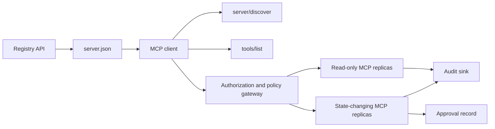

# 综合实战项目 13:带 سجل وإدارة لا حالة MCP Server

> إنتاج درجة MCP 绝对不是 مجرد عملية خادم بسيطة . انها مجموعة كاملة من الصفقات: يمكن إصدار البيانات المعدنية .

**Type:** Capstone
**Languages:** Python 与 TypeScript 参考模型；支持任何生产级编程语言
**Prerequisites:** Phase 11, Phase 13, Phase 14, Phase 17 与 Phase 18
**必修 MCP 进阶课：** [Lesson 28: Tool Contracts](../../../13-tools-and-protocols/28-mcp-tool-contracts-and-content/docs/en.md)،[Lesson 29: 可靠性与流控](../../../13-tools-and-protocols/29-mcp-reliability-cancellation-and-flow-control/docs/en.md)،[Lesson 30: Registry 供应链](../../../13-tools-and-protocols/30-mcp-registry-supply-chain-and-drift/docs/en.md)، 及 [Lesson 31: 一致性工程](../../../13-tools-and-protocols/31-mcp-conformance-versioning-and-operations/docs/en.md)
**目标协议规范：**المفوضية`2026-07-28`
**Time:** ~25 小时

## 學习目标

- 实现合规的无状态 MCP طلبات ومواصلات
- إصلاحات التسجيلات والاتفاقيات في الوقت الحقيقي في الوقت الحالي
- بناء نظام إكتشاف أدوات ذات ترتيبات محددة ومحافظة على الإدراك
- لكل أداة 调用强制执行签发发者 (): المصدر (): المُستقبل (: المُشاهد) : المجال المُستمر للعمل (: المجال) ؛ والإجراءات المُصادفة (: الإجراءات المُصادفة)
- 部署无 Session 亲和性绑定的 التسريب HTTP 集群──
- توفير شهادة كاملة على شبكة الإنترنت على الحدود بين السجل والتحقيق

## يجب أن تقوم بتعليمات

قبل أن يتم النظر في هذا المشروع على أنه جاهز للإنتاج، يجب أن يتم إكمال المرحلة 13 من المرحلة الثالثة:

1. [Lesson 28](../../../13-tools-and-protocols/28-mcp-tool-contracts-and-content/docs/en.md): تعريف هذا الخادم  يجب أن يكتشف الوسيلة الخطة المحتوى المهيكلي  الصفحات المكملات المحتوى المفروض المساعدة المساعدة المساعدة المخطط المحتوى المفروض المساعدة المساعدة المساعدة المساعدة المساعدة المساعدة المساعدة المساعدة المساعدة المساعدة المساعدة المساعدة المساعدة المساعدة المساعدة المساعدة المساعدة المساعدة المساعدة المساعدة المساعدة المساعدة المساعدة المساعدة المساعدة المساعدة المساعدة المساعدة المساعدة المساعدة المساعدة المساعدة المساعدة المساعدة المساعدة المساعدة المساعدة المساعدة المساعدة المساعدة المساعدة المساعدة المساعدة المساعدة المساعدة المساعدة المساعدة المساعدة المساعدة المساعدة المساعدة 
2. [Lesson 29](../../../13-tools-and-protocols/29-mcp-reliability-cancellation-and-flow-control/docs/en.md): تعريف取消竞争态、截止期限、等性、背压、重试与断线重连行为──
3. [Lesson 30](../../../13-tools-and-protocols/30-mcp-registry-supply-chain-and-drift/docs/en.md): definiţie命名空间归属、来源 تتبع、准入锁定、سجل 状态、漂移检测、账本记录与回滚凭证──
4. [Lesson 31](../../../13-tools-and-protocols/31-mcp-conformance-versioning-and-operations/docs/en.md): تحديد المعايير الذهبية مع حالة استخدام الالتسجيلات المضادة، والإصدار الصارم، والإصدار الصارم، والإصدار الصارم، والإصدار الصارم، والإصدار الصارم، والإصدار الصحي، والإصدار الصحي، والإصدار الصحي، والإصدار الصحي، والإصدار الصحي، والإصدار الصحي، والإصدار الصحي، والإصدار الصحي، والإصدار الصحي، والإصدار الصحي، والإصدار الصحي، والإصدار الصحي، والإصدار الصحي، والإصدار الصحي، والإصدار الصحي، والإصدار الصحي، والإصدار الصحي، والإصدار الصحي، والإصدار الصحي، والإصدار الصحي، والإصدار الصحي، والإصدار الصحي، والإصدار الصحي، والإصدار الصناعي، والإصدار الصناعية، والصناعة، والصناعة، والصناعة، والصناعة، والصناعة، والصناعة، والصناعة، والصناعة، والصناعة، والصناعة، والصناعة، والصناعة، والصناعة، والصناعة.

هذا المشروع هو المسؤول عن تركيب هذه العناصر التنفيذية بشكل وثيق، لا يمكن أن يتم إرسالها إلى مجموعة من المختبرات المتقدمة المختلفة التي تعمل بشكل بسيط.

## 问题背景

‬المساحة الداخلية للشركة تحتاج إلى مجموعة من أدوات البيانات القراءة فقط ومجموعة قليلة من أدوات التنفيذية التي تمتلك قدرة على تغيير الحالة‬‬‬‬‬‬‬‬‬‬‬‬‬‬‬‬‬‬‬‬‬‬‬‬‬‬‬‬‬‬‬‬‬‬‬‬‬‬‬‬‬‬‬‬‬‬‬‬‬‬‬‬‬‬‬‬‬‬‬‬‬‬‬‬‬‬‬‬‬‬‬‬‬‬‬‬‬‬‬‬‬‬‬‬‬‬‬‬‬‬‬‬‬‬‬‬‬‬‬‬‬‬‬‬‬‬‬‬‬‬‬‬‬‬‬‬‬‬‬‬‬‬‬‬‬‬‬‬‬‬‬‬‬‬‬‬‬‬‬‬‬‬‬‬‬‬‬‬‬‬‬‬‬‬‬‬‬‬‬‬‬‬‬‬‬‬‬‬‬‬‬‬‬‬‬‬‬‬‬‬‬‬‬‬‬‬‬‬‬‬‬‬‬‬‬‬‬‬‬‬‬‬‬‬‬‬‬‬‬‬‬‬‬‬‬‬‬‬‬‬‬‬‬‬‬‬‬‬‬‬‬‬‬‬‬‬‬‬‬‬‬‬‬‬‬‬‬‬‬‬‬‬‬‬‬‬‬‬‬‬‬‬‬‬‬‬‬‬‬‬‬‬‬‬‬‬‬‬‬‬‬‬‬‬‬‬‬‬‬‬‬‬‬‬‬‬‬‬‬‬‬‬‬‬‬‬‬‬‬‬‬‬‬‬‬‬‬‬‬‬‬‬‬‬‬‬‬‬‬‬‬‬‬‬‬‬‬‬‬‬‬‬‬‬‬‬‬‬‬‬‬‬‬‬‬‬‬‬‬‬‬‬‬‬‬‬‬‬‬‬‬‬‬‬‬‬‬‬‬‬‬‬‬‬‬‬‬‬‬‬‬‬‬‬‬‬‬‬‬‬‬‬‬‬‬‬‬‬‬‬‬‬‬‬‬‬‬‬‬‬‬‬‬‬‬‬‬‬‬‬‬‬‬‬‬‬‬‬‬‬‬‬‬‬‬‬‬‬‬‬‬‬‬‬‬‬‬‬‬

المشكلة الحقيقية ليست في كتابة وظيفة واحدة، ولكن كيفية جعل هذه المجموعات الستة من المصادر الحقيقية تحتفظ بالارتفاع المتوافق:

1. `server.json`علن الخادم في أي مكان يتم تثبيته أو من خلال أي نقطة اتصال على شبكة الإنترنت
2. `server/discover`إعلان قدرة الدعم العملي للعمليات الحالية التي تعمل
3. كل طلب يحدد صراحة إصدار الاتفاق الذي يتم استخدامه مع بيان قدرة العميل
4. سيُستخدم نظام الاختيار مع المُصدرين القانونيين، مؤشر الموارد (مؤشر الموارد) ، ومدى التطبيق
5. محرك الاستراتيجية لا يتخذ قرار مستقل بشأن ما إذا كان العملية المحددة جاهزة لتنفيذها ؛
6. 审计日志忠实记录跨界的每次交互,且绝不泄露敏感的载荷或凭证密钥──

أية حلقة تحدث في حالة التنقل، يمكن للمنصة أن تظهر خدمة لا يمكن توصيلها إليها أخطاء من طريق غير متوافق مع العميل استخدام خاطئ للبرامج التي تم إصدارها لموارد أخرى، أو إعلان عمليات مدمرة في حالة مراجعة غير متوقعة

## 两层发现机制 ((طبقات الاكتشاف الثانية)

السجلات 静态索引与实时的MCP Server  يجيب على سؤال مختلف تماما عن الامتداد:

| 发现层次 | 交互契约 | 回答的核心问题 |
|---|---|---|
| 发布层 (Publication) | `server.json` 与 Registry API | 该 Server 是什么？其代码包或远程网络端点在哪里？如何进行配置？ |
| 运行时 (Runtime) | `server/discover` | 该运行进程当前实际支持哪些协议版本、能力特性、扩展及 Server 身份？ |

السجل الرسمي 采用带版本控制的 `server.json`المخططات. يمكن إصدار عنوان HTTP المباشر:

```json
{
  "$schema": "https://static.modelcontextprotocol.io/schemas/2025-12-11/server.schema.json",
  "name": "com.example/internal-readonly",
  "title": "Internal Read-Only Tools",
  "description": "Read-only incident and data lookup tools.",
  "version": "1.0.0",
  "remotes": [
    {
      "type": "streamable-http",
      "url": "https://mcp.internal.example.com/readonly"
    }
  ]
}
```

نسخة السجلات  إصدار مع MCP  إتفاقية إصدار مستقلة تماما، لا تجعل الموافقين بدلا من تغيير واحدة من أيامها.

具备合规 Schema 不代表拥有命名空间所有权──对 `example.com`完成验证的发布者使用反向 DNS 命名空间 `com.example/*`أو其子命名空间──الاجتذاب المسؤول عن إثبات هذا الملكية── إذا حسب الترتيب العادي للكتابة، فإن الإشارة إلى مكان آخر للاسم──

标准库模型中的 `validate_registry_document`المشكلة هي أن المشكلة هي أن المشكلة هي أن المشكلة هي أن المشكلة هي أن المشكلة هي أن المشكلة هي أن المشكلة هي أن المشكلة هي أن المشكلة هي أن المشكلة هي أن المشكلة هي أن المشكلة هي أن المشكلة هي أن المشكلة هي أن المشكلة هي أن المشكلة هي أن المشكلة هي أن المشكلة هي أن المشكلة هي أن المشكلة هي أن المشكلة هي أن المشكلة هي أن المشكلة هي أن المشكلة هي أن المشكلة هي أن المشكلة هي أن المشكلة هي أن المشكلة هي أن المشكلة هي أن المشكلة هي أن المشكلة هي أن المشكلة هي أن المشكلة هي أن المشكلة هي أن تكون أكثر خطورة.`name`.`description`مع`version`字段,可选的 `title`, النشر والاسم والمدة المحددة, النسخة الخاصة النسخة, وكذلك كل `streamable-http`أو`sse`遠端点的 HTTP(S) URL 格式──由于 هذا المشروع المشترك يتضمن إجراء عمليات البحث عن نقطة بعيدة المدى، فإنه يضمن أيضاً متطلبات إضافية `remotes`列表非空──`validate_publisher_namespace`单独对照已验证的发行者域名检查名称,而`validate_runtime_alignment`则将发布名称与版本同实时的 `serverInfo`进行比较──官方 Schema 还支持仅含代码包的记录以及更多远程字段── 发布前,请使用锁定版本的官方 JSON Schema 或 `mcp-publisher`لا تعتبر هذه المجموعة المفروضة ككل المخططات المكملة

الخادم يجب أن يتم تنفيذه`server/discover`· العميل يمكن أن يقوم بتطويرها قبل أن يبدأ في استخدامها في طريقة أخرى. العميل يقوم بذلك بعد حل النقطة النهائية لهذا المشروع المشترك ، ويحصل على إصدار إصدار إصلاحات الاتفاق الحالي مع مجموعة القدرات في الوقت الحقيقي:

```json
{
  "resultType": "complete",
  "supportedVersions": ["2026-07-28"],
  "capabilities": {
    "tools": {
      "listChanged": false
    }
  },
  "_meta": {
    "io.modelcontextprotocol/serverInfo": {
      "name": "com.example/internal-readonly",
      "version": "1.0.0"
    }
  },
  "ttlMs": 3600000,
  "cacheScope": "public"
}
```

يمكن أن يُؤشر السجل الخاص بالصحة الإضافية أو المعلومات المقدمة عن الممتلكات أو المراجعة أو دورة الحياة، ولكن لا يمكن أبداً أن تُصنع هذه البيانات على أنها إطار خط MCP أو`server.json`根字段──策略组织应与已发布记录并列存储──当确实需要公开自定义元数据时,使用登记的 `_meta.io.modelcontextprotocol.registry/publisher-provided`扩展,并保持在它的4 KB 上限之内──

## 无状态 MCP 核心(مجموعة MCP غير حكومية)

المفوضية`2026-07-28`إزالة كاملة من الاتفاقية`initialize`- لا ، لا`notifications/initialized`يدي، في الوقت نفسه تحرك`Mcp-Session-Id`.

كل طلب يتوافق`params._meta`中携带协议上下文:

```json
{
  "io.modelcontextprotocol/protocolVersion": "2026-07-28",
  "io.modelcontextprotocol/clientCapabilities": {},
  "io.modelcontextprotocol/clientInfo": {
    "name": "internal-platform-client",
    "version": "1.0.0"
  }
}
```

版本与能力是请求层面的事实而不是连接层面的事实―― تحميل الموازنة يمكن بدون قلق أن تسلسل الطلبات إلى مختلف النسخ الصحي، لأن أي نسخة يمكن أن تكون تماما من التحقق من نفسها وتعامل الطلبات.

常规成功结果返回 `resultType: "complete"`و يجب أن يكون الخادم في كل نتيجة`_meta.io.modelcontextprotocol/serverInfo`中标明身份──协议版本缺失或不是字符串时返回 غير صالحة`-32602`(إنه)`-32022`فقط لتقديم نسخة غير مدعومة من الأسطر، يجب أن تكون بياناتها صحيحة`{"supported": ["2026-07-28"], "requested": "..."}`.

### خدمة البحث

لـ نفس مجموعة الأدوات الفعالة`tools/list`يجب أن تكون مؤكدة.

- `ttlMs`: وجهة العميل
- `cacheScope`:`public`(المشاركة العامة) أو `private`(上下文私有)
-  ترتيب أدوات ثابتة بشكل صارم، مما يجعل نفس القائمة قادرة على إعادة استخدام كاشة فوركت في نهاية النموذج.
- `resultType: "complete"`مع المستخدمين

                                                                                                                                                                                                                                                                                                                                                                                                                                                                                                                             `cacheScope: "private"`لا يمكن أبداً أن تكون أدوات المستخدم المخصصة في الاحتفاظ بها في الاحتفاظ العام المشترك.

## HTTP 传输 قابل للتدفق

面向网络的服务 暴露单一的 POST 端点──每个 JSON-RPC طلب أو إشعار均为独立的 POST──

针对请求,Server 返回单个JSON 响应或针对该次请求开启的请求作用域 SSE 流――长周期的变更通知通过 `subscriptions/listen`建立长连接流,承载选择订阅的变更通知──当前传输中不存在独立的GET流、Session DELETE、Session 请求头或 `Last-Event-ID`-إلى الـ (كويغ)

كل طلب يتضمن:

- `MCP-Protocol-Version`: يتوافق مع طلبات البيانات
- `Mcp-Method`: مع JSON-RPC 方法名一致
- `Mcp-Name`: للمستخدمين`tools/call`.`resources/read`مع`prompts/get`(إنه)
- `Accept: application/json, text/event-stream`.

استخدامات محددة`-32020`错误拒绝不一致的镜像请求头――校验 `Origin`، سوف تطوير المحلية الخادم  مقيد إلى عنوان الحلقة ، ويدرس العميل بعيد ،并将已关闭的请求作用域 SSE 响应视为取消──



```figure
cf-mcp-gate
```

## 认证与策略决策

传输层元数据绝不等于权限凭证.

对于远程服务:

1. 动态发现受保护资源元数据
2. لتحديد الموارد لتحقيق الموافقة على الخادم المفوض ؛
3. 优先使用客户ID DATA DATA 文件 CIMD 注册客户,将动态客户注册 动态客户注册                                                                                                                                                                                                                                            
4. في عملية الإرسال في إطار إشارة الموارد
5. 验证返回的 `iss`إمكانية إرسال المعلومات إلى الخادم
6.  حسب المصدر 隔离存储 العميل 凭据,绝不跨 المصدر 复用;
7. في MCP Server 侧验证 Token 的签发者、受众、过期时间与 Scope;
8. إدارة القرارات الاستراتيجية الثانية لتحديد أسماء الأدوات والعناصر الفعلية

`readOnlyHint`مع`destructiveHint`等工具注解帮助客户 呈现风险,但它们 ليست وسائل تحكم مرخصة قابل الايمان.

### الموافقة على الصناعة هي سجل الأدلة وليس نطاق السحر

状态变更调用需要一个结构化的人工审批凭证 () ,与操作者、工具名、规范化参数哈希值 () ,目标环境、过期时间及单次/多次使用策略深度绑定──单独一条聊天消息绝不能充充当审批凭证──

Python 模型 سوف تحكم على تطبيقات مفتاح الترتيب JSON 计算哈希,并将该 Digest与 Token Subject、工具名、服务器URL 和过期时间绑定──改哪怕是一个参数段,该审批记录也会重放失败在处理器运行之前──审批记录是独立证书证书,而不是添加到Access Token中的 Scope──

عندما يمكن أن يكون التخفيضات الجسدية تؤثر على نصف القطر، وضع أدوات المخاطر العالية على سطح مستقل يمكن تقييمها بشكل منفصل.

## 动手构建

### 1. 建模发布元数据

 إقامة `server.json`وملتحت النظام الاختبار.`repository`أو`packages`والبيانات، وكذلك المعلومات عن بعد أو الاستديو                                                                                                                                                                                                                                                                                                                                                                                                                                                                                                               

### 2. 实现实时服务发现

في أي عمل ريكتير  قبل تحقيق `server/discover`◊ إعلان إصدار بروتوكول مدعوم ‬المجموعة القدرات ‬التوسع مع Server Identity,并添加一个使用 ‬`-32022`إصدار رفض استخدام مثال:

### 3. 实现无状态信封 (غلاف)

كل طلب يجب أن يحمل نسخة اتفاقية مع قدرة العميل ؛ كل نتيجة ستعود`resultType`مع Server 身份──移除初始化状态、按连接缓存的能力集以及 Session 标识符──

### 4. 构建工具表面

من اثنين فقط أداة القراءة و واحد أداة تغيير الحالة البداية. لتوفير كل أداة مع حدة JSON مخططات وصف دقيق، وصف النتائج من أجل التأكد من أن النتائج هي بنية و كذلك التفاصيل الحقيقية.

### 5. 添加缓存感知的列表

إثبات الترتيبات العودة الوسائل،并附带 `ttlMs`مع`cacheScope`分別测试缓存过期与表变更通知行为

### 6. 添加认证与策略

المختبرات المقدمة والمستقبلات والمدة والمقياسات. في كل أداة، يتم استخدام قرارات استراتيجية تنفيذية، ويتم ربط الموافقة إلى عمليات عالية المخاطر. قبل أن يرفض المدير التنفيذي أو الموافقة على الموافقة المنتهية.

### 7. التفريق بين السجل والعمل

الوضع الاول`server.json`记录, reuse `server/discover`探测远程端点── عندما يتم نشر نقطة نهاية بعيدة٬身份、版本 أو قدرة ضرورية لا تتوافق مع عملية الوقت الحقيقي، فوق الصحيفة漂移──

### 8. إضافة شهادة المراجعة

记录操作者、发发发发发发发发发发发发发发发发发发发发发发发发发发发发发发发发发发发发发发发发发发发发发发发发发发发发发发发发发发发发发发发发发发发发发发发发发发发发发发发发发发发发发发发发发发发发发发发发发发发发发发发发发发发发发发发发发发发发发发发发发发发发发发发发发发发发发发发发发发发发发发发发发发发发发发发发发发发发发发发发发发发发发发发发发发发发发发发发发发发发发发发发发发发发发发发发发发发发发发发发发发发发发发发发发发发发发发发发发发发发发发发发发发发发发发发发发发发发发发发发发发发发发发发发发发发发发发发发发发发发发发发发发发发发发发发发发发发发发发发发发发发发发发发发发发发发发发发发发发发发发发发发发发发发发发发发发发发发发发发发发发发发发发发发发发发发发发发发发发发发发发发发发发发发发发发发发发发发发发发发发发发发发发发发发发发发发发发发发发发发发发发发发发发发发发发发发发发发发发发发发发发发发发发发发发发发发发发发发发发发发发发发发发发发发发发发发发发发发发发发发发发发发发发发发发发发发发发发发发发发发发发发发发发发发发发发发发发发发发发发发发发发发发发发发发发发发发发发发发发发发发发发发

### 9. 验证水平扩展

بعد وضع اثنين من النسخ غير الحالة في جهاز التوازن الحمل ، إرسال ما لا يقل عن 100 طلب ومطالبة ، إثبات الصدقة لا تعتمد على الصدقة. إذا كان هناك أداة تحتاج إلى عبور الحالة ، وإنتاج محرك غير شفاف واضح ، ووضعها في نظام الاستمرار المشترك.

### 10. 跨越真实线路

针对真实服务 二进制运行一致性检查――捕获请求头与JSON请求体,不仅仅是SDK对象──覆盖错误版本、请求头不匹配、缺少 Scope、受众错误、参数形、处理器 失败、取消与缓存过期等用例──

## ضرور备证据包(حزمة الأدلة)

يجب أن يحتوي المقدم على جميع الـ 5 فئات من الشهادات التالية، وإلا فهي غير كاملة:

| 证据类别 | 最低验证标准 | 来源课程 |
|---|---|---|
| 网络线路 (Wire) | 正向与反向用例的脱敏原始请求头与 JSON-RPC 请求体，覆盖元数据类型错误、请求头不匹配、不受支持的版本、缺失或未知的 `resultType`、通知无响应以及响应 ID 匹配 | [Lesson 31](../../../13-tools-and-protocols/31-mcp-conformance-versioning-and-operations/docs/en.md) |
| 代理网络 (Proxy) | 同一稳定用例分别直连与经过已部署的中间层运行，记录入口、源站与出口的状态码及响应体摘要；证明协议错误未被折叠为通用 500 响应，且流式传输未被缓冲 | [Lessons 29](../../../13-tools-and-protocols/29-mcp-reliability-cancellation-and-flow-control/docs/en.md) 与 [31](../../../13-tools-and-protocols/31-mcp-conformance-versioning-and-operations/docs/en.md) |
| 准入管理 (Admission) | 已验证的发布者命名空间、不可变的 Registry 记录摘要、产物或远程端点来源证明、实时 `server/discover` 身份与能力观测、描述符锁定、当前 Registry 状态以及准入账本事件 | [Lesson 30](../../../13-tools-and-protocols/30-mcp-registry-supply-chain-and-drift/docs/en.md) |
| 重试与取消 (Retry) | 取消与完成的竞态、显式超时、安全的只读重试、写操作幂等键、重连后重新拉取，以及证明请求取消不会悄然变成持久任务取消 | [Lesson 29](../../../13-tools-and-protocols/29-mcp-reliability-cancellation-and-flow-control/docs/en.md) |
| 发布回滚 (Rollback) | 确切的先前版本、准入与产物摘要、描述符锁定、当前生效的 Registry 状态、当前健康窗口、路由恢复结果以及脱敏的决策证据 | [Lessons 30](../../../13-tools-and-protocols/30-mcp-registry-supply-chain-and-drift/docs/en.md) 与 [31](../../../13-tools-and-protocols/31-mcp-conformance-versioning-and-operations/docs/en.md) |

随版本一并保存脱敏证据包的摘要──只要缺少任意一类,就暂缓发布──不要从进程内分发器推断代理行为,不要从注册表存在该条目推断准入,不要从新的 JSON-RPC ID推断重试安全,也不要从上一次部署推断回滚就绪──

## 本地参考模型运行

نموذج Python في حالة عدم فتح أي مجموعة شبكة اتصال، عرضت السجل 元数据、反向 DNS 发布者命名空间校验、发布与运行时身份验证、实时发现、确定性工具列表、逐请求元数据、可信签发者/受众/过期时间/Scope 检查、绑定操作的审批、一个有档案说明的部分 Registry 校验器、策略以及审计:

```bash
cd phases/19-capstone-projects/13-mcp-server-with-registry
python3 code/main.py
python3 -m unittest discover -s code/tests -v
```

في حالة المخططات المخططة لـ TypeScript 项目在不借助 MCP SDK ، من خلال الاستوديو 暴露无状态 JSON-RPC 结构──其`tools/call`路径执行与 `tools/list`النظام المشترك للدخول المعلن؛ عندما يتم إدخال أدوات معروفة إلى المعايير غير القانونية، أعدها`isError: true`نتيجة كاملة، و لا تستخدم المنفذ:

```bash
cd phases/19-capstone-projects/13-mcp-server-with-registry/code/ts
npm install
npm run typecheck
npm test
npm run demo
```

هذه النماذج تثبت منطقية محلية ، لا يمكن أن تثبت HTTP الطلبات عنوان أو أوث  تبادل أو سجل إصدار أو او بي اي إكمال أو توازن الحمل أو استلام محطة الاستخدام.

## 线路协议报文范例

```http
POST /mcp HTTP/1.1
Host: mcp.internal.example.com
Content-Type: application/json
Accept: application/json, text/event-stream
MCP-Protocol-Version: 2026-07-28
Mcp-Method: tools/call
Mcp-Name: postgres.readonly
Authorization: Bearer REDACTED

{
  "jsonrpc": "2.0",
  "id": 42,
  "method": "tools/call",
  "params": {
    "name": "postgres.readonly",
    "arguments": {"sql": "SELECT 1"},
    "_meta": {
      "io.modelcontextprotocol/protocolVersion": "2026-07-28",
      "io.modelcontextprotocol/clientCapabilities": {},
      "io.modelcontextprotocol/clientInfo": {
        "name": "internal-platform-client",
        "version": "1.0.0"
      }
    }
  }
}
```

## 交付物

交付一个包含以下内容的代码仓库:

- 通過 الخطة 校验的 `server.json`(إنه)
- فقط قراءة مع حالة تغير نوعين من سطح الخادم
- `server/discover`-مُتأكّد`tools/list`ويتم التحكم في الاستراتيجية`tools/call`(إنه)
- مع اثنين من النسخ المتاحة لـ Streamable HTTP 部署
- 认证与审批集成
- سجل  الناشر أو سجل API 适配器 الخاص ؛
- سجل الموافقة على تعريف الاستراتيجية والعملية المرتبطة بها
- 脱敏的审计输出和追踪传播
- شهادة الإصابة بالخطوط والوكلاء
- 准入、重试、健康与回滚证据, وكذلك ملخص من مجموعة شهادات الإصابة

| 权重 | 评分标准 | 证据 |
|---:|---|---|
| 25 | 协议正确性 | 无状态请求元数据、服务发现、结果、请求头与反向用例 |
| 20 | 授权 | 签发者、受众、过期时间、Scope 与绑定操作的审批用例 |
| 15 | Registry 完整性 | 合法的 `server.json`、发布记录、实时发现探测与漂移报告 |
| 15 | 策略与安全 | 允许、拒绝、畸形、过期审批与敏感数据用例 |
| 15 | 扩展性与可靠性 | 两个副本、无亲和性依赖、取消、超时与恢复 |
| 10 | 可审计性 | 接收端脱敏审计与追踪证据 |

## التدريب والتفكير

1. تحويل عنوان URL بعيد المنشأ ، في حين الحفاظ على الحفاظ على الحالة الحقيقية الخادم غير متغيرة ، جعل السجل 校验报告确切的漂移──
2. إثنان مرات نفس الإدخال والإرسال`tools/list`, اثبات الوسائل تسلسل 字节级稳定; ثم让 `ttlMs`过期并刷新──
3. ارسل طلب قانوني لكن`MCP-Protocol-Version`. . . . . . . . . . . . . . . . . . . . . . . . . . . . . . . . . . . . . . . . . . . . . . . . . . . . . . . . . . . . . . . . . . . . . . . . . . . . . . . . . . . . . . . . . . . . . . . . . . . . . . . . . . . . . . . . . . . . . . . . . . . . . . . . . . . . . . . . . . . . . . . . . . . . . . . . . . . . . . . . . . . . . . . . . . . . . . . . . . . . . . . . . . . . . . . . . . . . . . . . . . . . . . . . . . . . . . . . . . . . . . . . . . . . . . . . . . . . . . . . . . . . . . . . . . . . . . . . . . . . . . . . . . . . . . . . . . . . . . . . . . . . . . . . . . . . . . . . . . . . . . . . . . . . . . . . . . . . . . . . . . . . . . . . . . . . . . . . . . . . . . . . . . . . . . . . . . . . . . . . . . . . . . . . . . . . . . . . . . . . . . . . . . . . . . . . . . . . . . . . . . . . . . . . . . . . . . . . . . . . . . . . . . . . . . . . . . . . . . . . . . . . . . . . . . . . . . . . . . . . . . . . . . . . . . . . . . . . . . . . . . . . . . . . . . . . . . . . . . . . . . . . . . . . . .`-32020`, و لا تستخدم استراتيجية أو أداة
4. للاستماع فقط إلى الخادم  إصدار رمز و إظهارها إلى حالة تغيير الخادم ، إثبات تجربة المستخدم في المدير  إدارة قبل الفشل
5. إعادة تحديد الموافقة إلى مقتطف معين من المعايير المحددة، وتعديل أحد الفقرات، إثبات عدم إعادة تحديد الموافقة.
6. سيتم استمرار استخدام الصفحات المختلفة إلى مختلف النصوص.
7. توقف أحد المجالات المستخدمة للطلبات، وتقديم رسالة جديدة من JSON-RPC، وتقديم رسالة جديدة من JSON-RPC`Last-Event-ID`恢复路径‬

## 核心专业术语

| 术语 | 行业俗称 | 规范真实定义 |
|---|---|---|
| 无状态 MCP (Stateless MCP) | “到处都没有状态” | 协议层不存在 Session；跨调用状态是显式的，并由 Server 管理 |
| `server.json` | “工具清单” | Registry 静态元数据，用于定义发布命名、代码打包、配置项与传输端点 |
| `server/discover` | “传统握手” | 强制实现的常规 RPC，用于获取实时版本与能力，而非 Session 初始化器 |
| 缓存作用域 (Cache scope) | “能不能缓存？” | 标识可缓存结果是否可以被跨上下文公共复用（`public`）或仅限当前上下文（`private`） |
| 策略决策 (Policy decision) | “Token 允许就能调” | 针对调用者主体、工具、操作目标、参数载荷及外部上下文的细粒度二次判定 |
| 审批凭证 (Approval record) | “有人点了同意” | 在过期策略下绑定到一个操作者与一项重大操作的证据 |
| 显式句柄 (Explicit handle) | “Session ID” | 用于命名由 Server 管理之状态的普通应用数据，而非协议连接状态 |

## 延伸阅读

- [MCP 2026-07-28 核心变更](https://modelcontextprotocol.io/specification/2026-07-28/changelog)
- [Streamable HTTP 传输规范](https://modelcontextprotocol.io/specification/2026-07-28/basic/transports/streamable-http)
- [MCP 服务发现](https://modelcontextprotocol.io/specification/2026-07-28/server/discover)
- [MCP 鉴权与授权规范](https://modelcontextprotocol.io/specification/2026-07-28/basic/authorization)
- [官方 Registry server.json 要求](https://github.com/modelcontextprotocol/registry/blob/main/docs/reference/server-json/official-registry-requirements.md)
- [官方 Registry OpenAPI 契约](https://registry.modelcontextprotocol.io/openapi.yaml)
