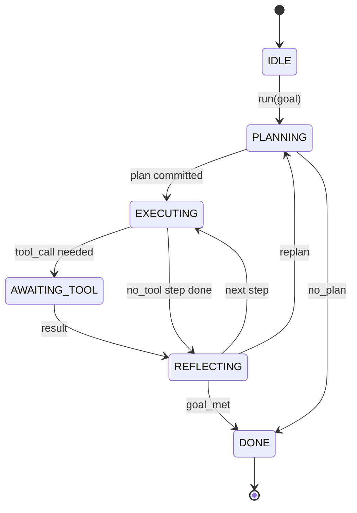

# عقد العميل " هيرنيس لوب "

> تعبئة هو وكيل، نموذج هو معالج، يمكنك الوصول إلى أي نموذج من العقود الدائرة.

**Type:** Build
**Languages:** Python
**Prerequisites:** Phase 13 lessons 01-07, Phase 14 lesson 01
**Time:** ~90 minutes

## أهداف التعلم


```figure
cf-loop-contract
```
- أن تكون حلقة استخدام العميل تُحدد لجهاز حالة تحديد مع انتقالات واضحة
- تطبيق 10 مواضيع حلقة الحياة، يمكن للمشغلين وضع السياسة والتلفون والحواجز
- تعريف نقطتين السحب، الحلقة في هذه المواقع، إعادة السيطرة إلى المكالم، وإعادة إدخال جديد.
- 强制执行每次会议预算 ((التحولات 工具通话 壁表),同时在超限时不泄漏部分状态──
- 发发含十一种类型事件的类型类型类型类型类型类型类型类型类型类型类型类型类型类型类型类型类型类型类型类型类型类型类型类型类型类型类型类型类型类型类型类型类型类型类型类型类型类型类型类型类型类型类型类型类型类型类型类型类型类型类型类型类型类型类型类型类型类型类型类型类型类型类型类型类型类型类型类型类型类型类型类型类型类型类型类型类型类型类型类型类型类型类型类型类型类型类型类型类型类型类型类型类型类型类型类型类型类型类型类型类型类型类型类型类型类型类型类型类型类型类型类型类型类型类型类型类型类型类型类型类型类型类型类型类型类型类型类型类型类型类型类型类型类型类型类型类型类型类型类型类型类型类型类型类型类型类型类型类型类型类型类型类型类型类型类型类型类型类型类型类型类型类型类型类型类型类型类型类型类型类型类型类型类型类型类型类型类型类型类型类型类型类型类型类型类型类型类型类型类型类型类型类型类型类型类型类型类型类型类型类型类型类型类型类型类型类型类型类型类型类型类型类型类型类型类型类型类型类型类型类型类型类型类型类型类型类型类型类型类型类型类型类型类型类型类型类型类型类型类型类型类型类型类型类型类型类型类型类型类

## 框架

وكيل التشفير الذي لا يملك أحد يعمل على أربعين دورة ليس حلقة دردشة. إنه آلة حالة، يمكن للمشغل إيقاف عقداتها، ويمكن أيضاً مراجعة حوافها.

هذا هو العقد الذي يُبني هذا الدراسة. سوف نسمي ستة دولات. 10 مواضيع، نقطتين إضافة، ونوع من الأحداث.

## الدول

الحلقة لديها ستة دولات. خمسة نشطة.



`IDLE`هو الموقع الوحيد القانوني للدخول`DONE`هو الصادرة القانونية الوحيدة`AWAITING_TOOL`هي الحالة الوحيدة التي ستحدث نقطة التقطير. جميع الانتقالات الأخرى هي داخلية.

هذه الآلة الحالة هي التأكد. تم تحديد نفس سجل الأحداث, والحصول سوف يعود إلى نفس الحالة.

## مواضيع الركبة

هوك هو المستخدم 接入循环的接口──harness 会触发十个话题──每个话题可以接受任意数量的订阅者──订阅者 按注册 顺序触发──一个订阅者可以突变的用负荷、升起来中止 当前轮,或返回一个哨兵跳过下一步──

```text
before_plan         after_plan
before_tool_call    after_tool_call
before_step         after_step
on_error
on_pause
on_budget_exceeded
on_complete
```

هذا الشكل يظهر كود كود كورسور و OpenCode حتى منتصف عام 2025 تم الاتجاه إلى نموذج تبني.`rm -rf`من المكعبة`before_tool_call` إرسال OpenTelemetry span من الرمز  وضع `after_step`في جلسة توقف فوق العودة`on_pause`.

## نقاط السحب

الحلقة سوف تمنحني السيطرة`AWAITING_TOOL`عندما لا يكون هناك أداة لا يمكن أن تستمر في التقدم`on_pause`عندما ينفذ الميزانية أو ينفذ بعض المكالمات

نقطة السحب ليست استثناءها. إنها عودة.`resume(payload)` الحافة سوف تستمر من موقع توقفها‬‬‬‬‬‬‬‬‬‬‬‬‬‬‬‬‬‬‬‬‬‬‬‬‬‬‬‬‬‬‬‬‬‬‬‬‬‬‬‬‬‬‬‬‬‬‬‬‬‬‬‬‬‬‬‬‬‬‬‬‬‬‬‬‬‬‬‬‬‬‬‬‬‬‬‬‬‬‬‬‬‬‬‬‬‬‬‬‬‬‬‬‬‬‬‬‬‬‬‬‬‬‬‬‬‬‬‬‬‬‬‬‬‬‬‬‬‬‬‬‬‬‬‬‬‬‬‬‬‬‬‬‬‬‬‬‬‬‬‬‬‬‬‬‬‬‬‬‬‬‬‬‬‬‬‬‬‬‬‬‬‬‬‬‬‬‬‬‬‬‬‬‬‬‬‬‬‬‬‬‬‬‬‬‬‬‬‬‬‬‬‬‬‬‬‬‬‬‬‬‬‬‬‬‬‬‬‬‬‬‬‬‬‬‬‬‬‬‬‬‬‬‬‬‬‬‬‬‬‬‬‬‬‬‬‬‬‬‬‬‬‬‬‬‬‬‬‬‬‬‬‬‬‬‬‬‬‬‬‬‬‬‬‬‬‬‬‬‬‬‬‬‬‬‬‬‬‬‬‬‬‬‬‬‬‬‬‬‬‬‬‬‬‬‬‬‬‬‬‬‬‬‬‬‬‬‬‬‬‬‬‬‬‬‬‬‬‬‬‬‬‬‬‬‬‬‬‬‬‬‬‬‬‬‬‬‬‬‬‬‬‬‬‬‬‬‬‬‬‬‬‬‬‬‬‬‬‬‬‬‬‬‬‬‬‬‬‬‬‬‬‬‬‬‬‬‬‬‬‬‬‬‬‬‬‬‬‬‬‬‬‬‬‬‬‬‬‬‬‬‬‬‬‬‬‬‬‬‬‬‬‬‬‬‬‬‬‬‬‬‬‬‬‬‬‬‬‬‬‬‬‬‬‬‬‬‬‬‬‬‬‬‬‬‬‬‬‬‬‬‬‬‬‬‬‬‬‬‬‬‬‬‬‬‬‬‬‬‬‬‬‬‬‬‬‬‬‬‬‬‬‬‬‬‬‬‬‬‬‬‬‬‬‬‬‬‬‬‬`tools/call`✿ من خلال الصف 时它是求职调查✿

## تدفق الأحداث

الحلقة 会在合同中的特定位置把事件添加到打字流. هذا التيار هو إضافة فقط، يمكن للمشتركين من أي تعويض المشاركة.

- `session.start` 调用 `run(goal)`时发出一次
- `plan.draft`المخطط  العودة إلى مشروع الخطة 时发出
- `plan.commit` مشروع تم تقديمه للخطة النشطة 后发发
- `step.start`كل خطوة تنفيذية
- `step.end`كل خطوة تنفيذية
- `tool.call` 需要 tool 的步骤 将控制权交给调用人 发发出
- `tool.result` استخدام أداة النتيجة 恢复时发出
- `tool.error` استخدام الخطأ 恢复时, أو هوك إلغاء المكالمة 时发出
- `budget.warn`  الوصول إلى الحد المالي 时发出
- `session.pause` حلقة بسبب توقف (ميزانية أو خطوة)
- `session.complete`حلقة حتى الوصول`DONE`时发出一次

الأحداث غير المُتَصَدِّقين الحمل المفيد للقبض. الحوادث هي الحاجة للقبض.

## ملف الميزانية

واحدة جلسة  حمل ثلاثة حدود  تعداد المفاتيح  عدد المكالمات الأداة  ساعات الحائط  ثواني كل دور سوف يجعل المفاتيح 加一── كل مكالمة أداة سوف يجعل مكالمات الأداة 加一── كل مرحلة انتقالية ستقوم بفحص الساعة الحائط ٬ بمجرد الوصول إلى حد إرادي، الحلقة سوف تتنشئ`on_budget_exceeded`, إرسال`budget.warn`ثم في نقطة السحب التالية`IDLE`،并附带预算 تجاوز سببها

الميزانية ليست مفتاح قتل، إنها عائدة واحدة، والذي يقرر توسيع الميزانية، وإستئناف، أو إغلاق الجلسة.

## 本课不做什么

لن تستخدم النموذج. لن تسجل الأدوات الحقيقية. لن تحقق النقل.

`main.py`المخطط الدستريفي في الوسط هو بديل. يعود إلى خطة ثلاث خطوات مشفرة، والتي تحتاج إلى نتيجة أدوات.

## كيف تقرأ ؟

`HarnessLoop`هو المجموعة الرئيسية.`Budget`مع الحدود`Event`هو الملف المخطط للدفق فوقها`HookRegistry`إنها طاولة إرسال`_transition`هي الوظيفة الوحيدة التي ستغير الحالة، لذلك تحالفات آلة الحالة تركز في مكان واحد.

من فوق إلى أسفل`main.py`‬ ‫ثمّ قراءة‬`code/tests/test_loop.py`ستقوم الاختبارات بتثبيت كل انتقال وكل ترتيب إطلاق الرموز

## استمر في المدى

في بيئة الإنتاج ، إنشاء الحاجز الأصعب ليس هو آلة الدولة ، بل جعل العقد يمكن إجبارها على الوفاء. هذا العقد يجب أن يكون قادرًا على تحمل التحميل الساخن للمخطط. يجب أن يكون قادرًا على تحمل إعادة أداة JSON غير المصممة. يجب أن يكون قادرًا على تحمل في جلسة أربعين دورة.`before_tool_call`في هذا الصف سوف تغطي هذه الاختبارات أساليب الفشل.

下一课会添加工具注册表――再下一课是 JSON-RPC 运输――再后是发送机――到第 24 课时,本文件中的循环将针对真实工具 运行真实计划,并执行真实预算――
