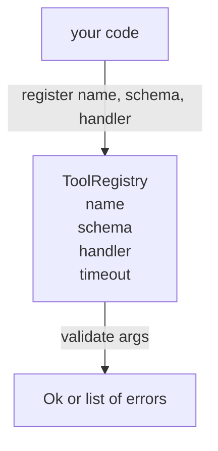

# 带 إعدادات التحقق من المخططات

> الوكيل غير المؤكد الوسيلة، هو الوكيل غير المستخدم الوسيلة.

**Type:** Build
**Languages:** Python
**Prerequisites:** Phase 13 lessons 01-07, Phase 14 lesson 01
**Time:** ~90 minutes

## أهداف التعلم


```figure
cf-registry-validate
```
- تملك نوعا من السجل، اسم أداة التخطيط → مخطط → مدير، دع المرسل فقط تحتاج إلى استفسار مرة واحدة، بعد ذلك即可信任。
- 实现 JSON Schema 2020-12 的一个子集,覆盖百分之九十的工具呼叫 实际使用的关键字──
- 返回精确的、形如 json-pointer 的错路,让模型可以在一次往返内自我修改──
- في حالة عدم وجود إغلبة واضحة رفض الالتحاق مرة أخرى، لأن الصمت يغطي تماما السبب في نقل كتالوجات أدوات الإنتاج
- 保持 اعتبار 纯净(无 I/O、无时间、无全球), بحيث يمكن أن تكون في سجل التشغيل 上重新运行。

## لماذا يجب أن يكون السجل أولاً على الأداة

2026 عام وكيل التشفير المحتملة الأدوات المسجلة، مثل النموذج 能放入单个文本窗口的还多──一个不寻常的 Harness 会注册200 أدوات، ويكشف عشرة إلى أربعين في أي دورة──السجل هو المصدر الحقيقي الوحيد لهذه المشاكل:有哪些 أدوات 、它们的参数是什么形状、应该调用哪个处理──一旦 تم تحديد هذه الردود الثلاثة، يمكن وقف التخمين بقيّة الجزء المتبقية من harness──

نحن يجب تجنب الخطأ، هو إصدار الملاعب دون مخططات، أو إصدار مخططات دون تأكيد.

## سجل الأدوات 长什么样

```text
ToolRecord
  name        : str          (unique, lowercase alphanumeric and underscore segments separated by dots, e.g., snake_case.segment.case)
  description : str          (one line, shown to the model)
  schema      : dict         (JSON Schema 2020-12 subset)
  handler     : Callable     (async or sync, returns Any)
  idempotent  : bool         (dispatcher uses this for retry decisions)
  timeout_ms  : int          (override per-tool dispatcher default)
```

المخطط هو المحقق  الوحيدة التي ستلمس الحجم  المدير لها غير مرئية  نحن نعتزم فصل الثانيين  المخطط هو البيانات  المدير هو الكود  دمجها معاً ، وسوف يجعلك تضع منطق التحقق  في المدير ، وهذا هو بالضبط الخطأ الذي يجب علينا حظرها 

## مخطط JSON 2020-12 子集

المثالية الكاملة لعام 2020-12 هي مقال. نحتاج إلى ثمانية كلمات رئيسية.

```text
type           string / number / integer / boolean / object / array / null
properties     map of property name -> schema
required       list of property names
enum           list of allowed primitive values
minLength      integer, applies to strings
maxLength      integer, applies to strings
pattern        ECMA-262-compatible regex, applies to strings
items          schema applied to every array element
```

هذا يكفي لتغطية أداة API  الحاجة إلى المحتوى الواقعي. نحن لا نضيف كلمات رئيسية ((oneOf، anyOf، allOf، $ref، الشروط) في مخططات الإنتاج فعالة، ولكن سوف تحويل المحقق إلى مشاة شجرة مع دورات.

## مؤشر Json  خطأ طريق

التحقق من التحقق من النجاح، المحقق من التحقق من التحقق من التحقق من التحقق من التحقق من التحقق من التحقق من التحقق من التحقق من التحقق من التحقق من التحقق من التحقق من التحقق من التحقق من التحقق من التحقق من التحقق من التحقق من التحقق من التحقق من التحقق من التحقق من التحقق من التحقق من التحقق من التحقق من التحقق من التحقق من التحقق من التحقق من التحقق من التحقق من التحقق من التحقق من التحقق من التحقق من التحقق من التحقق من التحقق من التحقق من التحقق من التحقق من التحقق من التحقق من التحقق من التحقق من التحقق من التحقق من التحقق من التحقق من التحقق من التحقق من التحقق من التحقق من التحقق من التحقق من التحقق من التحقق من التحقق من التحقق من التحقق من التحقق من التحقق من التحقق من التحقق من التحقق من التحقق من التحقق من التحقق من التحقق من التحقق من التحقق من التحقق من التحقق من التحقق.

```text
{"a": {"b": [1, 2, "x"]}}
                    ^
                    /a/b/2
```

نموذج 读取错误 paths 的能力强于读取句子的能力──如果 schema 要求 `args.user.email`و النموذج يُدخل عدداً كاملاً، الخطأ يجب أن يكون`/user/email`, لم يكن معي`expected_type: string`◊ نموذج 会在下一次调用中修正它,不需要一轮自然语言说明──

## ثبت مع الإغلاق

`register(name, schema, handler, **opts)`默认拒绝重复注册──调用方必须传入 `override=True`才能替换── هي الممارسة الصحية على مستوى التشغيل── اثنين من أجزاء المكتبة التشريعية مسجلة بشكل صامت في نفس اسم الأداة، هي نوع من الحذاء الذي سوف يستغرق أسبوع في الإنتاج لكي تجد──

السجل 暴露三个读取方法──`get(name)`返回记录 或抛出异常──`validate(name, args)`عُدْ إلى واحد`Ok`أو مجموعة من الأخطاء`names()`按注册顺序返回 أدوات الاسماء。

## المحقق هو ما، ليس ما

انها مجرد وظيفة، لا تستخدم معالجين، لا تقوم بنوع التحول القسري.`"42"`لن يمر من خلال نظام الأرقام.

انها ليست حدود آمنة. التحقق من التحقق من التحقق من التحقق من التحقق من التحقق من التحقق من التحقق من التحقق من التحقق من التحقق من التحقق من التحقق من التحقق من التحقق من التحقق من التحقق من التحقق من التحقق من التحقق من التحقق من التحقق من التحقق من التحقق من التحقق من التحقق من التحقق من التحقق من التحقق من التحقق من التحقق من التحقق من التحقق من التحقق من التحقق من التحقق من التحقق من التحقق من التحقق من التحقق من التحقق من التحقق من التحقق من التحقق من التحقق من التحقق من التحقق من التحقق من التحقق من التحقق من التحقق من التحقق من التحقق من التحقق من التحقق من التحقق من التحقق من التحققق من التحققق من التحققق.

## الشكل



## كيف تقرأ ؟

`code/main.py`تعريف`ToolRegistry`.`ToolRecord`.`ValidationError`، و8 وظائف مؤكدة`schema["type"]`أرسلها`enum`schema 当作 untyped enum check 处理) ── كل نوع مؤكد يجب أن يعود إلى قائمة空, يجب أن يعود إلى `ValidationError`列表──المشي على المستوى العلوي 会拼接 أخطاء، و و إلى الوراء إلى أسفل

`code/tests/test_registry.py`تغطية التسجيل، الإغلاق، نجاح التحقق من التحقق من التحقق من التحقق من التحقق من التحقق من التحقق من التحقق من التحقق من التحقق من التحقق من التحقق من التحقق من التحقق من التحقق من التحقق من التحقق من التحقق من التحقق من التحقق من التحقق من التحقق من التحقق من التحقق من التحقق من التحقق من التحقق من التحقق من التحقق من التحقق من التحقق من التحقق من التحقق من التحقق من التحقق من التحقق من التحقق من التحقق من التحقق من التحقق من التحقق من التحقق من التحقق من التحقق من التحقق من التحقق من التحقق من كل كلمة رئيسية في هذه المجموعة.

## استمر في المدى

بعد هذا الجزء من الدراسة، ستريد إضافيتين هي:`$ref`القرار، وكذلك المستخدمة في شكل صارم`additionalProperties: false`دوماً صغيراً جداً‬‬ مع نمو قائمة الأدوات إلى أكثر من خمسين أداة، كلتاً من هذه الأدوات شائعة جداً‬‬‬‬‬‬‬‬‬‬‬‬‬‬‬‬‬‬‬‬‬‬‬‬‬‬‬‬‬‬‬‬‬‬‬‬‬‬‬‬‬‬‬‬‬‬‬‬‬‬‬‬‬‬‬‬‬‬‬‬‬‬‬‬‬‬‬‬‬‬‬‬‬‬‬‬‬‬‬‬‬‬‬‬‬‬‬‬‬‬‬‬‬‬‬‬‬‬‬‬‬‬‬‬‬‬‬‬‬‬‬‬‬‬‬‬‬‬‬‬‬‬‬‬‬‬‬‬‬‬‬‬‬‬‬‬‬‬‬‬‬‬‬‬‬‬‬‬‬‬‬‬‬‬‬‬‬‬‬‬‬‬‬‬‬‬‬‬‬‬‬‬‬‬‬‬‬‬‬‬‬‬‬‬‬‬‬‬‬‬‬‬‬‬‬‬‬‬‬‬‬‬‬‬‬‬‬‬‬‬‬‬‬‬‬‬‬‬‬‬‬‬‬‬‬‬‬‬‬‬‬‬‬‬‬‬‬‬‬‬‬‬‬‬‬‬‬‬‬‬‬‬‬‬‬‬‬‬‬‬‬‬‬‬‬‬‬‬‬‬‬‬‬‬‬‬‬‬‬‬‬‬‬‬‬‬‬‬‬‬‬‬‬‬‬‬‬‬‬‬‬‬‬‬‬‬‬‬‬‬‬‬‬‬‬‬‬‬‬‬‬‬‬‬‬‬‬‬‬‬‬‬‬‬‬‬‬‬‬‬‬‬‬‬‬‬‬‬‬‬‬‬‬‬‬‬‬‬‬‬‬‬‬‬‬‬‬‬‬‬‬‬‬‬‬‬‬‬‬‬‬‬‬‬‬‬‬‬‬‬‬‬‬‬‬‬‬‬‬‬‬‬‬‬‬‬‬‬‬‬‬‬‬‬‬‬‬‬‬‬‬‬‬‬‬‬‬‬‬‬‬‬‬‬‬‬‬‬‬‬‬‬‬‬‬‬‬‬‬‬‬‬‬‬‬‬‬‬‬‬‬‬‬‬‬‬‬‬

下一课(ثلاثة وعشرون) سوف تكوين JSON-RPC استديو النقل، ضع هذا السجل 暴露 إلى العميل النموذج──再下一课(ثلاثة وعشرون) سوف ضع الثاني في معين وقت وتجربات ومبعوثات 后面──
