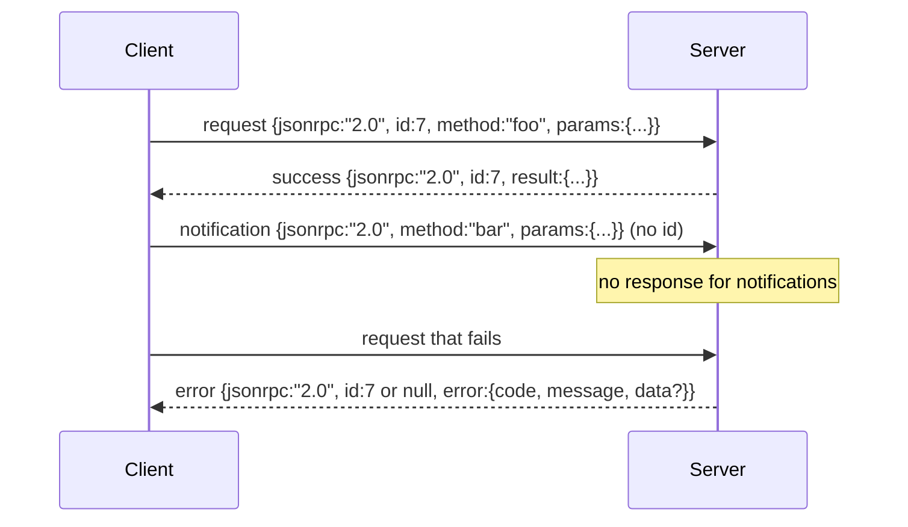

# على أساس JSON-RPC 2.0 من Newline-Delimited Stdio

> النموذج النقل بين العميل و خادم الأداة هو على أساس الاستديو JSON-RPC.

**Type:** Build
**Languages:** Python
**Prerequisites:** Phase 13 lessons 01-07, Phase 14 lesson 01
**Time:** ~90 minutes

## أهداف التعلم


```figure
cf-jsonrpc-frames
```
- استخدام من خلال stdin 和 stdout 上的 newline-delimited JSON framing of JSON-RPC 2.0 通信。
- 映射五个标准错误代码(-32700, -32600, -32601, -32602, -32603),并以正确语义暴露它们──
- 区分请求、响应、通知 和批量, دون أن يطور مفاتيح غلاف جديدة
- كل عمل يعالج خطأ تحليل، لا تلوث بقية جزء من التيار.
- استخدام io.BytesIO  بناء عرض تمهيده بنفسه، جعل الدورة بدون حاجة إلى عملية الولادة الطفل 即可运行──

## لماذا JSON-RPC  مازالت اللغة الفرنسية

2026 سنة، وكيل برمجة في جلسة واحدة في الموقع المشترك مع 12 خادم أداة 通信. كل خادم هو عملية مستقلة أو نهاية آخر عن بعد. صيغة السلك منذ عام 2013 كانت نفسها. JSON-RPC 2.0 هو مواصفات صفحتين. يمكن أن يعيش، وذلك بسبب البدائل.

本课构建 ستديو فاريانتها。 JSON محدد خط جديد。 كل طلب هو واحد 行。 كل رد هو واحد 行。 حدود النقل هو `\n`.

## شكل الأسلاك

هناك أربع أشكال من الغلافات.



الإخطار 没有 `id` الخادم لا يستجيب لها. إذا كان الخادم إلى الإخطار رد فعل، العميل لا يوجد طريقة لربطها إلى موقع مكالمة.

البطاقة هي صف JSON لطلبات أو إشعارات. الخادم يعود إلى صف ردود، حسب الترتيبات، كل مدخل غير إشعارات على ردود.

## خمسة رموز خطأ

```text
-32700  Parse error      JSON could not be parsed
-32600  Invalid Request  Envelope shape is wrong
-32601  Method not found
-32602  Invalid params
-32603  Internal error
```

-32000 إلى -32099  الحفاظ على الأخطاء المحددة على الخادم  جميع الرموز الأخرى هي المحددة على التطبيق `data.exception`中放入 اسم فئة الاستثناء

خطأ في الحسّاسة`id`نعم`null`، لأن الطلب لم يتم تحليله حتى نطاق الحصول على الهوية

## الإطار الجديد و BytesIO عرض

النقل ̇ ̇ ̇ ̇ ̇ ̇ ̇ ̇ ̇ ̇ ̇ ̇ ̇ ̇ ̇ ̇ ̇ ̇ ̇ ̇ ̇ ̇ ̇ ̇ ̇ ̇ ̇ ̇ ̇ ̇ ̇ ̇ ̇ ̇ ̇ ̇ ̇ ̇ ̇ ̇ ̇ ̇ ̇ ̇ ̇ ̇ ̇ ̇ ̇ ̇ ̇ ̇ ̇ ̇ ̇ ̇ ̇ ̇ ̇ ̇ ̇ ̇ ̇ ̇ ̇ ̇ ̇ ̇ ̇ ̇ ̇ ̇ ̇ ̇ ̇ ̇ ̇ ̇ ̇ ̇ ̇ ̇ ̇ ̇ ̇ ̇ ̇ ̇ ̇ ̇ ̇ ̇ ̇ ̇ ̇ ̇ ̇ ̇ ̇ ̇ ̇ ̇ ̇ ̇ ̇ ̇ ̇ ̇ ̇ ̇ ̇ ̇ ̇ ̇ ̇ ̇ ̇ ̇ ̇ ̇ ̇ ̇ ̇ ̇ ̇ ̇ ̇ ̇ ̇ ̇ ̇ ̇ ̇ ̇ ̇ ̇ ̇ ̇ ̇ ̇ ̇ ̇ ̇ ̇ ̇ ̇ ̇ ̇ ̇ ̇ ̇ ̇ ̇ ̇ ̇ ̇ ̇ ̇ ̇ ̇ ̇ ̇ ̇ ̇ ̇ ̇ ̇ ̇ ̇ ̇ ̇ ̇ ̇ ̇ ̇ ̇ ̇ ̇ ̇ ̇ ̇ ̇ ̇ ̇ ̇ ̇ ̇ ̇ ̇ ̇ ̇ ̇ ̇ ̇ ̇ ̇ ̇ ̇ ̇ ̇ ̇ ̇ ̇ ̇ ̇ ̇ ̇ ̇ ̇ ̇ ̇ ̇ ̇ ̇ ̇ ̇ ̇ ̇ ̇ ̇ ̇ ̇ ̇ ̇ ̇ ̇ ̇ ̇ ̇ ̇ ̇ ̇ ̇ ̇ ̇ ̇ ̇ ̇ ̇ `\n`إن لم يتمكن أحد من تحليلها، فسوف يكتب النقل في شريط`id: null`رد الإجابة على الإجابة على الإجابة على الإجابة على الإجابة على الإجابة على الإجابة على الإجابة على الإجابة على الإجابة على الإجابة على الإجابة على الإجابة على الإجابة على الإجابة على الإجابة على الإجابة على الإجابة على الإجابة على الإجابة على الإجابة على الإجابة على الإجابة على الإجابة على الإجابة على الإجابة على الإجابة على الإجابة على الإجابة على الإجابة على الإجابة على الإجابة على الإجابة على الإجابة على الإجابة على الإجابة على الإجابة

في هذه الدروس، نحن نضع على`io.BytesIO`包装成 stdin 和 stdout──server 读取 طلبات حتى EOF،为每一个请求 写进回复,然后回归──客户端 再读回回复──没有过程 spawn──没有时间out──运输 行为与真实子进程管 完全相同,因为 Python 的`io`التواصل  قدمت نفس `.readline()`和 `.write()`العقد

## طريقة إرسال

النقل لا يعرف أي طرق وجودها.`handler(method, params)` التعامل  نتائج العودة أو إلقاء عادة غير عادية  ثلاث فئات استثناء                                                                                                                                                                                                                                                                                                                                                                                                                                                                                                     

```text
MethodNotFound -> -32601
InvalidParams  -> -32602
Anything else  -> -32603 with exception name in data
```

النقل 永远不会看到工具注册表 登录 位于处理器 后面──这正是我们想要的层次化──transport说 JSON-RPC──登录说工具形状──发送器第23课) 把它们合在一起──

## الأخطاء  السير

```text
client writes              server reads             server writes
---------------            -----------              -------------
{...valid request...}      parses ok                {...response, id matches...}
{...broken json...         parse fails              {id:null, error: -32700}
{...valid request...}      parses ok                {...response, id matches...}
{...missing method...}     invalid envelope         {id:X, error: -32600}
```

واحد صف كسر JSON لن توقف حلقة.`method`المجال 不会停止循环──استثناء المُتعامل 不会停止循环──النقل 会持续读取直到 EOF──

## الإخطارات و غير المقارنة

الإخطار هو النار ونسيان. الحوار استخدام الإخطارات تبين الأحداث التقدم. إشارات إلغاء.

本课实现一个出境通知助手,`write_notification` الخادم في الطلب  إجراء استخدامها لإصدار تقدمها  التجربة  عرض هذا النمط: طلب 进来,مدير 发发两条通知进度, ثم كتابة الإجابة النهائية 

## كيف تقرأ ؟

`code/main.py`تعريف`StdioTransport`、ساعد البحث`parse_request`(、三 مساعدون في الكتابة`write_response`.`write_error`.`write_notification`), و حلقة الإرسال `serve`◊ مستمرات رمز الخطأ  في نطاق الوحدة

`code/tests/test_transport.py`تغطي خمسة رموز خطأ  إشعارات  لا تكتب رد)  مجموعات  ترتيب داخل، ترتيب خارج، 跳过 إشعارات)  جسون مكسور  خطأ الحجز 后继续) ، وكذلك المعامل في调用中途写入通知的不对称流程──

## استمر في المدى

هذا النقل 足以支后续课程──إنتاج النقل سوف يضيف ثلاثة أشياء── واحد يمكن أن يستمر في الإرسال  بعد وجود الحقل الهوية التواصل الخاص بك `id`لقد كان هذا، ولكن في الشبكة في الداخل تحتاج أيضا إلى هوية البحث الخارجية`$/cancelRequest`الإخطار، حمل في رحلة الاتصال (ID) ، فضلا عن تسليم يد نوع المحتوى التفاوض، دع نفس المقبض يمكن أن تقول في نفس الوقت JSON-RPC و HTTP Streamable ، هذه الأشياء لن تغير الأسلاك. أنها فقط إضافة البيانات المعدنية 
