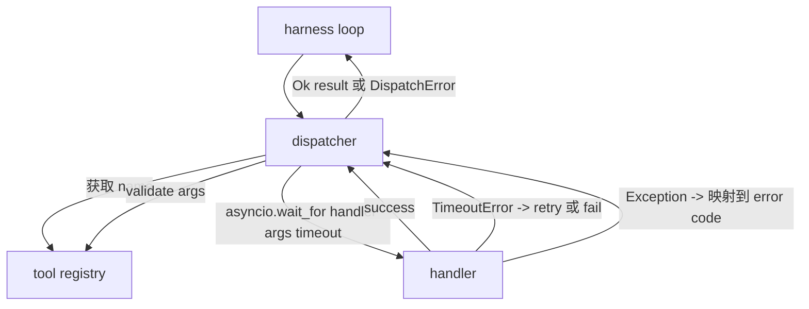
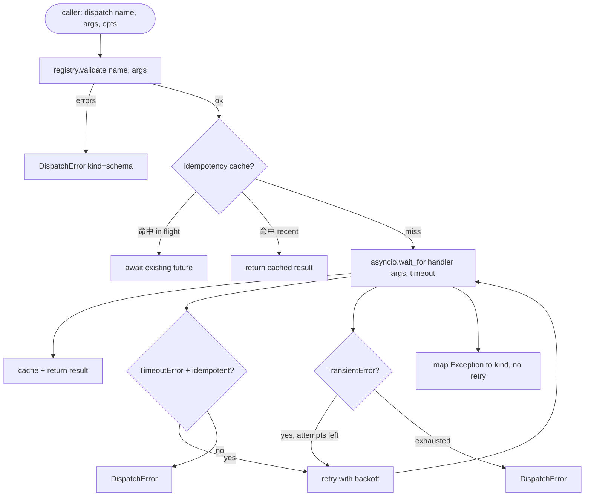

# جهاز مكالمة الوظيفة

> المُرسل هو استخدام النظام لإعداد كل تعهد للشراء في مكان واحد.

**Type:** Build
**Languages:** Python
**Prerequisites:** Phase 13 lessons 01-07, Phase 14 lesson 01
**Time:** ~90 minutes

## أهداف التعلم
- استخدام كل مكالمة وقت  تحميل عامل أداة، جعلها تعود إلى الخطأ المكتوب، بدلا من جعل الحلقة  تعليق ‬‬‬‬‬‬‬‬‬‬‬‬‬‬‬‬‬‬‬‬‬‬‬‬‬‬‬‬‬‬‬‬‬‬‬‬‬‬‬‬‬‬‬‬‬‬‬‬‬‬‬‬‬‬‬‬‬‬‬‬‬‬‬‬‬‬‬‬‬‬‬‬‬‬‬‬‬‬‬‬‬‬‬‬‬‬‬‬‬‬‬‬‬‬‬‬‬‬‬‬‬‬‬‬‬‬‬‬‬‬‬‬‬‬‬‬‬‬‬‬‬‬‬‬‬‬‬‬‬‬‬‬‬‬‬‬‬‬‬‬‬‬‬‬‬‬‬‬‬‬‬‬‬‬‬‬‬‬‬‬‬‬‬‬‬‬‬‬‬‬‬‬‬‬‬‬‬‬‬‬‬‬‬‬‬‬‬‬‬‬‬‬‬‬‬‬‬‬‬‬‬‬‬‬‬‬‬‬‬‬‬‬‬‬‬‬‬‬‬‬‬‬‬‬‬‬‬‬‬‬‬‬‬‬‬‬‬‬‬‬‬‬‬‬‬‬‬‬‬‬‬‬‬‬‬‬‬‬‬‬‬‬‬‬‬‬‬‬‬‬‬‬‬‬‬‬‬‬‬‬‬‬‬‬‬‬‬‬‬‬‬‬‬‬‬‬‬‬‬‬‬‬‬‬‬‬‬‬‬‬‬‬‬‬‬‬‬‬‬‬‬‬‬‬‬‬‬‬‬‬‬‬‬‬‬‬‬‬‬‬‬‬‬‬‬‬‬‬‬‬‬‬‬‬‬‬‬‬‬‬‬‬‬‬‬‬‬‬‬‬‬‬‬‬‬‬‬‬‬‬‬‬‬‬‬‬‬‬‬‬‬‬‬‬‬‬‬‬‬‬‬‬‬‬‬‬‬‬‬‬‬‬‬‬‬‬‬‬‬‬‬‬‬‬‬‬‬‬‬‬‬‬‬‬‬‬‬‬‬‬‬‬‬‬‬‬‬‬‬‬‬‬‬‬‬‬‬‬‬‬‬‬‬‬‬‬‬‬‬‬‬‬‬‬‬
- التطبيقات مع الاضطرابات و أكبر محاولة من محاولة الاحتمالية
- على أساس مفتاح الاستقلال للقيام بمحاولات إعادة التأثير، مثل هذا مع بطء المكالمة الأصلية
- سوف يتم إصلاح استثناءات ومخططات النقل
- باستخدام الحد المتزامن لتسليم الموازية، تجنب أربع عشرة مكالمة أداة من المروحة خارج حلقة الحدث


```figure
cf-dispatch-retry
```

## حيث يجلس المرسل

位于 harness loop(درس عشرين) و سجل الأدوات(درس عشرين واحد)之间──transport(درس اثنين والعشرين) إلى حلقة 输入──loop 把 tool call 交给 dispatcher──dispatcher 调用 registry,运行 handler,并返回 result 或 JSON-RPC 形状的错误包──



المُرسل هو الوحيد الذي يعرف الأوقات والتخفيضات و الأطراف المُعاقرة.

## توقيت المدة

كل أداة لديها توقيت متبعيّن. سجل سجل`timeout_ms`عندما يُغلق الهرمة، سوف يستخدمها المرسل`asyncio.wait_for` وقت انتهاء 时, المهام المُتعاملة سوف يتم إلغاءها, المرسل  عودة `DispatchError(kind="timeout")`.

بالنسبة للأدوات غير ذات القدرة، فالتوقيت المعتمد ليس خطأ قابل للتحقيق.`db.write`ربما قد تم تقديمها، وربما لا.`idempotent`العلم. أدوات عاجزة ستجرب مرة أخرى. أدوات غير عاجزة ستجرب مرة أخرى.

## التجربة المُرجعة مع التخلف المتعرض

سياسة إعادة المحاولة 最多三次尝试──الباكوف هو التخلف المفيد من الاضطرابات

```text
attempt 1  -> delay 0
attempt 2  -> delay 0.1s * (1 + random[0..0.5])
attempt 3  -> delay 0.4s * (1 + random[0..0.5])
```

فقط`timeout`和 `transient`الخطأ سوف يحاول مرة أخرى`schema`خطأ`not_found`أو`internal`خطأ لن يُحاول مرة أخرى. أخطاء الخطة هي مؤكدة.

ستقوم الحلقة بإعادة المحاولة بتحقيق ميزانية المستخدم إذا كان ميزانية المتصلة تبقى من أداة الاتصال إلى صفر، وسوف يقوم المرسل بتفشيل الفشل السريع في المحاولة الأولى، ثم يعود`kind="budget_exceeded"`.

## مفتاح الاختفاء

عندما يصل المكالمة الأصلية 仍然在飞行 时触发重复尝试,是一个 خطأ إنتاج حقيقي.`payments.charge`لقد تم إغلاقه مرتين

المُرسل  قبول可选的 `idempotency_key`إذا كان هناك مكالمة في وقت وصولها مع مفتاح واحد في الطيران، وسوف ينتظر المرسل ذلك في الطيران المستقبل، ويعود إلى نتيجة ذلك.

المفتاح هو مسؤولية المُتصل.`f"{step_id}:{tool_name}:{hash(args)}"`المُبعث لن يُصنع المفتاح لأنّه فقط من الحجج المفتاح يُصنع مكالمتين مختلفة

## غلاف الخطأ

إرسال الفشل يعود إلى شكل واحد

```text
DispatchError
  kind        : "timeout" | "transient" | "schema" | "not_found" | "internal" | "budget_exceeded"
  message     : str
  attempts    : int
  jsonrpc_code: int   （-32601、-32602、-32603 之一）
```

حلقة الحزام ستعمل`kind`映射到下一个状态──`schema`和 `not_found`دخول`on_error`لم يُرسل خطة إعادة التخطيط`timeout`和 `transient`دخول`on_error`, ربما يستجيب , وربما لا يستجيب , يعتمد على المحاولات`budget_exceeded`触发 `on_budget_exceeded`.

## حد التنافسية على المروحة

`gather(*calls)`会同時运行所有 coroutines──四十工具通话意味着四十个开源插座或四十个子工艺管── معظم الخلفيات لا يحبون عميل واحد 发起四十个并行连接──

المُرسل يستخدم الـ " سيفور "`gather`默认 متزامن الحد هو 八── كل مكالمة في الشحن  قبل الحصول على الجهاز الاختصاري، و في الانتهاء في الإفراج.`gather`إنتاج الشكل، ولكن الجدول المفروض هو محدد.

## التدفق لمكالمة واحدة



## كيفية قراءة الرمز

`code/main.py`تعريف`Dispatcher`.`DispatchError`和 `TransientError` المُرسل في التسجيلات المُستقبلية`dispatch(name, args, ...)`هو نقطة دخول الوحيدة.`_run_with_retries`في استخدام`asyncio.wait_for`في الخط  تطبيقها`gather_bounded(calls)`فى الحد المتزامن 运行多个发送──

`code/tests/test_dispatcher.py`تغطي وقت الإنتظار 触发、transient 上的 retry、schema error 上不 retry、idempotency dedupe(2 مع نفس المفتاح المكالمات المتزايدة 折叠为一次处理调用) ، فضلا عن الحد من التزايدة ((semaphore 生效) 

اختبارات استخدام `asyncio.sleep(0)`و على أساس تحديد`Counter`وذلك في خلال دقائق، لا يعتمد على توقيت الساعة الجدارية

## الذهاب إلى أبعد

المراسلين الإنتاج سوف يضيفان توسيعان. أولا، في كل انتقال على إجراء التسجيل المهيكلي.`dispatch.attempt`和 `dispatch.retry`الأحداث)── ثانيا، مفروقات الدائرة: في نافذة واحدة يحدث N 次 الفشل بعد، الأداة  دخول فترة التبريد، الرسائل 会立即回来 `kind="circuit_open"`وبدلاً من محاولة التنفيذ، يمكن إضافة كلتا الاثنين على هذا المُرسل دون تغيير العقد

الدرس 24 سوف نلتزم بالعميل المخطط والتنفيذ، دعك ترى أربعة أجزاء معاً
