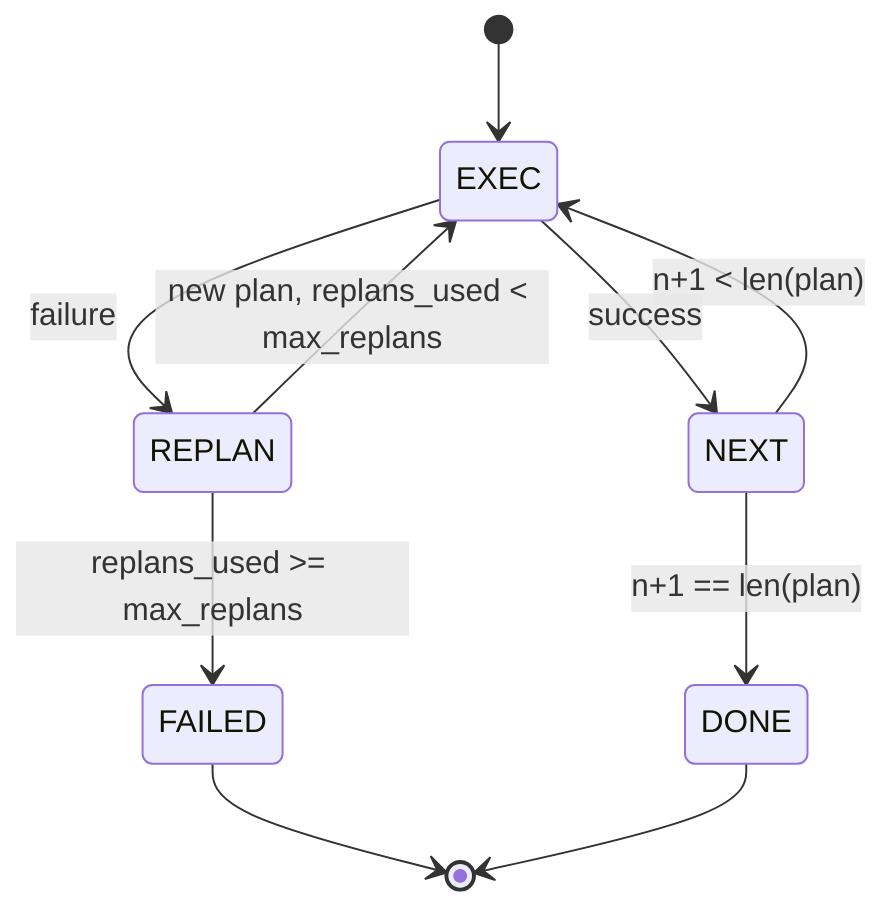

# خطة التدفقات التدريبية

> خطة عدم تحمل الفشل هي النص.

**Type:** Build
**Languages:** Python
**Prerequisites:** Phase 13 lessons 01-07, Phase 14 lesson 01
**Time:** ~90 minutes

## أهداف التعلم


```figure
cg-plan-replan
```
- سوف يعبر عن خطة لخطوات منخفضة، ويحصل على التنفيذية قادرة على التفكير في التقدم والنتيجة.
- 顺序执行 steps,并将失败 受控地 转移 回规划者──
- من السير السابق  البدء في إعادة التخطيط، وأخذ خطأ سابق في السياق، دع الخطة التالية 更有信息──
- كل مراجعة تم إصدار خطة مختلفة، فجعلي تتبع أسفل السفر أو UI 能展示 خطة لماذا تغير
- إضافة إلى ذلك، فإنّه من المفترض أن يكون هناك إضافة كبيرة إلى ذلك.

## خطة وتنفيذ، وليس سلسلة من الفكر

وكيل سلسلة الفكر سوف يصدّر رموز،并让循环 猜测工具 call 在哪里结束──خطط-و-إجراء وكيل أولا إصدار خطة مهيكلة، ثم تحديد وضبطها لتنفيذ كل خطوة──خطط هو استخدام البيانات يمكن أن تتطلعها──التنفيذ هو استخدام 通过发送器 运行这些数据──

جزءان. واحد من الخطة. تنشأ خطة. واحد من التنفيذيات. تنفيذ خطة.

```text
1. Abort         （返回 failed，暴露 error）
2. Skip          （将 step 标记为 failed，继续剩余部分）
3. Replan        （把 error 交给 planner，从 cursor 获取新 plan）
```

إعادة التخطيط هو جعل النص حول وكيل اختيارات

## صيغة الخطوة

```text
Step
  id              : int           （在一个 plan revision 内单调递增）
  tool_name       : str
  args            : dict
  expected_outcome: str           （planner 声明的 success condition）
  result          : Any | None
  error           : str | None
```

`expected_outcome`هو المخطط مع الخطوة الأولى الإصدار قصير. لا يجبر المدير على فحصها.

## شكل المخطط

```python
def planner(goal: str, history: list[Step], last_error: str | None) -> list[Step]:
    ...
```

وظيفة نقية`goal`هو هدف المستخدم`history`إضافة إلى ذلك، فإنّه من المفترض أن يكون هناك خطوات قد تم تنفيذها.`last_error`في أول مرة تم تطبيقها هي لا، في بعد كل مرة تم تطبيقها هي الأخيرة رسالة فشل.

المخطط لا يعرف المنفذ. لا يعرف التجربات. لا يعرف المواعيد.

## المُجرم

المفيد هو آلة صغيرة الحكومة. كل خطوة تمر عبر المُرسل. النتيجة.`FAILED`نتيجة الجلسة



## الإصلاح 时的计划 diff

عندما يُعطي المخطط في إعلان الخطة الجديدة بعد فشله، سيتم إصدار خطة واحدة تحتوي على ثلاثة أحكام`plan.diff`الحدث

```text
removed: 旧 plan 中存在但新 plan 中不存在的 step ids 列表
added  : 新 plan 中存在但旧 plan 中不存在的 step ids 列表
revised: tool_name 或 args 已改变的 step ids 列表
```

يمكن تعديلها إلى إضافة خطوات إزالتها، فضلا عن إضافة أخرى إلى التركيز.

## الميزانية الثابتة

`max_steps`حد من إجمالي خطوات التنفيذ في الجلسة بأكملها، بما في ذلك إعادة التخطيط. الاعتراف هو 12.`step_budget`返回 فشل

`max_replans`الحد من الخطة الأولى بعد الخطة المخطط المستخدمة. الحد الأهم هو الخامسة. الحد الأهم هو الخطة المخططة.

## خططيات تحديد في 本课中

هذا الدرس غير مستخدم للنموذج. الدرس يوفر خططاً تحديدياً، وفقًا لذلك.`last_error`خطة اختيار

```text
last_error is None    -> emit 一个 four-step plan
last_error matches X  -> emit 一个绕过 X 的 three-step plan
last_error matches Y  -> emit 一个优雅放弃的 two-step plan
otherwise             -> return []（表示没有内容可 replan）
```

هذا يكفي لتجربة المنفذ في كل طريق انتقال أعلى من السلوك: النجاح ‬إعادة التخطيط ‬إعادة التخطيط ‬مرة مرتين‬إعادة التخطيط ‬إنفاذ ومفروضات الميزانية

## شكل النتيجة

```text
SessionResult
  status      : "completed" | "failed"
  reason      : str     ("goal_met" | "step_budget" | "replan_budget" | "no_plan")
  history     : list[Step]
  revisions   : list[PlanDiff]
  events      : list[Event]
```

الدروس العشرين درجة الحلقة من الحزام يمكن قراءتها مباشرة. درجة الثالثة والعشرين درجة الحمولة من الحمولة من الحمولة من الحمولة من الحمولة من الحمولة من الحمولة من الحمولة من الحمولة من الحمولة من الحمولة من الحمولة من الحمولة من الحمولة من الحمولة من الحمولة من الحمولة من الحمولة من الحمولة من الحمولة من الحمولة من الحمولة من الحمولة من الحمولة من الحمولة من الحمولة من الحمولة من الحمولة من الحمولة من الحمولة من الحمولة من الحمولة من الحمولة من الحمولة من الحمولة من الحمولة من الحمولة من الحمولة من الحمولة من الحمولة من الحمولة من الحمولة من الحمولة من الحمولة من الحمولة من الحمولة من الحمولة من الحمولة من الحمولة من الحمولة من الحمولة من الحمولة من الحمولة من الحمولة من الحمولة من الحمولة من الحمولة من الحمولة من الحمولة من الحمولة من الحمولة من الحمولة من الحمولة من الحمولة من الحمولة من الحمولة من الحمولة من الحمولة من الحمولة من الحمولة من الحمولة من الحمولة من الحمولة من الحمولة من الحمولة من الحمولة من الحمولة من الحمولة من الحمولة من الحمولة من الحمولة من الحمولة من الحمولة من الحمولة من الحمولة من الحمولة من الحمولة من الحمولة من الحولية من الحولية من الحولية من الحولية

## كيفية قراءة الرمز

`code/main.py`تعريف`PlanExecuteAgent`.`Step`.`PlanDiff`.`SessionResult`و المخطط المحدد:`run(goal)`طريقة، عودة `SessionResult`◊ خطة مختلفة                                                                                                                                                                                                                                                                                                                                                                                                                                                                                                                        `(tool_name, args)`أضعاف 计算。

`code/tests/test_agent.py`تغطية النجاح الخطى ∙ مرة واحدة فشل في منتصف خطة            `failed:replan_budget`إستنفاد الإجراءات الإعادة التخطيطية، وإستنفاد الميزانية الخطوة، وكذلك تنسيق الحدث التخلفي للخطط.

## الذهاب إلى أبعد

连接到真实模型 后,你会需要两个扩展──第一,部分计划缓存:当一个计划的六步中前三个成功、后失败时,你不想重新运行前三个──执行者 已保留历史;planner 只需要读取它──第二,并行分支:当前执行者是严格序列的──发行独立分支(`gather_step`بدلاً من ذلك`next_step`يمكن للمخطط أن يستخدم المبعوث في وقت واحد

كلتا هذين يزيدون من التعقيد الحقيقي. بعد أن يتم تحديد المفعول على الإنترنت، كلتا هذين يزيدون من سهولة الإضافة. هذا ما يجب القيام به في هذا الدروس.
