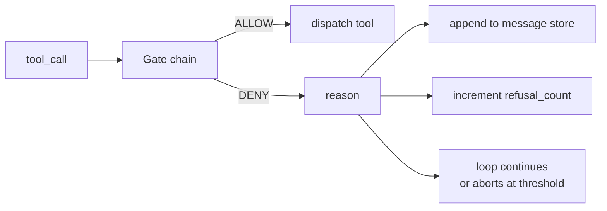
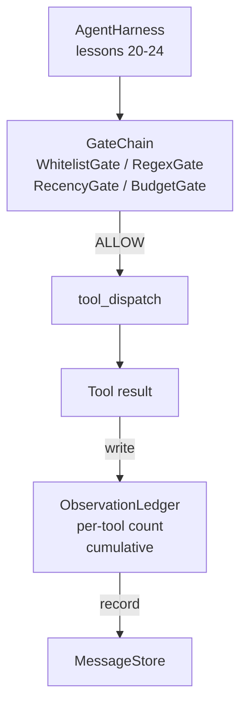

# كابستون 第 25 课:بوابات التحقق وموازنة الملاحظة

> لا يوجد مستوى تأكيد من استخدام العميل، مجرد التعبير عن رغبة المجموعة. سيتم بناء سلسلة البوابة لتحديد، لتحديد ما إذا كان السماح بمكالمة واحدة من الأدوات.

**Type:** Build
**Languages:** Python (stdlib)
**Prerequisites:** Phase 19 · 20-24（Track A1：agent loop、tool registry、message store、prompt builder、model router），Phase 14 · 33（instructions as constraints），Phase 14 · 36（scope contracts），Phase 14 · 38（verification gates）
**Time:** ~90 minutes

## أهداف التعلم

- بناء مع ثقة `evaluate(call)`طريقة`VerificationGate`البروتوكول
- ستقوم بتصميم الميزانية والحديثات والقائمة البيضاء و بوابات Regex
- 通過按工具 和 轉 建索引的 `ObservationLedger`تتبع كل مشاهدة
- عندما يتم تجاوز ميزانية الملاحظة الإجمالية، رفض طلب واحد للأدوات
-                 `GateDecision`السجل،供下游 قابل للملاحظة

## 问题

عندما يسمح الوكيل بـ "تطبيق النموذج الحر" للأدوات، في أول ساعة من استخدامها الحقيقي، ستظهر ثلاث أنواع من الأخطاء.

الأول من الفئة هو الملاحظة المحدودية. في إطار إعادة التنفيذ، سيتم وضع 50000 رمز في المرحلة التالية.

الثانية هي التقارير القديمة. المهام التي تعمل لفترة طويلة تتراكم 50 مرة في المكالمات الأداة. النموذج يضع في المرحلة الثالثة في أول قراءة_ملف عند إعادة قراءة الحالة في الوقت الحقيقي.

الثالثة هي المزايا المزيفة.`web_search`بدأت، ثم لا أعرف كيف بدأت بالعمل`shell`، لأن النموذج صمم اسم أداة ، و استغل 默认宽松──等有人读取痕迹 时, / tmp 里已经放了一个垃圾文件, و مرة واحدة

بوابة التحقق هي الحزمة التي تتولى المسؤولية عن تركيبها.`(call, history, ledger)`في المقابل، فإن الممثل قد يُخبر بالدورة، أو يُؤدي إلى الموافقة أو الرفض، أو يُضيف سبب.

## 概念



البوابة هي أي شيء مع`evaluate(call, ctx) -> GateDecision`方法的对象──chain 是一个有序列表──评估 在第一次拒绝时短路──序很重要:便宜的结构性门 会先于昂贵的代币计数门 运行──

本课提供四门:

- `WhitelistGate`أسماء الأدوات المسموح بها هي مجموعة واضحة. أي محتوى خارج المجموعة سيتم رفضه.
- `RegexGate`أدوات الحجج 会与 regex 匹配。适合拒绝包含 `rm -rf`دعوات القذيفة، أو دعوات HTTP من خلال IP الداخلية.
- `RecencyGate` النموذج يمكن أن يرى فقط مشاهدات N 轮 الأخيرة  مشاهدات سابقة سوف تكون مغطاة  هذا البوابة سوف ترفض نتائجها وسوف تمتد من نافذة مشاهدة قد انتهت مدة الزمنية 
- `BudgetGate` نموذج في الجلسة بأكملها في مجموع القراءة من الرموز هناك حد أعلى.

دفتر الملاحظات 负责记账。 كل مرة ناجحة أداة الاتصال مدينة写入一行: اسم الأداة、التحول、الرموز المنبعثة、التراكمية。 دفتر الملاحظات 回答两个问题:模型总共看到了多少,以及它看到了多少的工具 X──وازحة البوابة 读取第一部──每工具预算门是你的练习内容,它会读取第二部──


```figure
cg-gate-chain
```

## المكونات



حربة سوف تسأل سلسلة. سلسلة 要么点头,要么拒绝. إذا كانت نقطة, أداة سوف تعمل, دفتر حسابات, النتيجة سوف يتم إضافة إلى مخزن الرسائل.

## ماذا ستبني

实现 واحد `main.py`مع اختبارات

1. `Observation`和 `ToolCall`فئات البيانات  تعريف أشكال الأسلاك。
2. `ObservationLedger` سجل `(turn, tool, tokens)`الصفوف,并回答 `cumulative()`和 `per_tool(name)`.
3. `GateDecision` حمل `(allow, reason, gate_name)`.
4. `VerificationGate`كل بوابة تم تنفيذها`evaluate(call, ctx)`.
5. `GateChain`حزمة قائمة مرتبة. ستقوم بتسجيل كل بوابة، وتعود إلى البوابة الأولى. إذا تم عبور جميع البوابات، فإن العودة تسمح.
6. التجربة 运行一个很小的合成代理循环──三轮──第三轮触发预算门,循环 会报告一次干净的拒绝,并带有非零拒绝计量──

معداد الرمز لديه إرادة في استخدامها`len(text) // 4`تعريفات المعلومات والتحقيقات والتحقيقات والتحقيقات

## لماذا سلسلة  ترتيب مهم

إنكار أكثر من السماح مرة أخرى`WhitelistGate`运行 $O(1)$البحث عن الهاش`RegexGate`运行 $O(\text{pattern} \cdot \text{argv})$.`RecencyGate`读取 مخزن رسائل 的一个小片──`BudgetGate`读取整个 sổ cái.‬‬‬‬‬‬‬‬‬‬‬‬‬‬‬‬‬‬‬‬‬‬‬‬‬‬‬‬‬‬‬‬‬‬‬‬‬‬‬‬‬‬‬‬‬‬‬‬‬‬‬‬‬‬‬‬‬‬‬‬‬‬‬‬‬‬‬‬‬‬‬‬‬‬‬‬‬‬‬‬‬‬‬‬‬‬‬‬‬‬‬‬‬‬‬‬‬‬‬‬‬‬‬‬‬‬‬‬‬‬‬‬‬‬‬‬‬‬‬‬‬‬‬‬‬‬‬‬‬‬‬‬‬‬‬‬‬‬‬‬‬‬‬‬‬‬‬‬‬‬‬‬‬‬‬‬‬‬‬‬‬‬‬‬‬‬‬‬‬‬‬‬‬‬‬‬‬‬‬‬‬‬‬‬‬‬‬‬‬‬‬‬‬‬‬‬‬‬‬‬‬‬‬‬‬‬‬‬‬‬‬‬‬‬‬‬‬‬‬‬‬‬‬‬‬‬‬‬‬‬‬‬‬‬‬‬‬‬‬‬‬‬‬‬‬‬‬‬‬‬‬‬‬‬‬‬‬‬‬‬‬‬‬‬‬‬‬‬‬‬‬‬‬‬‬‬‬‬‬‬‬‬‬‬‬‬‬‬‬‬‬‬‬‬‬‬‬‬‬‬‬‬‬‬‬‬‬‬‬‬‬‬‬‬‬‬‬‬‬‬‬‬‬‬‬‬‬‬‬‬‬‬‬‬‬‬‬‬‬‬‬‬‬‬‬‬‬‬‬‬‬‬‬‬‬‬‬‬‬‬‬‬‬‬‬‬‬‬‬‬‬‬‬‬‬‬‬‬‬‬‬‬‬‬‬‬‬‬‬‬‬‬‬‬‬‬‬‬‬‬‬‬‬‬‬‬‬‬‬‬‬‬‬‬‬‬‬‬‬‬‬‬‬‬‬‬‬‬‬‬‬‬‬‬‬‬‬‬‬‬‬‬‬‬‬‬‬‬‬‬‬‬‬‬‬‬‬‬‬‬‬‬‬‬‬‬‬‬‬‬‬‬‬‬‬‬‬‬‬‬‬‬‬‬‬‬‬‬‬‬‬‬‬‬‬‬‬‬‬‬‬‬‬

أنت أيضاً يجب أن تتفق مع نصف قطر الانفجار 排序。 المخطط الأبيض هو أقوى的主张: هذا الأداة غير في العقد وسط──بوابة ريجكس 其次: هذا الحجج غير في العقد وسط──جداول في الخلف:البرنامج لا يزال مهتمًا ، ولكن الدعوة في البنية مشروعة── ميزانية وضع في النهاية ، لأنه حسب التعريف ، فإنه سيتم فقط في جميع المراجعات الأخرى تمرير بعد التأثير‬‬‬‬‬‬‬‬‬‬‬‬‬‬‬‬‬‬‬‬‬‬‬‬‬‬‬‬‬‬‬‬‬‬‬‬‬‬‬‬‬‬‬‬‬‬‬‬‬‬‬‬‬‬‬‬‬‬‬‬‬‬‬‬‬‬‬‬‬‬‬‬‬‬‬‬‬‬‬‬‬‬‬‬‬‬‬‬‬‬‬‬‬‬‬‬‬‬‬‬‬‬‬‬‬‬‬‬‬‬‬‬‬‬‬‬‬‬‬‬‬‬‬‬‬‬‬‬‬‬‬‬‬‬‬‬‬‬‬‬‬‬‬‬‬‬‬‬‬‬‬‬‬‬‬‬‬‬‬‬‬‬‬‬‬‬‬‬‬‬‬‬‬‬‬‬‬‬‬‬‬‬‬‬‬‬‬‬‬‬‬‬‬‬‬‬‬‬‬‬‬‬‬‬‬‬‬‬‬‬‬‬‬‬‬‬‬‬‬‬‬‬‬‬‬‬‬‬‬‬‬‬‬‬‬‬‬‬‬‬‬‬‬‬‬‬‬‬‬‬‬‬‬‬‬‬‬‬‬‬‬‬‬‬‬‬‬‬‬‬‬‬‬‬‬‬‬‬‬‬‬‬‬‬‬‬‬‬‬‬‬‬‬‬‬‬‬‬‬‬‬‬‬‬‬‬‬‬‬‬‬‬‬‬‬‬‬‬‬‬‬‬‬‬‬‬‬‬‬‬‬‬‬‬‬‬‬‬‬‬‬‬‬‬‬‬‬‬‬‬‬‬‬‬‬‬‬‬‬‬‬‬‬‬‬‬‬‬‬‬‬‬‬‬‬‬‬‬‬‬‬‬‬‬‬‬‬‬‬‬‬‬‬

## كيف يتوافق مع بقية قطاع المسار A

 الدورة السابقة قد أعطت لك حلقة ‬مكتب الأدوات ‬مخزن الرسائل ‬المبني الفوري ومدولات الجهاز التوجيه‬‬‬‬‬‬‬‬‬‬‬‬‬‬‬‬‬‬‬‬‬‬‬‬‬‬‬‬‬‬‬‬‬‬‬‬‬‬‬‬‬‬‬‬‬‬‬‬‬‬‬‬‬‬‬‬‬‬‬‬‬‬‬‬‬‬‬‬‬‬‬‬‬‬‬‬‬‬‬‬‬‬‬‬‬‬‬‬‬‬‬‬‬‬‬‬‬‬‬‬‬‬‬‬‬‬‬‬‬‬‬‬‬‬‬‬‬‬‬‬‬‬‬‬‬‬‬‬‬‬‬‬‬‬‬‬‬‬‬‬‬‬‬‬‬‬‬‬‬‬‬‬‬‬‬‬‬‬‬‬‬‬‬‬‬‬‬‬‬‬‬‬‬‬‬‬‬‬‬‬‬‬‬‬‬‬‬‬‬‬‬‬‬‬‬‬‬‬‬‬‬‬‬‬‬‬‬‬‬‬‬‬‬‬‬‬‬‬‬‬‬‬‬‬‬‬‬‬‬‬‬‬‬‬‬‬‬‬‬‬‬‬‬‬‬‬‬‬‬‬‬‬‬‬‬‬‬‬‬‬‬‬‬‬‬‬‬‬‬‬‬‬‬‬‬‬‬‬‬‬‬‬‬‬‬‬‬‬‬‬‬‬‬‬‬‬‬‬‬‬‬‬‬‬‬‬‬‬‬‬‬‬‬‬‬‬‬‬‬‬‬‬‬‬‬‬‬‬‬‬‬‬‬‬‬‬‬‬‬‬‬‬‬‬‬‬‬‬‬‬‬‬‬‬‬‬‬‬‬‬‬‬‬‬‬‬‬‬‬‬‬‬‬‬‬‬‬‬‬‬‬‬‬‬‬‬‬‬‬‬‬‬‬‬‬‬‬‬‬‬‬‬‬‬‬‬‬‬‬‬‬‬‬‬‬‬‬‬‬‬‬‬‬‬‬‬‬‬‬‬‬‬‬‬‬‬‬‬‬‬‬‬‬‬‬‬‬‬‬‬‬‬‬‬‬‬‬‬‬‬‬‬‬‬‬‬

## 运行方式

```bash
cd phases/19-capstone-projects/25-verification-gates-observation-budget
python3 code/main.py
python3 -m pytest code/tests/ -v
```

تم طباعة التسجيلات على أثر كل دورة، منها كل قرار بوابة، ومع ذلك تم إصدارها إلى صفر.
