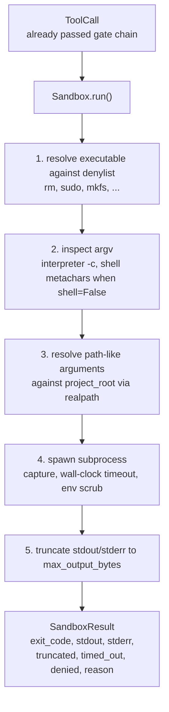
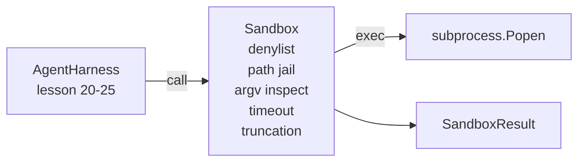

# كابستون 第 26 课:带 دنيلست ومسير سجن رمال

> بوابة التحقق تقرر مرة واحدة دعوة الأداة نعم ينبغي أن تعمل. صناديق الرمل تقرر ما سيحدث عند تشغيلها.

**Type:** Build
**Languages:** Python (stdlib)
**Prerequisites:** Phase 19 · 25（verification gates and observation budget），Phase 14 · 33（instructions as constraints），Phase 14 · 38（verification gates）
**Time:** ~90 minutes

## أهداف التعلم

- بناء حزمة`subprocess.run``Sandbox`درجة، مع وقف الوقت، القبض و التقطيع
- 按名称通过 denylist、按结构通过 argv inspector 拒绝命令──
- رفض أي حجة خارج مسار الجذر من مشروع الإعلان
- في وضع القذيفة 关闭时拒绝 قذيفة طابع المتحفف
- عودة إلى التكوين `SandboxResult`, لتراجع الملاحظة و تقييم الحشد 摄取──

## 问题

يمكن أن يُطلق قذيفة وكيل التشفير يمكن أن يُثبت في جولة واحدة داخل الأبواب الخلفية، مفاتيح خارجية، مفاتيح المطور المحمولة، وتوليد فاتورة سحابة.

تتبع العاملات 中反复出现三类失败──

الأول من الفئة هي خطير التنفيذيات.`sudo`.`chmod -R 777`.`rm -rf`.`mkfs`.`dd` كل هذه ليست من العاملين في الجولة  دينيلست 会按名称和别名 捕获它们‬

الفئة الثانية هي خدوش argv. المُتهمين لا يستطيعون استخدام نموذج القذيفة، سيتمّ إدخالها عبر المُترجم:`python3 -c "import os; os.system('rm -rf /')"`.`bash -c '...'`.`node -e '...'`.`perl -e '...'`-الصندوق الرملي -عليك أن تعرف أي شيء`-c`إنّه فقط مجرد دعوة قذيفة

الثالثة: الهروب من الطريق`./src/main.py`، لكن قرأت`../../etc/passwd`✿ صناديق الرمال 会通过 `os.path.realpath`حل كل حجة طريق،并断言其前,从而将限制它们在监狱内──

هذا الصندوق الرملي ليس حدود أمن النظام التشغيلي ‬بمعنى القرارات التي ينفذها المهاجمين القويين لا يزال بإمكانهم الهرب‬‬‬‬‬‬‬‬‬‬‬‬‬‬‬‬‬‬‬‬‬‬‬‬‬‬‬‬‬‬‬‬‬‬‬‬‬‬‬‬‬‬‬‬‬‬‬‬‬‬‬‬‬‬‬‬‬‬‬‬‬‬‬‬‬‬‬‬‬‬‬‬‬‬‬‬‬‬‬‬‬‬‬‬‬‬‬‬‬‬‬‬‬‬‬‬‬‬‬‬‬‬‬‬‬‬‬‬‬‬‬‬‬‬‬‬‬‬‬‬‬‬‬‬‬‬‬‬‬‬‬‬‬‬‬‬‬‬‬‬‬‬‬‬‬‬‬‬‬‬‬‬‬‬‬‬‬‬‬‬‬‬‬‬‬‬‬‬‬‬‬‬‬‬‬‬‬‬‬‬‬‬‬‬‬‬‬‬‬‬‬‬‬‬‬‬‬‬‬‬‬‬‬‬‬‬‬‬‬‬‬‬‬‬‬‬‬‬‬‬‬‬‬‬‬‬‬‬‬‬‬‬‬‬‬‬‬‬‬‬‬‬‬‬‬‬‬‬‬‬‬‬‬‬‬‬‬‬‬‬‬‬‬‬‬‬‬‬‬‬‬‬‬‬‬‬‬‬‬‬‬‬‬‬‬‬‬‬‬‬‬‬‬‬‬‬‬‬‬‬‬‬‬‬‬‬‬‬‬‬‬‬‬‬‬‬‬‬‬‬‬‬‬‬‬‬‬‬‬‬‬‬‬‬‬‬‬‬‬‬‬‬‬‬‬‬‬‬‬‬‬‬‬‬‬‬‬‬‬‬‬‬‬‬‬‬‬‬‬‬‬‬‬‬‬‬‬‬‬‬‬‬‬‬‬‬‬‬‬‬‬‬‬‬‬‬‬‬‬‬‬‬‬‬‬‬‬‬‬‬‬‬‬‬‬‬‬‬‬‬‬‬‬‬‬‬‬‬‬‬‬‬‬‬‬‬‬‬‬‬‬‬‬‬‬‬‬‬‬‬‬‬‬‬‬‬‬‬‬‬‬‬‬‬

## 概念



صندوق الرمل لديه أربعة محورات رفض: اسم √argv √path √ هيكل √ كل محور √ هو وظيفة خالصة للدعوة، في الوقت الحالي لا يوجد أي عملية فرعية √ فقط جميع المحور √ تم عبورها بعد، العملية الفرعية √ فقط سوف تنشأ‬

`SandboxResult`رموز الخروج استخدام النظام القياسي:0 تعبر عن النجاح، غير صفر تعبر عن الفشل، بالإضافة إلى ثلاثة رموز محرقة: رفض (-100)、وقت_خارج (-101) 和 قصف


```figure
cg-path-jail
```

## المكونات



denylist 是 أسماء أسماء عملة`/bin/rm`.`/usr/bin/rm`)都会解析到相同的基名──argv المفتش 了解解释器形:任何 argv[0] 是解释器 且后续任一 arg 以 `-c`أو`-e`أُردتُ دعوةً لم يُظهر طلبًا واضحًا`;`.`|`.`&`.`>`.`<`الخلفيات`$()`) سيقود إلى رفضها

الطريق السجن هو الجزء الأكثر صعوبة.`project_root`أي شيء يبدو مثل طريق الجدل`/`أو مطابقة الملفات الحالية) سيتم تمريرها`os.path.realpath`归一化,然后与项目根的真路比较──如果解析后的目标不在根下,则拒绝──Symlink escape attempts(项目根中指向外部的 symlink) سيتم فحصها على realpath 阻止,而不是检查字面路径──

## ماذا ستبني

实现是 `main.py`إضافة للاختبارات

1. `SandboxResult`فئة البيانات:exit_code、stdout、stderr、truncated、timed_out、denied、reason、duration_ms。
2. `SandboxConfig`فئة البيانات:project_root、max_output_bytes、timeout_seconds、denylist、interpreter_block。
3. `Sandbox`الفئة:`run(argv, *, shell=False, cwd=None)`عودتي`SandboxResult`.
4. المساعدون الداخليون في رفض:`_check_executable_denylist`.`_check_argv_interpreter`.`_check_shell_metachars`.`_check_path_jail`.
5. التخفيضات المخرجة،带清晰的 `truncated`العلم و السيطرة على التيارات
6. 底部デモ:一系列合法与对抗的呼叫──每一次呼叫都会显示其结果──

صندوق الرمال 默认使用 `subprocess.run`و`shell=False`.`capture_output=True` توقيت ساعة الحائط استخدام `timeout`الحجة`TimeoutExpired`ستقوم مجموعة عملية قتل و تكوين مجموعة واحدة

## لماذا هذا ليس صندوق رمل حقيقي

صناديق الرمل في هذا المرحلة لا تستخدم مساحات الأسماء، مجموعات، وفرق، أو أي عزل على مستوى النواة.

对于生产代理, you need to overlay it: in unprivileged Docker container 中运行、在microVM 中运行、滴滴功能、将项目 root 挂载为读写而已 并将划分 dir 挂载为读写而已、对内存 和 CPU 设置清洁限制、将环境 理为已知安全的白名单──第 29 课会做其中一部分──操作系统隔离 不在本课范围内──

## 运行方式

```bash
cd phases/19-capstone-projects/26-sandbox-runner-denylist
python3 code/main.py
python3 -m pytest code/tests/ -v
```

Demo 会创建一个临时目录,放入一个干净文件,然后运行一组通话――合法通话 会成功――被拒绝的通话 会回带有`denied=True`و سبب ذلك.`timed_out=True`✿ إعداد الحلقة`truncated=True`◊مؤشر JSON من نتائج التمثيل،并以零退出──

## كيف يتوافق مع بقية قطاع المسار A

第 25 课产出门链. 第 26 课课在门许可后运行执行者. 第 27 课的评估 harness 会将沙盒结果与每个任务的期望出门代码进行比较. 第 28 课会围绕每次`Sandbox.run`调用发出 واحد `gen_ai.tool.execution`في المرحلة 29 من الدراسة، سوف نضع وكيلًا حقيقيًا للتشفير في هذه الطبقتين
