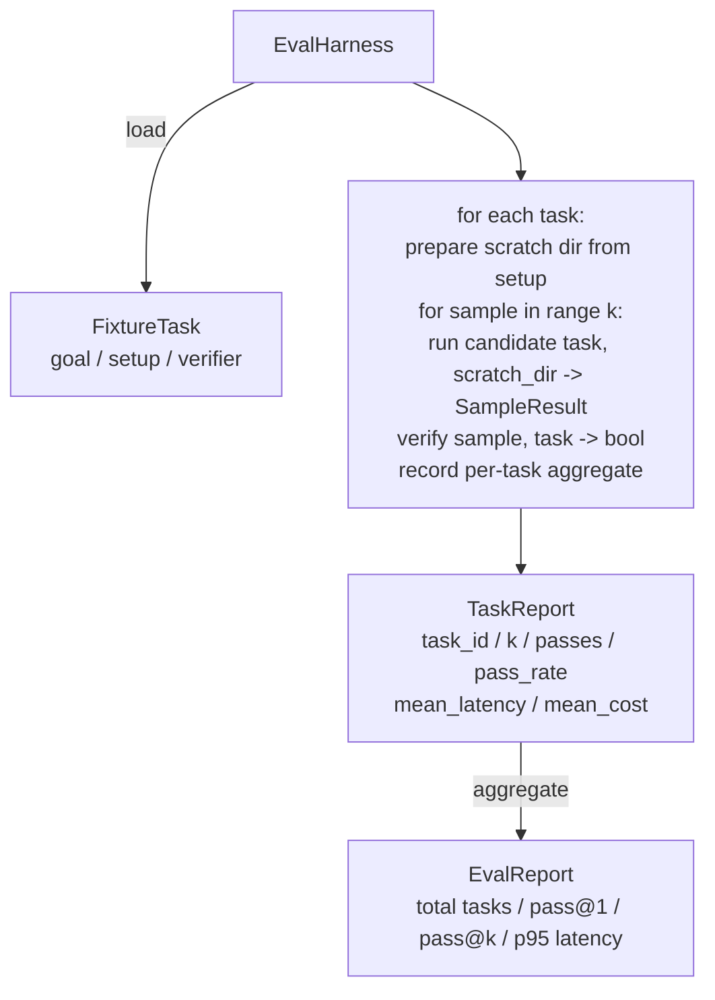

# دراسة الحجر الاحتياطي 27: 带固定 Tasks of Eval Harness

> مستوى وكيل التشفير، يعتمد على ما تستخدم به لقياس مجموعة مهامها. سيتم بناء حزمة تقييم: فإنه يتلقى مهام ثابتة.

**Type:** Build
**Languages:** Python (stdlib)
**Prerequisites:** Phase 19 · 25 (verification gates), Phase 19 · 26 (sandbox runner), Phase 14 · 30 (eval-driven agent development), Phase 14 · 19 (SWE-bench and GAIA benchmarks)
**Time:** ~90 minutes

## أهداف التعلم

- سوف تحدد مهمة الإصلاح 定义为目标、setup 和验证器的三元组──
- للكل مهمة عدة مرات نموذج يدير 打分,并计算 pass@1 和 pass@k。
- لنقوم بتحديد التأخير والتكلفة مع معايير 95 بالمئة
- سوف يُؤكد التحققات المُختلفة الملفات، رمز الخروج، تطابقات الرجكس)
- 输出结构化 JSON report,供回归跟踪脚本 摄取──

## المشكلة

بدون استخدام تقييم في بناء النتائج الاختيارية، سوف تواجه ثلاثة أنواع من النجاحات

الأول هو المرور غير المختبر. يقول العميل أنه قام بإصلاح الحذاء، البشر في نظرة واحدة مختلفة، فان وضع المجموعة على علامة خضراء، بعد ثلاثة أسابيع من اختبار التراجعة  الكشف عن نفس الحذاء. يبدو أن التفكير العميل يبدو معقولًا، ولكن في الواقع لا شيء ما لم يصلح.

والنوع الثاني هو التراجع غير المكتشف. التغييرات المفروضة في النموذج، والتي جعلت العميل يرتفع 4٪ على المهام الواضحة، ولكن انخفض 14٪ على المهام الهادئة.

الثالث هو التنقل بالمهام. والحصول على 100 مهام، والحصول على 95 مهام فقط، لأن شخص ما أعاد تسمية 5 مهام.

تعتمد على إعادة إصدارات المعلومات في كل مرة، وتستخدم مُحققًا، يُرجع إلى صحيح أو خاطئ، حسب التأكد.

## المفهوم

```mermaid
flowchart LR
  F1[fixtures/task_001/<br/>task.json + expected/] --> Harness
  F2[fixtures/task_002/<br/>...] --> Harness
  Harness[Harness<br/>for each task:<br/>setup / run agent k samples /<br/>verify each sample /<br/>record latency, cost]
  Harness --> Report[EvalReport<br/>pass@1 / pass@k<br/>mean ms / p95 ms<br/>mean cost]
```

`FixtureTask`هو ملف JSON صغير، بالإضافة إلى واحد إختياري `expected/`目录──JSON 声明 `id`.`goal`(إعطاء العميل الإشارة)`setup`块(要放入 γρα γραش dir 的文件) و`verifier`块──verifier 块指定 harness 块‬ أحد الوظائف في سجل المحققين،并提供其参数──

ثلاثة أشكال مُحقق 形态覆盖大多数有用任务──

الأول هو`file_equals`بعد تشغيل العميل، سيتم مقارنة الملف المحدد مع المحتوى المتوقع.

الثانية هي`regex_match` سوف يحدد محتوى الملفات مع regex .....................................................................................................................................................................................................................

الثالثة هي`shell_exit_zero`السلطة 运行命令 shell السلطة من خلال الدروس 26 ، فقط عندما تكون الأوامر صفر 退出时才让任务通过──

ستقوم كل مهمة بالعمل`k`次──Pass@k 是 `1 - (1 - p)^k`، من بينها p هو معدل مرور التجربة ؛الارتفاع أيضا تقرير العد الخام ، سهلة لك اكتشاف التباين ؛التأخير هو كل ساعة حائطة من العينة ؛التكلفة هو وكيل

## الهندسة المعمارية



المرشح هو واحد قابل للدعوة:`Callable[[FixtureTask, str], SampleResult]`✿العباءة        `tempfile.mkdtemp()`创建草图目录,并把其路径作为普通字符串传入──harness 不关心候选人 如何工作──候选人 可以是确定性的补丁申请者(对 harness自试测 很有用)、真实LLM代理、fuzzer──契约是 SampleResult──

## ما ستبني

`main.py`提供:

1. `FixtureTask`درجة البيانات
2. `SampleResult`فئة البيانات:نجاح_مبلغ عن نفسه
3. 带 `to_dict()``TaskReport`.`EvalReport`فئات البيانات
4. سوف اسم المؤكد 映射到函数 的`VerifierRegistry` إثباتات إضافة:file_equals、regex_match、shell_exit_zero‬
5. `EvalHarness`فئة── مع مرشح 运行一个任务目录──返回EvalReport──
6. " محمولاً "`tasks/`وسط الخمسة مهام:
   - `fizzbuzz`وسط من خارج واحد
   - `factorial`中缺少 عائد
   - رسالة خطأ وسط الخطأ
   - 空 جسم الوظيفة
   - من خلال القائمة المرتبطة 中的
7. المرشح المرجعي للتأكد`apply_known_fixes`),الوسائل المستخدمة لتحديد النتائج
8. التجربة 打印 EvalReport JSON 并以零 退出──

مهام الإصلاح`tasks/`中 中中 中 中 中 中 中 中 中 中 中 中 中 中 中 中 中 中 中 中 中 中 中 中 中 中 中 中 中 中 中 中 中 中 中 中 中 中 中 中 中 中 中 中 中 中 中 中 中 中 中 中 中 中 中 中 中 中 中 中 中 中 中 中 中 中 中 中 中 中 中 中 中 中 中 中 中 中 中 中 中 中 中 中 中 中 中 中 中 中 中 中 中 中 中 中 中 中 中 中 中 中 中 中 中 中 中 中 中 中 中 中 中 中 中 中 中 中 中 中 中 中 中 中 中 中 中 中 中 中 中 中 中 中 中 中 中 中 中 中 中 中 中 中 中 中 中 中 中 中 中 中 中 中 中 中 中 中 中 中 中 中 中 中 中 中 中 中 中 中 中 中 中 中 中 中 中 中 中 中 中 中 中 中 中 中 中 中 中 中 中 中 中 中 中 中 中 中 中 中 中 中 中 中 中 中 中 中 中 中 中 中 中 中 中 中 中 中 中 中 中 中 中 中 中 中 中 中 中 中 中 中 中 中 中 中 中 中 中 中 中 中 中 中 中 中 中 中 中 中 中 中 中 中 中 中 中 中 中 中 中 中 中 中 中 中 中 中 中 中 中 中 中 中 中 中 中 中 中 中 中 中 中 中 中 中 中 中 中 中 中 中 中 中 中 中 中 中 中 中 中 中 中 中 中 中 中 中 中 中 中 中 中 中 中 中 中 中 中 中 中 中 中 中 中 中 中 中 中 中 中 中 中 中 中 中 中 中 中 中 中 中 中 中 中 中 中 中 中 中 中 中 中 中 中 中 中 中 中 中 中 中 中 中 中 中 中 中 中 中 中 中 中 中 中 中 中 中 中 中 中 中 中 中 中 中 中 中 中 中 中 中 中 中 中 中 中 中 中`tasks/<id>/buggy/`和 `tasks/<id>/expected/`中的源文件──harness 将 buggy 复制到零 dir,把它交给候选人,并根据预期验证──

## لماذا تستخدم المرور@k، وليس مجرد المرور@1

وكلاء ماجستير في العلوم الحقيقية هم随机的.pass@1为0.6看起来像失败.pass@5为0.95 表明 وكيل 大多数时候能得到正确答案,但在早期样本上选错了.

إنما كان هذا هو السبب في أنّه من المفترض أن يكون هناك أيّة إشارة أخرى، فمن الممكن أن تكون هناك إشارة أخرى، فمن المفترض أن تكون هناك إشارة أخرى.

## كيف يتوافق مع بقية قطاع المسار A

الدرس 25 產出門鎖 درس 26 產出沙盒 `shell_exit_zero`المحقق استخدام صندوق الرمل.درس 28 会把每次 harness run 包进 OTel trace.درس 29 针对其中一个捆绑固定 运行端到端演示,并断言参考候选人的 pass@1 = 1.0。

## 运行方式

```bash
cd phases/19-capstone-projects/27-eval-harness-fixture-tasks
python3 code/main.py
python3 -m pytest code/tests/ -v
```

Demo 以 JSON 打印 EvalReport, بما في ذلك pass@1、pass@5、 متوسط التأخير 和逐任务 breakdown── خروج رمز 为 صفر── اختبارات 覆盖验证器函数、pass@k math、fixture loading,以及 harness 针对捆绑参考候选人的端到端 行为──

```figure
pass-at-k
```
