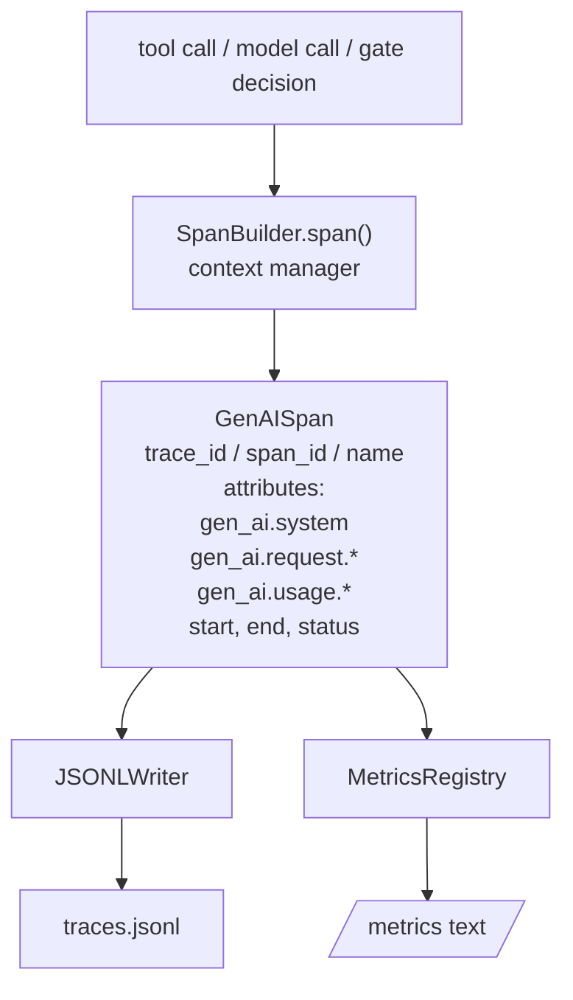
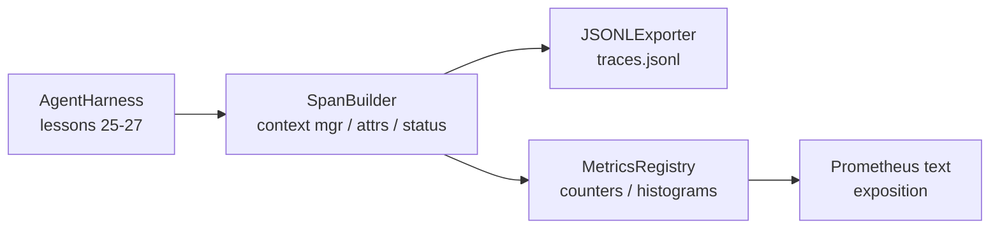

# دراسة كابستون 28: استخدام OTel GenAI Spans و Prometheus Metrics  تحقيق الملاحظة

> 没有可观性的代理 harness 是一个会花钱的黑盒──本课会手写一个跨度构造商,发发出符合OpenTelemetry GenAI 语义公约的记录,把它们写到JSON-Lines 文件,每行一个跨度,并以 Prometheus 文本格式 暴露计和 histograms──整个实现都是 stdlib Python,并且可离线运行──

**Type:** Build
**Languages:** Python (stdlib)
**Prerequisites:** Phase 19 · 25 (verification gates), Phase 19 · 26 (sandbox), Phase 19 · 27 (eval harness), Phase 13 · 20 (OpenTelemetry GenAI), Phase 14 · 23 (OTel GenAI conventions)
**Time:** ~90 minutes

## أهداف التعلم

- 构建一个符合OpenTelemetry GenAI الاتفاقيات الارضية 形态的跨度数据类──
- 实现 JSONL المصدر، كل خط يكتب في فترة ذاتية المحتويات
- 构建带标签 和 Prometheus التعرض على شكل نص ومعدادات ومخططات تاريخية。
- استخدام مدير السياق المدى 包装 أي قابلة للاتصال، سجل مدة、حالة و استثناءات
- الاختبار الإصدارات يمكن أن تمر`json.loads`رحلة ذهاب و ذهاب،并匹配 spec شكل

## المشكلة

وكيل التشفير في المنتجات كل دورة من المنتجات يخرج ثلاثة أنواع من الأثاث: مكالمة نموذجية واحدة، تنفيذ أداة واحدة، فضلا عن قرار بوابة التحقق.

نمط الفشل الأول هو عدم وجود أثر. أظهر المشكلة، ولكن السجل الوحيد هو 500 صفات من سجل الدردشة. لا يوجد سجل أي أداة يتم تنفيذها.

نوع الثاني من النظام الفاشل هو أثر لا يمكن فهمه. كتب هارنس فاصلة، ولكن باستخدام أسماء ميدانية خاصة به.

النمط الثالث هو المقاييس غير المجمعة. يمكنك رؤية مكالمة أداة بطيئة في التتبع، ولكن لا يمكنك الإجابة على مكالمات قراءة الملفات خلال ساعة الماضية.

OpenTelemetry GenAI الاتفاقيات الترجمية 正是为此而存在──它们定义了一小组标准属性,供各类LLM框架的跨度发射者共享──如果你的harness 写入这些属性,所有兼容 OTel的后端都能读取它们──

## المفهوم



كل عملية في الحارمة ستخلق فترة. فترة.`gen_ai.chat`.`gen_ai.tool.execution`)、 تتبع خصائص اتفاقيات جنرال إلكترونية、البدء والنهاية، والحالة‬

اتفاقيات جناي  قيّمت هذه المفاتيح:`gen_ai.system`(أي مزود، على سبيل المثال `anthropic`.`openai`)`gen_ai.request.model`(مثيل الهوية)`gen_ai.request.max_tokens`.`gen_ai.usage.input_tokens`.`gen_ai.usage.output_tokens`.`gen_ai.response.model`.`gen_ai.response.id`.`gen_ai.operation.name`، وكذلك المفاتيح الخاصة بالأدوات `gen_ai.tool.name`和 `gen_ai.tool.call.id`.

المصدر كتب JSONL。 في كل صف من جسم JSON。 هذا هو أداة down游 يمكن تدفق、القبض 和 الإيراد بأبسط صيغة。 المصدر الحقيقي OTel سوف تستخدم OTLP gRPC؛ المصدر JSONL من هذا المرحلة هو خارج الإنترنت، ومثابة الأسعار، وفي كل محطة عمل 上都以零 退出。

المقاييس والبصمات ليست موجودة. كل مرة يطلب فيها أداة`tools_called_total{tool="read_file"}`◊ تاريخي 记录观察到的延迟:`tool_latency_ms{tool="read_file"}`两者都会序列化为 Prometheus نص تصريحات النسخة، هذا هو المقاييس القائمة على السحب.

## الهندسة المعمارية



المهندس هو فئة صغيرة،带有 `span(name, attrs)`طريقة، عودة إلى مدير السياق. مدير السياق في وقت الدخول 记录 start time، في وقت الخروج 记录 end time، إذا تم إلقاء استثناء، فانضاف هذا الاستثناء،并把 النهائي span 推送 إلى المصدر.

سجل المقاييس هو اثنين من القوائم.`{(name, frozen_labels): int}` ستقوم البيانات الهستوغرافية بتحديد العينات الخامة في قائمة الحفاظ عليها، وتعدّل في المعرض 时序列化为 Prometheus histogram buckets──

## ما ستبني

`main.py`提供:

1. `GenAISpan`فئة البيانات: trace_id、span_id、parent_span_id、name、attributes、start_unix_nano、end_unix_nano、status、status_message、events。
2. 带 `span(name, attrs, parent=None)`مدير السياق`SpanBuilder`الصف
3. 带 `export(span)``JSONLExporter`درجة، إضافة كتابة
4. `Counter`和 `Histogram`الفئات، و`MetricsRegistry`.
5. 生成 النسخة النصية`prometheus_exposition(registry)`.
6. 发发发 span 并更新 المقاييس `wrap_tool_call(name)`ديكورات
7. Demo: sintet一次完整代理 دعوة ((مدة أداة خارج层包 gen_ai.chat span) ،写入 traces.jsonl,打印 Prometheus تعريفة,并以 صفر 退出。

فترة id 和 تعقب id هو 16 بايت حبال هيكس، من `os.urandom`生成── هذا يتوافق مع سياق تعقب W3C OTel──المصدر 永不抛出;خطأ IO 会被浮现,但 Harness 会继续运行──

نظام التاريخ لديه مجموعة من السفن الثابتة ((وتيل على الاهتمام للحصول على تأخر ملي ثانية: 5、10、25、50、100、250、500、1000、2500、5000、10000、+Inf)  عينات من قائمة  حفظ؛ التعرض 会按需计算每个 السفن 

## لماذا يكتبون بدلاً من استخدام Openetry-SDK

OTel Python SDK هو اعتماد حقيقي. لديها آلاف الصفوف من البرمجيات، وتتبع العديد من العمليات في مصدر OTLP، فضلا عن أنها سوف تغرق جزء من الميزانية الدراسية التكلفة في الوقت التشغيلي.

الاتفاقيات هي ثابتة. سيتم استمرار تحليل النموذج المحمول الذي يصدر هذا المادة حتى عام 2030، لأن OTel لن يفسد أسماء سمات GenAI.

## كيف يتوافق مع بقية قطاع المسار A

الدرس 25 產出門鎖── الدرس 26 產出沙盒── الدرس 27 產出 eval harness── الدرس 28 让这三者都可观测── الدرس 29 会把端到端的演示的每一步都包进跨度,并在最后打印 Prometheus نص──

## 运行方式

```bash
cd phases/19-capstone-projects/28-observability-otel-traces
python3 code/main.py
python3 -m pytest code/tests/ -v
```

التجربة في هذا الصف العمل في الصف`traces.jsonl`(最后清理), ثم طبع عينة ثلاثة فترات, ومعدات الطباعة مرة أخرى ويعرض histograms Prometheus.

```figure
trace-spans
```
