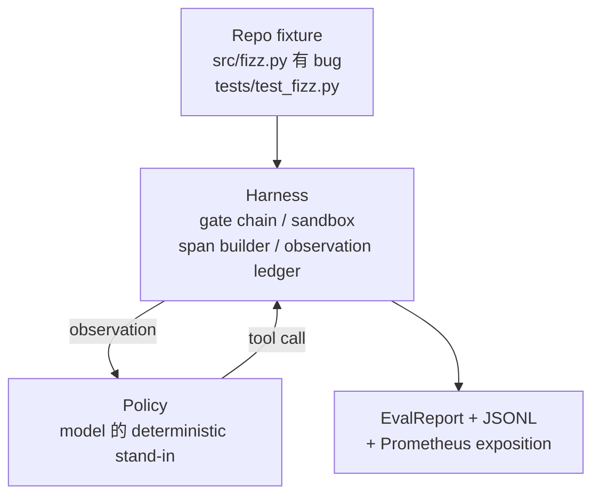
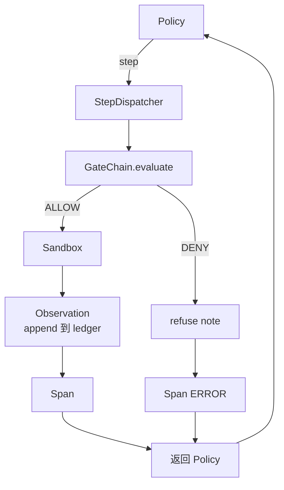

# كابستون  الدورة 29: استغلال العاملة في التدوين

> نتائج المسار A. بوصفه هذا البرنامج تصل سلسلة البوابة، سندبوكس، والحزمة الحيوانية و OTel تمتد 串接成一个可工作的编码代理، لتحديد أكثر من ملفات مشروع Python 中真实的(صغرى مقياس 尺寸) البغ. هذا الوكيل هو السياسة التحديدية، وليس LLM. هذا البدائل جعل البرنامج قابل للاستعادة، وموضح الحزمة 才始终是最关键部分──عقد 完全相同:

**Type:** Build
**Languages:** Python (stdlib)
**Prerequisites:** Phase 19 · 25 (verification gates), Phase 19 · 26 (sandbox), Phase 19 · 27 (eval harness), Phase 19 · 28 (observability), Phase 14 · 38 (verification gates), Phase 14 · 41 (workbench for real repos), Phase 14 · 42 (agent workbench capstone)
**Time:** ~90 minutes

## أهداف التعلم

- ستقوم بإنشاء سلسلة البوابة، صندوق الرمال، وسلسلة الحيوانات، ومدفع المجال، وتكوين حلول عاملة واحدة.
- 实现一个使用 read_file、run_tests 和 write_file 修复 إصلاح الأخطاء السياسة الحتمية‬
- في فان واحد من نهاية إلى آخر من خلال التنفيذ القسري للميزانية الدورية والميزانية الرسمية الملاحظة
- لتنفيذ عمليات إصدار كاملة من OTel GenAI آثار و Prometheus المقاييس
- وكيل التحقق في أقل من 12 خطوة في حل المصلحة، و الأدوات القانونية

## المشكلة

معظم الوكلاء التجريبية هم معزولون: مجرد مربع رمل، مجرد حزمة تقييم، مجرد إصدار فترة.

سلسلة البوابة  أعطت السماح، ولكن صندوق الرمال لأن سلسلة  لم يكن هناك توقعات  سبب رفضها  الحافظة  تسجيل مرور، ولكن OTel امتدادات  عرض البوابة  رفض الوكيل  دعوى استخدام الأدوات  Prometheus العداد هذا ينبغي أن تزيد مرة واحدة، ولكن تزيد مرتين ‬ الميزانية المراقبة ‬ قد تجاوزت، ولكن العميل ‬ استمر في العمل، لأن الميزانية فقط في السلسلة تتبع، بينما صندوق الرمال لم يعرف‬‬‬‬‬‬‬‬‬‬‬‬‬‬‬‬‬‬‬‬‬‬‬‬‬‬‬‬‬‬‬‬‬‬‬‬‬‬‬‬‬‬‬‬‬‬‬‬‬‬‬‬‬‬‬‬‬‬‬‬‬‬‬‬‬‬‬‬‬‬‬‬‬‬‬‬‬‬‬‬‬‬‬‬‬‬‬‬‬‬‬‬‬‬‬‬‬‬‬‬‬‬‬‬‬‬‬‬‬‬‬‬‬‬‬‬‬‬‬‬‬‬‬‬‬‬‬‬‬‬‬‬‬‬‬‬‬‬‬‬‬‬‬‬‬‬‬‬‬‬‬‬‬‬‬‬‬‬‬‬‬‬‬‬‬‬‬‬‬‬‬‬‬‬‬‬‬‬‬‬‬‬‬‬‬‬‬‬‬‬‬‬‬‬‬‬‬‬‬‬‬‬‬‬‬‬‬‬‬‬‬‬‬‬‬‬‬‬‬‬‬‬‬‬‬‬‬‬‬‬‬‬‬‬‬‬‬‬‬‬‬‬‬‬‬‬‬‬‬‬‬‬‬‬‬‬‬‬‬‬‬‬‬‬‬‬‬‬‬‬‬‬‬‬‬‬‬‬‬‬‬‬‬‬‬‬‬‬‬‬‬‬‬‬‬‬‬‬‬‬‬‬‬‬‬‬‬‬‬‬‬‬‬‬‬‬‬‬‬‬‬‬‬‬‬‬‬‬‬‬‬‬‬‬‬‬‬‬‬‬‬‬‬‬‬‬‬‬‬‬‬‬‬‬‬‬‬‬‬‬‬‬‬‬‬‬‬‬‬‬‬‬‬‬‬‬‬‬‬‬‬‬‬‬

هذا المرحلة هي اختبار التكامل في المسار بأكمله. يجب على العميل أن ينهي حسب الترتيب ستة أشياء: قرأ المشروع.

## المفهوم



سياسة العميل هي آلة دولة واحدة.

`SURVEY`:agent 读取 المشاريع القائمة──下一个状态是 RUN_TESTS──

`RUN_TESTS`:عميل 运行 اختبار أمر. إذا تمت اختبارات، حالة آلة 以 النجاح 停止.

`INSPECT`:agent 读取失败的源文件──下一个状态是FIX──

`FIX`:agent 写入修正后的文件──下一个状态是 VERIFY──

`VERIFY`:agent 再次运行 اختبار الأوامر. إذا تمت اختبارات، توقف النجاح.

كل دولة تتعامل مع مكالمة أداة واحدة. كل مكالمة أداة تمر عبر سلسلة البوابات.

خطأ في الجهاز هو `fizz.py`وسط خارج واحد-بحد-حد-حد السياسة 通過 regex من رسالة فشل الاختبار 中检测出 bug,并发发出修正后的文件──把政策 替换成 LLM 不会改变利用合同──


```figure
cg-harness-weave
```

## الهندسة المعمارية



هذا المرحلة هو الذاتي المحتوي على كل دروس سابقة بدائية في كل مدينة`main.py`في الحد الأدنى من الحجم لإعادة تنفيذها، لذا فإن هذه الدورة لا تحتاج إلى إدخال الأخوة على النحو المناسب.

## ما ستبني

`main.py`提供:

1. أوائل الحزمة الصغيرة, اسم مع الدروس 25-28 相同:`GateChain`.`Sandbox`.`ObservationLedger`.`SpanBuilder`.`MetricsRegistry`.
2. `CodingAgentPolicy`فئة: تتضمن خمس دولات
3. `Repo`مساعد: جاهز لشربها، والتي تحتوي على مجموعة من أجهزة البغغغ
4. `AgentRun`الفئة: سياسة القيادة، من خلال إرسال القائمة،并返回 `AgentRunReport`.
5. واحد مقبض على المجموعة`fixture_repo/`), يتضمن src/fizz.py、tests/test_fizz.py، وكذلك المتوقع/شجرة لاستخدامها في استخدام تقييم الاستخدام
6. التجربة: من المنتصف إلى المنتظر، طباعة متابعة خطوة بخطوة، اختصار مرسلة،并 طباعة المقاييس

المجموعة المثبتة مع الدرس 27 هيكل المهام نفس الشكل: ملف حذف و ملف اختبار. رسالة فشل الاختبار.

## لماذا السياسة ليست ماجستير في العلوم

الحق LLM  بحاجة إلى مفتاح API ‬دعوة الشبكة، فضلا عن استقرار غير المؤكد‬‬‬‬‬الحشد ‬‬‬‬‬‬‬‬‬‬‬‬‬‬‬‬‬‬‬‬‬‬‬‬‬‬‬‬‬‬‬‬‬‬‬‬‬‬‬‬‬‬‬‬‬‬‬‬‬‬‬‬‬‬‬‬‬‬‬‬‬‬‬‬‬‬‬‬‬‬‬‬‬‬‬‬‬‬‬‬‬‬‬‬‬‬‬‬‬‬‬‬‬‬‬‬‬‬‬‬‬‬‬‬‬‬‬‬‬‬‬‬‬‬‬‬‬‬‬‬‬‬‬‬‬‬‬‬‬‬‬‬‬‬‬‬‬‬‬‬‬‬‬‬‬‬‬‬‬‬‬‬‬‬‬‬‬‬‬‬‬‬‬‬‬‬‬‬‬‬‬‬‬‬‬‬‬‬‬‬‬‬‬‬‬‬‬‬‬‬‬‬‬‬‬‬‬‬‬‬‬‬‬‬‬‬‬‬‬‬‬‬‬‬‬‬‬‬‬‬‬‬‬‬‬‬‬‬‬‬‬‬‬‬‬‬‬‬‬‬‬‬‬‬‬‬‬‬‬‬‬‬‬‬‬‬‬‬‬‬‬‬‬‬‬‬‬‬‬‬‬‬‬‬‬‬‬‬‬‬‬‬‬‬‬‬‬‬‬‬‬‬‬‬‬‬‬‬‬‬‬‬‬‬‬‬‬‬‬‬‬‬‬‬‬‬‬‬‬‬‬‬‬‬‬‬‬‬‬‬‬‬‬‬‬‬‬‬‬‬‬‬‬‬‬‬‬‬‬‬‬‬‬‬‬‬‬‬‬‬‬‬‬‬‬‬‬‬‬‬‬‬‬‬‬‬‬‬‬‬‬‬‬‬‬‬‬‬‬‬‬‬‬‬‬‬‬‬‬‬‬‬‬‬‬‬‬‬‬‬‬‬‬‬‬‬‬‬‬‬‬‬‬‬‬‬‬‬‬‬‬‬‬‬‬‬‬‬‬‬‬‬‬‬‬‬‬‬‬‬‬‬‬‬‬‬‬‬‬‬‬‬‬‬‬‬‬‬‬‬‬‬‬‬‬‬‬

سياسة هذا البرنامج هو وكيل ماجستير في إدارة الأعمال حيث القيام بالأشياء الصارمة. سياسة 读取 repo,看到 فشل الاختبار,识别对应行,然后发出修正.

## الادعاء سوف يقرر ماذا

في نهاية المطاف التجربة في الخروج من الخروج 5 أشياء، مجموعة الاختبارات أيضا سوف يعد التأكيد على طريقة البرمجة

السياسة في أقل من 12 خطوة في حل المصلحة

ميزانية الملاحظة 从未超出──

أدوات قانونية 上触发了零次 门拒绝──(وكيل 从未凭空发明一个被拒绝的工具名──)

كل خطوة لديها مدة تتعلق بها

تعريفة (بروميثيوس) 包含一个 `tools_called_total{tool="read_file"}`دخول و واحد`tool_latency_ms`رسم السحرية

## كيف يتوافق مع بقية قطاع المسار A

本课程是集成──Lesson 25 编写了门链──Lesson 26 编写了沙盒──Lesson 27 编写了 eval harness──Lesson 28 编写了可观性──Lesson 29 证明它们作为一个系统 可以工作──真实代理 harness 从这里扩展:把确定性政策 换成模型,把捆绑的固定 换成实例任务,把 JSONL exporter 换成 OTLP──

## 运行方式

```bash
cd phases/19-capstone-projects/29-end-to-end-coding-task-demo
python3 code/main.py
python3 -m pytest code/tests/ -v
```

Demo 会打印 لكل خطوة تتبع ‧ تقرير التقييم النهائي 和 Prometheus تعريفة‬退出码为零──اختبارات 覆盖政策状态过渡、Synthetic tool calls 上的门拒绝、捆绑 fixture 上的端到端运行,以及步骤预算变量──
