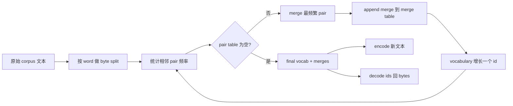
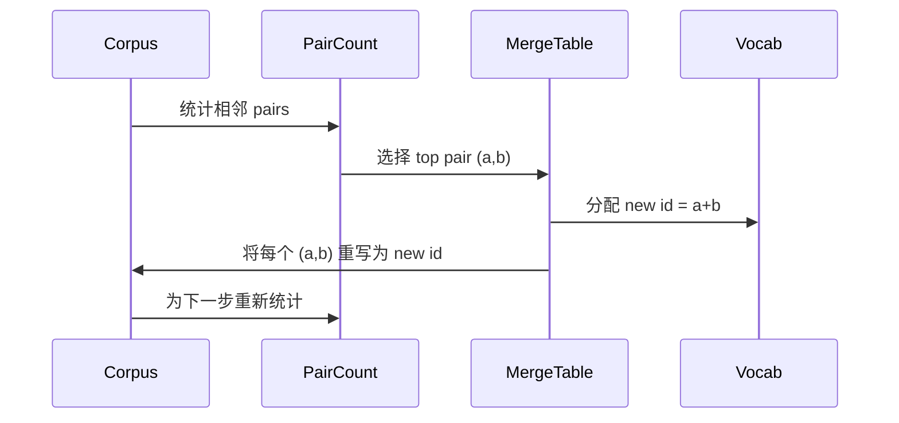

# من صفر بناء BPE Tokenizer

> 字节进, 字节 出, 字节 再回相同字节──构建每个现代文本模型仍然起步于此的Tokenizer──

**Type:** Build
**Languages:** Python
**Prerequisites:** Phase 04 lessons, Phase 07 transformer lessons
**Time:** ~90 minutes

## أهداف التعلم
- 通过反复 merge 最频繁的相邻符号对,从原始文字 corpus 训练 Byte-Pair تشفير المفردات。
- 实现确定性 merge table,并将其应用到新文本上,生成子词 ids 流──
- إعادة إدخال UTF-8 إرادي 往返转换为 ids 并恢复,且不丢失信息──
- 保留并保护 رموز خاصة`<|endoftext|>`.`<|pad|>`),جعلهم قادرين على الاحتفاظ بالتغيير في التدريب و بعد فك التشفير.
- 推理为什么字母 بايت المستوى هو الاطلاق العام Tokenizer


```figure
cap-bpe-merge
```

## الإطار

نموذج اللغة 永远看不到文本──它看到是整数──把字符串 映射为整数列表 并再映射回来东西,就是Tokenizer──这个层做错了,训练运行中每条损失曲线都在衡量错误的东西──

وتحتوي المجموعة الرئيسية في نموذج النصوص المستخدمة في المجموعة التوقيتية. تعريفات: طوكينيزرز عائلة هي طائفة بايت تشفير. فكره صغير.

سوف نبني متغير على مستوى البايتات. الحرف هو 256 بايت خام، وليس نقاط رمز يونيكود. هذا الاختيار يجعل Tokenizer قادرة على معالجة أي إدخال UTF-8، دون الحاجة إلى الاحتفاظ بالخلف إلى Token مجهول.

## خط الأنابيب



الجانب التدريبي 和 الجانب الاستنتاج 共享 merge table──这个共享就是合同── إذا كنت في الاستنتاج 时改变 merge order،就会解码出不同的 ids 流──

## الحرف البايت

قبل 256 هوية الحفاظ على البايتات الخام 0x00 إلى 0xFF. هذا يضمن كل سلسلة إدخال قادرة على إظهار المفردات قبل أي اندماج يحدث. بعد ذلك، نحتفظ بالرموز الخاصة في الحدود البايتية.

قبل التدريب  انظر الجسم  قبل، حسب الفضاء الأبيض و حدود اللحظة  إجراء الانقسام. إذا لم يكن هناك هذا الانقسام، BPE دمج خطوة 会很乐意学习跨越字界的融合, قاموس 会被常见整句短语填满;;

## حلقة التدريب

في كل خطوة تدريبية، يقوم بالدورة بفعل ثلاثة أشياء. يمر عبر كل كلمة في الجسم، ويحسب كل زوج من الرموز الحالية المجاورة، وتعزز عدد المرات التي تظهر بها كلمة، ويحسبها في نفسها. يختار حساب أعلى زوج. يكتب كل مرة تظهر فيها هذا الزوج إلى رمز جديد واحد، ويحدد هويته في المفردات، ثم يجمعها.



تكلفة كل خطوة مع الجسم  كتفريق تسلسل الرمز تعبر عن ذلك                                                                                                                                                                                                                                                    

## تشفير النص الطازج

الاستنتاج 不调用 merge counter──它按学习到的相同顺序应用 merge表──对于一个新词,encoder从字节分开 开始──它扫描当前序列,寻找排名 最低的 merge(最早学习到且可应用的那个)──它执行该 merge──然后再扫描──在当表中没有任何 merge 适用于当前序列时,loop 结束──

按排序 排序 属性使编码确定性,并与训练一致在同一输入上的行为──最先学习到的结合 位于表顶部,并最先应用──如果两个结合都能在同一位置应用, rank 更低的胜出──

## الرموز الخاصة

الوهم الخاص هي البايتات التيار لا يمكن أن تولد أبدا الهويات.

- `<|endoftext|>`في فترة التدريب  دوران تفصل الوثائق‬، يخبر النموذج: مستند جديد من هنا، لا تدع السياق من قبل الوثيقة  تفشّل إلى هنا‬
- `<|pad|>`填充短序列,让批量可以成为矩形── 丢面膜 会在训练期间藏藏它──

رمز  قبول علم، لسمح بإدخال إشارات خاصة في البيانات.`<|endoftext|>`和 `<|pad|>`سوف يتم تحديد البايتات التي يتم تحديدها. عندما يتم فتح العلم، ستظهر السلاسل الحرفية إلى أوراق الهوية المحتفظة، ولن تشارك في أي اندماج.

## ضمان الرحلة ذهابًا وإيابًا

تشفير 后再解码 必须精确返回输入字节──decoder 会按顺序拼接每个 id 的字节扩展──由于每个 id 要么是原始字节,要么是两个已知 id 的连锁,复发式扩展 总会终止于原始字节──decoding 随后返回这些字节 拼出的 UTF-8字符串──

مجموعة الاختبارات في هذا الدروس سوف تكون في جملة غير مرئية`<|endoftext|>`عبارة العلامة 上检查这个属性──

## ما لا يفعله هذا الدروس

لن يُنشئ أكبر نوع من الإنتاج Tokenizers 风格 regex محرك pretokenizer. Preokenizer في هذا هو مساحة بيضاء صغيرة وفرق اللحظة. فإنه يكفي لإنتاج اندماج معقول في مجموعة تدريب صغيرة، ويكون مع التعاقد مع الجزء التالي من سلسلة الدراسة.

لن توازي معداد الزوجات. في بايثون، تكون حلقة عمل مجموعة من عدة آلاف الكلمات في وقت أقل من ثانية واحدة.

## كيفية قراءة الرمز

`main.py`تعريف أربعة أشياء`BPETokenizer`يملكون مخزون لغوي، طاولة الاندماج و طاولة الايطالية الخاصة`train`إنها حلقة تدريبية`encode`إنها مسار الإستنتاج`decode`هو سلسلة البايتات.`code/tests/test_bpe.py`اختبارات وسط ثبت خصائص ذهاب وإياب ‬احتياط رموز خاصة و ترتيب الاندماج‬‬

运行 demo──然后把 demo 中的目标词汇规模从300 改成600,观察 如何下降──那条曲线就是 BPE
