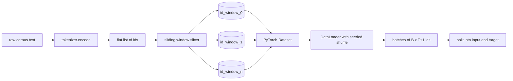
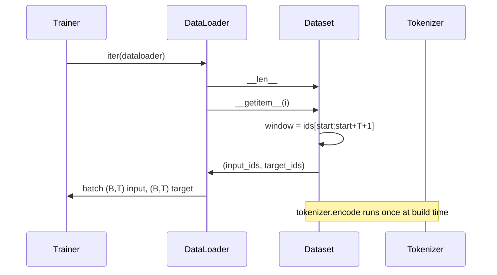

# استخدام النوافذ المزلقة

> 1- تدريب إضافي، وهو من أوراق رمزية إلى وظيفة درجة.

**Type:** Build
**Languages:** Python
**Prerequisites:** Phase 04 lessons, Phase 07 transformer lessons, 本 phase 的 Lesson 30
**Time:** ~90 分钟

## أهداف التعلم


```figure
cap-sliding-window
```
- 通過调用一次 Tokenizer,把原始 corpus 转换为 Token ids 流──
- استخدام قابلة للتصميم من خطوة التكثيف، ضع id 流切成固定长度的窗口──
- إنشاء مجموعة بيانات PyTorch، للتنبؤ بالتوقيت التالي عودة المدخلات و العوامل المستهدفة‬
- 用 DataLoader 包装 dataset,并使用按时 设定种子 的确定性混动──
- 推理步步、冗余和有效数据集大小 之间的权衡──

## 框架

一次预训运行 每次读取一批代码,并更新模型──形状的每批 由训练合同 固定──对于因果语言模型,批量 持有`(B, T)`أرقام إدخال 和 `(B, T)`الهدف هو إدخال يسار واحد. عمل خط أنابيب البيانات، هو من الممكن أن يكون هناك عدد من غيغابايت في جسم النص الأصلي، حسب الحاجة.

سوف يُبني هذا المخطط. سوف يُحوّل Tokenizer المقال إلى قائمة طويلة جداً. سوف يُقطع هذا القائمة على عدة أمثلة. سوف يُختلط هذا القائمة. سوف يُختلط هذه القائمة على عدة أمثلة. سوف يُعرض المجموعة المعلوماتية على عدة أمثلة. سوف يُعرضها على عدة مضغوطات. سوف يُعَدّها DataLoader على عدة أجزاء.

## عقد شكل

الـ LM 消费形状为 `(B, T)`أوراق الهوية، من بينها`B`هو حجم اللحظة`T`هو طول السياق.`t`الهدف هو الموقع`t+1`المدخلات. هذا يعني كل مثال التدريب`T+1`个原始 ids──window step 控制相邻 مثالات 之间有多少重叠──



المقطوع لن يتجاوز أبدا حدود الجسم`T+1`الموقع، سيلسر سوف يتركها.`<|pad|>`填充尾部也是有效的选择,但它会让Loss Mask变复杂.

## لماذا تستخدم النافذة المزلقة

预训练 corpus 是一条很长的 ids 流―― إذا كان النموذج فقط يرى نافذة غير متداخلة، كل مثال التدريب سوف يعلّم نفسها `T`个边界──调整步骤 会移动这些边界,让模型 看到更多类似预测下一个标记任务──

خطوة`T`سوف يحدث عدم التركيز على النافذة.`T // 2`سوف تتم إنتاج مائة في خمسين من التكثيف،并使有效 المجموعة البيانية 翻倍──stride 为 `1`سوف تتمثل في أكبر تراكم ، و تسمح بتزايد مجموعة البيانات`T`倍──代价是每时代 需要更多计算──收益是边界多样性更高──大多数预训运行使用等于文本长度的步骤,因为体积已经远大于模型 在一个时代内能跑完的规模,所以边界多样性论点更弱──

## فئة مجموعة البيانات

مجموعة بيانات بيتورش هناك طريقتان ضروريتين`__len__`返回 أمثلة 数量。`__getitem__`في شكل عجلات العجلات عودة إلى مثال. لدينا مجموعة بيانات  مخزن محفوفة بعد إعداد الهدف والخطوات. عندما يتم إدراجها، سوف يكون عندها نقطة البدء في نافذة الحساب، لذلك مهما كانت الخطوات  تخلق عدد الأمثلة، تكلفة الذاكرة هي مجرد نسخة من هدف الهدف.



التحولات الفردية تحدث`__getitem__`内部──تعيين البيانات 返回 `(input, target)`، من بينهم`input = window[:-1]`،`target = window[1:]` الاثنين هم متانصرات بطيئة طويلة‬ ‫حلقة تدريبية ستعتبرهم حقيقة أرضية‬

## التشويش القياسي

استخدام `shuffle=True`读取──通过传入一个按时 设定种子的显式 `torch.Generator`عندما تُقارن اثنين فقط من مختلفة عن معايير واحد، هذه الصفة مهمة. عندما لا يوجد بذرة، فإن اثنين من عمليات العمل سوف تكون في ترتيب مختلف.

عقد البذور في هذا المرحلة بسيط جدا`epoch_seed = base_seed + epoch_index` البذور الأساسية في البناء  المؤشر العصر بواسطة المدرب في كل عصر  الزيادة  استخدام نفس البذور الأساسية 重新运行,总会在每个时代看到相同序列──

## عينة العينات

معينة متخلفة في PyTorch 会无放回地均随机选择索引──这正是预训练需要的──对小数据集做细节调整时,合同也一样──DataLoader 通过调用 `B`ثانياً`__getitem__`ليس على كومة  نتائج لتجميع مجموعة واحدة. لأن كل مثال في بناء على طول واحد، لذلك لا حاجة إلى منطق التشبيه.

هذا الصف من أجل البقاء`num_workers=0`في عملية الإنتاج، العمال سيتم تجميعهم`__getitem__`للخطوط الأنابيب لدينا، هذا في الأساس هو لا تشغيل، لأن العمل مجرد لقطعة في الذاكرة العجلة، ولكن مع نفس مجموعة البيانات API يمكن أن تفعل بشكل صافي دعم العمال.

## 计算 أمثلة

对于长度为 `N`طول المواضيع`T`وخطوة`S`,مثالات 数量是 `max(0, 1 + (N - (T + 1)) // S)`本课把这个计算暴露为数据集上的静态方法,这样教练可以不过代代就计算每时代的总步骤──

## 本课不做什么

لن يتم ترقية الكود الكاملة من القرص المتدفق. في الذاكرة، ويعمل كعجلة واحدة. في الذاكرة، ويعمل كعجلة واحدة. في عدد من الملايين من الأرقام، هذا أقل من مائة MB، ويعتبر شكل مناسب.

لا يعالج العديد من الوثائق. الجسم يعتبر كـ 1 条连续的 id 流.`<|endoftext|>`أجهزة تعريف لتصميم الحدود التالية للوثيقة.

## كيف تقرأ ؟

`main.py`تعريف فصول و مساعد واحد`SlidingWindowDataset`هو مجموعة بيانات بيتورش`make_dataloader`عودوا إلى جهاز تحميل بيانات جيد، ومع مولد بذور.`_encode_corpus_to_ids`هو مكالمة Tokenizer مرة واحدة. في أساس المرحلة التجريبية، يتم إنشاء Tokenizer صغير، وتحديد الجسم الداخلي، وتحديد مجموعة بيانات ومحمول بيانات، وتطبيق مجموعة، وتقديم عقد شكل.`code/tests/test_dataset.py`اختبارات وسط ثبت صيغة حساب النافذة التحول واحد 属性 تحريف التحديد والتبادل الدوري

运行示范──然后把背景长度从16 改为 32,观察每时代的例子 数量如何下降──这个数字就是你的每时代步骤预算──
