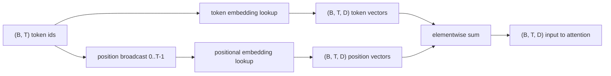
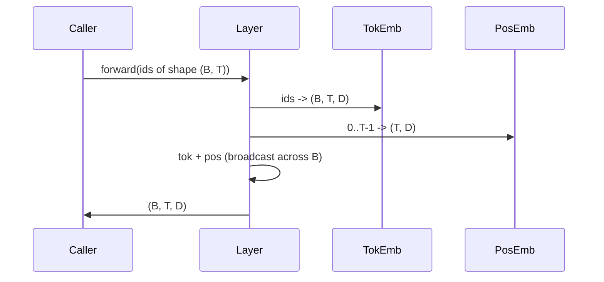

# علامات ووضع التوابل

> المعلومات هي العدد الكامل. النموذج يحتاج إلى متجه. الجداول البحثية تقع بينهما.

**Type:** Build
**Languages:** Python
**Prerequisites:** Phase 04 lessons, Phase 07 transformer lessons, 本 phase 的 Lessons 30 和 31
**Time:** ~90 分钟

## أهداف التعلم


```figure
cc-embedding-lookup
```
- 构建一个代号嵌入式查找表,把词汇IDs 映射到密集向量──
- 构建一个按位置索引的学习位置嵌入式查找表──
- 构建一个按位置索引、没有参数的固定 sinusidal positional embedding──
- وضع رموز ووضع التوابل 组合成 مدخل واحد من كتلة المحول
- مقابل تعلم ووضع الحواجب السينوسيدال في التعميم الطويل وعدد المعلمات

## 框架

أول اتصال مع نموذج الهوية، يتم إجراء البحث في الصفوف في المصفوفة التي تضمنها الوهم. هذا المصفوف كل صفوف لغة هوية، كل حجم نموذج لديه صفوف. البحث عود إلى متجه، والباقي من النموذج سوف يعتبره بمثابة معنى هذا الهوية.

الهوية الوهمية 本身无序──模型 需要第二信号,告诉它位置一 不同于位置十七──这个信号的两种主流选择是学习位置嵌入式的(第二张查找表,每个位置一行) 和固定突形位置嵌入式的数学公式)──选择会带来后果──学习表是参数,并且受到限制的模型 训练时最大的背景长度──突形表 理论上没有参数,公式可以扩展到任何位置,但本课的`SinusoidalPositionalEmbedding`سوف`max_context_length`预计算一张 ثابتة، من `forward`سوف تكون أكبر من الحدود عندما يرتفع؛ لذلك هنا، هناك وحدتين سوف تجبر على تنفيذ أقصى طول السياق. حتى لو كانت الجدول كبيرة بما فيه الكفاية يمكن أن تكون مؤشرة، عندما تتجاوز طول التدريب، ما زال نموذج يمكن أن يظهر قوة.

هذا الدروس سوف يُبني الاثنين، و يُضيفهما مع إضافة الرمزية.

## عقد شكل

مرحلة إدخال الإدخال هي شكل`(B, T)`∙ ∙ ∙ ∙ ∙ ∙ ∙ ∙ ∙ ∙ ∙ ∙ ∙ ∙ ∙ ∙ ∙ ∙ ∙ ∙ ∙ ∙ ∙ ∙ ∙ ∙ ∙ ∙ ∙ ∙ ∙ ∙ ∙`(B, T, D)`من الجهاز الجهازي`D`يَكُونُ طول النموذجِ. كل عنصرِ لِحزمةِ لديهم نفس طولِ السياقِ.`T`كل موقع لديه نفس الوسيط المتجه`D`.



组合方式是 sum، ليس concatenation.`D`في الشبكة الحفاظ على التغيرات،并让模型 基于每个特征决定符号的含义或位置 在每层中哪个占主导

## رمز تضمين المصفوفة

إضافة رمزية هي شكل`(V, D)`من المعايير الزمنية، من بينها `V`هو حجم المفردات.`nn.Embedding(V, D)`暴露它──init 时 时 条目 从一个小高西亚 中抽取, بالنسبة للنماذج على نطاق المحول, تقليديا يعني 为零, انحراف معيار 约为`0.02`  تحديد البداية  ليس مهماً، المهم هو أن تكون متوافقة بين مختلف النشاطات‬

المضي قدما هو عملية تحديد المعدلات مرة واحدة.`(B, T)`معرفات int64 映射为 `(B, T, D)`تعبر: تعبر: تعبر: تعبر: تعبر: تعبر: تعبر: تعبر: تعبر: تعبر: تعبر: تعبر: تعبر: تعبر: تعبر: تعبر: تعبر: تعبر: تعبر: تعبر: تعبر: تعبر: تعبر: تعبر: تعبر: تعبر: تعبر: تعبر: تعبر: تعبر: تعبر: تعبر: تعبر: تعبر: تعبر: تعبر: تعبر: تعبر: تعبر: تعبر: تعبر: تعبر: تعبر: تعبر: تعبر: تعبر: تعبر: تعبر: تعبر: تعبر: تعبر: تعبر: تعبر: تعبر: تعبر: تعبر: تعبر: تعبر: تعبر: تعبر: تعبر: تعبر: تعبر: تعبر: تعبر: تعبر: تعبر: تعبر: تعبر: تعبر: تعبر: تعبر: تعبر: تعبر: تعبر: تعبر: تعبر: تعبر: تعبر: تعبر: تعبر: تعبر: تعبر: تعبر: تعبر: تعبر: تعبر: تعبر: تعبر: تعبر: تعبر: تعبر: تعبر: تعبر: تعبر: تعبر: تعبر: تعبر: تعبر: تعبر: تعبر: تعبر: تعبر: تعبر: تعبر: تعبر: تعبر: تعبر: تعبر: تعبر: تعبر: تعبر: تعبر: تعبر: تعبر: تعبر: تعبر: تعبر: تعبر: تعبر: تعبر: تعبر: تعبر: تعبر: تعبر: تعبر: تعبر: تعبر:

في هذه الحالة، كل مرّة للخلف ستمرّ من خلال جانب الخروج 触碰嵌入的每一行.

## التدريب الموضعي المتعلم

تعلمت التثبيت الموضعي هو الثاني `nn.Embedding`, شكل`(max_context_length, D)` نظرة من موقع id `0, 1, 2, ..., T-1`كفتاح.تسلسل للأمام.تسلسل هذا الموقف.

الميزة المكتسبة من الطاولة هي، إذا كان النموذج فقط تدريب إلى الموقف `T-1`، لا يمكنه استفسار الموقف`T`那一行不存在──使用这种方案的生产 decoder-only models 会把最大的文本长度进入架构,并拒绝处理更长的输入──

## التوابل الموضعية السينوسويدية

التثبيت الموضعي السينوسويدي هو من الموقف إلى وظيفة الجهاز.`p`و الميزة`i` تكوين:

```python
angle = p / (10000 ** (2 * (i // 2) / D))
emb[p, 2k]     = sin(angle)
emb[p, 2k + 1] = cos(angle)
```

هذه الوظيفة لا توجد فيها معايير. كل موقف لها متجه فريد. طول الموجة يتغير على طول الخصائص حسب الجيوهات. لذلك الأبعاد المنخفضة تغير.

بواسطة نفس الوقت`sin`和 `cos` الحصول على طبيعة هو، الموقف `p + k`处的 متجه هو الموقف `p`处 矢量的线性函数──这给注意层提供一个学习相对位置抵消的简单路径──模型 不需要单独参数来表达向后看五个代币──

هذا الدراسة سوف تقوم بتحساب الجدول الصناعي الكامل عندما تقوم ببناءه مرة واحدة ، ثم تقدم إلى الأمام

## 组合

خط أنابيب المدخل 按顺序做三件事──读取 رمزية IDs──查找 رمزية المتجهات──加上 موضعية المتجهات──返回 sum──



المجموعة الخطوة 中的广播 会沿批量尺寸 复制 `(T, D)`الجهاز الموضعي:`(1, T, D)`.

## تجميع النسب

هذا الدروس سوف يتم في نفس المدخلات 上运行两种变化,并印印两种诊断.

الأول هو عدد المعلمات. المتغيرات المتعلمة سوف تتضمن إضافة الرمز`max_context_length * D`个参数── المتغيرات السينوسيدالية 增加零个──

الثاني هو التشابه بين المواقع المجاورة. التشابه بين المواقع المجاورة. التنوع السينوسويدي لديه انخفاض مسطح ويمكن التنبؤ به، لأن الوظيفة متواصلة. التنوع المعلم لديه تشابه متزايد تقريبًا عند البدء، لأن الصفوف هي مستقلة. بعد التدريب، يتطور التنوع المعلم عادة إلى بنية مسطحة مماثلة، ولكن يجب أن يجد هذا النوع من البيانات.

## 本课不做什么

فإنها لا تكوين التشفير الموقفية التدريجية (RoPE) أو AliBi.`(B, T, D)`نطاقات الجهاز التنقل التنقل التطبيقي (التحولات) ، ولكن تطبيقات في خطوة الانتباه-الاعلان، وليس المدخلات.

لا يتطلب التدريب التضمين. التدريب يتطلب الخسارة.

## كيف تقرأ ؟

`main.py`定义了三个模块──`TokenEmbedding`包装 `nn.Embedding(V, D)`.`LearnedPositionalEmbedding`包装 `nn.Embedding(L, D)`.`SinusoidalPositionalEmbedding`جدول الحسابات،并把它暴露为缓冲.`EmbeddingComposer`وضع إضافة رمزية ووضعية إضافة مقيدة معا.`code/tests/test_embeddings.py`اختبارات وسط ثبت الشكل ‬سلوك البث ‬عدد المعايير 和 صيغة السينوسيدل‬‬‬‬‬‬‬‬‬‬‬‬‬‬‬‬‬‬‬‬‬‬‬‬‬‬‬‬‬‬‬‬‬‬‬‬‬‬‬‬‬‬‬‬‬‬‬‬‬‬‬‬‬‬‬‬‬‬‬‬‬‬‬‬‬‬‬‬‬‬‬‬‬‬‬‬‬‬‬‬‬‬‬‬‬‬‬‬‬‬‬‬‬‬‬‬‬‬‬‬‬‬‬‬‬‬‬‬‬‬‬‬‬‬‬‬‬‬‬‬‬‬‬‬‬‬‬‬‬‬‬‬‬‬‬‬‬‬‬‬‬‬‬‬‬‬‬‬‬‬‬‬‬‬‬‬‬‬‬‬‬‬‬‬‬‬‬‬‬‬‬‬‬‬‬‬‬‬‬‬‬‬‬‬‬‬‬‬‬‬‬‬‬‬‬‬‬‬‬‬‬‬‬‬‬‬‬‬‬‬‬‬‬‬‬‬‬‬‬‬‬‬‬‬‬‬‬‬‬‬‬‬‬‬‬‬‬‬‬‬‬‬‬‬‬‬‬‬‬‬‬‬‬‬‬‬‬‬‬‬‬‬‬‬‬‬‬‬‬‬‬‬‬‬‬‬‬‬‬‬‬‬‬‬‬‬‬‬‬‬‬‬‬‬‬‬‬‬‬‬‬‬‬‬‬‬‬‬‬‬‬‬‬‬‬‬‬‬‬‬‬‬‬‬‬‬‬‬‬‬‬‬‬‬‬‬‬‬‬‬‬‬‬‬‬‬‬‬‬‬‬‬‬‬‬‬‬‬‬‬‬‬‬‬‬‬‬‬‬‬‬‬‬‬‬‬‬‬‬‬‬‬‬‬‬‬‬‬‬‬‬‬‬‬‬‬‬‬‬‬‬‬‬‬‬‬‬‬‬‬‬‬‬‬‬‬‬‬‬‬‬‬‬‬‬‬‬‬‬‬‬‬‬‬‬‬‬‬‬‬‬‬‬‬‬‬‬‬‬‬‬‬‬‬‬‬‬‬‬‬‬‬‬‬‬‬‬‬‬‬‬‬‬‬‬‬‬‬‬‬

运行 demo──然后把模型维度 `D`من 64 改为 32, مشاهدة سلسلة طول الموجة السينوسوايدال  كيف تتغير
