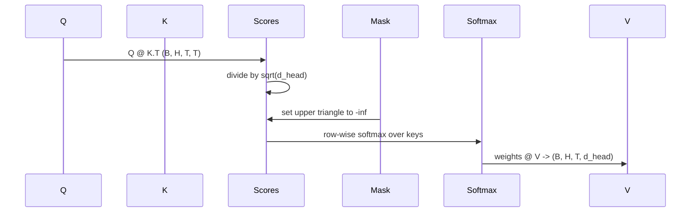

# الاهتمام الذاتي متعدد الرؤوس

> واحد خطي الصورة، ثلاثة أشكال، H 个并行头، واحدة قناع.

**Type:** Build
**Languages:** Python
**Prerequisites:** Phase 04 lessons, Phase 07 transformer lessons, Lessons 30 through 32 of this phase
**Time:** ~90 minutes

## أهداف التعلم
- سوف يتم تنفيذ الطلبات المفتاحية والقيمة المطلوبة إلى طبقة حاسمة، ويتم تقسيمها إلى H 个头.
- استخدام صحيحة التوطين و dtype 处理计算
- تطبيق قناع السببية، لمنع مكان ما من التركيز على الموقع المستقبلي.
- 检查固定输入下 كل رأس الاعتناء الوزن،并推理 كل رأس 关注的内容──
- في مهمة اللعب 上训练一个小型注意区,观察 Loss 随着各头 专门化而下降──


```figure
cap-multihead-attention
```

## الإطار

الاهتمام هو وظيفة، فإنه يجعل تعبير رمز واحد قادرة على الحصول على معلومات من الوهم الآخرين في نفس التسلسل. الاهتمام الذاتي يعبر عن استفسارات، مفاتيح، وقيم تأتي من نفس الدخول.

نمط تحقيق عالي الكفاءة هو استخدام مستوى خطي من`D`投影到 `3 * D`, ثم نقسمها إلى ثلاث صور ثم نقوم بتشكيلها إلى H 个 رأس , لكل حجم`D // H`◊ المواد ‧softmax 和加权求和都 كجزء من تنسور عملية تنفيذ، لذلك يمكن لكل رأس على السريع المكمل والعمل على

هذا الدرس سوف يُبني هذا الكتلة. سوف يُضيف أيضاً قناع السببية، حتى يتمكن نفس الفصل من العمل كنموذج لغة مُقرّر فقط في الطبقة الاهتمام.

## عقد الشكل

输入是 `(B, T, D)`  `(B, T, D)`✿ قناع هو ✿`(T, T)`، أو يمكن أن تنشر إلى ذلك. في الحجر 内部، شكل الانسداد الوسط هو `(B, H, T, d_head)`، من بينهم`d_head = D // H`约束条件是 `D % H == 0`.

```mermaid
flowchart LR
    A["(B, T, D) 输入"] --> B[Linear D -> 3D]
    B --> C["拆分为 Q, K, V"]
    C --> D["reshape 为 (B, H, T, d_head)"]
    D --> E["scores = Q @ K.T / sqrt(d_head)"]
    E --> F[应用 causal mask]
    F --> G[对 keys 做 softmax]
    G --> H["context = weights @ V"]
    H --> I["reshape 为 (B, T, D)"]
    I --> J[输出 Linear D -> D]
    J --> K["(B, T, D) 输出"]
```



两个线性层(QKV الاستطلاع و الاستطلاع) هي المكون الوحيد في الكتلة:

## الانقسام في QKV

朴实实现会有三个独立线性层,分别用于 Q、K 和 V──高效实现只有一层,输出 `3 * D`个特征并分分结果──二在数学上等价,因为三分别乘以 `(D, D)`ضربات المصفوفة ذات الوزن، هي مثل ضرب واحد من كل واحد منهم`(3D, D)`权重的矩阵乘法──

الإصدار الأكثر فعالية أسرع، لأن المسرع يبدأ مرة واحدة فقط من المثاثة، وليس ثلاث مرات.

## رأسها يُعيد تشكيل

بعد الانفصال، Q 、K 、V 都是 `(B, T, D)`◊ لتحويله إلى H 个 متوازية الاهتمام  مشكلة، نعيد تشكيل 为 `(B, T, H, d_head)`, إعادة نقل`(B, H, T, d_head)`المركز يقع على جانب المجموعة، لذا سيتم إعطاء الاهتمام لكل رأس`B * H`个独立实例的批量操作:

`d_head`الدرجة تبقى في النهاية، لذلك النتيجة متمول`Q @ K.transpose(-2, -1)`سوف تتقلص على هذا الدرجة.`(B, H, T, T)`درجات الاهتمام لكل شخص

## التوسع

النتيجة ستعمل في الـ " softmax "`sqrt(d_head)`إذا لم يكن هناك هذا التوسع، فإن منتجات النقاط ستأتي مع`d_head`增大而增大,把软max 推到一种 quasi-all qualities are concentrated on one item 其他条目 are almost disappearing                                                                                                                                                                                                                                               `sqrt(d_head)`يمكن أن يسمح الاختلاف في الدرجات في حجم الرأس مختلف

## القناع السببي

نموذج لغة المفكّر فقط في التوقّع 时只能依赖过去──mask 会强制这一点──具体而言,在软max 之前,`(T, T)`بعد ذلك، تغير الوزن في هذه المواقع إلى 0.



نحن في عملية البناء وضعنا القناع مسجلًا كمسدس ، لذلك سيكون على نفس الجهاز مع النموذج ، وليس جزءًا من الرسم البياني التدريجي. القناع يغطي هذا الكتلة قد يُرى أكبر طول القناع.`(T, T)`منطقة

## التنبؤات

 الحصول على المتجهات السياقية لكل رأس `(B, H, T, d_head)`بعد، نحن نقوم بتحويل`(B, T, H, d_head)`, إعادة تشكيل`(B, T, D)`, ولم تطبق الأخير`(D, D)`线性投影──output projection 让模型可以混合各个头――没有它,H 个头只能通过后层重组,块会受到人为限制──

## فحص الوزن الاهتمام

هذا هو المرحلة المقبلة`return_weights=True`العلم، بعد إعداد، الحجر سوف تكون خارجة، ثم تعود إلى الشكل`(B, H, T, T)`الوزن الاهتمام لكل رأس. الاختيارات المثيرة في الموقع المختصرة.

في النموذج المُدرّب جيد، سوف يتعلم رؤساء مختلفة أنماط مختلفة. بعض الرؤوس سوف تتأمل في التواصل المُقرب. بعض الرؤوس سوف تتأمل في التسلسل المُفتَح. بعض الرؤوس سوف تتأمل في الانتقال المُفتَح. بعض الرؤوس سوف تُفتَتِش الاهتمام بشكل متساوي تقريبا.

## التدريب التجريبي

`main.py`في الجزء السفلي من التجربة سوف نقوم بتحديد كتلة الاهتمام صل إلى رأس LM صغير جداً ، ونكرر المهمة فوق تدريب الموديل بأكمله. كل سطر من الإدخال هو id متزايد ، في جميع أنحاء 下文中复制. الهدف هو إدخال واحد يمتد إلى اليمين ، لذلك يجب أن يتعلم الموديل التعرف على Token التالي مع Token السابقة.`log(64) ~ 4.16`) انخفض إلى أقل بكثير من`1.0`.

الهدف من الادماج ليس تدريب نموذج مفيد، الهدف هو التأكد من أن الدرجة يمكن أن تدفق عبر كل جزء من الحجر، ويمكن لكل رأس أن يتعلم شيء على سؤال واحد واضحة.

## ما لا يفعله هذا الدروس

انها لن تضيف حظر تغذية إلى الأمام. الطبقة المحولة في النموذج الحقيقي هي الاهتمام بعد الطبقتين من MLP، وتحتوي على اتصال بقايا حول كل جزء وطبقة القاعدة.

لا يتم تحقيق التشفير المتحرك أو الموضعي AliBi. لا يتم تطبيقها في مراحل التنبؤ QKV في نفس الكتلة، ولكنها وحدات تعليمية مستقلة.

فإنه لن تحقق الاستنتاج باستخدام cache KV. عبر الممرات إلى الأمام.

## كيفية قراءة الرمز

`main.py`تعريف`MultiHeadSelfAttention` هذا الفصل 包含 دو خطية طبقة ومركز مسجلة من الماسك بوفر‬.ممر إلى الأمام 会依次执行 الاستطلاع‬‬‬الإعادة تشكيل‬الدرجة‬الماسك‬الرمع‬الوزن‬‬الإعادة تشكيل‬‬، وإعادة الاستطلاع‬‬‬‬‬‬‬‬‬‬‬‬‬‬‬‬‬‬‬‬‬‬‬‬‬‬‬‬‬‬‬‬‬‬‬‬‬‬‬‬‬‬‬‬‬‬‬‬‬‬‬‬‬‬‬‬‬‬‬‬‬‬‬‬‬‬‬‬‬‬‬‬‬‬‬‬‬‬‬‬‬‬‬‬‬‬‬‬‬‬‬‬‬‬‬‬‬‬‬‬‬‬‬‬‬‬‬‬‬‬‬‬‬‬‬‬‬‬‬‬‬‬‬‬‬‬‬‬‬‬‬‬‬‬‬‬‬‬‬‬‬‬‬‬‬‬‬‬‬‬‬‬‬‬‬‬‬‬‬‬‬‬‬‬‬‬‬‬‬‬‬‬‬‬‬‬‬‬‬‬‬‬‬‬‬‬‬‬‬‬‬‬‬‬‬‬‬‬‬‬‬‬‬‬‬‬‬‬‬‬‬‬‬‬‬‬‬‬‬‬‬‬‬‬‬‬‬‬‬‬‬‬‬‬‬‬‬‬‬‬‬‬‬‬‬‬‬‬‬‬‬‬‬‬‬‬‬‬‬‬‬‬‬‬‬‬‬‬‬‬‬‬‬‬‬‬‬‬‬‬‬‬‬‬‬‬‬‬‬‬‬‬‬‬‬‬‬‬‬‬‬‬‬‬‬‬‬‬‬‬‬‬‬‬‬‬‬‬‬‬‬‬‬‬‬‬‬‬‬‬‬‬‬‬‬‬‬‬‬‬‬‬‬‬‬‬‬‬‬‬‬‬‬‬‬‬‬‬‬‬‬‬‬‬‬‬‬‬‬‬‬‬‬‬‬‬‬‬‬‬‬‬‬‬‬‬‬‬‬‬‬‬‬‬‬‬‬‬‬‬‬‬‬‬‬‬‬‬‬‬‬‬‬‬‬‬‬‬‬‬‬‬‬‬‬‬‬‬`code/tests/test_attention.py`اختبار ثالث يثبت العقد الشكل خصائص السببية خصائص الضعف خصائص رأس منفصل و تدفق الدرجة

运行 demo──然后把 `n_heads`من 4  زيادة إلى 8                                                                                                                                                                                                                                                                                                                                                                                                                                                                                                                       `d_model=32`، لذلك`d_head=4`), مشاهدة خريطة الحرارة 如何变化──
