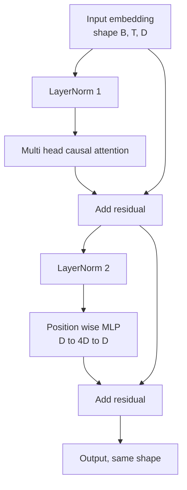
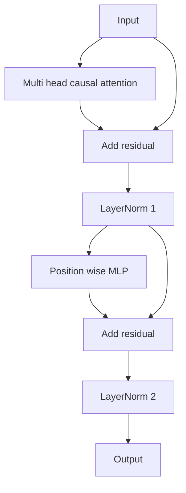

# من التحقق من بلاك المحول

> واحد من الكتل هي كل واحد أساسي من المقرر الحديث LLM.

**Type:** Build
**Languages:** Python
**Prerequisites:** Phase 19 lessons 30 to 33 (tokenizer, embeddings, attention math, batched data loader)
**Time:** ~90 minutes

## أهداف التعلم

- من أربع عناصر حركة تشكيل كتلة المحولات في PyTorch:LayerNorm、عدد الرؤوس الاهتمام السببية、الارتباطات المتبقية、المخططات المثبتة للموقف‬
- وضعت الطبقة القياسية بين تكوينينين ((قبل LN و بعد LN) ، و شرح لماذا واحد منهم لا يحتاج إلى تسخين و أيضا يمكن أن يكون مستقر التدريب.
- في الرأس المتعددة الاهتمام داخل تحقيق الغطاء السببية، جعل الوهم `i`لا أستطيع رؤية الرموز`j > i`.
- تتبع 12 طبقة كومة تدفق التغيرات المتدريجية بين اثنين، لا يعتمد على المفهومات
- في دراسة التالي تجميع 1.24 مليار عنصر GPT 时، ضع هذا الكتلة 作为可直接替换的单元复用──

## المشكلة

المحول هو إعادة كتلة. إذا كان هذا الكتلة الأول بدأ على خطأ، وإعادة تكرار 12 مرات، فإن النموذج الذي تحصل عليه إما في العصر الأول على الانتشار، وإما في الطريق كله يحتاج إلى حرارة الاختراق.

عندما نرى أنّه واضح، فإنّه مُعدّلٌ مُعدّن. هذا الكتيب يُعدّ عبارة عن طريقين متبقين ومواقعٍ طبيعية.

## المفهوم

كل مُعبرة فقط حجر المحولات مد فعل واحد، فإنه يتلقى شكل`(batch, sequence, embedding)`تنسور،并返回相同形状的.‬‬‬‬‬‬‬‬‬‬‬‬‬‬‬‬‬‬‬‬‬‬‬‬‬‬‬‬‬‬‬‬‬‬‬‬‬‬‬‬‬‬‬‬‬‬‬‬‬‬‬‬‬‬‬‬‬‬‬‬‬‬‬‬‬‬‬‬‬‬‬‬‬‬‬‬‬‬‬‬‬‬‬‬‬‬‬‬‬‬‬‬‬‬‬‬‬‬‬‬‬‬‬‬‬‬‬‬‬‬‬‬‬‬‬‬‬‬‬‬‬‬‬‬‬‬‬‬‬‬‬‬‬‬‬‬‬‬‬‬‬‬‬‬‬‬‬‬‬‬‬‬‬‬‬‬‬‬‬‬‬‬‬‬‬‬‬‬‬‬‬‬‬‬‬‬‬‬‬‬‬‬‬‬‬‬‬‬‬‬‬‬‬‬‬‬‬‬‬‬‬‬‬‬‬‬‬‬‬‬‬‬‬‬‬‬‬‬‬‬‬‬‬‬‬‬‬‬‬‬‬‬‬‬‬‬‬‬‬‬‬‬‬‬‬‬‬‬‬‬‬‬‬‬‬‬‬‬‬‬‬‬‬‬‬‬‬‬‬‬‬‬‬‬‬‬‬‬‬‬‬‬‬‬‬‬‬‬‬‬‬‬‬‬‬‬‬‬‬‬‬‬‬‬‬‬‬‬‬‬‬‬‬‬‬‬‬‬‬‬‬‬‬‬‬‬‬‬‬‬‬‬‬‬‬‬‬‬‬‬‬‬‬‬‬‬‬‬‬‬‬‬‬‬‬‬‬‬‬‬‬‬‬‬‬‬‬‬‬‬‬‬‬‬‬‬‬‬‬‬‬‬‬‬‬‬‬‬‬‬‬‬‬‬‬‬‬‬‬‬‬‬‬‬‬‬‬‬‬‬‬‬‬‬‬‬‬‬‬‬‬‬‬‬‬‬‬‬‬‬‬‬‬‬‬‬‬‬‬‬‬‬‬‬‬‬‬‬‬‬‬‬‬‬‬‬‬‬‬‬‬‬‬‬‬‬‬‬‬‬‬‬‬‬‬‬‬‬‬‬‬‬‬‬‬‬‬‬‬‬‬‬‬‬‬‬‬



هذا قبل LN 变体──LayerNorm 位于 residual branch 内部,在子层 之前──الارتباط المتبقية 会把未归一化的信号向前传递──

بعد LN 变体会把 LayerNorm 移到残余添加 之后──



الشكل 完全 نفسها. لا يتطابق سلوك التدريب. استخدام بعد LN 时, على طول المسار المتبقية عكس التدفق.`3e-4`أسفل، هذا الحد الأدنى يختصر بسرعة كافية، حتى تحتاج إلى جدول التدفئة.

### الاهتمام العلوي متعدد الرأس

الاهتمام الطبقة الفرعية سوف تضع إدخال في ثلاث طرق إضافة إلى استفسار  المفتاح  المعدلات  القيمة  كل مؤشر `(B, T, D)`إعادة تشكيل إلى`(B, H, T, D/H)`، من بينهم`H` عدد الرأس تقييم الاهتمام بالنتج`softmax(Q K^T / sqrt(d_k))`, ضع القناع فوق العربة , ومرحباً`V`رؤوس سوف تكون مصممة مرة أخرى`(B, T, D)`العجلة،并再次投投投──mask هي جعل النموذج له جزء واحد من النتائج──نسيان القناع هو في تدريب نموذج سوف يجعله غش──

### المجلس

الموقع الحكيم MLP 会把同一个两层网络独立应用到每个代币──隐藏宽是嵌入宽的四倍,激活是 GELU,并且在第二线性 后接下落──MLP 内部没有代币 互交流──所有代币混合都发生在注意中──

### العلاقات المتبقية تفعل شيئان

يسمح لهم أن يتحول مسار الدرجة عبر العميقة إلى شكل إضافي ، بحيث يحافظ على مقياس المعيار الدرجة عبر 12 طبقة.


```figure
cc-transformer-block
```

## بناءها

`code/main.py`实现:

- `class LayerNorm`,带可学习的规模 和 shift、bias eps,并应用到每个代币矢量──
- `class MultiHeadAttention`,带 `num_heads`.`head_dim = d_model // num_heads`、مضمنة QKV التنبيه 、注册的因果化面具、انتظار وانقطاع والبقايا الانقطاع‬
- `class FeedForward`يحتوي على طبقتين من التشغيل والإيقاف
- `class TransformerBlock`,带 `pre_ln`العلم، يستخدم لتحويل بين اثنين من المتغيرات.
- واحد التجربة، تشكيل 6 طبقة قبل LN كومة و 6 طبقة بعد LN كومة، باستخدام نفس النفاذ،并打印 (أ) شكل الخروج،(ب) مرة مرة للخلف مرر 后 إدراج 处的 渐进规则。

运行它:

```bash
python3 code/main.py
```

输出: اختبار الشكل من كومتين، فضلا عن تمريرها القواعد الدرجة. في نفس معدل التعلم.

## الـ"كثيرة"

- `torch`باستخدام الرياضيات التنسورية`nn.Module`المياه
- غير مستخدم`transformers`، لا تستخدم الأوزان المسبقة.

## أنماط الإنتاج في البرية

ثلاثة طرق ستحول حجر الكتب إلى شيء يمكن تقديمه

**Fused QKV projection.**ثلاث مرات إطلاق النواة و ثلاث مرات مشتركة.`3 * d_model`يمكن أن يتم الانتهاء من نفس العمل في إطلاق واحد، ثم على طول المحور الأخير  فصل الناتج ‬ المسار المدمج على كل نوع من المكثفات تكون أسرع، ووافق مع تنفيذات مرجعية GPT-2‬ LMA‬ و Mistral‬ ‬ الإصدار ‬

**Registered causal mask buffer.**القناع يعتمد على أقصى طول القناع`register_buffer`تمتزيع مرة واحدة، كل مرة إمامة تقطع نافذة نشطة، ومقفزة كل مرة تصل إلى التوزيع.

**Dropout in two places, not three.**الانسحاب 应位于 Attention softmax 之后 ( Attention dropout) ، وكذلك الثاني خطي من MLP 之后 ( residual dropout) ◦ في البداية 本身上做 dropup 会破坏让 Gradient 在深度上传播的添加性身份── بعض التطبيقات المبكرة ارتكبت هذا الخطأ،并为脆弱的训练付出代价──

## استخدمها

- الكتلة في هذا الدراسة يمكن أن لا تغير مباشرة في الدروس 35 من GPT 组装。
- قبل LN 变体是每个现代开权 LLM 使用形式──后LN 变体是 2017年原始注意论文使用形式──了解二者就足以阅读你会遇到的任何解码架构──
- لو غيرت GELU إلى SiLU، حصلت على تشغيل سلسلة LLaMA ‬‬‬‬‬‬‬‬‬‬‬‬‬‬‬‬‬‬‬‬‬‬‬‬‬‬‬‬‬‬‬‬‬‬‬‬‬‬‬‬‬‬‬‬‬‬‬‬‬‬‬‬‬‬‬‬‬‬‬‬‬‬‬‬‬‬‬‬‬‬‬‬‬‬‬‬‬‬‬‬‬‬‬‬‬‬‬‬‬‬‬‬‬‬‬‬‬‬‬‬‬‬‬‬‬‬‬‬‬‬‬‬‬‬‬‬‬‬‬‬‬‬‬‬‬‬‬‬‬‬‬‬‬‬‬‬‬‬‬‬‬‬‬‬‬‬‬‬‬‬‬‬‬‬‬‬‬‬‬‬‬‬‬‬‬‬‬‬‬‬‬‬‬‬‬‬‬‬‬‬‬‬‬‬‬‬‬‬‬‬‬‬‬‬‬‬‬‬‬‬‬‬‬‬‬‬‬‬‬‬‬‬‬‬‬‬‬‬‬‬‬‬‬‬‬‬‬‬‬‬‬‬‬‬‬‬‬‬‬‬‬‬‬‬‬‬‬‬‬‬‬‬‬‬‬‬‬‬‬‬‬‬‬‬‬‬‬‬‬‬‬‬‬‬‬‬‬‬‬‬‬‬‬‬‬‬‬‬‬‬‬‬‬‬‬‬‬‬‬‬‬‬‬‬‬‬‬‬‬‬‬‬‬‬‬‬‬‬‬‬‬‬‬‬‬‬‬‬‬‬‬‬‬‬‬‬‬‬‬‬‬‬‬‬‬‬‬‬‬‬‬‬‬‬‬‬‬‬‬‬‬‬‬‬‬‬‬‬‬‬‬‬‬‬‬‬‬‬‬‬‬‬‬‬‬‬‬‬‬‬‬‬‬‬‬‬‬‬‬‬‬‬‬‬‬‬‬‬‬‬‬‬‬‬‬‬‬‬‬‬‬‬‬‬‬‬‬‬‬‬‬‬‬‬‬‬‬‬‬‬‬‬‬‬‬‬‬‬‬‬‬‬‬‬‬‬‬‬‬‬‬‬‬‬‬‬‬‬‬‬‬‬‬‬‬‬‬‬‬‬‬‬‬‬‬‬‬‬‬

## التمارين

1. أعطني الحجر في كل خطي`bias=False`العلم.‬‬‬‬‬‬‬‬‬‬‬‬‬‬‬‬‬‬‬‬‬‬‬‬‬‬‬‬‬‬‬‬‬‬‬‬‬‬‬‬‬‬‬‬‬‬‬‬‬‬‬‬‬‬‬‬‬‬‬‬‬‬‬‬‬‬‬‬‬‬‬‬‬‬‬‬‬‬‬‬‬‬‬‬‬‬‬‬‬‬‬‬‬‬‬‬‬‬‬‬‬‬‬‬‬‬‬‬‬‬‬‬‬‬‬‬‬‬‬‬‬‬‬‬‬‬‬‬‬‬‬‬‬‬‬‬‬‬‬‬‬‬‬‬‬‬‬‬‬‬‬‬‬‬‬‬‬‬‬‬‬‬‬‬‬‬‬‬‬‬‬‬‬‬‬‬‬‬‬‬‬‬‬‬‬‬‬‬‬‬‬‬‬‬‬‬‬‬‬‬‬‬‬‬‬‬‬‬‬‬‬‬‬‬‬‬‬‬‬‬‬‬‬‬‬‬‬‬‬‬‬‬‬‬‬‬‬‬‬‬‬‬‬‬‬‬‬‬‬‬‬‬‬‬‬‬‬‬‬‬‬‬‬‬‬‬‬‬‬‬‬‬‬‬‬‬‬‬‬‬‬‬‬‬‬‬‬‬‬‬‬‬‬‬‬‬‬‬‬‬‬‬‬‬‬‬‬‬‬‬‬‬‬‬‬‬‬‬‬‬‬‬‬‬‬‬‬‬‬‬‬‬‬‬‬‬‬‬‬‬‬‬‬‬‬‬‬‬‬‬‬‬‬‬‬‬‬‬‬‬‬‬‬‬‬‬‬‬‬‬‬‬‬‬‬‬‬‬‬‬‬‬‬‬‬‬‬‬‬‬‬‬‬‬‬‬‬‬‬‬‬‬‬‬‬‬‬‬‬‬‬‬‬‬‬‬‬‬‬‬‬‬‬‬‬‬‬‬‬‬‬‬‬‬‬‬‬‬‬‬‬‬‬‬‬‬‬‬‬‬‬‬‬‬‬‬‬‬‬‬‬‬‬‬‬‬‬‬‬‬‬‬‬‬‬‬‬‬‬‬‬‬‬‬‬‬‬‬‬‬‬‬‬‬‬‬‬‬‬‬‬‬‬‬‬‬‬
2. 用手写 RMSNorm 替换 `nn.LayerNorm`,并验证 وضعية الخروج 不变──
3. إضافة علم، عودة إلى الرأس الأول من الاعتناء الوزن، ك `(B, T, T)`العجلة: رسم على ثلاثي الأبعاد، تأكد من الارتفاع الرخيص
4. قم بتحقيق صحة العقل،`(2, 16, 384)`الجهاز`H=6`أسفل إرسال إلى اثنين من المتغيرات،并断言在权重初始化相同且 dropup 设为零时,前出不同`not torch.allclose`(‬)

## الشروط الرئيسية

| Term | What people say | What it actually means |
|------|-----------------|------------------------|
| Pre-LN | "Pre norm" | LayerNorm 位于 residual branch 内部，在每个 sublayer 之前；residual 携带未归一化的 signal |
| Post-LN | "Post norm" | LayerNorm 位于 residual add 之后；这是 2017 年论文发布的形式，并且需要 warmup |
| Causal mask | "Triangle mask" | Attention logits 的上三角被设为负无穷，因此当 j 大于 i 时，Token i 不能读取 Token j |
| Fused QKV | "Combined projection" | 一个宽度为 3D 的 linear，而不是三个宽度为 D 的 linears；一个 kernel，一次 matmul |
| Residual stream | "Skip connection" | 自上而下流过每个 block 的未归一化 tensor；也是每个 block 添加到的对象 |

## المزيد من القراءة

- مرحلة 7 دروس 02 ((الاهتمام الذاتي من الصفر) ، فهم هذه الكتل
- المرحلة 7 الدروس 05 ((المحول الكامل) ، معرفة نفس العظام架
- المرحلة 10 الدروس 04 ((قبل التدريب GPT) ، فهم هذه الكتل
- المرحلة 19 الدروس 35 ((هذا المسار) ، سوف تضع 12 كتلة من هذا القبيل  مجموعة في نموذج GPT
