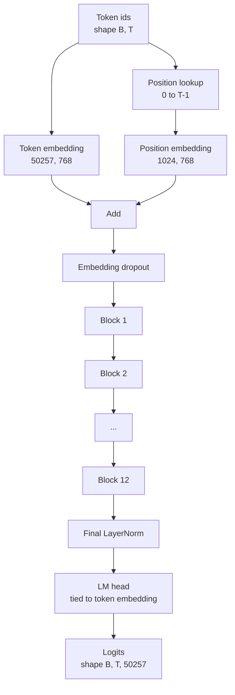
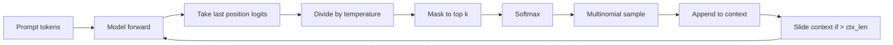

# GPT 模型组装

> 12 كتلة 堆叠, إضافة رمزية, إضافة موقع تتعلم, LayerNorm النهائي, فضلا عن رأس نموذج لغة مقيدة بالوزن.

**Type:** Build
**Languages:** Python
**Prerequisites:** Phase 19 lessons 30 到 34
**Time:** ~90 分钟

## أهداف التعلم

- 将 درس 34 中的变压器块 组装成完整 GPT 模型:Token Embedding、Position Embedding、N 个块、最终 LayerNorm、语言模型头──
- 复现 1.24 مليار عنصر تصميم: الفصائل 50257 背景 1024 嵌入 768 十二个头十二层──
- ويشرح لماذا هذا في هذا الحجم يمكن أن توفر حوالي 38 مليون عنصر.
- استخدام العينات متعددة الحدود توسيع درجة الحرارة 和 قصر أعلى-k 从 prompt 生成文本,并用滑窗 保持背景长度──
- 对照 124M  هدف قياس معايير العد 和 المضي قدما تمرير 成本。

## المشكلة

محور المحول 单独存在时什么也做不了──你需要把代币 id 转换成向量,混入位置信息,让它们穿过堆,再投投投回词汇逻辑──错过这四步中的任何一步,模型要么不能前进,要么位置信息漂移,要么不能说话──

形状模型也很重要──参考GPT-2 small 在上面的精确配置下是1.24 亿参数──这些数字不神秘── Vocab 50257 乘以嵌入 768 是代币表──Position 1024 乘以 768 是位置表──十二个块,每大约700万参数,总共 8400 万──最终头 通过重量绑定 复用代币表──把这些部分相加,你就得到1.24 亿──构建模型如果数不匹配参数,通常说明你把某处连错了──

## المفهوم



تكتينات الهوية  تحولت إلى متجهات الهوية. تكتينات الموقع  تحولت إلى متجهات الموقف.

### الوزن

إشارة إضافة                                                                                                                                                                                                                                                                                                                                                                                                                                                                                                                        `(vocab, d_model)`◊ رأس نموذج اللغة 需要从 `d_model`投影回 `vocab` يُقَامَانَ لِتَحَوُّلِهِمَا.  يُقَامَانَ لِتَقَامَانَ، وَيُعْنَى أنَّهُمَا يَتَقَامَانَ لِتَقَامَانِ لِلتَقَامَةِ.

### وضع إضافة هو تعلم الحصول على، وليس السينوسيدال

GPT-2 استخدام تعلم الحصول على موقع إدراجها. الجدول هو شكل`(1024, 768)`العدوان المعلمي. النموذج في كل مرة إلى الأمام 查找位置 0 إلى T-1,并把查找结果加到 Token Embedding 上── هي أسهل حلول الموقع.

### الجيل: درجة الحرارة، أعلى-ك، متعددة النقاط

الجيل هو السلطات التنقلية. في كل خطوة، النموذج يعود في كل موقع كامل المفردات.



ثلاث ثورات، للتعامل مع ثلاث أنواع مختلفة من السلوكيات.                                                                                                                                                                                                                                                      


```figure
cc-gpt-assembly
```

## بناءها

`code/main.py`实现:

- `class GPTConfig`فئة البيانات، مع 124M 默认值:`vocab_size=50257`.`context_length=1024`.`d_model=768`.`num_heads=12`.`num_layers=12`.`mlp_expansion=4`.`dropout=0.1`.`use_bias=True`.`weight_tying=True`.
- `class GPTModel`, يتضمن إضافة الوهمات , إضافة الموقف , إضافة الإضافة`TransformerBlock`、 النهائي LayerNorm، وكذلك في العلم 打开时绑定到代币嵌入的 `lm_head`.
- `count_parameters`ساعد، عودوا إلى العدد الوحيد للمعلمات
- `generate`وظيفة، تنفيذ درجة الحرارة ‧أعلى-ك‧عدد الأعداد 和 سياق نافذة الزرعة‬
- إظهار، بناء نموذج، طبع عدد المعلمات و مع مراجع 124M على الصورة، ثم من محاولة ثابتة 生成 序列短, عرض خط الأنابيب 端到端可运行──

运行它:

```bash
python3 code/main.py
```

输出: العد الإعدادي مع 124M 参考值的对照、从固定 prompt 生成的代币 ids,以及在绑定中打开时 LM head 和 Token Embedding共享存储的确认信息──

لكي تجعل الظهور سريعًا ، يجب أن تقوم بتشغيل إعداد صغير`d_model=64`.`num_layers=2`),并 inline 打印生成的代币序列──124M التكوين 会被构建,但只执行参数计和一次前传──

## الـ"كثيرة"

- `torch`باستخدام الرياضيات التنسورية أو التأقلم ومدولات التوصيل
- `code/main.py`في إعادة تنفيذ نفس نمط الكتلة في الدروس 34

## أنماط الإنتاج في البرية

ثلاثة أنماط تحدد أن نموذج يمكن أن يذهب فقط، أو يمكن أن يتم تسليمها حقا.

**把 residual projections 初始化得小一些。**التنبؤات الخروجية للاهتمام و MLP الثانية خطية المدينة مباشرة إلى إضافة بقايا. إذا استخدم مع المثالية الأخرى خطية الانحرافات القياسية ابتداءها.`1 / sqrt(2 * num_layers)`缩放;التيار المتبقية 就能在十二层保持合理范围──

**缓存 position id tensor，不要重复计算。** `torch.arange(T)`سوف يتم توزيع النتائج الجديدة في كل مرة`__init__`中按最大文本 分配一次,每次调用时切片 前 T 个条目,跳过分配器 往返──

**在 parameter 层面 tie weights，而不只是 copy。** إعداد `lm_head.weight = token_embedding.weight`会共享 Tensor;copi 不会──优化器 需要更新参数,自动化图也需要一次积累──如果你 نسخ,头 会从嵌入 漂走,权重绑定就没有任何收益──

## استخدمها

- نموذج الفصل في هذا الدراسة هو نفس شكل نموذج الدراسة التالية التي يجب تدريبها.
- سوف تتعلم وضع وضعية إضافة لـ RoPE، فيمكن الحصول على عائلة LLaMA، و لا حاجة إلى تغيير كتلة أو رأس.
- لبدل GELU إلى SiLU، لبدل LayerNorm إلى RMSNorm، على أن تحصل على المتغيرات المتبقية من عائلة LLaMA.
- يمكن استخدام أي عمل من الألغاز المصدر، ليس محدودًا لهذا النموذج. يمكنك استخراج الألغاز من ملف GPT-2 المُتدرب مسبقًا في الدروس 37، ومع ذلك، استخدام نفس حلقة التوليد.

## التمارين

1. رفع رأس LM مع إدخال الوهمات 绑定并重新统计参数──验证差值为 50257 乘以 768 = 38000000 ⋅
2. سوف تتعلم وضع وضعية إضافة بدلاً من الجدول السينوسيدالي الذي يتم تحسينه عند البناء ‬
3. لـ " الجيل "`greedy=True`العلم، قفز عن طريق العينات 并选择 argmax── تأكيد تسلسل في العديد من عمليات التشغيل هو دeterministic‬‬‬‬‬‬‬‬‬‬‬‬‬‬‬‬‬‬‬‬‬‬‬‬‬‬‬‬‬‬‬‬‬‬‬‬‬‬‬‬‬‬‬‬‬‬‬‬‬‬‬‬‬‬‬‬‬‬‬‬‬‬‬‬‬‬‬‬‬‬‬‬‬‬‬‬‬‬‬‬‬‬‬‬‬‬‬‬‬‬‬‬‬‬‬‬‬‬‬‬‬‬‬‬‬‬‬‬‬‬‬‬‬‬‬‬‬‬‬‬‬‬‬‬‬‬‬‬‬‬‬‬‬‬‬‬‬‬‬‬‬‬‬‬‬‬‬‬‬‬‬‬‬‬‬‬‬‬‬‬‬‬‬‬‬‬‬‬‬‬‬‬‬‬‬‬‬‬‬‬‬‬‬‬‬‬‬‬‬‬‬‬‬‬‬‬‬‬‬‬‬‬‬‬‬‬‬‬‬‬‬‬‬‬‬‬‬‬‬‬‬‬‬‬‬‬‬‬‬‬‬‬‬‬‬‬‬‬‬‬‬‬‬‬‬‬‬‬‬‬‬‬‬‬‬‬‬‬‬‬‬‬‬‬‬‬‬‬‬‬‬‬‬‬‬‬‬‬‬‬‬‬‬‬‬‬‬‬‬‬‬‬‬‬‬‬‬‬‬‬‬‬‬‬‬‬‬‬‬‬‬‬‬‬‬‬‬‬‬‬‬‬‬‬‬‬‬‬‬‬‬‬‬‬‬‬‬‬‬‬‬‬‬‬‬‬‬‬‬‬‬‬‬‬‬‬‬‬‬‬‬‬‬‬‬‬‬‬‬‬‬‬‬‬‬‬‬‬‬‬‬‬‬‬‬‬‬‬‬‬‬‬‬‬‬‬‬‬‬‬‬‬‬‬‬‬‬‬‬‬‬‬‬‬‬‬‬‬‬‬‬‬‬‬‬‬‬‬‬‬‬‬‬‬‬‬‬‬‬‬‬‬‬‬‬‬‬‬‬‬‬‬‬‬‬‬‬‬‬‬‬‬‬‬‬‬‬‬‬‬‬‬‬‬‬‬‬
4. إضافة`repetition_penalty`旋، قبل softmax ، سوف تُسأل أو تم إنشاؤها في التاريخ من أي رمز من التوقيتات باستثناء عدد ثابت  باستخدام تُسأل ثابت ‬ تُظهر قيمة أكبر من واحد لتقلل من عدد المكررات في الإنتاج‬‬‬‬‬‬‬‬‬‬‬‬‬‬‬‬‬‬‬‬‬‬‬‬‬‬‬‬‬‬‬‬‬‬‬‬‬‬‬‬‬‬‬‬‬‬‬‬‬‬‬‬‬‬‬‬‬‬‬‬‬‬‬‬‬‬‬‬‬‬‬‬‬‬‬‬‬‬‬‬‬‬‬‬‬‬‬‬‬‬‬‬‬‬‬‬‬‬‬‬‬‬‬‬‬‬‬‬‬‬‬‬‬‬‬‬‬‬‬‬‬‬‬‬‬‬‬‬‬‬‬‬‬‬‬‬‬‬‬‬‬‬‬‬‬‬‬‬‬‬‬‬‬‬‬‬‬‬‬‬‬‬‬‬‬‬‬‬‬‬‬‬‬‬‬‬‬‬‬‬‬‬‬‬‬‬‬‬‬‬‬‬‬‬‬‬‬‬‬‬‬‬‬‬‬‬‬‬‬‬‬‬‬‬‬‬‬‬‬‬‬‬‬‬‬‬‬‬‬‬‬‬‬‬‬‬‬‬‬‬‬‬‬‬‬‬‬‬‬‬‬‬‬‬‬‬‬‬‬‬‬‬‬‬‬‬‬‬‬‬‬‬‬‬‬‬‬‬‬‬‬‬‬‬‬‬‬‬‬‬‬‬‬‬‬‬‬‬‬‬‬‬‬‬‬‬‬‬‬‬‬‬‬‬‬‬‬‬‬‬‬‬‬‬‬‬‬‬‬‬‬‬‬‬‬‬‬‬‬‬‬‬‬‬‬‬‬‬‬‬‬‬‬‬‬‬‬‬‬‬‬‬‬‬‬‬‬‬‬‬‬‬‬‬‬‬‬‬‬‬‬‬‬‬‬‬‬‬‬‬‬‬‬‬‬‬‬‬‬‬‬‬‬‬‬‬‬‬‬‬‬‬‬‬‬‬‬‬‬‬‬‬‬‬‬‬‬‬‬‬‬‬‬‬‬‬‬‬‬‬‬‬
5. في`top_k`إضافة`top_p`(النواة) العينات.`top_p`.

## الشروط الرئيسية

| Term | What people say | What it actually means |
|------|-----------------|------------------------|
| Weight tying | “Tied embeddings” | LM head 和 Token Embedding 共享同一个 parameter tensor；节省 vocab times d_model 参数，并匹配 GPT-2 参考模型 |
| Position embedding | “Learned positions” | 一个单独的 table，形状为 (context length, d_model)，加到 token vectors 上；端到端学习得到 |
| Sliding window context | “Context cap” | 当 prompt 加生成 tokens 超过 context length 时，丢弃最旧的 tokens，让 active window 能放下 |
| Top-k sampling | “K truncation” | 保留值最高的 K 个 logits，把其余 logits mask 成 negative infinity，并在剩余项上 softmax |
| Temperature | “Sampling temperature” | 在 softmax 前用 T 除以 logits；T 小于 1 会变尖锐，T 等于 1 保持自然 distribution，T 大于 1 会变平坦 |

## المزيد من القراءة

- المرحلة 19 الدروس 34، معرفة هذا النموذج كتلة
- المرحلة 19 الدروس 36، معرفة استخدام الخسارة المتقاطعة للاندروبي
- مرحلة 19 دروس 37، معرفة كيفية تحويل الأوزان GPT-2 المدربة مسبقاً 加载到这个精确架构 中──
- المرحلة 7 دروس 07 ((GPT نمذجة لغة السببية) ، معرفة التنبؤات التمهيدية التالية
- المرحلة 10 الدروس 04 ((قبل التدريب GPT) ، معرفة نفس الهندسة المعمارية 上的原始训练过程──
