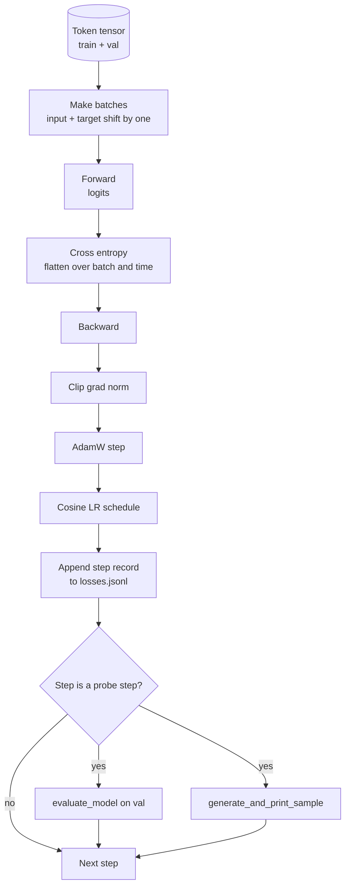

# حلقة التدريب والتقييم

> حلقة عدم قياسات على الاطلاق.`calc_loss_batch`مساعد ‬ ‬ ‬ ‬ ‬ ‬ ‬ ‬ ‬`evaluate_model`تمر كل خطوة مرة واحدة`generate_and_print_sample`قناة التشخيص، وكذلك سجل خسارة JSONL يمكن رسمها بعد ذلك.

**Type:** Build
**Languages:** Python
**Prerequisites:** Phase 19 lessons 30 到 35
**Time:** ~90 分钟

## أهداف التعلم

- بناء حلقة تدريبية، للتنبؤ التوجيهي التالي استخدام المدخل الصحيح و التوجيهه الهدف لحساب خسارة الانتروبيا المتقاطعة
- تكوين AdamW، جعل التدهور الوزن 应用于 وزني الوزن، وليس应用于 LayerNorm أو الالتفاف الوزن.
- 实现带线性升温和宇宙衰退的学习率时间表,并读取 LR 随时间的变化──
- استخدام `evaluate_model`في التقييمات المقدمة على التقسيم، جعل خسارة التقييم قابلة للتقارن.
- كل خطوة`generate_and_print_sample`生成 عينة ثابتة، حتى يتمكن من الوصول إلى الاختلافات قبل عرض منحنى الخسارة
- سوف يتم استمرار كل خطوة في التخفيض إلى JSONL، حتى يتم إعادة تحميل رسم، وتحويل سجل التدريب إلى تسليم.

## المشكلة

كتابة التدريبات التي لا تقوم بها هي لغز الخسارة، ولا يمكن أن تخبرك عن الخسارة، أو أنها بسبب السبب الصحيح في الانخفاض. ماذجها قد تكون مجرد فترة طويلة في مجموعة التدريبات، ولكن لم تتعلم حقاً. لا يمكن أن تخبرك عن التباين، أو أنها بدأت.

في هذه الدورة، يتم قياس كل خطوة في مجموعة التدريبات، وفقدانها. في كل خطوة من المكالمة الثابتة، ينتج خطوة من المكالمة الثابتة إلى استمرار. في كل خطوة من المكالمات الثابتة، يتم قياس كل خطوة في مجموعة التدريبات.

## المفهوم



جزء واضح جدا هو التوصل إلى الخسارة و الانقسام في الانهيار

### التوجه في الخسائر

模型在每个位置预测下一个代币──如果输入批量是代币 `[t0, t1, t2, t3]`، ثم اللحظة المستهدفة يجب أن تكون`[t1, t2, t3, t4]`✿ إنتروبيّة عبرّة في شكل مسطح `(batch * seq, vocab)`上计算,并对照 هدف مسطح `(batch * seq,)` نسيان التحول، ونحن سوف نضع نموذج التدريب في التنبؤ نفسه؛ وهذا سوف تتلقى إلى صفر الخسارة، ولكن لا تعلم إلى أي شيء مفيد‬‬‬‬‬‬‬‬‬‬‬‬‬‬‬‬‬‬‬‬‬‬‬‬‬‬‬‬‬‬‬‬‬‬‬‬‬‬‬‬‬‬‬‬‬‬‬‬‬‬‬‬‬‬‬‬‬‬‬‬‬‬‬‬‬‬‬‬‬‬‬‬‬‬‬‬‬‬‬‬‬‬‬‬‬‬‬‬‬‬‬‬‬‬‬‬‬‬‬‬‬‬‬‬‬‬‬‬‬‬‬‬‬‬‬‬‬‬‬‬‬‬‬‬‬‬‬‬‬‬‬‬‬‬‬‬‬‬‬‬‬‬‬‬‬‬‬‬‬‬‬‬‬‬‬‬‬‬‬‬‬‬‬‬‬‬‬‬‬‬‬‬‬‬‬‬‬‬‬‬‬‬‬‬‬‬‬‬‬‬‬‬‬‬‬‬‬‬‬‬‬‬‬‬‬‬‬‬‬‬‬‬‬‬‬‬‬‬‬‬‬‬‬‬‬‬‬‬‬‬‬‬‬‬‬‬‬‬‬‬‬‬‬‬‬‬‬‬‬‬‬‬‬‬‬‬‬‬‬‬‬‬‬‬‬‬‬‬‬‬‬‬‬‬‬‬‬‬‬‬‬‬‬‬‬‬‬‬‬‬‬‬‬‬‬‬‬‬‬‬‬‬‬‬‬‬‬‬‬‬‬‬‬‬‬‬‬‬‬‬‬‬‬‬‬‬‬‬‬‬‬‬‬‬‬‬‬‬‬‬‬‬‬‬‬‬‬‬‬‬‬‬‬‬‬‬‬‬‬‬‬‬‬‬‬‬‬‬‬‬‬‬‬‬‬‬‬‬‬‬‬‬‬‬‬‬‬‬‬‬‬‬‬‬‬‬‬‬‬‬‬‬‬‬‬‬‬‬‬‬‬‬‬‬‬‬‬‬‬‬‬‬‬‬‬‬‬‬‬‬‬‬‬‬‬‬‬‬‬‬‬‬‬‬‬‬‬‬‬‬‬‬‬‬‬‬‬‬‬‬‬‬‬‬‬‬

### الانقسام في الاندماج

سيقوم التدهور بتعديل الوزن، ولكن لا يُعديل مقاييس التطبيع أو التحيزات. سيقوم بالتدهور. سيقوم بتعديل الوزن. سيقوم بتعديل الوزن. سيقوم بتعديل الوزن. سيقوم بتعديل الوزن. سيقوم بتعديل الوزن. سيقوم بتعديل الوزن. سيقوم بتعديل الوزن. سيقوم بتعديل الوزن. سيقوم بتعديل الوزن. سيقوم بتعديل الوزن. سيقوم بتعديل الوزن. سيقوم بتعديل الوزن. سيقوم بتعديل الوزن. سيقوم بتعديل الوزن. سيقوم بتعديل الوزن. سيقوم بتعديل الوزن. سيقوم بتعديل الوزن. سيقوم بتعديل الوزن. سيقوم التدهور. سيقوم التدريج.

### التدفئة بالإضافة إلى جدول المواعيد

حرارة سوف في بضعة مئات من الخطوات لتغيير معدل التعلم من الصفر إلى القيمة المستهدفة ، دع الحالة التكامل لديها وقت لملءها.

### تم تقييمها

`evaluate_model`عن التحقق من التحقق من التقسيم 运行 عدد ثابت من الحزم، الخسارة التراكمية، إزالة عدد الحزم، ثم العودة.

### العينات النوعية كإشارة مبكرة

تعرضت عينة التدريبية للخسارة، لكن النماذج التي تم إنشاؤها كلها نفس النموذج الذي تم إنشاؤه هو سيء.


```figure
cap-training-loop
```

## بناءها

`code/main.py`实现:

- `make_batches(token_ids, batch_size, context_length)`, سوف تكون شرائح الجهاز التنسوري
- `calc_loss_batch(model, inputs, targets)`, تنفيذ للأمام, صافي,并 عودة إلى الانتروبيا المتقاطعة المتعددة.
- `evaluate_model(model, val_loader, max_batches)`, في أي درجة أسفل 代 ثابتة عدد مجموعات التحقق من التحقق،并返回 متوسط الخسارة.
- `generate_and_print_sample(model, prompt, max_new_tokens)`, في محاولة ثابتة 上运行 درس 35 من عمل الجيل 并印结果──
- `build_param_groups(model, weight_decay)`,生成两组 قائمة المعلمات AdamW
- `cosine_with_warmup(step, warmup_steps, total_steps, max_lr, min_lr)`، عودة إلى خطوة معينة من LR:
- `train(...)`،运行循环،持久化 `outputs/losses.jsonl`,并每 `eval_every`الخطوات 打印 تقييم الخسارة 和 العينة
- إختبار، في بيانات اصطناعية 上 تدريب النموذج الصغير، عدد قليل من الخطوات، كتابة سجل JSONL، ووضع نقاط البحث  طباعة تخسير التقييم و عينة.

运行它:

```bash
python3 code/main.py
```

输出: كل خطوة خسر 行、 كل خطوة المسح تخسير التقييم、 كل خطوة المسح الناتج عن العينة، وكذلك النهائي `outputs/losses.jsonl`يمكنك استخدامها`json.loads`-حسب الموقع

## الـ"كثيرة"

- `torch`يستخدم في أوتوغريد أو ماودولات
- `main.py`في الواقع إعادة تنفيذ الدروس 35 `GPTModel`و تدعم وحدات

## أنماط الإنتاج في البرية

ثلاثة طرق ستحول حلقة الكتب المدرسية إلى شيء يمكن أن تعمل طوال الليل

**Gradient norm clipping 不可协商。**واحد من المجموعات الخبيثة ((معطيات غير عادية، ذروة الر، الحدود العددية) سوف تنتج ضخمة درجة، تدمير عدد ساعات التدريبات.`backward`بعد ذلك`step`之前调用 `torch.nn.utils.clip_grad_norm_(params, max_norm=1.0)`,可让优化器 保持在安全范围内──剪值是一个自由参数;1是大多数设置下都能住的默认值──

**可恢复的 JSONL logging，而不是 pickled state。**ستعمل سجلات الخسارة`{"step": int, "train_loss": float, "lr": float}`行写入 JSONL 是耐用: أي حادث سوف يترك الآثار القابلة للقراءة، يمكنك التقاطها، يمكنك استخدام ثلاثين سطر Python 绘图، ويمكنك أيضاً من خلال قراءة الخطوة الأخيرة لتحسين التدريب.

**Eval batches 来自固定 slice。**رموز التحقق من التحقق في النص  يتم شرائها إلى مجموعات عند بدء، بدلا من النشاطات التوليد  قابل للرد تعتمد على مجموعات التحقق من التحقق من التحقق من التحقق من التحقق من التحقق من التحقق من التحقق من التحقق من التحقق من التحقق من التحقق من التحقق من التحقق من التحقق من التحقق من التحقق من التحقق من التحقق من التحقق من التحقق من التحقق من التحقق من التحقق من التحقق من التحقق من التحقق من التحقق من التحقق من التحقق من التحقق من التحقق من التحقق من التحقق من التحقق من التحقق من التحقق من التحقق من التحقق من التحقق من التحقق من التحقق من التحقق من التحقق من التحقق من التحقق من التحقق من التحقق من التحقق من التحقق من التحقق من التحققق من التحقق من التحققق من التحقق من التحققق من التحققق من التحققق من التحققق من التحققق من التحققق من التحققق من التحققق من التحققق.

## استخدمها

- الحلقة في هذا الدراسة نفسها مع 124M 模型 من العظام التنفسية على البيانات الحقيقية`datasets`حلقة، حلقة، حلقة
- سجل JSONL هو جعل تدريب الجولة إلى دليل من المنتجات.
- أبحاث العينات هي فقدان مستوي لا يمكن استبدالها

## التمارين

1. إضافة`weight_decay_groups()`اختبارات الوحدة، تحديد مقياس و معايير التحيز 落入 no decay group، و معايير خطية و معايير ضخمة 落入 decay group。
2. باستخدام بايت في ملفات كتاب صغيرة بدل رموز عشوائية اصطناعية، دعم التجربة في المحتوى القراءة ‬ تجربة نموذج تم إنشاؤه باستخدام الشخصيات الموجودة في الملف‬‬‬‬‬‬‬‬‬‬‬‬‬‬‬‬‬‬‬‬‬‬‬‬‬‬‬‬‬‬‬‬‬‬‬‬‬‬‬‬‬‬‬‬‬‬‬‬‬‬‬‬‬‬‬‬‬‬‬‬‬‬‬‬‬‬‬‬‬‬‬‬‬‬‬‬‬‬‬‬‬‬‬‬‬‬‬‬‬‬‬‬‬‬‬‬‬‬‬‬‬‬‬‬‬‬‬‬‬‬‬‬‬‬‬‬‬‬‬‬‬‬‬‬‬‬‬‬‬‬‬‬‬‬‬‬‬‬‬‬‬‬‬‬‬‬‬‬‬‬‬‬‬‬‬‬‬‬‬‬‬‬‬‬‬‬‬‬‬‬‬‬‬‬‬‬‬‬‬‬‬‬‬‬‬‬‬‬‬‬‬‬‬‬‬‬‬‬‬‬‬‬‬‬‬‬‬‬‬‬‬‬‬‬‬‬‬‬‬‬‬‬‬‬‬‬‬‬‬‬‬‬‬‬‬‬‬‬‬‬‬‬‬‬‬‬‬‬‬‬‬‬‬‬‬‬‬‬‬‬‬‬‬‬‬‬‬‬‬‬‬‬‬‬‬‬‬‬‬‬‬‬‬‬‬‬‬‬‬‬‬‬‬‬‬‬‬‬‬‬‬‬‬‬‬‬‬‬‬‬‬‬‬‬‬‬‬‬‬‬‬‬‬‬‬‬‬‬‬‬‬‬‬‬‬‬‬‬‬‬‬‬‬‬‬‬‬‬‬‬‬‬‬‬‬‬‬‬‬‬‬‬‬‬‬‬‬‬‬‬‬‬‬‬‬‬‬‬‬‬‬‬‬‬‬‬‬‬‬‬‬‬‬‬‬‬‬‬‬‬‬‬‬‬‬‬‬‬‬‬‬‬‬‬‬‬‬‬‬‬‬‬‬‬‬‬‬‬‬‬‬‬‬‬‬‬‬‬‬‬‬‬‬‬‬‬‬‬‬‬‬‬
3. لجدول زمني 添加一个 `min_lr`الطابق، قيمة`max_lr`10%،并重新绘图──
4. إضافة إلى سجل JSONL خارج، كل `eval_every`خطوات حفظ نقطة تفتيش`resume_from`العلم لإعادة تحميل حالة النموذج ووضع المحفز
5. في الخسارة 旁边记录每步吞吐 ((أعلام التكنولوجيا في الثانية) ،并确认它保持在稳定区间──

## الشروط الرئيسية

| Term | What people say | What it actually means |
|------|-----------------|------------------------|
| Loss alignment | “Shift by one” | Input tokens 位于 positions 0..T-1，target tokens 位于 positions 1..T；cross entropy 在 flattened shapes 上计算 |
| Decay split | “Two groups” | AdamW 接收带 weight decay 的 matrix shaped tensors，以及不带 decay 的 scale 或 bias tensors |
| Warmup | “Ramp” | learning rate 在固定步数内从零爬升到目标值，让 Optimizer state 可以填充 |
| Eval batches | “Held out batches” | validation token tensor 的一个固定 slice，在 script 启动时 slice 一次，并在每个 probe 中相同使用 |
| Qualitative probe | “Sample print” | 每 K steps 从固定 prompt 打印一次短 generation，用于捕捉单靠 loss 会隐藏的 failure modes |

## المزيد من القراءة

- المرحلة 19 الدروس 35، معرفة هذه الحلقة 驱动的模型──
- مرحلة 19 دروس 37، معرفة كيفية تحميل الأوزان المسبقة للتدريب إلى نفس النموذج.
- المرحلة 10 الدروس 04 ((قبل التدريب GPT) ، معرفة عملية على البيانات الحقيقية
- المرحلة 10 الدروس 10 ((التقييم) ، فهم فقدان الانتروبيا المتقاطعة 之外更廣的 eval surface──
