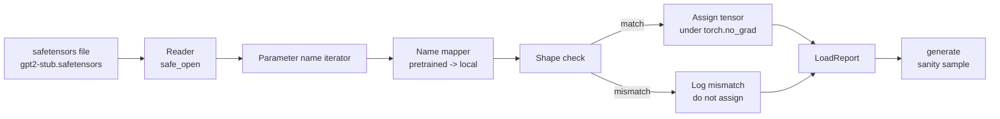

# 加载 أوزان متدربة

> من التدريب الصفر نموذج 124 مليون برميل هو قرار الميزانية؛ تحميل نقطة تفتيش مفتوحة 则是日常操作。 本课会把安全器文件中预训练的GPT-2风格重量加载到课35的同一个架构中,逐段讲解参数名称映射,并通过智能生成一个延续来证明加载成功──无网络、无第三方加载者、无不透明魔法──

**Type:** Build
**Languages:** Python
**Prerequisites:** Phase 19 lessons 30 to 36
**Time:** ~90 minutes

## أهداف التعلم

- استخدام `safetensors`مكتبة Python 读取 safetensors file,并检查テンসর names 和 shapes──
- سوف كل اسم المعلم المسبق 映射到课 35 GPT النموذج 内部的一个参数。
- 处理 نشر GPT-2 الوزن مع هذا النموذج المسار  بين مختلف اثنين:`wte/wpe/h.N.attn.c_attn/c_proj`和 `mlp.c_fc/c_proj`, على درجة من الاسم`tok_embed/pos_embed/blocks.N.attn.qkv/out_proj`和 `mlp.fc1/fc2`.
- في أي تخصيص الوزن  يحدث قبل،检测并拒绝 شكل عدم مطابقة،并给出清晰错误──
- استخدام الوزن المحمل 生成一个短延续,并确认 tokens 来自加载分布,而不是 عشوائية التوزيع المبدئي.

## المشكلة

الوزن المنشورة ليس من أجل معمارتك 打包的. أنها تحمل اسم استخدامها الأصلي.`(2304, 768)``transformer.h.0.attn.c_attn.weight`؛ نموذجك             `(2304, 768)``blocks.0.attn.qkv.weight`(هذه نفس المصفوفة، مجرد ترتيب عقد مختلفة) ، أو نموذجك استخدام `nn.Linear`، سوف يتم تحويلها إلى شكل مخزن المصفوفة.

سيقوم محمّل النسخة العمى بإرسال الجهاز الصحيح إلى الموقع الخطأ، ويحصل على نموذج من أجل إنتاج الحوارث الفوضوية.`LoadReport`معظم الأضربات والخسائر وعدم الوصول إلى شكل، فلتكن قادرة على فهم ما حدث

## المفهوم



اسم خريطة  مجرد واحد من سلسلة إلى سلسلة وظيفة。تحقق الشكل هو واحد إذا。التعيين  يحدث `torch.no_grad()`内部, لذلك autograd 不会跟踪加载过程──Report 会保存每个名字的结果──

### اتفاقية تسمية GPT-2

وزن GPT-2 المنشورة 使用如下名称:

| Pretrained name | Shape | Meaning |
|-----------------|-------|---------|
| `wte.weight` | (50257, 768) | Token Embedding |
| `wpe.weight` | (1024, 768) | Position Embedding |
| `h.N.ln_1.weight` | (768,) | block N 的 LayerNorm 1 scale |
| `h.N.ln_1.bias` | (768,) | block N 的 LayerNorm 1 shift |
| `h.N.attn.c_attn.weight` | (768, 2304) | 融合 QKV linear weight |
| `h.N.attn.c_attn.bias` | (2304,) | 融合 QKV linear bias |
| `h.N.attn.c_proj.weight` | (768, 768) | Attention output projection |
| `h.N.attn.c_proj.bias` | (768,) | Attention output projection bias |
| `h.N.ln_2.weight` | (768,) | LayerNorm 2 scale |
| `h.N.ln_2.bias` | (768,) | LayerNorm 2 shift |
| `h.N.mlp.c_fc.weight` | (768, 3072) | MLP fc1 weight |
| `h.N.mlp.c_fc.bias` | (3072,) | MLP fc1 bias |
| `h.N.mlp.c_proj.weight` | (3072, 768) | MLP fc2 weight |
| `h.N.mlp.c_proj.bias` | (768,) | MLP fc2 bias |
| `ln_f.weight` | (768,) | Final LayerNorm scale |
| `ln_f.bias` | (768,) | Final LayerNorm shift |

هناك نقطتين لا غابيتين تحتاج إلى معالجة سابقة`c_attn`.`c_proj`.`c_fc`هذه الخطوط المصفوفة طريقة تخزينها، مقارنة`nn.Linear.weight`期望方式是转置的──Loader 会在分配时转置──LM head 完全不在文件中; 模型依赖与 `wte`من الوزن الارتباط، لذلك عندما `wte`-أقيم رأسكِ من خلال التعبيرات

### الإتفاقية المحلية

本 track 的模型 使用描述性名称:

| Local name | Meaning |
|------------|---------|
| `tok_embed.weight` | Token Embedding |
| `pos_embed.weight` | Position Embedding |
| `blocks.N.ln1.scale` | block N 的 LayerNorm 1 scale |
| `blocks.N.ln1.shift` | LayerNorm 1 shift |
| `blocks.N.attn.qkv.weight` | 融合 QKV |
| `blocks.N.attn.qkv.bias` | 融合 QKV bias |
| `blocks.N.attn.out_proj.weight` | Attention output projection |
| `blocks.N.attn.out_proj.bias` | Output projection bias |
| `blocks.N.ln2.scale` | LayerNorm 2 scale |
| `blocks.N.ln2.shift` | LayerNorm 2 shift |
| `blocks.N.mlp.fc1.weight` | MLP fc1 |
| `blocks.N.mlp.fc1.bias` | MLP fc1 bias |
| `blocks.N.mlp.fc2.weight` | MLP fc2 |
| `blocks.N.mlp.fc2.bias` | MLP fc2 bias |
| `final_ln.scale` | Final LayerNorm scale |
| `final_ln.shift` | Final LayerNorm shift |

الخرائط هي وظيفة ثابتة.

### الوصول إلى الدرج

الوزن الحقيقي GPT-2 حوالي 0.5 GB──Demo لن تنزلها؛ فإنه سوف ينتج في أول مرة تشغيل جهاز جهاز أجهزة الأجهزة الآمنة الصغيرة، وتتبع تماما نفس اتفاقية تسمية GPT-2، ومستخدمة تناسب 12 كتلة نموذج d_مودل 192 بدلا من أشكال 768──هذا جهاز  مع بنية صحيحة، يمكن أن تثير طريق كل شريحة رمزية داخل محمولها──把装置 换成真文件 后, محمول 无需修改即可工作──


```figure
cc-weight-remap
```

## بناءها

`code/main.py`实现:

- درس 35`GPTModel`من الصفحة الصغيرة، جعل هذا الدراسة نفسها
- `make_pretrained_to_local(num_layers)`,展开每层条目──
- `load_safetensors(model, path)`,代 أسماء مخطط أسماء مظهر الشكل تحويل الوزن على الطراز`torch.no_grad()`أعود إلى هنا`LoadReport`.
- `make_stub_safetensors(path, cfg)`، إنشاء ملف ثابت لاقتضاء على اتفاقية الإسم المحددة المسبقة.
- إثبات: أول مرة تعمل`outputs/gpt2-stub.safetensors`, بناء نموذج جديد , قبضة عشوائية init 生成 استمرار , تحميل stub , إعادة قبضة آخر استمرار , طباعة الثاني ,并验证两者不同(حميل确实改变了模型)

运行:

```bash
python3 code/main.py
```

الناتج: مسار الإصلاحات`LoadReport`الموجة التالية: التالي: التالي: التالي: التالي: التالي: التالي: التالي: التالي: التالي: التالي: التالي: التالي: التالي: التالي: التالي: التالي: التالي: التالي: التالي: التالي: التالي: التالي: التالي: التالي: التالي: التالي: التالي: التالي: التالي: التالي: التالي: التالي: التالي: التالي: التالي: التالي: التالي: التالي: التالي: التالي: التالي: التالي: التالي: التالي: التالي: التالي: التالي: التالي: التالي: التالي: التالي: التالي: التالي: التالي: التالي: التالي: التالي: التالي: التالي: التالي: التالي: التالي: التالي: التالي: التالي: التالي: التالي: التالي: التالي: التالي: التالي: التالي: التالي: التالي: التالي: التالي: التالي: التالي: التالي: التالي: التالي: التالي: التالي: التالي: التالي: التالي: التالي: التالي: التالي: التالي: التالي: التالي: التالي: التالي: التالي: التالي: التالي: التالي: التالي: التالي: التالي: التالي: الت: الت: الت: الت: الت: الت: الت: الت: الت: الت: الت: الت: الت: الت: الت: الت: الت: الت: الت: الت: الت: الت: الت: الت: الت: الت: الت: الت: الت: الت: الت: الت: الت: الت: الت: الت: الت: الت: الت: الت: الت: الت: الت: الت: الت: الت: الت: الت: الت: الت: الت: الت: الت: الت: الت: الت: الت: الت: الت: الت: الت: الت: الت: الت: الت: الت: الت: الت: الت: الت: الت: الت: الت: الت: الت: الت: الت: الت: الت: الت: ت: الت: الت: ت: ت: ت: ت: ت: ت: ت: ت: ت: ت: ت: ت: ت: ت: ت: ت:

## الـ"كثيرة"

- `safetensors`يستخدم على شكل القرص و قراءة البث
- `torch`باستخدام النموذج و الرياضيات المهام
- غير مستخدم`transformers`,不使用 `huggingface_hub`، لا تقوم بمكالمات الشبكة

## أنماط الإنتاج في البرية

ثلاثة أنماط يمكن أن يجعل الشاحنة في مواجهة الأوزان التي لم تخلقها لا تزال موثوقة.

**始终在任何 assignment 前验证 file。**打开文件,列出每个纳体名称 及其dtype 和形状,运行完整地图和形状检查,只有在成功后才开始分配──半加载模型 是静默失败机器──

**每次 assignment 都记录 source name 和 destination name。**عندما يبدو أن شيء ما غير صحيح، سيقول لك اللغز أيّة الجهازات المضغوطة قد وصل إلى أين؛ والحلّة البديلة هي قراءة الجهازات المضغوطة.`LoadReport`درجة البيانات 会跟踪`loaded`.`missing`.`unexpected`和 `shape_mismatch`القوائم، و في آخر طباعة ملخصها

**LM head 是 weight tying alias，不是单独 copy。**- إضافة`tok_embed`后设置 `model.lm_head.weight = model.tok_embed.weight`هو نمط النظام.`lm_head.weight`المعلم سوف يفسد الارتباط،并让 المعلم يعد 翻倍。

## استخدمها

- محمول  تطبق لأي استخدام سابقة تعريف اسم ملفات الأمانات‬‬‬‬‬‬‬‬‬‬‬‬‬‬‬‬‬‬‬‬‬‬‬‬‬‬‬‬‬‬‬‬‬‬‬‬‬‬‬‬‬‬‬‬‬‬‬‬‬‬‬‬‬‬‬‬‬‬‬‬‬‬‬‬‬‬‬‬‬‬‬‬‬‬‬‬‬‬‬‬‬‬‬‬‬‬‬‬‬‬‬‬‬‬‬‬‬‬‬‬‬‬‬‬‬‬‬‬‬‬‬‬‬‬‬‬‬‬‬‬‬‬‬‬‬‬‬‬‬‬‬‬‬‬‬‬‬‬‬‬‬‬‬‬‬‬‬‬‬‬‬‬‬‬‬‬‬‬‬‬‬‬‬‬‬‬‬‬‬‬‬‬‬‬‬‬‬‬‬‬‬‬‬‬‬‬‬‬‬‬‬‬‬‬‬‬‬‬‬‬‬‬‬‬‬‬‬‬‬‬‬‬‬‬‬‬‬‬‬‬‬‬‬‬‬‬‬‬‬‬‬‬‬‬‬‬‬‬‬‬‬‬‬‬‬‬‬‬‬‬‬‬‬‬‬‬‬‬‬‬‬‬‬‬‬‬‬‬‬‬‬‬‬‬‬‬‬‬‬‬‬‬‬‬‬‬‬‬‬‬‬‬‬‬‬‬‬‬‬‬‬‬‬‬‬‬‬‬‬‬‬‬‬‬‬‬‬‬‬‬‬‬‬‬‬‬‬‬‬‬‬‬‬‬‬‬‬‬‬‬‬‬‬‬‬‬‬‬‬‬‬‬‬‬‬‬‬‬‬‬‬‬‬‬‬‬‬‬‬‬‬‬‬‬‬‬‬‬‬‬‬‬‬‬‬‬‬‬‬‬‬‬‬‬‬‬‬‬‬‬‬‬‬‬‬‬‬‬‬‬‬‬‬‬‬‬‬‬‬‬‬‬‬‬‬‬‬‬‬‬‬‬‬‬‬‬‬‬‬‬‬‬‬‬‬‬‬‬‬‬‬‬‬‬‬‬‬‬‬‬‬‬‬‬‬‬‬‬‬‬‬‬‬‬‬‬‬‬‬‬‬‬‬‬‬‬‬‬‬‬
- عندما يتم تحديث خريطة الاسم، يمكن توسيع النمط نفسه إلى LLaMA、Mistral、Qwen الوزن──تحقق الشكل 和 تقرير 保持不变──
- إن توليد العقل الصحي بعد الحمل هو بوابة سريعة: إذا كانت عينات ما بعد الحمل تبدو مثل عينات ما قبل الحمل، فإن الحمل لا يغير النموذج، ويعني أيضاً أن الخرائط ستفقد كل تنسور.

## التمارين

1. لتحميل 添加 `dtype`الحجة، في المهام سوف كل تنسور يلقي إلى الهدف dtype(`bfloat16`.`float16`.`float32`)。 تأكيد `float32`النموذج يمكن أن يُبطأ إلى`bfloat16`لا يزال بإمكانه توليدها
2. إضافة`expected_layers`الحجة، رفض الحمل`h.N`مؤشرات وموديل`num_layers`نقطة تفتيش غير متطابقة
3. ضع محمولة 接入 درس 35 عمل الجيل،并生成 اثنين من عينات并排: واحد من عشوائية init، والآخر من محمولة ثابتة。
4. 添加出口路径: استخدام اتفاقية الإسم المسبق تدريب 将当前模型状态 写入一个新的安全感器文件──循环旅行载荷器 并确认报告 中形状不匹配 为零──
5. 扩展 `NAME_MAP`以处理 LLaMA naming convention ((无偏见、RMSNorm、合并 qkv layout) ، ووضع الوضع LLaMA المثبتة على القطع التي قمت بتوليدها 上重新运行 loader。

## الشروط الرئيسية

| Term | What people say | What it actually means |
|------|-----------------|------------------------|
| Name map | "Key remapping" | 从 pretrained tensor names 到 local parameter names 的 function；通常是一个 literal dict，每个 layer index 一个 entry，并在 loop 中展开 |
| Shape mismatch | "Bad shape" | Pretrained tensor 存在于 mapped name 下，但其 dimensions 与 local parameter 不一致；loader 会拒绝 assignment 并记录这对 name |
| Transpose-on-load | "Conv1d layout" | Published GPT-2 将 Attention 和 MLP projections 存储为 nn.Linear 期望形式的转置；loader 会在 assignment 时转置 |
| Weight tying alias | "Shared LM head" | 设置 model.lm_head.weight = model.tok_embed.weight，让 head 和 Embedding 共享 storage；正因为如此，head 不在 file 中 |
| Load report | "Coverage summary" | 一个小型 dataclass，跟踪 loaded、missing、unexpected 和 shape_mismatch lists；打印它可以判断加载是否成功 |

## المزيد من القراءة

- المرحلة 19 دروس 35: استلام الأوزان معمارة
- المرحلة 19 الدروس 36: إنتاج حلقة تدريبية لمراقبة نفس الشكل
- المرحلة 10 الدروس 11 ((تقييم):ذاكرة 紧张时如何处理负载重量──
- المرحلة 10 الدروس 13 ((بناء خط أنابيب كاملة للدرجة العليا):حمله و الاستنتاجات 周边的完整生命周期──
