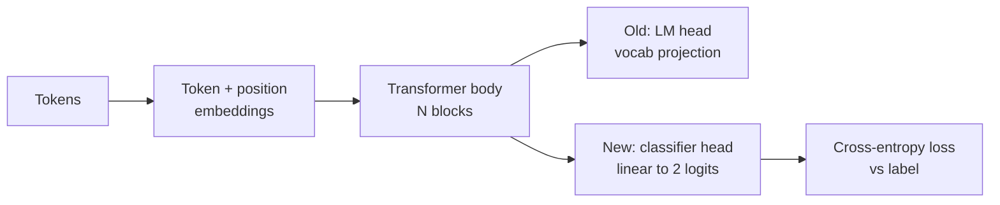
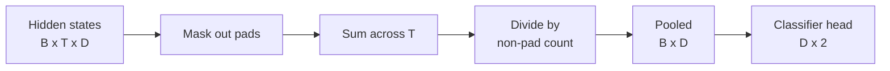
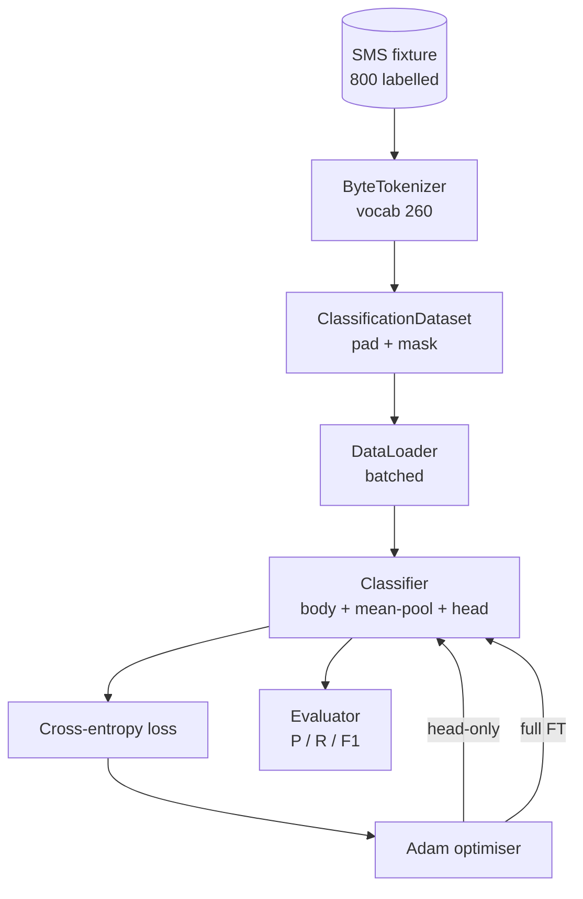

# دراسة كابستون 38: من خلال الصرف الرئيسي  إجراء تصنيف التنسيق

> الموسيقى ب. أول حجر نهاية. نموذج اللغة المدربة هو واحد على التكامل كتلة الاهتمام الذاتي، والمنتهية هي الرأس التنبؤ الرمزية. عندما كنت تريد أن تفعل الرقائق ضد الخنزير، الرأس هو خطأ، ولكن الجسم هو أساسا على.

**Type:** Build
**Languages:** Python (torch, numpy)
**Prerequisites:** Phase 19 lessons 30-37 (NLP LLM track: tokenizer, embedding table, attention block, transformer body, pre-training loop, checkpointing, generation, perplexity)
**Time:** ~90 minutes

## أهداف التعلم

- في حالة عدم إعادة تشكيل الجسم، قم بتبديل رأس نموذج اللغة إلى رأس التصنيف.
- 实现两种训练模式:
- 构建 tokeniser-aware data pipeline,负责 padding、mask padding,并对 Attention output做pooling──
- من المخططات الخامة  حساب دقة ‬التذكير ‬F1 和 المصفوفة الخلط
- 推理 المعايير العد 、وقت التدريب و التداول بين غرفة الرأس ‬‬‬‬‬‬‬‬‬‬‬‬‬‬‬‬‬‬‬‬‬‬‬‬‬‬‬‬‬‬‬‬‬‬‬‬‬‬‬‬‬‬‬‬‬‬‬‬‬‬‬‬‬‬‬‬‬‬‬‬‬‬‬‬‬‬‬‬‬‬‬‬‬‬‬‬‬‬‬‬‬‬‬‬‬‬‬‬‬‬‬‬‬‬‬‬‬‬‬‬‬‬‬‬‬‬‬‬‬‬‬‬‬‬‬‬‬‬‬‬‬‬‬‬‬‬‬‬‬‬‬‬‬‬‬‬‬‬‬‬‬‬‬‬‬‬‬‬‬‬‬‬‬‬‬‬‬‬‬‬‬‬‬‬‬‬‬‬‬‬‬‬‬‬‬‬‬‬‬‬‬‬‬‬‬‬‬‬‬‬‬‬‬‬‬‬‬‬‬‬‬‬‬‬‬‬‬‬‬‬‬‬‬‬‬‬‬‬‬‬‬‬‬‬‬‬‬‬‬‬‬‬‬‬‬‬‬‬‬‬‬‬‬‬‬‬‬‬‬‬‬‬‬‬‬‬‬‬‬‬‬‬‬‬‬‬‬‬‬‬‬‬‬‬‬‬‬‬‬‬‬‬‬‬‬‬‬‬‬‬‬‬‬‬‬‬‬‬‬‬‬‬‬‬‬‬‬‬‬‬‬‬‬‬‬‬‬‬‬‬‬‬‬‬‬‬‬‬‬‬‬‬‬‬‬‬‬‬‬‬‬‬‬‬‬‬‬‬‬‬‬‬‬‬‬‬‬‬‬‬‬‬‬‬‬‬‬‬‬‬‬‬‬‬‬‬‬‬‬‬‬‬‬‬‬‬‬‬‬‬‬‬‬‬‬‬‬‬‬‬‬‬‬‬‬‬‬‬‬‬‬‬‬‬‬‬‬‬‬‬‬‬‬‬‬‬‬‬‬‬‬‬‬‬‬‬‬‬‬‬‬‬‬‬‬‬‬‬‬‬‬‬‬‬‬‬‬‬‬‬‬‬‬‬‬‬‬‬‬‬‬‬‬‬‬‬‬‬‬‬‬‬‬‬‬‬‬

## المشكلة

أنت في الجسم العام على تدريب مسبق  محول صغير ٬ رأس الخروج سوف يضع الحالة الخفية الأخيرة  投影 إلى 1000 رمز لغة٬ الآن لديك 800 条标注 على رسائل رسالة عن طريق الهاتف أو الهاتف، على أمل بناء تصنيف ثنائي٬ هنا هناك ثلاثة خيارات٬

错误选择是基于800 个例子从零训练一个新类型器──已编码了有用结构:word identity、position、简单的共发──丢失它就是浪费构建时消耗计算──

两个正确选择是头交换 后结身体,以及头交换 后让身体可训练――头交换 后让身体可训练――头交换 后结身体,以及头交换 后让身体可训练――头交换 后让身体可训练――头交换 后结身体,后让身体可训练――头交换 后结身体 可训练――头交换 后结身体 可训练――头交换 后结身体 可训练――头交换 后结身体 可训练――头交换 后结身体,以及后结身体 可训练――后让身体可训练――头交换 后让身体 可训练――头交换 后练 可训练 快速,记忆 几乎免费,在这么少的数据上也不太容易过过过过过过过过过过过过过过过过过过过过过过过过过过过过过过过过过过过过过过过过过过过过过过过过过过过过过过过过过过过过过过过,而且慢慢过过过过过过过过过过过过过过过过在小数据上上上上可能过过过过过过过过过过过过过了,但当下游了下游的后的后的后的后的后的后的后的后 偏离离离离离离离离离离了了了了了了了了了了了了了了了了了了了了了了了了了了了了了了了了了了了了了了了了了了了了

هذا الدروس سوف تكوين اثنين في نفس الوقت، ويمكنك في نفس المقامة

## المفهوم



النموذج هو وظيفة:`f_theta(tokens) -> hidden_states`الرأس هو وظيفة:`g_phi(hidden) -> logits`تغيير الرؤوس يعني الاحتفاظ`theta`وبدل`g_phi`ملامح الجسم هي جزء مكلف. الرأس مجرد طبقة خطية.

هناك مجموعة من المعلمين القابلان للتدريب

- `theta`كل كتلة اهتمام لديها ملايين الوزن
- `phi`(الرأس):`hidden_dim * num_classes`الوزن إضافة إلى التحيز

في التدريب الرأس فقط، كنت تستهدف `phi`计算 gradients,并让 `theta`نسبة المرتفعات 为零──PyTorch  يسمح لك بالمرور في معايير الجسم `requires_grad=False`لكي نفعل ذلك، فلن نرى سوى الرأس، والجسم، والحفاظ على الجليد

في التنسيق الكامل، تسمح التدرج للدفقات 回流穿越整个 stack. وزن الجسم 会漂移以适应 التصنيف هدف.风险 في البيانات الصغيرة.

## سؤال التجميع

المصنف  بحاجة لكل تسلسل وكتور واحد، بدلا من كل رمز وكتور واحد.

- **Mean pool**: طبقاً لقناع الاهتمام 加权، على التسلسل أعلى من الحالات الخفية 取平均──
- **CLS pool**: 前置一个特殊的代币,并只使用它的输出──这是BERT的做法──
- **Last-token pool**: استخدام آخر رمز غير ملصق.

هذا هو الأسهل، على طول التسلسلات المختلفة 上给出稳定信号,也不需要预训练 CLS رمز.



## البيانات

800 رسالة نصية، 400 رسالة عن طريق الهاتف و 400 رسالة عن طريق الهاتف`code/main.py`中 تحديد 生成──مدير استخدام البذور الثابتة، اختيار القوالب ومبدل ملء فتحات، إصدار طول بين 5 إلى 25 رمزا ‬ رسائل── مجموعات بيانات حقيقية 会有 هذا المكون ‬ بدون ضجيج──تركيز المكون هو قابلية التنويع‬‬‬‬‬‬‬‬‬‬‬‬‬‬‬‬‬‬‬‬‬‬‬‬‬‬‬‬‬‬‬‬‬‬‬‬‬‬‬‬‬‬‬‬‬‬‬‬‬‬‬‬‬‬‬‬‬‬‬‬‬‬‬‬‬‬‬‬‬‬‬‬‬‬‬‬‬‬‬‬‬‬‬‬‬‬‬‬‬‬‬‬‬‬‬‬‬‬‬‬‬‬‬‬‬‬‬‬‬‬‬‬‬‬‬‬‬‬‬‬‬‬‬‬‬‬‬‬‬‬‬‬‬‬‬‬‬‬‬‬‬‬‬‬‬‬‬‬‬‬‬‬‬‬‬‬‬‬‬‬‬‬‬‬‬‬‬‬‬‬‬‬‬‬‬‬‬‬‬‬‬‬‬‬‬‬‬‬‬‬‬‬‬‬‬‬‬‬‬‬‬‬‬‬‬‬‬‬‬‬‬‬‬‬‬‬‬‬‬‬‬‬‬‬‬‬‬‬‬‬‬‬‬‬‬‬‬‬‬‬‬‬‬‬‬‬‬‬‬‬‬‬‬‬‬‬‬‬‬‬‬‬‬‬‬‬‬‬‬‬‬‬‬‬‬‬‬‬‬‬‬‬‬‬‬‬‬‬‬‬‬‬‬‬‬‬‬‬‬‬‬‬‬‬‬‬‬‬‬‬‬‬‬‬‬‬‬‬‬‬‬‬‬‬‬‬‬‬‬‬‬‬‬‬‬‬‬‬‬‬‬‬‬‬‬‬‬‬‬‬‬‬‬‬‬‬‬‬‬‬‬‬‬‬‬‬‬‬‬‬‬‬‬‬‬‬‬‬‬‬‬‬‬‬‬‬‬‬‬‬‬‬‬‬‬‬‬‬‬‬‬‬‬‬‬‬‬‬‬‬‬‬‬‬‬‬‬‬‬‬‬‬‬‬‬‬‬‬‬‬‬‬‬‬‬‬‬‬

البيانات 按 80/20 split:640 train,160 test。 Splits 使用 stratified, therefore test set 保持 50/50 balance──a balance 已知的 held-out set 能让精度 和回忆 被当作可信数字 解读──

## المقاييس

التصنيف الثنائي 中 class 1 是 positive class(spam)。计数如下:

- `TP`:预测为垃圾邮件,实际是垃圾邮件.
- `FP`:预测为垃圾邮件,实际是
- `FN`:预测为 لحم، في الواقع هو سبام
- `TN`:预测为 لحم،实际是 لحم

ثلاثة مقاييس رئيسية:

- `precision = TP / (TP + FP)`كم هو النسبة الحقيقية للشحنة في الرسائل التي تم تسجيلها على أنها رسائل زبائح؟
- `recall = TP / (TP + FN)`في الرسائل غير المرسلة الفعلية، ما هو نسبة نموذج التسجيل؟
- `F1 = 2 * P * R / (P + R)`◊ المتوسط الهرموني للآخرين

ماتريكس الارتباك سوف ترسم أربعة أرقام طباعة على شبكة 2x2.


```figure
cap-classifier-head-swap
```

## الهندسة المعمارية



الجسم هو محول صغير جداً: الصوت 260٬ مختبئاً 64٬4 رؤوس٬2 كتلة٬ تسلسل أقصى 32٬ إنه صغير بما فيه الكفاية، يمكن وضع النظم في 90 ثانية فوق CPU لتدريبها إلى التقارب٬ في درجة الأولى أنه ليس مدرباً مسبقاً، على العكس،`pretrain_quick`ساعد سوف يكون في نفس المرتبة من النص على القيام بخمسة فترات من تدريب LM، جعل الجسم لديه نقطة بداية غير عادية.

## ما ستبني

التنفيذ هو واحد`main.py`加一个测试模块(`code/tests/test_main.py`(‬)

1. `ByteTokenizer`:把字节 映射到 ids,并保留一个pad id──
2. `Block`: واحد مع معدات متعددة الرأس والكليات المتحولات المقدمة للطعام
3. `LMBody`: التوكن + الموقف إدراجات 加上一叠块──返回隐藏状态──
4. `MeanPool`: على طول محور التسلسل صنع متوسط وزنه القناع
5. `Classifier`الجسم، الجدول، الرأس الخطوي. الجسم في أنظمة مختلفة هو نفس الحالة.
6. `freeze_body`和 `unfreeze_body`: تغيير معايير الجسم 上的 `requires_grad`.
7. `train_classifier`: حلقة مشتركة. نموذج استقبال وحدة لتدريب مجموعة المعلمات الحالية.
8. `evaluate`: مجموعة اختبار运行 并返回 `Metrics(precision, recall, f1, confusion)`.
9. `run_demo`:先简短预训练机体,然后训练并评估头脑,再训练并评估完整,打印两份报告,并以零 退出。

## لماذا المقارنة مهمة

نظام الرأس فقط عادة تدريب أسرع،并以更平滑的方式 دون فئة. في هذا المكونة، التدريب الرأس فقط بعد عشر فترات، سوف ترى عادة الدقة 接近 0.9 ‬التذكر 接近 0.85‬.

هذا هو المفهوم الذي يُمكنك أن تتعلمه. هذا هو المفهوم الذي يُمكنك أن تتعلمه. هذا هو المفهوم الذي يُمكنك أن تتعلمه.`train_classifier`وظيفة 处理两种情况,一起 只是一次电话

## إرسال أهداف

- إضافة النظام الثالث، فقط فك التجميد، والحجر الأخير. هذا يُطلق عليه أحياناً التنسيق الجزئي.
- 添加学习率调度器──对头 使用 cosine schedule,并对身体 使用更小的常率,是常见生产设置──
- استخدام تجمع الاهتمام المتعلمة بدل المعدل المشترك: واحد مع مستوى الاهتمام المتعلمة ‬‬‬‬‬‬‬‬‬‬‬‬‬‬‬‬‬‬‬‬‬‬‬‬‬‬‬‬‬‬‬‬‬‬‬‬‬‬‬‬‬‬‬‬‬‬‬‬‬‬‬‬‬‬‬‬‬‬‬‬‬‬‬‬‬‬‬‬‬‬‬‬‬‬‬‬‬‬‬‬‬‬‬‬‬‬‬‬‬‬‬‬‬‬‬‬‬‬‬‬‬‬‬‬‬‬‬‬‬‬‬‬‬‬‬‬‬‬‬‬‬‬‬‬‬‬‬‬‬‬‬‬‬‬‬‬‬‬‬‬‬‬‬‬‬‬‬‬‬‬‬‬‬‬‬‬‬‬‬‬‬‬‬‬‬‬‬‬‬‬‬‬‬‬‬‬‬‬‬‬‬‬‬‬‬‬‬‬‬‬‬‬‬‬‬‬‬‬‬‬‬‬‬‬‬‬‬‬‬‬‬‬‬‬‬‬‬‬‬‬‬‬‬‬‬‬‬‬‬‬‬‬‬‬‬‬‬‬‬‬‬‬‬‬‬‬‬‬‬‬‬‬‬‬‬‬‬‬‬‬‬‬‬‬‬‬‬‬‬‬‬‬‬‬‬‬‬‬‬‬‬‬‬‬‬‬‬‬‬‬‬‬‬‬‬‬‬‬‬‬‬‬‬‬‬‬‬‬‬‬‬‬‬‬‬‬‬‬‬‬‬‬‬‬‬‬‬‬‬‬‬‬‬‬‬‬‬‬‬‬‬‬‬‬‬‬‬‬‬‬‬‬‬‬‬‬‬‬‬‬‬‬‬‬‬‬‬‬‬‬‬‬‬‬‬‬‬‬‬‬‬‬‬‬‬‬‬‬‬‬‬‬‬‬‬‬‬‬‬‬‬‬‬‬‬‬‬‬‬‬‬‬‬‬‬‬‬‬‬‬‬‬‬‬‬‬‬‬‬‬‬‬‬‬‬‬‬‬‬‬‬‬‬‬‬‬‬‬‬‬‬‬‬‬‬‬‬‬‬‬‬‬‬‬‬‬‬‬‬‬‬‬‬‬‬‬‬‬‬‬

التنفيذ أعطاك القضبان. الاختبارات تحدد العقد. الأرقام من قبلك.
