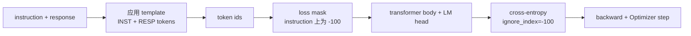
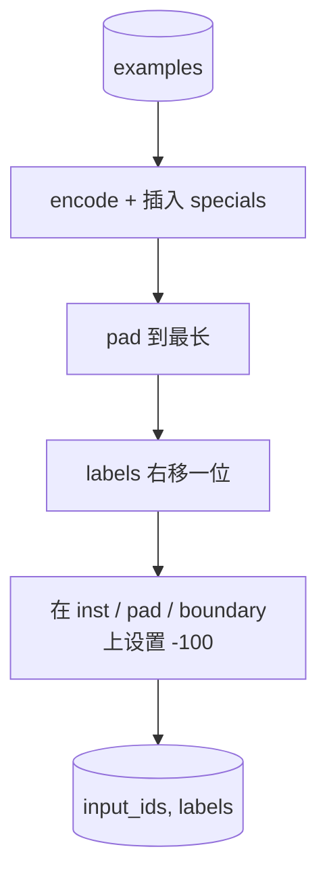
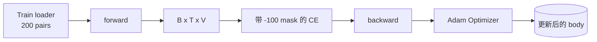

# كابستون 课程 39: من خلال الإشراف على التنسيق الدقيق  إجراء إرشادات التنسيق

> يمكن أن يستمر النموذج الأساسي المسبق للتدريب على سلسلة ، ولكن لا يمكن اتباع إرشادات. التنسيق الدقيق المراقب هو الحد الأدنى من التحسين من هذا النقطة: إلى النموذج من خلال التعليمات 和 ردة الأمل 配对组合的样本,并训练主体来预测响应代币.`ignore_index=-100`屏蔽 تعليمات رموز، في 200 个 تعليمات-رد على زوجات 上训练,并使用精确匹配 在保持-out تقسيم 上评估。

**Type:** Build
**Languages:** Python (torch, numpy)
**Prerequisites:** Phase 19 lessons 30-37 (NLP LLM track: tokenizer, embedding table, attention block, transformer body, pre-training loop, checkpointing, generation, perplexity)
**Time:** ~90 minutes

## أهداف التعلم

- سوف يتم تنسيق بيانات التعليمات-رد على التسجيل إلى تسلسل سببي واحد لهذه الادلة مع رموز حدود واضحة
- بناء وظيفة التجميع، تحمي رموز التعليمات، وتجعل الإنتروبي المتقاطع فقط حساب رموز الاستجابة
- في هدف SFT 下训练一个小变体体,并观察评估计量的变化──
- 实现 لالية 和 توليد العينات الحرارية,并遵守 رد فعل-بدء الحدود
- على الانتهاءات المنتجة حساب التطابق الدقيق

## المشكلة

استخدام التنبؤ التوقيت التالي النموذج الأساسي للتدريب لم يعرف ما هو التعليمات.`"What is the capital of France?"`، سوف تستمر في هذه المشكلة ، أو تصميم جملة جديدة.

عقد SFT هو نموذج سلسلة. كل حالة تدريبية تتحول إلى سلسلة واحدة تتكون من ثلاثة مناطق:

```text
<INST> What is the capital of France? <RESP> The capital of France is Paris.
```

رموز الحدود هي رموز خاصة يتم حفظها أثناء التدريب`<RESP>`بعد كل شيء هو رد، والرد هو فقط جزء من يتم تقييمها. الهدف التالي للنموذج الأساسي لا يزال مُطبقًا.

ولكن هناك خدعة واحدة. إذا كنت تعطي النظام بأكمله خسارة متقاطعة للاندروبي العادي، أنت أيضا في التدريب نموذج التنبؤ إشارات التعليمات. التعليمات هي محددة.

## المفهوم



`ignore_index`نعم`torch.nn.functional.cross_entropy`أي موقف هدف يتعلق`ignore_index`مدينة مساهمة صفر خسارة و صفر درجيينت.`-100`وظيفة الكولاتة لكل حالة بناء اثنين من العجلات:`input_ids`(السلسلة الكاملة) و `labels`(`input_ids`و من بينها مواقع التعليمات تم تغطيتها`-100`(‬)

模型在前进传递 期间看整个序列;注意可以参加到指令──输掉只计算响应代币──这正是你想要的:条件在指令,预测响应──

## البيانات

`main.py`تم إنتاج 200 زوج من التعليمات والرد على المهام.

- الفعليّة المفروضة على الفور ((X 的首都)
- الحساب
- إستخراج القائمة
- ملخص جملة واحدة
- الرمز ((طباعة، فرز)
- التعريف

كل مهمة لديها تعليمات مخطط ومجابة تحديدية. هذا هو الحل للحفاظ على تصميم بسيط.

تقسيمات 160 قطار  40 اختبار  اختبار مجموعة  تغطي جميع 6 أنواع من أنواع المهام، لذلك يمكن تقديم تقرير لكل فئة مطابقة دقيقة 

## التسمية والإطلاع

الـ Tokeniser هو على مستوى البايت، و يحتوي على ثلاث خصائص احتفظية:

- `INST_ID = 256`: 标记 إقليم التعليمات
- `RESP_ID = 257`: حدة بين التعليمات والرد
- `PAD_ID = 258`: تستخدم في إطارات الطول المتغير

序列是 `[INST] inst_bytes [RESP] resp_bytes [PAD]*`وظيفة الكولاتة:

1. الوهم في كل حالة
2. أن يضع كل نموذج في المجموعة إلى طول أطول سلسلة في هذه المجموعة
3.  تكوين `labels`= 右移一位的`input_ids`(هدف LM السبب) ، و:
   -  将 إقليم التعليم 替换为 `-100`.
   -  将 غطاء المنطقة 替换为 `-100`.
   - ستعمل`RESP_ID`وضع الحدود 本身替换为 `-100`(أنت لا تدرب模型预测 حدة رمز؛ فإنه预测后续内容)



التحول هو خدعة سببية قياسية:`input_ids`موقف`i`预测 موقف `i+1`، لذلك`labels[i] = input_ids[i+1]`(المدخول 丢弃最终位置,Target 丢弃第一个位置)

## التدريب



المعدل هو المعدل PyTorch SFT المعدل. آدم، معدل التعلم  3e-4 إلى 1e-3, في هذا المكون  上訓練十到二十時代,不使用安排器──模型足夠小(藏 96、2 بلوك、最大长64), يمكن أن تكون في خلال 2 دقائق في CPU  上訓練到收──

في كل خمس حقائق، الحلقة سوف تكون في مجموعة عقد فوق عمل مرور تقييم صغير جدا والطباعة مطابقة دقيقة. انظر مطابقة دقيقة من الحقائق الأولى من 0.0 إلى الحقائق الخامسة عشر 左右 من 0.85, هو المفصل الرئيسي لهذا الدراسة: يمكنك في نفس الوقت رؤية نموذج تعلم النمط والجواب.

## الجيل

eval 时,模型获得 التعليمات المسبق `[INST] inst_bytes [RESP]`,并生成 tokens, حتى:

- 序列 يصل `max_len`أو
- 模型触发一个特殊 stop heurist:连续两个句子结束的字节(`.`.`!`.`?`(‬)

هذا المرحلة تقدم تشفير طموح،并附带一个可选的温度样本──精确匹配 使用贪,因为温度会让米τρική变为 Stochastic──真实系统通常会样本,然后进行模糊判断;

## تقييم مطابقة تمامًا

المقابلة الدقيقة هي أكثر المقاييس التقنية صرامة. ستعمل سلسلة الاستجابة للتنبؤ على النحو الطبيعي (<<<<<<<<<<<<<<<<<<<<<<<<<<<<<<<<<<<<<<<<<<<<<<<<<<<<<<<<<<<<<<<<<<<<<<<<<<<<<<<<<<<<<<<<<<<<<<<<<<<<<<<<<<<<<<<<<<<<<<<<<<<<<<<<<<<<<<<<<<<<<<<<<<<<<<<<<<<<<<<<<<<<<<<<<<<<<<<<<<<<<<<<<<<<<<<<<<<<<<<<<<<<<<<<<<<<<<<<<<<<<<<<<<<<<<<<<<<<<<<<<<<<<<<<<<<<<<<<<<<<<<<<<<<<<<<<<<<<<<<<<<<<<<<<<<<<<<<<<<<<<<<<<<<<<<<<<<<<<<<<<<<<<<<<<<<<<<<<<<<<<<<<<<<<<<<<<<<<<<<<<<<<<<<<<<<<<<<<<<<<<<<<<<<<<<<<<<<<<<<<<<<<<<<<<<<<<<<<<<<<<<<<<<<<<<<<<<<<<<<<<<<<<<<<<<<<<<<<<<<<<<<<<<<<<<<<<<<<

حق أنابيب SFT الحقيقية سوف تستخدم رمز مستوى F1 ((درس 41) وموديل القضاة  إضافة مطابقة دقيقة── المقابلة الدقيقة  لا تزال مفيدة، لأنه لا يوجد اختلافات؛ إذا كان يظهر 0.7, فإن ذلك يعني أن 70 في المائة من تعليمات الاختبار  حرفاً بعد حرف تولدت ردة ذهبية──


```figure
cc-sft-loss-mask
```

## ما ستبني

实现 بواسطة واحد `main.py`أعلى اختبارات

1. `InstructionTokenizer`:带 محفوظات خاصة ‬ ‬ ‬ ‬ ‬ ‬ ‬ ‬ ‬ ‬ ‬ ‬ ‬ ‬ ‬ ‬ ‬ ‬ ‬ ‬ ‬ ‬ ‬ ‬ ‬ ‬ ‬ ‬ ‬ ‬ ‬ ‬ ‬ ‬ ‬ ‬ ‬ ‬ ‬ ‬ ‬ ‬ ‬ ‬ ‬ ‬ ‬ ‬ ‬ ‬ ‬ ‬ ‬ ‬ ‬ ‬ ‬ ‬ ‬ ‬ ‬ ‬ ‬ ‬ ‬ ‬ ‬ ‬ ‬ ‬ ‬ ‬ ‬ ‬ ‬ ‬ ‬ ‬ ‬ ‬ ‬ ‬ ‬ ‬ ‬ ‬ ‬ ‬ ‬ ‬ ‬ ‬ ‬ ‬ ‬ ‬ ‬ ‬ ‬ ‬ ‬ ‬ ‬ ‬ ‬ ‬ ‬ ‬ ‬ ‬ ‬ ‬ ‬ ‬ ‬ ‬ ‬ ‬ ‬ ‬ ‬ ‬ ‬ ‬ ‬ ‬ ‬ ‬ ‬ ‬ ‬ ‬ ‬ ‬ ‬ ‬ ‬ ‬ ‬ ‬ ‬ ‬ ‬ ‬ ‬ ‬ ‬ ‬ ‬ ‬ ‬ ‬ ‬ ‬ ‬ ‬ ‬ ‬ ‬ ‬ ‬ ‬ ‬ ‬ ‬ ‬ ‬ ‬ ‬ ‬ ‬ ‬ ‬ ‬ ‬ ‬ ‬ ‬ ‬ ‬ ‬ ‬ ‬ ‬ ‬ ‬ ‬ ‬ ‬ ‬ ‬ ‬ ‬ ‬ ‬ ‬ ‬ ‬ ‬ ‬ ‬ ‬ ‬ ‬ ‬ ‬ ‬ ‬ ‬ ‬ ‬ ‬ ‬ ‬ ‬ ‬ ‬ ‬ ‬ ‬ ‬ ‬ ‬ ‬ ‬ ‬ ‬ ‬ ‬ ‬ ‬ ‬ ‬ ‬ ‬ ‬ ‬ ‬ ‬ ‬ ‬ ‬ ‬ ‬ ‬ ‬ ‬ ‬ ‬ ‬ ‬ ‬
2. `make_dataset`: استخدام بذور ثابتة 生成覆盖六种任务类型200 زوج
3. `SFTDataset`: للكل من المثالات`(input_ids, labels)`و قد أعتدت على وضع القناع
4. `sft_collate`:الملابس الديناميكية، تشكيل الجهاز التنسيجي للشحنة، في التعليمات ووضع الملفات 上设置 `-100`.
5. `TinyGPT`جسم المتحول 加 مقيد أو غير مقيد رأس LM
6. `train_sft`: حلقة SFT،带 per-epoch تقييم الكوكس
7. `generate`: من المسبق  إجراء تشخيص السببية, طموح أو عينات,并带 توقف heuristic
8. `exact_match`: مقارنة سلسلة طبيعية،返回 `[0, 1]`في العلو
9. `run_demo`: بناء البيانات، تدريب 20 عصر، تقييم، طباعة حسب الفئة،并成功时以零 退出。

## لماذا القلق مهم

没有面具 时,Loss 会把指示令牌当作目标──模型会学习预测指示──这是一个不同的目标,并将从两方面产生更差的模型──首先,模型容量被浪费用于重构用户总会提供的输入──第二,在大多数批量中,指示令牌数量多于响应令牌,因此,响应损失在 Gradient 总和中占比较小;优化器在你真正关心部分有效学习率比预期更低──面具不是波兰;它就是目标──

## إرسال أهداف

- إضافة معدل التعلم التدفئة، ثم استخدام التهزيم الكوسيني.
- 添加 per-token تخسير السجلات،并绘制训练过程中的 Loss curve──注意早期 epochs 由模板代币(`<RESP>`المشاركات المشتركة) 主导,后期 epochs 由真实答案代币 主导。
- سوف يمتد تقييم  إلى BLEU-1 أو chrF  المقابلة الدقيقة  تقييم تلك التي تنتج نفس التغييرات ولكن الإجابة نفس النموذج 
- 添加带有多轮格式化的 قالب دردشة، ويشمل المتابعات من المثبتة 上训练。

实现会给你格式合同、面具 和循环──从基模型到指令跟随者的目标 变化,就是一个拼接函数──
