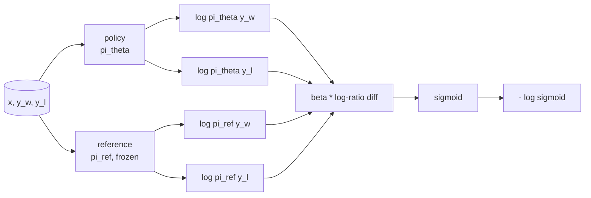
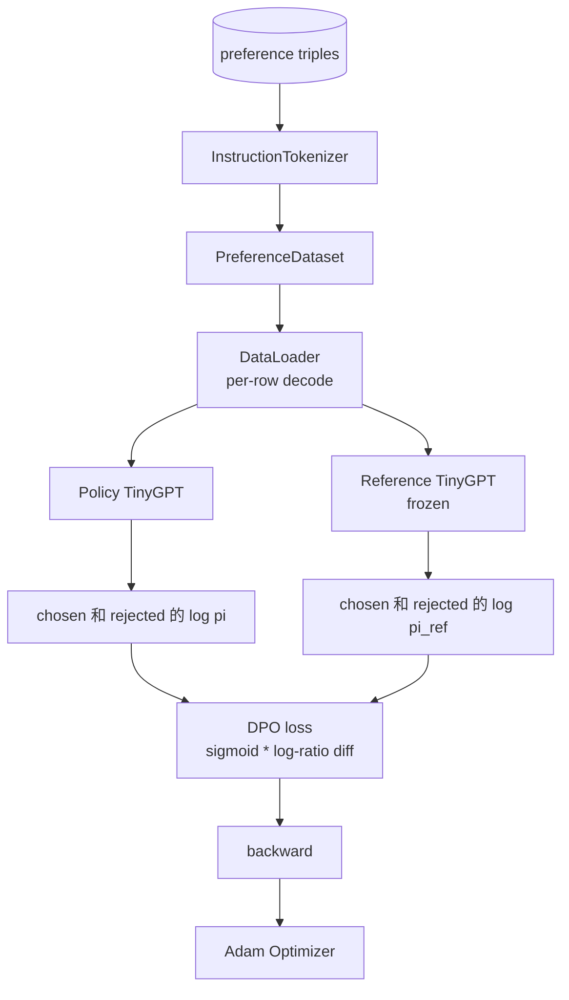

# كابستون  الدورة 40: من الصفر البدء في تحقيق تحسين التفضيلات المباشرة

> نموذج مكافأة و PPO هو كلاسيكي RLHF كومة. . . . . . . . . . . . . . . . . . . . . . . . . . . . . . . . . . . . . . . . . . . . . . . . . . . . . . . . . . . . . . . . . . . . . . . . . . . . . . . . . . . . . . . . . . . . . . . . . . . . . . . . . . . . . . . . . . . . . . . . . . . . . . . . . . . . . . . . . . . . . . . . . . . . . . . . . . . . . . . . . . . . . . . . . . . . . . . . . . . . . . . . . . . . . . . . . . . . . . . . . . . . . . . . . . . . . . . . . . . . . . . . . . . . . . . . . . . . . . . . . . . . . . . . . . . . . . . . . . . . . . . . . . . . . . . . . . . . . . . . . . . . . . . . . . . . . . . . . . . . . . . . . . . . . . . . . . . . . . . . . . . . . . . . . . . . . . . . . . . . . . . . . . . . . . . . . . . . . . . . . . . . . . . . . . . . . . . . . . . . . . . . . . . . . . . . . . . . . . . . . . . . . . . . . . . . . . . . . . . . . . . . . . . . . . . . . . . . . . . . . . . . . . . . . . . . . . . . . . . . . . . . . . . . . . . . . . . . . . . . . . . . . . . . . .

**Type:** Build
**Languages:** Python (torch, numpy)
**Prerequisites:** Phase 19 lessons 30-37 (NLP LLM track: tokenizer, embedding table, attention block, transformer body, pre-training loop, checkpointing, generation, perplexity)
**Time:** ~90 minutes

## أهداف التعلم

- سوف تخسر DPO 推导 إلى اختلاف النسبة السجلية المتوسطة على السيغمويد ،并把它连接到隐含奖励──
- بناء نموذج مرجع + زوج نموذج سياسة، من بينها تم تجميد المرجعية ‬الممارسة القائمة على سياسة تدريبية‬
- في اثنين من الموديلات تحت حساب مستوى التسلسل المحتملات السجل،并 نقب إشارات الإستعارة.
- في`(prompt, chosen, rejected)`ثلاث مرات 上訓練政策,并观察 اختار السجل-مراقبة مقابل رفض 上升──
- استخدام الاختبارات  ثابت الخسارة الرياضية、 علامة درجيات 和 إشارة عدم تغيرات

## المشكلة

لديك نموذج SFT. سوف تتبع التعليمات، ولكن الناتج غير مستقرة. بعض الإكمالات 清晰,有些冗长或错误. لديك أيضا مجموعة بيانات أزواج الاختيارات الصغيرة: بالنسبة لنفس المفاجأة، البشر سوف يختار إكمال واحد، والآخر يرفض.

经典 RLHF 答案是两阶段管道──先用偏好──训练奖励模型──再用 PPO 根据奖励 优化政策──这可行,但成本很高:

استخدام DPO مع خسارة مشرفة بدل هذه المرحلتين  نموذج المكافأة  غير واضحة وجودها‬‬ ‬ ‬ ‬ ‬ ‬ ‬ ‬ ‬ ‬ ‬ ‬ ‬ ‬ ‬ ‬ ‬ ‬ ‬ ‬ ‬ ‬ ‬ ‬ ‬ ‬ ‬ ‬ ‬ ‬ ‬ ‬ ‬ ‬ ‬ ‬ ‬ ‬ ‬ ‬ ‬ ‬ ‬ ‬ ‬ ‬ ‬ ‬ ‬ ‬ ‬ ‬ ‬ ‬ ‬ ‬ ‬ ‬ ‬ ‬ ‬ ‬ ‬ ‬ ‬ ‬ ‬ ‬ ‬ ‬ ‬ ‬ ‬ ‬ ‬ ‬ ‬ ‬ ‬ ‬ ‬ ‬ ‬ ‬ ‬ ‬ ‬ ‬ ‬ ‬ ‬ ‬ ‬ ‬ ‬ ‬ ‬ ‬ ‬ ‬ ‬ ‬ ‬ ‬ ‬ ‬ ‬ ‬ ‬ ‬ ‬ ‬ ‬ ‬ ‬ ‬ ‬ ‬ ‬ ‬ ‬ ‬ ‬ ‬ ‬ ‬ ‬ ‬ ‬ ‬ ‬ ‬ ‬ ‬ ‬ ‬ ‬ ‬ ‬ ‬ ‬ ‬ ‬ ‬ ‬ ‬ ‬ ‬ ‬ ‬ ‬ ‬ ‬ ‬ ‬ ‬ ‬ ‬ ‬ ‬ ‬ ‬ ‬ ‬ ‬ ‬ ‬ ‬ ‬ ‬ ‬ ‬ ‬ ‬ ‬ ‬ ‬ ‬ ‬ ‬ ‬ ‬ ‬ ‬ ‬ ‬ ‬ ‬ ‬ ‬ ‬ ‬ ‬ ‬ ‬ ‬ ‬ ‬ ‬ ‬ ‬ ‬ ‬ ‬ ‬ ‬ ‬ ‬ ‬ ‬ ‬ ‬ ‬ ‬ ‬ ‬ ‬ ‬ ‬ ‬ ‬ ‬ ‬ ‬ ‬ ‬ ‬ ‬ ‬ ‬ ‬ ‬ ‬ ‬ ‬ ‬ ‬ ‬ 

## المفهوم

من نموذج برادلي تيري 开始──给定提示 `x`و إكمالات`y_w`(مختار)`y_l`(رفض) ، الإنسان偏好 `y_w`احتمالية

```math
P(y_w > y_l \mid x) = \sigma\big( r(x, y_w) - r(x, y_l) \big)
```

من بينهم`r`هو وظيفة مكافأة غامضة.`r`ثم تدريب السياسة`pi`، باستخدام المرسومة KL أقصى قدر ممكن`r`:

```math
\max_{\pi} \; \mathbb{E}_{x, y \sim \pi} \big[ r(x, y) \big] - \beta \, \mathrm{KL}(\pi \,\|\, \pi_{\text{ref}})
```

وذلك من أجل تحقيق هذه المهداف`pi*`يمكن استخدامها`r`写成 شكل مغلق:

```math
\pi^*(y \mid x) = \frac{1}{Z(x)} \, \pi_{\text{ref}}(y \mid x) \exp\!\left( \frac{r(x, y)}{\beta} \right)
```

على`r`重新整理:

```math
r(x, y) = \beta \big( \log \pi^*(y \mid x) - \log \pi_{\text{ref}}(y \mid x) \big) + \beta \log Z(x)
```

`log Z(x)`项对 `y_w`和 `y_l`مماثلة`x`بدلاً من ذلك`y`), لذلك في حساب الفرق في الاختلافات الاختيارية:

```math
\begin{aligned}
r(x, y_w) - r(x, y_l) = \beta \big( &\log \pi_\theta(y_w \mid x) - \log \pi_{\text{ref}}(y_w \mid x) \\
&- \log \pi_\theta(y_l \mid x) + \log \pi_{\text{ref}}(y_l \mid x) \big)
\end{aligned}
```

代入 برادلي-تيري sigmoid،并对偏好对 取负记录概率:

```math
\begin{aligned}
L_{\text{DPO}}(\theta) = -\mathbb{E}_{(x, y_w, y_l)} \Big[
  \log \sigma\big( \beta \big( &\log \pi_\theta(y_w \mid x) - \log \pi_{\text{ref}}(y_w \mid x) \\
  &- \log \pi_\theta(y_l \mid x) + \log \pi_{\text{ref}}(y_l \mid x) \big) \big)
\Big]
\end{aligned}
```

هذا هو الخسارة. انها في كل حالة من نموذج واحد من علامات التشديد، والمعيار يتم تحديده من قبل أربعة احتمالات السجلات.



## علامة التراجع

قبل أي تدريب كان هناك فحص عقلاني مفيد`log pi_theta(y_w | x)`求 درجة:

```math
\frac{\partial L_{\text{DPO}}}{\partial \log \pi_\theta(y_w \mid x)} = -\beta \big(1 - \sigma(z)\big)
```

من بينهم`z`هو حجة سيغمايد.`z`مدونة، وهذا يعني: تحسين السياسة على احتمالية التكمل المختار من التسجيل سوف تقلل الخسائر.`log pi_theta(y_l | x)`√ √ √ √ √ √ √ √ √ √ √ √ √ √ √ √ √ √ √ √ √ √ √ √ √ √ √ √ √ √ √ √ √ √ √ √ √ √ √ √ √ √ √ √ √ √ √ √ √ √ √ √ √ √ √ √ √ √ √ √ √ √ √ √ √ √ √ √ √ √ √ √ √ √ √ √ √ √ √ √ √ √ √ √ √ √ √ √ √ √ √ √ √ √ √ √ √ √ √ √ √ √ √ √ √ √ √ √ √ √ √ √ √ √ √ √ √ √ √ √ √ √ √ √ √ √ √ √ √ √ √ √ √ √ √ √ √ √ √ √ √ √ √ √ √ √ √ √ √ √ √ √ √ √ √ √ √ √ √ √ √ √ √ √ √ √ √ √ √ √ √ √ √ √ √ √ √ √ √ √ √ √ √ √ √ √ √ √ √ √ √ √ √ √ √ √ √ √ √ √ √ √ √ √ √ √ √ √ √ √ √ √ √ √ √ √ √ √ √ √ √ √ √ √ √ √ √ √ √ √ √ √ √ √ √ √ √ √ √ √ √ √ √ √ √ √ √ √ √ √ √ √ √ √ √

## البيانات

هذا الدروس يقدم 12 تفضيل ثلاثية. كل واحد منهم.`(prompt, chosen, rejected)` اختيارهم الانتهاء 短且精确── رفض 冗长、偏题或错误── هذه الأزواج 覆盖与课堂 39 相同的任务族(رأس المال、算术、清单) ، لذلك من قاعدة SFT 开始的政策会有一个合理起点──

يتم تصميمها بشكل مصمم جدا. في الإنتاج، سوف تستخدم DPO عشرات الآلاف على أزواج. التركيز هنا هو فقدان الرياضيات ودورة قادرة على العمل في مجموعة بيانات صغيرة من الصفحات الصغرى إلى الصفحات الصغرى، ويمكن أن يزداد الفجوة في المعلومات المختارة مقابل المرفوضة بشكل واضح.

## عدم تغير الإشارة

يجب أن يتم تنفيذ DPO بعناية مع نموذج المرجع.

- المعلمات المرجعية لا تلقى أبداً تراجعيات
- احتمالات السجل الإرجاني بين العصور لا تتغير أبداً
- السياسة من مقارنة مع المرجعية الوزن 开始──(أفضل `theta`إشارة إضافة إلى التحديث المكتشف؛ إشارة إشارة إشارة إشارة إشارة إشارة إشارة إشارة إشارة إشارة إشارة إشارة إشارة إشارة إشارة إشارة إشارة إشارة إشارة إشارة إشارة إشارة إشارة إشارة إشارة إشارة إشارة إشارة إشارة إشارة إشارة إشارة إشارة إشارة إشارة إشارة إشارة إشارة إشارة إشارة إشارة إشارة إشارة إشارة إشارة إشارة إشارة إشارة إشارة إشارة إشارة إشارة إشارة إشارة إشارة إشارة إشارة إشارة إشارة إشارة إشارة إشارة إشارة إشارة إشارة إشارة إشارة إشارة إشارة إشارة إشارة إشارة إشارة إشارة إشارة إشارة إشارة إشارة إشارة إشارة إشارة إشارة إشارة إشارة إشارة إشارة إشارة إشارة إشارة إشارة إشارة إشارة إشارة إشارة إشارة إشارة إشارة إشارة إشارة إشارة إشارة إشارة إشارة إشارة إشارة إشارة إشارة إشارة إشارة إشارة إشارة إشارة إشارة إشارة إشارة إشارة إشارة إشارة إشارة إشارة إشارة إشارة إشارة إشارة إشارة إشارة إشارة إشارة إشارة إشارة إشارة إشارة إشارة إشارة إشارة إشارة إشارة إشارة إشارة إشارة إشارة إشارة إشارة إشارة إشارة إشارة إشارة إشارة إشارة إشارة إشارة إشارة إشارة إشارة إشارة إشارة إشارة إشارة إشارة إشارة إشارة إشارة إشارة إشارة إشارة إشار

‬ ‬ ‬ ‬ ‬ ‬ ‬ ‬ ‬ ‬ ‬ ‬ ‬ ‬ ‬ ‬ ‬ ‬ ‬ ‬ ‬ ‬ ‬ ‬ ‬ ‬ ‬ ‬ ‬ ‬ ‬ ‬ ‬ ‬ ‬ ‬ ‬ ‬ ‬ ‬ ‬ ‬ ‬ ‬ ‬ ‬ ‬ ‬ ‬ ‬ ‬ ‬ ‬ ‬ ‬ ‬ ‬ ‬ ‬ ‬ ‬ ‬ ‬ ‬ ‬ ‬ ‬ ‬ ‬ ‬ ‬ ‬ ‬ ‬ ‬ ‬ ‬ ‬ ‬ ‬ ‬ ‬ ‬ ‬ ‬ ‬ ‬ ‬ ‬ ‬ ‬ ‬ ‬ ‬ ‬ ‬ ‬ ‬ ‬ ‬ ‬ ‬ ‬ ‬ ‬ ‬ ‬ ‬ ‬ ‬ ‬ ‬ ‬ ‬ ‬ ‬ ‬ ‬ ‬ ‬ ‬ ‬ ‬ ‬ ‬ ‬ ‬ ‬ ‬ ‬ ‬ ‬ ‬ ‬ ‬ ‬ ‬ ‬ ‬ ‬ ‬ ‬ ‬ ‬ ‬ ‬ ‬ ‬ ‬ ‬ ‬ ‬ ‬ ‬ ‬ ‬ ‬ ‬ ‬ ‬ ‬ ‬ ‬ ‬ ‬ ‬ ‬ ‬ ‬ ‬ ‬ ‬ ‬ ‬ ‬ ‬ ‬ ‬ ‬ ‬ ‬ ‬ ‬ ‬ ‬ ‬ ‬ ‬ ‬ ‬ ‬ ‬ ‬ ‬ ‬ ‬ ‬ ‬ ‬ ‬ ‬ ‬ ‬ ‬ ‬ ‬ ‬ ‬ ‬ ‬ ‬ ‬ ‬ ‬ ‬ ‬ ‬ ‬ ‬ ‬ ‬ ‬ ‬ ‬ ‬ ‬ ‬ ‬ ‬ ‬ ‬ ‬ ‬ ‬ ‬ ‬ ‬ ‬ ‬ ‬ ‬ ‬ ‬ ‬ ‬ ‬ ‬ ‬ ‬ ‬ ‬ ‬ ‬ ‬ ‬

- المخططات الاصطناعية`torch.no_grad()`إشارة
- لكل مُعيار مرجعي`requires_grad=False`.
- في المرجعية  بناء بعد، من خلال `policy.load_state_dict(reference.state_dict())`سياسة بناء


```figure
cap-dpo-preference
```

## الهندسة المعمارية



模型与教学 39 中使用的TinyGPT 相同(القطع العريض فقط、سبب、بايت توكنيزر) المراجعة 和 السياسة مشاركة الهندسة المعمارية؛ أثناء التدريب وزن السياسة من المراجعة 发生 الانحراف، بينما المراجعة 保持 ثابتة‬

## ما ستبني

实现 بواسطة واحد `main.py`أعلى اختبارات

1. `InstructionTokenizer`:带 `INST`和 `RESP`أشكال الاختصاصات الخاصة
2. `TinyGPT`:معدل مُعدل فقط للتعديل.
3. `make_preferences`عودوا إلى هنا`(prompt, chosen, rejected)`ثلاث مرات
4. `sequence_log_prob`:给定模型、快点前 和完成,返回完成 上 التوقيت التالي إشارات السجل احتمالات 总和(不包含快点位置贡献)
5. `dpo_loss`:接收四个日志概率 和 `beta`، عودة لكل مثال ضياع الجهاز وذلك في تسجيل الديلتا المقصود للمكافأة.
6. `train_dpo`:per-epoch loop,在政策 和引用 下计算 منتخب مع رفض السجلات-تحقيقات,应用 Loss,并执行 آدم خطوة
7. `evaluate_margins`: في أي وقت تعود سياسة أسفل المتوسط المختار رفض الحدود احتمالية المذكرة
8. `run_demo`: من التدريب السابق للتدفئة الصغيرة  بناء مرجع و سياسة، نسخ الوزن، تدريب ثلاثين خطوة، طباعة خطوة خسرة و هامش،并成功时以零 退出。

## لماذا يعمل الـ DPO

في نموذج برادلي تيري التفضيل أسفل، DPO في الرياضيات على مساوية إلى RLHF، فقط فرق معايير الجائزة.`r(x, y) = beta * (log pi(y|x) - log pi_ref(y|x))`يمكن التعرف على بين الاختيارات، أكثر من ذلك عن`x`وظيفة، بينما سوف يكون في الفارق قيمة抵消──سياسة النموذج المغلق 让你跳过显式奖励模型──KL القيود هي الإضافة الهيكلية:`pi`مقارنة`pi_ref`أي منحدرات سوف تجعل النسبة التسجيل التغير، وذلك في السياسة 走得太远时湿 gradient.

## إرسال أهداف

- عطاء جمع احتمالات التسجيل  إضافة التطبيع على الطول: باستثناء طول الانتهاء.
- 添加 Loss of IPO: استخدام `(z - 1)^2`替代 sigmoid + log──比较它在固定上的融合──
- 添加一个标签- smoothing参数, 在硬选择拒绝标签 和均 0.5 之间插值──
- استخدام更小、更便宜的模型替换参考(مصنوع المعرفة 风格)

实现会给你 Loss 引用不变 和训练循环――数学是本课的核心──代码 让数学具体化──
