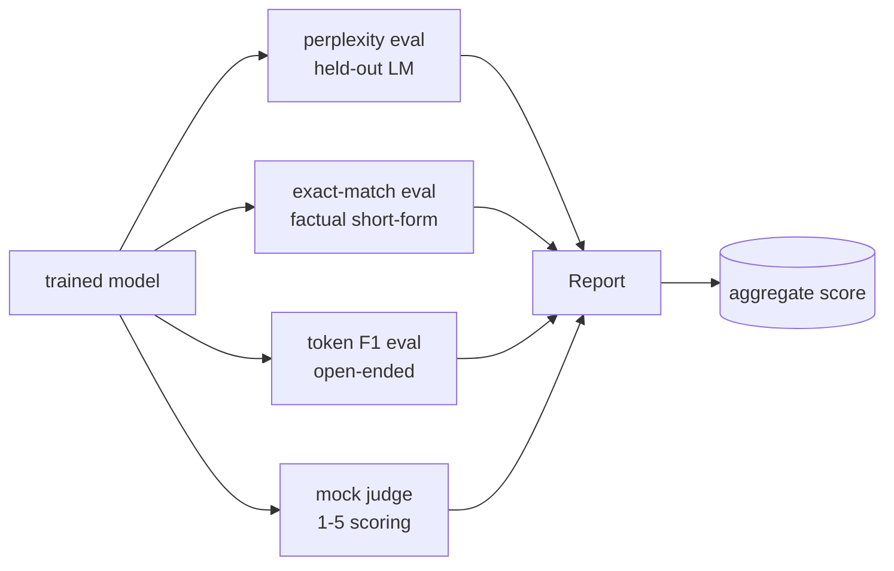
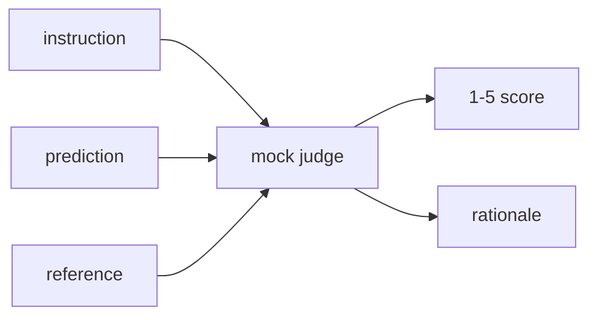
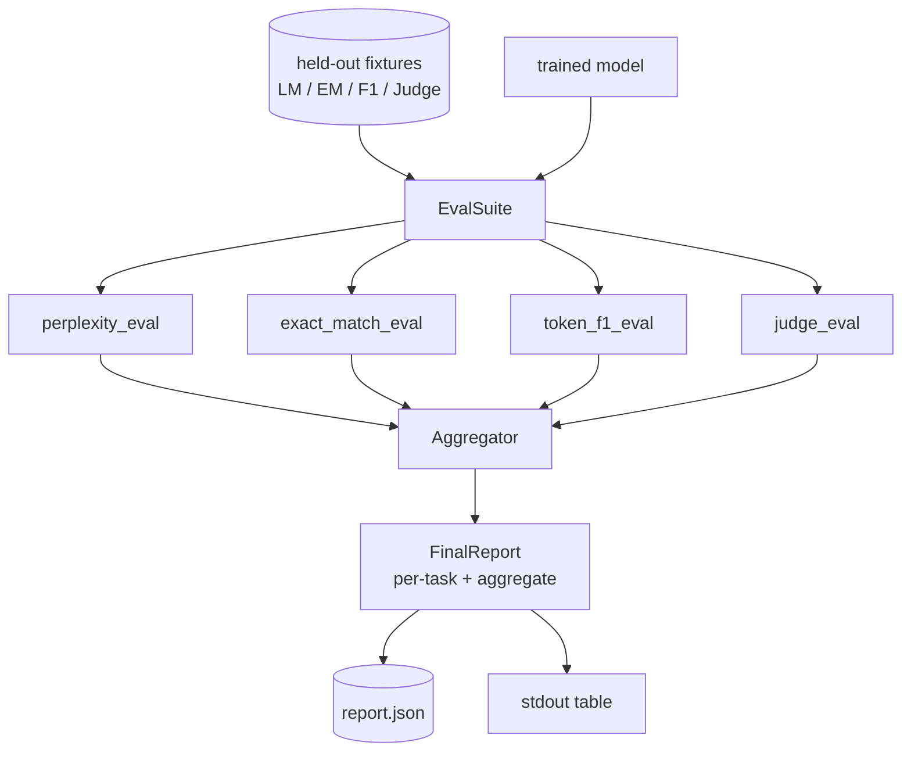

# دراسة كابستون 41: 完整 خط أنابيب التقييم

> التدريب هو يمكنك استخدام منحنى الخسارة  جزء من المراقبة. التقييم هو جزء من يجب عليك تصميمه. هذا الدراسة سوف تبني خط أنابيب تقييم موحدة: فإنه يتقبل نموذج اللغة المُدربة بشكل جيد، ويتم على ذلك تشغيل أربعة أنواع مختلفة من التقييمات، وسوف تجمع النتائج إلى تقرير لتمزيق المهام، وتقديم تقرير محلي مزيف LLM-ك-قضاة، حتى تكون الدورة بأكملها 无需网络也能运行.

**Type:** Build
**Languages:** Python (torch, numpy)
**Prerequisites:** Phase 19 lessons 30-37 (NLP LLM track: tokenizer, embedding table, attention block, transformer body, pre-training loop, checkpointing, generation, perplexity)
**Time:** ~90 minutes

## أهداف التعلم

- في محول صغير أعلى باستخدام الوهم المخفي حسابات معقدة معقدة
- في短事实提示 上运行 تقييم مطابق دقيق
- 通過 التطبيع 计算 التنبؤ مع الإشارة 字符串 بين رمز مستوى F1。
- بناء محكمة محلية مزيفة كقاضي، مع 1-5 حصص لتصميم النتائج النموذجية
- أن تجمع أربع تقييمات لتجميع تقرير واحد من التقسيم حسب المهام

## المشكلة

单一指标 永远无法描述语言模型――الغموض في النموذج الذي يوضح كيفية تكوين التوزيع اللغوي، ولكن لا يوضح ما إذا كان يمكن أن يرد على السؤال――النموذج الذي يطابق بالضبط هو إن لم ينتج سلسلة ذهبية، ولكن سوف يعاقب التغيير الصحيح في النص.

تمتلك خط الأنابيب الذي تريده حقاً هذه القدرات الأربعة في الوقت نفسه. كل تقييم يغطي تقييمات أخرى. يفتقد بعدة واحدة. كل تقييم يعمل على بيانات مختلفة من أجل هذا المقياس.

هذا الدروس سوف يكون في الملف من وسط إلى آخر بناء هذا الأنابيب.

## المفهوم



كل تقييم كان من`(model, dataset) -> EvalResult`تحتوي النتائج على قيمة قياسية، وتفاصيل لكل نموذج يتم استخدامه في المراقبة، وكذلك اسم الجمع.

## الارتباك، معد بشكل صحيح

الارتباك هو`exp(mean negative log-likelihood per token)`تطبيقها من بين اثنين من الثوار:

- يعني يجب أن يكون مبني على مواقع الوهم الحقيقي، وليس على تسلسل البطاقات. يجب أن يتم إزالة الوهم من المعادلة. وإلا فإن الارتباك سيكون أفضل من الواقع.
- النموذج 预测下一个 رمز,所以位置 `i`预测位置 `i+1`الـ "أف ب ب ب ب ب ب" في هذا الصدد

والقيام بتقييم حسب الارتباط  حساب المواقف غير المكملة `-log p(token)`总和与Token count,最后再相除──这比平均 per-batch perplexities 更数值安全(后者会低估短序列的权重),并且符合教科书的定义──

## مطابقة دقيقة مع التطبيع

الحاجة إلى تقييم التنبؤات والإشارات

- 转为 الحرف الصغير
- "في المجال الأبيض الأول"
- ستقوم بإعادة تشكيل الفضاء الداخلي
- إذا كان الجانبين فقط بسبب التقاط مختلفة، ثم إزالة نهاية النهاية التقاط`.`.`!`.`?`(‬)

التطبيع 让精确匹配 在实践中有用.`"Paris"`نعم对的;说 `"Paris."`أيضاً`"  paris  "`أيضاً على هذا المقياس لا يزال يطلب التطبيع

## الـ F1، الطريق الصحيح

رمز F1 هو على أساس حقيبة من الرموز  حساب دقة و التذكر المتوسط المتناسبة:

1. عادي التنبؤ 和 الإشارة(مع مطابقة دقيقة 相同规则)
2. 将每个字符串分割为代币 列表(تدوين الفضاء الأبيض)
3. 统计 متعددة المجموعات المتقاطعة
4. الدقة = `intersection_count / len(pred_tokens)`❖تذكير = `intersection_count / len(ref_tokens)`ف1 = المتوسط الهارموني

إذا كان التنبؤ و الإشارة 都为空، F1 为 1 ((المقابلة الفارغة) ⋅ إذا كان هناك جانب واحد فقط为空، F1 为 0⋅ هذا النموذج يتناسب مع إشارة تقييم SQuAD،并能在表情上产生稳定数字──

## محلية محلية محلية محلية

القاضي الحقيقي هو نموذج الحدود في API  后面的模型──本课中的法官 必须离线运行──模仿法官 是一个确定性得分,它收到指令、模型的预测 和参考,并返回`{1, 2, 3, 4, 5}`النتيجة و العقلية. قواعد الاعتبارات واضحة:

- إذا كان التنبؤ المعتاد يشبه الإشارة المعتادة، فهي 5
- إذا كان التنبؤ بين الرمز F1 و الرمز  على الأقل 0.8، فإن 4
- إذا كان رمز F1  تقع `[0.5, 0.8)`,إذاً 3
- إذا كان رمز F1  تقع `[0.2, 0.5)`,إذاً فمن 2
- 其他情况为 1

هذا ليس قاضي حقيقي، لكنه لديه واجهة صحيحة. بعد ذلك يجب فقط استبدال وظيفة يمكن الاتصال بها إلى النموذج الحقيقي.



## التجميع

مجموع هو متوسط الموازنة لدرجات التقييم المعتاد. كل تقرير تقرير عن نفسه في`[0, 1]`الرقم الوسطى:

- الارتباك: التطبيع`1 / (1 + log(perplexity))`تعجّب 为 1 映射到 1, لا نهاية 映射到 0
- المقابلة الدقيقة:`[0, 1]`في الوسط
- الـ (F1): لقد تم`[0, 1]`في الوسط
- القاضي:

الوزن 可配置──默认组合是 0.2 تعقيدا ً 0.3 مطابقة دقيقة ً 0.3 رمز F1、 0.2 قاضي ً الوزنات 选择的产品决策;本课暴露这个键,方便你实验──


```figure
cg-eval-quadrant
```

## الهندسة المعمارية



`EvalSuite`هو محفل موسيقي صغير جدا. كل تقييم مستقل هو وظيفة مجانية.`(model, tokenizer, dataset, config)`ولم أعود`EvalResult`.`Aggregator`收集结果并生成最终 report──demo 会打印表格,并写入一个 JSON副本,供下游CI ingest──

## ما ستبني

实现 واحد `main.py`مع اختبارات

1. `TinyGPT`: دروس 38-40 中使用的同一个解码架构,内置在本课中以便独立运行──
2. `InstructionTokenizer`:带 INST / RESP / PAD خاصات بايت tokeniser。
3. أربع أدوات: مجموعة LM corpus ̇ مجموعة EM ̇ مجموعة F1 和 مجموعة القضاة ̇
4. `perplexity_eval`: عودة تحتوي على قيمة الارتباك و/أو خسارة هرم`EvalResult`.
5. `exact_match_eval`: عودة متوسط EM 和 على كل سجلات نموذجية
6. `token_f1_eval`: عودة متوسط الرمز F1 和 على كل سجلات نموذجية
7. `mock_judge`和 `judge_eval`:للمثال النتيجة مع العقلانية، فضلا عن متوسط النتيجة في المجموعة العليا
8. `Aggregator.normalise`:قاعدة التطبيق المتوافق مع المستوى
9. `Aggregator.aggregate`: المتوسط الموزن و تقرير بعد التجميع
10. `run_demo`: تدريب قصير على نموذج صغير، عمل جميع أنواع تقييم، طبع جدول تقرير ومكملة في JSON، نجاح وقت صفر 退出。

## قراءة التقرير

هناك ثلاثة مستويات. أعلى مستوى هو النتيجة الإجمالية. أسفل أربعة أرقام لكل فئة. مرة أخرى أسفل هي الانفجارات لكل مثال المستخدمة في التشخيص.

استخدام مفاتيح استقرار، دع المكتب التحكمي يُمكن أن يُخطط عبر الإصدار خطوط الاتجاهات.

## إرسال أهداف

- 添加校准 eval:model's softmax probabilities 是否匹配其准确性?
- 添加强度 eval:给每一个例子 标注扰乱(typ、paraphrase、distractor),并报告每类扰乱的度量下降──
- استخدام هاتف HTTP 后面的真实模型 替换假法官──功能签名 不变──
- 添加 per-task weight learning:不使用固定 weights,而是根据模型上的目标偏好顺序 拟合体重──

هذا النوع من التقييمات الحقيقية سوف تتضمن المزيد من الدرجات على هذا النوع من التقييمات.
