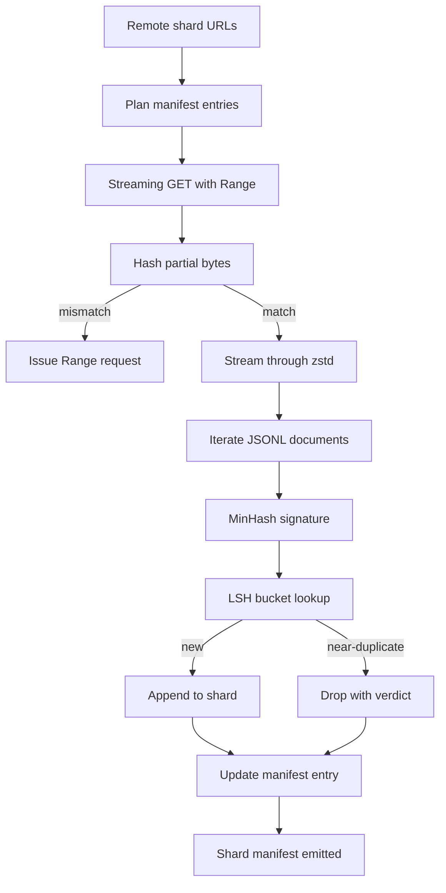

# مُنزّل كبير للجسم

> 訓練語言模型 早在第一次前进通过 之前就开始了──corpus 必须落到磁盘上,完成解压缩, 脱复,并且可地址; 在网络 4٪ 处断掉之前, resume story 就已经要设计好──本课会构建一个流媒体下载器:它拉取压缩片段,使用Zstandard 边下边解压缩,通过 MinHash加本地敏感的哈希为出近似的重复生成指纹,并写片段表,让管道的剩余部分可以信任──

**Type:** Build
**Languages:** Python
**Prerequisites:** Phase 19 lessons 30-37
**Time:** ~90 minutes

## أهداف التعلم

- استخدام `urllib`تدفق الشظايا البعيدة،并用 `zstandard`إزالة الضغط، وتجنب إرسال كافة الملفات إلى الذاكرة
- 针对验证字节抵消 发起 HTTP `Range`طلبات، لانتقال التنزيل الجزئية
- لكل وثيقة، قم بتكوين توقيع من هاش، و استخدم LSH 分桶، و اجعل المزدوج القريب يحدث تصادم.
- 输出包含内容 hash、byte size、document count 和 dedup verdict 的碎片宣言──

## المشكلة

لأول مرة في 200 جيجابايت في التدريب، الشبكة في 41% من التقطيع، النص`urllib`استثناء 退出──第二次 انها في نسبة 78 处断掉──到了 نسبة 99, لقد قمت بإعادة كتابة الحلقة ثلاث مرات── أنت من اللحظة الأولى على أن تصمم معالجة نقطة فشل اثنين هي إعادة تنزيل جزئية وإزالة المستندات المكررة── كلاهما لديه خطة متقدمة؛ وكلاهما غالبا ما يتم تجاوزها، لأن خط الأنابيب الأول يبدأ ببعض المشكلة المزدوجة.`requests.get`اتصل

المتابعة هي مشكلة HTTP. الخادم يجب أن يدعمها.`Range`يجب أن يكون المستخدم على أساس سجل القرص ويتبع تعويضات معتمدة ويتم تأكيد تعويضات معتمدة يجب أن يتم الاحتفاظ بها في عملية وفاة بعد الحفاظ على الوصول إلى الموقع. إذا كان تعويضات الملفات والتي تفرق عن بايت، استئناف التنزيل سوف يكتب في القمامة، والجسم سوف يكون في حالة من التفسير فقط في وقت التوكينيزة.

التخفيف هو توقيع واحد  مشكلة. سوف تفشل التخفيف الدقيق في التخفيف القريب من التخفيف: نفس المقال في ويكيبيديا  مع ثلاثة أقدام مختلفة من اللوحة التخفيفية المظهر، نفس الملف الرمزي  مع رأس رخصة مختلفة، نفس المقال في المدونة كل رابط  مع تعقب المعلمات.

## المفهوم



### التدفق مع`urllib`

المكتبة القياسية`urllib.request.urlopen`返回文件像对象──将它包在 `zstandard.ZstdDecompressor().stream_reader`في وسط، البايتز فقط في التقاطع من الشبكة 流经解压缩器، مرة أخرى إلى المُعكر المستند، تماماً لا حاجة إلى المادة في الذاكرة شقق ضغط أو شقق مُحكمة──التكلفة الوحيدة للذاكرة هي حافظة الخط、 توقيع MinHash للوثيقة الحالية، فضلاً عن مؤشر LSH──

### استئناف مع `Range`

المنزّل لكل شقّة كتب اثنين من الملفات: شقّة`.partial.json`نقطة تفتيش`verified_bytes`.`expected_size`.`sha256_prefix`(بناء على`verified_bytes`البايتات  حساب) و عنوان المصدر.`sha256_prefix`، و فقط في إعادة حساب الهاش 匹配 时才 استئناف. إذا كان الهاش  خطأ ، سيتم تخليص جزء ، تنزيل من بايت صفر 重新开始.

### مين هاش + LSH

MinHash باستخدام مساحة ثابتة تقدير مجموعتين من تشابه جاكارد.`k`个最小 hash قيم، كل من المبتدئين من وظيفة hash مستقلة.`s`المستندات، في أي عنصر واحد من التوقيع`s`.

ثم سيقوم`k`المكونات`b`كل فرقة لديها`r`الصفوف ، من بينها`k = b * r`احتمالية الصدام بين اثنين من الوثائق في شريط واحد على الأقل`1 - (1 - s^r)^b`، سوف تستخدمك`(b, r)`调优的 `s`值附近形成尖门──典型 corpus dedup `s = 0.8`أبحاث "إل.إش"`k = 128`.`b = 32`.`r = 4`للوصول إلى هذا النقطة

### إشارة الشظايا كعقد

المنزول المخرج الوحيد الدائم هو manifesto──manifest 按 shard 保存 URL、decompressed byte count、document count、dedup 后的独特文件 count،以及最后的 shard file sha256──downstream Tokenization 读取 manifest، وليس قائمة الإداري──如果某一 shard 缺失或其 sha256 错误,manifest 会告诉下一阶段拒绝启动──manifest 是 数据 已下载与 已下载和可验证 之间的决定性界限──


```figure
cap-corpus-downloader
```

## بناءها

`code/main.py`实现:

- `ShardPlanner`- 读取 URLs 列表并生成 مخطط إدخالات المظاهر。
- `StreamingDownloader`- إفتح المعدة اختياريّة`Range``urllib`التدفق، كتابة في ملف مؤقت، في كل جزء  تحديث `.partial.json`نقطة التفتيش، و استئناف 时验证 sha256 المرفق
- `ZstdDocIterator`- سوف تكون مثل الملفات التيار 包在 `zstandard.ZstdDecompressor`في وسط،并逐行 yield a وثيقة
- `MinHasher`- استخدام البذور المثبتة عائلة لسلسلة النمو`k`- توقيع المكونات
- `LSHIndex`- 按频段 إلى التوقيعات 分桶并报告碰撞──
- `Dedup`- 组合 hasher 和 index، سيتم تدوين كل وثيقة`keep`أو`near_duplicate`,并附带 مطابقة هوية الشظايا
- `ManifestWriter`- جمع إحصاءات لكل حصة و كتابة`manifest.json`.

أداء الملفات في القرص`zstandard`ضغط عليه، من خلال`file://`URL 下载,执行 deduplicate,并打印 منشور

运行它:

```bash
python3 code/main.py
```

النص 以 صفر 退出并印印 إيجاز المخطط

## نمط الإنتاج

أربعة أنماط يمكن أن تمتد إلى الجسم الحقيقي.

**Checkpoint before write.** `.partial.json`يجب أن يتم قبل إضافة البايت`fsync`否则电源损失 会颠倒顺序:shard bytes 在磁盘上,checkpoint 中没有它们,下一次重复 认为验证字节比实际更少,翻译后尾字节 会损坏 file──先检查点,再写──这与写前日志是同样的纪律──

**Sharded LSH index.**تحت حجم 200 جيجابايت، تغطي مؤشر LSH واحد في الجسم بأكمله 放不进 RAM。 وفقاً للمؤشر LSH في أول شريط hash 分区، سيتم وجود القرص على القرص، ويحث فقط على طلب التوقيع الجديد سيتم إدخال القرص‬‬‬‬‬‬‬‬‬‬‬‬‬‬‬‬‬‬‬‬‬‬‬‬‬‬‬‬‬‬‬‬‬‬‬‬‬‬‬‬‬‬‬‬‬‬‬‬‬‬‬‬‬‬‬‬‬‬‬‬‬‬‬‬‬‬‬‬‬‬‬‬‬‬‬‬‬‬‬‬‬‬‬‬‬‬‬‬‬‬‬‬‬‬‬‬‬‬‬‬‬‬‬‬‬‬‬‬‬‬‬‬‬‬‬‬‬‬‬‬‬‬‬‬‬‬‬‬‬‬‬‬‬‬‬‬‬‬‬‬‬‬‬‬‬‬‬‬‬‬‬‬‬‬‬‬‬‬‬‬‬‬‬‬‬‬‬‬‬‬‬‬‬‬‬‬‬‬‬‬‬‬‬‬‬‬‬‬‬‬‬‬‬‬‬‬‬‬‬‬‬‬‬‬‬‬‬‬‬‬‬‬‬‬‬‬‬‬‬‬‬‬‬‬‬‬‬‬‬‬‬‬‬‬‬‬‬‬‬‬‬‬‬‬‬‬‬‬‬‬‬‬‬‬‬‬‬‬‬‬‬‬‬‬‬‬‬‬‬‬‬‬‬‬‬‬‬‬‬‬‬‬‬‬‬‬‬‬‬‬‬‬‬‬‬‬‬‬‬‬‬‬‬‬‬‬‬‬‬‬‬‬‬‬‬‬‬‬‬‬‬‬‬‬‬‬‬‬‬‬‬‬‬‬‬‬‬‬‬‬‬‬‬‬‬‬‬‬‬‬‬‬‬‬‬‬‬‬‬‬‬‬‬‬‬‬‬‬‬‬‬‬‬‬‬‬‬‬‬‬‬‬‬‬‬‬‬‬‬‬‬‬‬‬‬‬‬‬‬‬‬‬‬‬‬‬‬‬‬‬‬‬‬‬‬‬‬‬‬‬‬‬‬‬‬‬‬‬‬‬‬‬‬‬‬‬‬‬

**Tombstone, not delete.**المنسخة المهجورة ستحصل على الحكم`near_duplicate`وذلك في حالة حدوث تصادم بينهم و بينهم. و بعد ذلك يمكن تغيير الحد الأدنى.

**Per-shard sha256 in the manifest, plus a manifest sha256.**المظهر نفسه سوف يحصل على المحتوى hash. مرحلة أسفل الحدود.

## استخدمها

أنماط الإنتاج:

- **Resume on every CI run.**أجهزة تشغيل المعلومات الإلكترونية هي مؤقتة.`--cache-dir`إنها علم فئة أولى
- **Dedup before tokenization.**التكنولوجيا ثمينة جدا. في نفس الوثيقة 上运行两次,为了 نفس منحنى الخسارة 支付两倍成本.
- **Manifest as merge gate.**التدريب من اللمسة المثبتة 读取 manifesto sha256。 إصدار مجموعة بيانات جديدة 需要新 manifesto commit── رمز و بيانات 之间的链接是 git,而不是口口相传──

## أرسله

`outputs/skill-corpus-downloader.md`في المشاريع الحقيقية، تصف ما هي عناوين URL  إمدادات المنزيل  دليل نقاط التفتيش  كيفية التخطيط  المزودة استخدام ما عرض الشنجل و`(k, b, r)`ثلاثية، فضلا عن المظهر في مركز التحكم في الإصدار.

## التمارين

1. إضافة`--shingle-width`العلم،并测量 dedup حكم في عرض 3、5、9 下如何变化──为选择的默认值辩护──
2. 通過嗅探魔法字节,在 zstd 旁边添加 gzip 支持──下载器 不应要求调用者 指定代码──
3. إضافة`--resume-only`وضع: إذا لم تصل إلى نقطة التفتيش، فإن رفض البدء في تنزيل جديد.
4. لنقل مؤشر LSH إلى رف أو ملف مربع، ونقلها إلى التدفقات المتداولة في الذاكرة.
5. في البدء إضافة المظاهر Sha256 التحقق... إذا كان القرص على المظاهر مع `manifest.lock`وسط المظهر hash 不一致، downloader 应 failed closed──

## الشروط الرئيسية

| Term | What people say | What it actually means |
|------|-----------------|------------------------|
| Shard | “一个 file” | corpus 的一个自包含 slice，拥有自己的 sha256，并作为 resume 和 dedup 的单位 |
| MinHash signature | “Fingerprint” | 一个 set 的 `k`-component sketch，其中每个 component 是该 set 上一个 independent hash 的最小值 |
| LSH band | “Bucket” | 一组 `r` 个 signature components，用作 collision detection 的单个 bucket key |
| Verified bytes | “Resume offset” | disk 上 sha256 prefix 与 checkpoint 匹配的 bytes；唯一安全的 resume offset |
| Manifest | “The index” | downloader 产出的单一 durable record，包含 content hashes |

## المزيد من القراءة

- [RFC 7233](https://datatracker.ietf.org/doc/html/rfc7233)- طلبات HTTP Range، أي بروتوكول استئناف
- [Zstandard format specification](https://datatracker.ietf.org/doc/html/rfc8478)- 让 流解压缩安全的框架格式
- [MinHash](https://en.wikipedia.org/wiki/MinHash)- 本课使用的 توقيع عائلة
- [Locality-sensitive hashing](https://en.wikipedia.org/wiki/Locality-sensitive_hashing)- عتبة الإفراج 背后的带制
- المرحلة 19 · 43 - المنزول 供给的 HDF5 تميزات الجسم
- المرحلة 19 · 44 - في الجسم التدريب على جدول الكوسين
- المرحلة 19 · 45 - 消耗该时间表的 AMP循环
