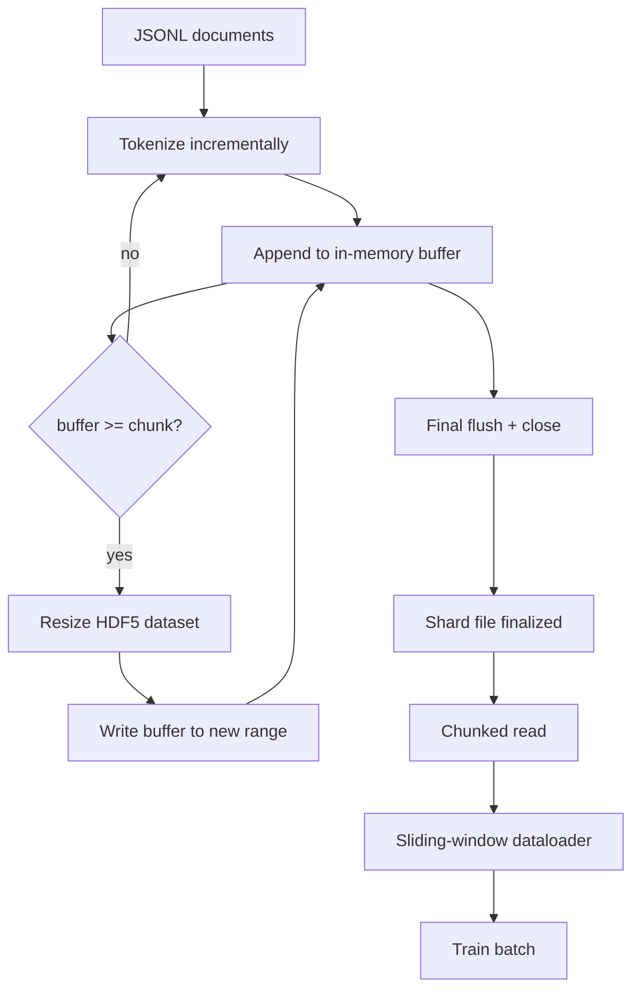

# HDF5 رمزية 语料库

> يجب أن يقع المواد الجيدة على نوع من التدريبات التي يمكن أن تتم في خطة القراءة بسرعة. على القرص القرصي JSONL لا يحتوي على 16 عامل محمولة بيانات.

**Type:** Build
**Languages:** Python
**Prerequisites:** Phase 19 lessons 30-37
**Time:** ~90 分钟

## أهداف التعلم

- 将文档流式写入一个带决定性分断的可调整大小HDF5整数数据集──
- سوف يكتب في مقاطع إلى العديد من HDF5 文件, جعل هزيمة الحدود قابلة للسيطرة, و يجعل الميزة ممكنا.
- 通过 HDF5 بواسطة مخزن الصفحة 支的分碎布局 读回代币,使数据loader 只在批量时间 复制到批量缓冲
- 实现 a sliding-window dataloader, with apparently packing 规则发发出固定长度训练序列──

## المشكلة

现代语言模型培训运行 会在数十名工人 上以每秒数十万样本的速度读取代码. JSONL على القرص في أول خطأ في صفحة الاحتفاظ بالمناسبة الباردة 时就会崩: JSON parser 很慢,文档边界无法寻址,而寻找到"样本 4,217,884" 需要扫描文件──即使压缩效果很好,Parquet,也不适合这里,因为 المدرب لا يريد الأعمدة;它想要带$O(1)$الوصول العشوائية 平 رمز التيار

HDF5  مناسبة، لأنها توفر مجموعة بيانات صغيرة جدا جدا جدا جدا جدا جدا جدا جدا جدا جدا جدا جدا جدا جدا جدا جدا جدا جدا جدا جدا جدا جدا جدا جدا جدا جدا جدا جدا جدا جدا جدا جدا جدا جدا جدا جدا جدا جدا جدا جدا جدا جدا جدا جدا جدا جدا جدا جدا جدا جدا جدا جدا جدا جدا جدا جدا جدا جدا جدا جدا جدا جدا جدا جدا جدا جدا جدا جدا جدا جدا جدا جدا جدا جدا جدا جدا جدا جدا جدا جدا جدا جدا جدا جدا جدا جدا جدا جدا جدا جدا جدا جدا جدا جدا جدا جدا جدا جدا جدا جدا جدا جدا جدا جدا جدا جدا جدا جدا جدا جدا جدا جدا جدا جدا جدا جدا جدا جدا جدا جدا جدا جدا جدا جدا جدا جدا جدا جدا جدا جدا جدا جدا جدا جدا جدا جدا جدا جدا جدا جدا جدا جدا جدا جدا جدا جدا جدا جدا جدا جدا جدا جدا جدا جدا جدا جدا جدا جدا جدا جدا جدا جدا جدا جدا جدا جدا جدا جدا جدا جدا جدا جدا جدا جدا جدا جدا جدا جدا جدا جدا جدا جدا جدا جدا جدا جدا جدا جدا جدا جدا جدا جدا جدا جدا جدا جدا جدا جدا جدا جدا جدا جدا جدا جدا جدا جدا جدا جدا جدا جدا جدا جدا جدا جدا جدا جدا جدا جدا جدا جدا جدا جدا جدا جدا جدا جدا جدا جدا جدا جدا جدا جدا جدا جدا جدا جدا جدا جدا جدا جدا جدا جدا جدا جدا جدا جدا جدا جدا جدا جدا جدا جدا جدا جدا جدا جدا جدا جدا جدا جدا جدا جدا جدا جدا جدا جدا جدا جدا جدا جدا جدا جدا جدا جدا جدا جدا جدا جدا جدا جدا جدا جدا جدا جدا جدا جدا جدا جدا جدا جدا جدا جدا جدا جدا جدا جدا جدا جدا جدا جدا جدا جدا جدا جدا جدا جدا جدا جدا جدا جدا جدا جدا جدا جدا جدا جدا جدا جدا جدا جدا جدا جدا جدا جدا جدا جدا جدا جدا جدا جدا جدا جدا جدا جدا جدا جدا جدا جدا جدا جدا جدا جدا جدا جدا جدا جدا جدا جدا جدا جدا جدا جدا جدا جدا جدا جدا جدا جدا جدا جدا جدا جدا جدا جدا جدا جدا جدا جدا جدا جدا جدا جدا جدا جدا جدا جدا جدا جدا جدا جدا جدا جدا جدا جدا جدا جدا جدا جدا جدا جدا جدا جدا جدا جدا جدا جدا جدا جدا جدا جدا جدا جدا جدا جدا جدا جدا جدا جدا جدا جدا جدا جدا جدا جدا جدا جدا جدا جدا جدا جدا جدا جدا جدا جدا جدا جدا جدا جدا جدا جدا جدا جدا جدا جدا جدا جدا جدا جدا جدا جدا جدا جدا جدا جدا جدا جدا جدا جدا جدا جدا جدا جدا جدا جدا جدا جدا جدا جدا جدا جدا جدا جدا جدا جدا جدا جدا جدا جدا جدا جدا جدا جدا جدا جدا جدا جدا جدا جدا جدا جدا جدا جدا جدا جدا جدا جدا جدا جدا جدا جدا جدا جدا جدا جدا جدا`tokens[3,200,000 : 3,200,8192]`في شريحة، سوف يقوم HDF5 بتحويل الطلب من الاحتفاظ بالصفحة إلى نسخة إلى تعدد صف NumPy الموزع الجديد. تكلفة كل عامل هو واحد مفتوحة مع الملفات، فضلا عن قطعة كبيرة من الاحتفاظ بالصفحة.

مشكلة التكوين تكمن في جعل الكتابة من الصدقة. المجموعات البيانية القابلة للانتقال  سهلة الاستخدام الخطأ: مرة واحدة كتابة مستند، HDF5 文件会碎碎化到不可用. مرة واحدة تحويل حجم 写入所有文件,进程死亡会丢失整个片段.

## المفهوم



### 正确使用 قابلة للاستخدام HDF5

مجموعة بيانات رمزية استخدام `maxshape=(None,)`و ثابتة`chunks=(chunk_size,)`创建──写入时,将代币 缓存在长度为 `chunk_size`تعدد المجموعة 中──当缓冲 填满时,数据集 精确地按 `chunk_size`扩展,并把缓冲 写入新范围──在 shard 结束时,剩余缓冲 会写入最后一段范围──除了最后一段写入外,每次写入都是连接的和分类的;读者会根据 shard 的 HDF5属性 中记录的`token_count`اخر مرة اكتب فيها

### الكتابة الممزقة

单个 HDF5 文件是单点故障──管道 会并行写入片段:Phase 19 lesson 42 中的每个输入片段 生成一个 HDF5输出片段──`shards.json`المرجحات حسب الشظيفة  سجل مسار الملفات  إعداد الوهم  إعداد الوثائق ، وكذلك شكل الوهم 读取 `shards.json`لتحديد التوازنات العالمية و التحقق من المعلومات

### القراءة في الخريطة الذاكرة

في التدريب، كل عامل سوف`swmr=True`وضع 打开自己负责的 HDF5文件,并请求 `tokens[start:stop]` بمجرد أن يتغير جزء 热,وضع جزء من HDF5 就会让它成为页面缓存支持的阅读──工作者 永远不会实现 整个文件:slice 会被复制到数据加载器的批量缓冲,之后数据加载器在批量时间将其复制到固定记忆训练.

### محمّل بيانات النافذة المنزلقة

محرك تحميل البيانات هو الوحيد الذي يعرف طول تسلسل التدريب.`window_size + 1`رموز، ثم العودة`(input, target) = (tokens[:-1], tokens[1:])`لا يجب أن تتبع الحدود المستندية: نافذة واحدة يمكن أن تمر عبر اثنين من المستندات، في الوسط هناك واضحة`boundary_token_id`، فلتستخدم المُفصلة. هذه هي قاعدة التعبئة المعيارية. إنها قاعدة ينساها الباحثون بسهولة، ويتحول المكتبة إلى 8 في المائة من رموز الحدود التدريبية و 92 في المائة من النص الطبيعي.


```figure
cc-hdf5-corpus
```

## بناءها

`code/main.py`实现:

- `Tokenizer`- إشارة تحديدية على مستوى البايت، على التجربة 足够好──接口是 `encode(text) -> list[int]`和 `vocab_size`.
- `HDF5ShardWriter`- فتح مجموعة بيانات كاملة يمكن ضبطها ، وسوف تضخ طوابع إلى حجم الجزء ، وتحديد حجم الخطوة الصغيرة`token_count`和 `sha256`记录为 HDF5 صفات
- `ShardedTokenizationPipeline`- عبر الوثائق المدخلة، وسوف يصل إلي الكتاب، ومصدر`shards.json`المؤشر
- `MmapTokenStore`- 打开碎片文件  إجراء قراءات خريطة ذاكرة، حساب التداولات العالمية، كشف فردية `get_slice(start, stop)`(إيه بي)
- `SlidingWindowDataloader`- من التيار العالمي 中 اختيار النوافذ عشوائية،并 yield `(input_ids, target_ids)`المجموعات العديدة

سوف تقوم بإنشاء مجموعة صغيرة جداً من الذاكرة، وتقوم بتوجيه إلى شريحتين، من خلال خريطة الذاكرة، فتحهما، وتشغيل محفظة البيانات 10 دفعات، وتطبيع شكل كل دفعة ومجموعة التحقق.

运行:

```bash
python3 code/main.py
```

脚本以 0 退出并印出批量检查量──

## نمط الإنتاج

أربعة أنماط يمكن أن تمتد هذه الدورة إلى تدريب حقيقي

**Chunk size 等于典型读取大小。**مدرب كل عينة 读取 `window_size + 1`个代币──把 HDF5 جزء 设置为 `window_size`عدد المعدلات، قراءة على صفحة-مخزن الموافقة.

**Token count 放在 attributes 中，而不是 dataset 中。**الجزء الأخير من مجموعة البيانات ربما لا يتم ملئ بالكامل ، لأن حجم الجزء لا يتطلب الحدود الكاملة للوثيقة`token_count`作为 HDF5属性 存在数据集 上,并让读者在该值处截断──否则读者 会越过真实末尾读到零填的代币,模型也会学会预测零──

**带 parallel verification 的 sharded sha256。**كل شقق لديه بطن رمزي خاص به Sha256...... المدرب يمكن أن يبدأ التدريب قبل وممارسة التحقق من جميع الشققات... خطأ Sha256 سوف تجعل الجري 提前失败، وليس بعد 16 ساعات الثالثة 才失败。

**两侧都使用 `swmr=True`，writer 使用 `libver="latest"`。**وضع الكاتب الواحد والقراءة المتعددة  مطلوب الكاتب 以 `libver="latest"`打开, قبل إنشاء كل مجموعة بيانات, ثم إعداد `file.swmr_mode = True`بعد ذلك يجب على الكاتب أن يغير حجمها`dataset.flush()`، هكذا تستخدم`swmr=True`打开的读者工人 才能看到一致数据──跳过 `libver="latest"`، أو في تغييرات الهيكل بعد إعادة تشغيل SWMR ، هو "الملف مغلق" 失败的常见来源

## استخدمها

أنماط الإنتاج:

- **每个 source shard 一个 HDF5。**المنزّل ((درس 42) كل URL 输出一个片段;tokenization(本课) كل شقة مصدر 输出一个 HDF5──1:1 خريطة 让恢复 和部分失败恢复 变得简单──
- **Boundary token id。**رمز الحدود هو جزء من الكلمات الوهمية، وهو أيضا رمز واحد يُدخل في محمول البيانات. إذا كان يجب على النموذج تجاهله، فإن الخسارة التدريبية سوف تغطي رمز الحدود. وإلا فإن النموذج سوف يستخدمها كفصل تسلسل.
- **`shards.json` 是 source of truth。**添加新片段意味着写入 HDF5、计算它的 sha256,并添加一条入──trainer 在启动时读取该文件一次,之后永远不碰目录列表──

## أرسله

في المشاريع الحقيقية`outputs/skill-hdf5-tokenized-corpus.md`سأصف أي رمزية أو خط أنابيب أو أي جزء من حجم مربي مناسب`shards.json`في التحكم في النسخة وضعت في أي مكان، وكذلك عمال محرك تحميل البيانات كيفية عبور الملفات 分片──本课交付引擎──

## التمارين

1. 给HDF5 كاتب 添加 `--compression gzip`العلم، و في تجارب التجربة 上测量吞吐成本──为所选默认做出辩护──
2. 给滑窗数据لوader 添加确定性种子,并验证相同种子的两次运行 会产生相同批量――
3. إضافة`--validate`وضع، قرأ كل شق، أعاد حساب رموزها`shards.json`على المقابل، يجب أن يبدأ التدريب قبل أن يبدأ العمل عليه.
4. مقارنة مع حجم الجزء مثل حجم النافذة ∙ نصف حجم النافذة ∙ ضعف حجم النافذة ∙
5. إضافة`--max-document-tokens`العلم، في كتابة قصص طويلة جدا في الملفات.

## الشروط الرئيسية

| Term | What people say | What it actually means |
|------|-----------------|------------------------|
| Resizable dataset | "Append-only" | 一个带 `maxshape=(None,)` 的 HDF5 dataset，通过按 chunk 大小 stride 调用 `resize` 增长 |
| Chunked layout | "How HDF5 stores it" | 固定大小的 on-disk pages，kernel 可 memory-map，dataloader 可连续读取 |
| `swmr` mode | "Read-while-write" | Single-Writer-Multiple-Reader mode，使 dataloader workers 能安全共享文件 |
| Shard index | "shards.json" | 包含 offsets 和 content hashes 的所有 token shards 的 durable index |
| Sliding window | "Training sample" | global token stream 的固定长度 slice，trainer 会把它与 shift-by-one target 配对 |

## المزيد من القراءة

- [HDF5 chunking documentation](https://docs.hdfgroup.org/hdf5/v1_14/)- 本课使用的碎片式,可扩展的数据集布局
- [h5py user guide](https://docs.h5py.org/en/stable/)- HDF5 Python الارتباطات
- [NumPy memory mapping](https://numpy.org/doc/stable/reference/generated/numpy.memmap.html)- HDF5 通过 h5py 暴露的读侧原始
- المرحلة 19 · 42 - 输出由本课 टोकenize 的 downloader
- المرحلة 19 · 44 - 消费 هذا الملف المتحرك
- المرحلة 19 · 45 - 包裹 تدريب خطوة من حلقة AMP
