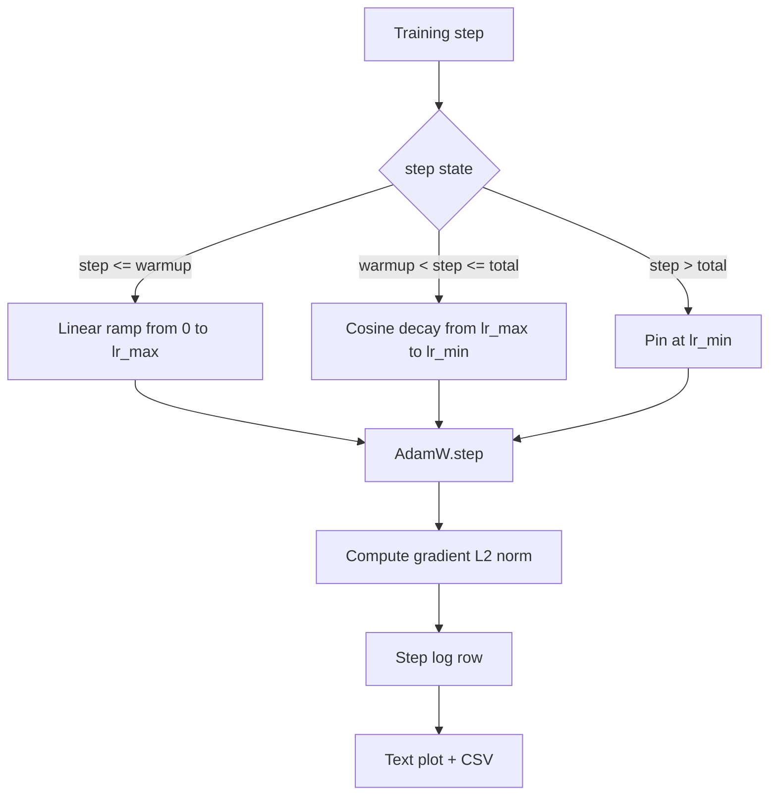

# 带 حرارة خطية of كوزين LR

> جدول معدل التعلم هو فقط بعد الثاني مهمة في وظيفة الخسارة. بضعة تسوس الكوسين وترقية التدفئة. آدم.و هو الاختيار المتبقي الحديث للتدريب على النموذج اللغوي، لأنه يجعل النموذج في التحديثات السابقة الف الفرة ضعيفة رؤية حجم خطوة فعالة أصغر، صعود تدريجيًا إلى ذروة التكوين، ثم التسهيل التناقص مرة أخرى تقترب من صفر.

**Type:** Build
**Languages:** Python
**Prerequisites:** Phase 19 lessons 30-37
**Time:** ~90 分钟

## أهداف التعلم

- 实现 a AdamW Optimizer,并接入带线性 التدفئة جدول معدل التعلم الكوسيني.
- في أي خطوة 精确计算表的值,避免跨 run 出现浮点漂移──
- أن تكون معدل التعلم مع معدل التعلم، والسجلات، والحالة الصحية للتدريب يمكن ملاحظة.
- سوف نضع جدولًا لـ 染 للعين البشرية، وكذلك أي أداة يمكن استهلاكها CSV.

## المشكلة

السابق 1000 مرة تحديثات التدريب 最──模型的重量 仍然接近初始化── оптимиzer 的运行第二时刻估计 尚未稳定──渐进标准 又大又噪──如果 معدل التعلم في هذه التحديثات في الذروة، فإن النموذج أو الاختلاف مباشرة، أو في حالة سقوط في مستوى الخسارة الخالية من الهروب إلى الأبد──

جدول التدريبات مع الحرارة هناك ثلاثة مناطق`warmup_steps`، معدل التعلم من الصفر التخفيض إلى ذروة التخصص`lr_max` من`warmup_steps`إلى`total_steps`,عدد التعلم  اتباع منحنى الكوسين `lr_max`衰减到 `lr_min`في`total_steps`بعد ذلك، معدلات التعلم ثابتة`lr_min`، مثل هذا التجاوز من المدربة خطأ التشغيل لن يخرج صامتًا من الجدول الزمني

تظهر معدل التعلم بعد ست ساعات في الموديل يبدأ في الانتقال إلى المعدل مرتفع أو منخفض بنسبة 1٪؛ إلا إذا تم إجراء اختبار مفصل على حدود الموعد، وإلا فمن المستحيل أن يكون ذلك.

## المفهوم



### صيغة الحرارة

لـ`warmup_steps > 0`时位于 `[0, warmup_steps]``step`معدل التعلم هو`lr_max * step / warmup_steps` التغير`warmup_steps = 0`حالة "لا تسخين": الجدول الزمني في الخطوة الصفر  مباشرة من `lr_max`بدأت،并立即 دخلت في التهالك الكويسيني.`warmup_steps = 0`، لجدول زمني للتفتيش  مازال يمكن أن تولد منحنى قابل للعمل

### صيغة كوزين

لـ`(warmup_steps, total_steps]`وسط`step`معدل التعلم هو`lr_min + 0.5 * (lr_max - lr_min) * (1 + cos(pi * progress))`، من بينهم`progress = (step - warmup_steps) / max(1, total_steps - warmup_steps)`في`step = warmup_steps`, كوسين  طلب قيمة`cos(0) = 1`، الحصول على`lr_max`, مع نقطة نهاية التدفئة 精确匹配──在 `step = total_steps`, كوسين  طلب قيمة`cos(pi) = -1`، الحصول على`lr_min`، مع نقطة نهاية التهالك 精确匹配

لا يوجد أيّة نقطة نهاية فوقها، فهي ليست مصادفة، لذا، يتمّ تنفيذ الجدول المخطط لتحقيقها`step`في المرتبة الأولى من المرتبة الأولى من المرتبة الأولى من المرتبة الأولى من المرتبة الأولى من المرتبة الأولى من المرتبة الأولى من المرتبة الأولى من المرتبة الأولى من المرتبة الأولى من المرتبة الأولى من المرتبة الأولى من المرتبة الأولى من المرتبة الأولى من المرتبة الأولى من المرتبة الأولى من المرتبة الأولى من المرتبة الأولى من المرتبة الأولى من المرتبة الأولى من المرتبة الأولى من المرتبة الأولى من المرتبة الأولى من المرتبة الأولى من المرتبة الأولى من المرتبة الأولى من المرتبة الأولى من المرتبة الأولى من المرتبة الأولى من المرتبة الأولى من المرتبة الأولى من المرتبة الأولى من المرتبة الأولى من المرتبة الأولى من المرتبة الأولى من المرتبة الأولى من المرتبة الأولى من المرتبة الأولى من المرتبة الأولى من المرتبة الأولى من المرتبة الأولى من المرتبة الأولى من المرتبة الأولى من المرتبة الأولى من المرتبة الأولى من المرتبة الأولى من المرتبة الأولى من المرتبة الأولى من المرتبة الأولى`lr_max`عندما سوف تفقد الحدود

### الطابق بعد الخطوات الكلية

لـ`step > total_steps`, معدل التعلم  الحفاظ على `lr_min`العقد هو واضح: الجدول غير المخطأ، ولا يستقطب؛ إنه ثابت على الأرض، ويحرص المدرب على تسجيل التحذير.`total_steps`بدلاً من تغيير الحلقة

### ووضع معدل التدريج مع معدل التسجيل

جدول التدريب هو نصف حالة صحية. النمط التدريبي هو نصف آخر. حلقة التدريب كل خطوة 记录两者── التدريب المختلفة يظهر أولا ارتفاع النمط التدريبي، ثم الخسارة 才会改变.`step, lr, grad_l2_norm, loss` CSV هو السجل الوحيد الدائم


```figure
cap-cosine-warmup
```

## بناءها

`code/main.py`实现:

- `CosineWithWarmup`- وظيفة بلا ولاية، على شكل بناء على جدول التخطيط`lr(step) -> float`.
- `TrainState`-إذاً`AdamW`تحسين و جدول 封装成单一步函数──
- `TrainState.step`- 运行一次前行一次倒退, سجّل النمط الدرجيني L2`lr(step)`تطبيق إلى المحفز
- `plot_schedule_ascii`- سوف نضع جدول 染为人眼可读的文本图片──
- `write_schedule_csv`- لكل خطوة 输出一行 تعلم معدل

و سوف يُبني الديمو في قاع الملف`nn.Linear`模型,在固定输入批量上训练20步骤,并打印每步的学习速度、渐进标准 和损失──时间表也会被染为文本图,用于视觉智力检查──

运行:

```bash
python3 code/main.py
```

脚本以 0 退出,并印每步训练日志 和时间表图.

## نمط الإنتاج

أربعة أنماط يمكن أن تصل إلى جدول أعمال

**Schedule 放在 config 中，而不是 code 中。**المدرب من المقدم إلى git من YAML أو JSON تكوين 读取 `warmup_steps`.`total_steps`.`lr_max`.`lr_min`الموعد هو قابل للرد، لأن التكوين هو المواد المستهدفة؛ الموعد هو قابل للدراسة، لأن التكوين هو جزء من اختلاف العلاقات العامة.

**Step counter 是 monotonic，并与 epochs 解耦。**عندما يتم شقق مجموعة البيانات أو إعادة تشغيل محركات تحميل البيانات ، بعض الإطارات سوف تتداخل مع خطوة و إطارها.`global_step`، بدلا من من العداد المحلي 读取── استئناف الجولة 会在正确的时间表 位置继续, لأن العداد الخطوة هو محور دائم──

**Schedule plot 放在 run directory 中。**كل تدريب يُجري`outputs/lr_schedule.png`(أو خطة نصية في درجة) اكتبها إلى دليل التشغيل.

**Log row schema 固定。** `step, lr, grad_l2_norm, loss`,顺序如此──下游笔记本或仪表板 会读取这个方案;不弹版本就重新命名列,会让所有现有仪表板 失效──

## استخدمها

أنماط الإنتاج:

- **先 sweep peak，再 sweep 其他任何东西。** `lr_max`هو أكثر حساسية من كل هذه الموديلات الصغيرة`lr_max`مع نموذج كبير من النطاق  ضعيف جدا، لذلك نموذج صغير مسح هو واحد قوي قبلها 
- **Warmup 是 total steps 的 fraction，不是绝对 count。**إذا كان هناك 2000 خطوة فقط لتدفئة، فإنه تقريبا يصل إلى القمة؛ ركض 20،000 خطوة باستخدام نفس الكمية فإنه سوف يدفئ بنسبة 10 في المائة.
- **`lr_min` 非零是有意的。**واحد ل`lr_max`10% من الأرض، سوف تسمح لتحسين في الذيل الطويل في مواصلة التعلم.`lr_min = 0`الموعد سوف تحصل على صورة جيدة على منحنى التدريب، فضلا عن نموذج لم يتم الانتهاء من التدريب في الواقع.

## أرسله

في المشاريع الحقيقية`outputs/skill-cosine-warmup.md`سأصف أي إعداد  تحمل جدول  معداد عالمي من أي خطوة مدرب 读取، وكيف `lr_max`التصفيف 产出 قيمة نشرتها.

## التمارين

1. إضافة الجدول الزمني من التغير العكسي الجذر المربع، و200 خطوة لعبة التدريب تشغيل 上对比──哪条曲线 产生更低的最终损失?
2. إضافة`--restart`العلم، في`total_steps / 2`زيادة التدفئة الثانية. لبدء جديد دافئ.
3. إضافة وحدة اختبار جدول التحقق هو مستمر:`warmup_steps > 0`时, لل`[0, total_steps]`في كل خطوة،差值 `|lr(step+1) - lr(step)|`                `lr_max / warmup_steps`مع أعلى  كوسين  منحدر `pi * (lr_max - lr_min) / (2 * (total_steps - warmup_steps))`两者中较大者的约束──较短的阴道段可能比升温 斜坡更,所以仅使用升温 斜率不是安全的上界──
4. ستقوم بتخطيط الموعد`torch.optim.lr_scheduler.LambdaLR`, جعله قادر على التركيب مع الرمز الإطار 组合.
5. إضافة`--plot-png`العلم، من خلال `matplotlib`写出真实图片──为本课的文本图片 和 PNG 哪个更适合合作为CI runs的默认做出辩护──

## الشروط الرئيسية

| Term | What people say | What it actually means |
|------|-----------------|------------------------|
| Warmup | "Slow start" | 在前 `warmup_steps` 次 updates 中，从 zero 到 `lr_max` 的 linear ramp |
| Cosine decay | "Smooth drop" | 在剩余 steps 中，从 `lr_max` 到 `lr_min` 的上半段 cosine curve |
| Floor | "After training" | schedule 在超过 `total_steps` 后固定的 `lr_min` 值 |
| Gradient norm | "L2 of grads" | 拼接后的 gradient vector 的 Euclidean norm，每 step 记录 |
| Global step | "Schedule axis" | 一个能跨 restart 保留的 monotonic step counter，用于驱动 schedule |

## المزيد من القراءة

- [Loshchilov and Hutter, SGDR: Stochastic Gradient Descent with Warm Restarts (arXiv 1608.03983)](https://arxiv.org/abs/1608.03983)- ورقة مرجعية لجدول التخطيط
- [Loshchilov and Hutter, Decoupled Weight Decay Regularization (arXiv 1711.05101)](https://arxiv.org/abs/1711.05101)- ورقة مرجعية من AdamW
- [PyTorch torch.optim.lr_scheduler](https://docs.pytorch.org/docs/stable/optim.html#how-to-adjust-learning-rate)- وظائف الخطوة  كيفية التوافق مع الجدوليات الإطارية 组合
- المرحلة 19 · 42 - 产出此表 所消费语料的下载器
- المرحلة 19 · 43 - مع هذا الجدول التنفيذي
- المرحلة 19 · 45 - تراجع التراجع و AMP، وذلك الطبقة السفلى من الحلقة
