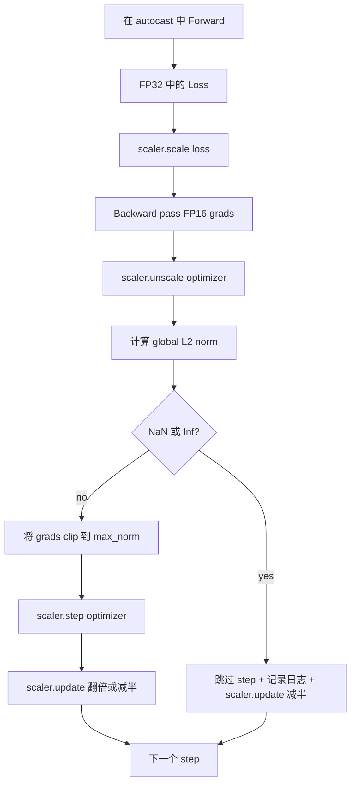

# التقطيع المتدريج والدقة المختلطة

> في الصف الأول من الصف الأول من الصف الأول من الصف الأول من الصف الأول من الصف الثاني من الصف الثاني من الصف الثاني من الصف الثاني من الصف الثاني من الصف الثاني من الصف الثاني من الصف الثاني من الصف الثاني من الصف الثاني من الصف الثاني من الصف الثاني من الصف الثاني من الصف الثاني من الصف الثاني من الصف الثاني من الصف الثاني من الصف الثاني من الصف الثاني من الصف الثاني من الصف الثاني من الصف الثاني من الصف الثاني من الصف الثاني من الصف الثاني من الصف الثاني من الصف الثاني من الصف الثاني من الصف الثاني من الصف الثاني من الصف الثاني من الصف الثاني من الصف الثاني من الصف الثاني من الصف الثاني من الصف الثاني من الصف الثاني من الصف الثاني من الصف الثاني من الصف الثاني من الصف الثاني من الصف الثاني من الصف الثاني من الصف الثاني من الصف الثاني من الصف الثاني من الصف الثاني من الصف الثاني من الصف من الصف من الصف الثاني من الصف من الصف من الصف من الصف من الصف من الصف من الصف من الصف من الصف من الصف من الصف من الصف من الصف من الصف من الصف من الصف من الصف من الصف من الصف من الصف من الصف من الصف من الصف من الصف من الصف من الصف من الصف من الصف من الصف من الصف من الصف من الصف من الصف من الصف من الصف من الصف من الصف من الصف من الصف من الصف من الصف من الصف من الصف من الصف من الصف من الصف من الصف من الصف من الصف من الصف من الصف من الصف من الصف من الصف من الصف من الصف من الصف من الصف من الصف من الصف من الصف من الصف من الصف من الصف من الصف من الصف من الصف من الصف من الصف من الصف من الصف من الصف من الصف من الصف من الصف من الصف من الصف من الصف من الصف من الص

**Type:** Build
**Languages:** Python
**Prerequisites:** Phase 19 lessons 30-37
**Time:** ~90 minutes

## أهداف التعلم

- 计算所有参数梯度的全球 L2 标准, وتجاوز配置值时原地剪辑──
- باستخدام الدرجة المتعددة التلقائية، فليستمر الطائرة في التدريب، فليستمر في التدريب للأمام والخلف
- 检测 فقدان أو درجة وسط NaN 和 Inf، قفز خطوة التحسين،并记录 this skip──
- كل خطوة  تقرير عامل تراكم GradScaler، جعل سلسلة كبيرة من القفز 能立刻可见──

## المشكلة

في مرحلة التدريبية، في خطوة 8,217 时 منحنى الخسارة فجأة عمودياً ارتفاعاً.

تدريب بدقة مختلطة  من خلال استخدام FP16  حساب المضي قدما و معظم المضي قدما ، سوف يتبنى ارتفاع 2-3 倍. 代价是 FP16 نطاق المضرب 很窄.  واحد من النموذجية المعدل الذي يتفوق في FP16 سوف يتحول إلى Inf ، ثم ينتشر في المستوى التالي إلى NaN ، مما يؤدي إلى الخطوة التالية المحسّنة وضع كل وزن في NaN.  GradScaler من PyTorch  من خلال المضي قدما إلى الوراء  باستخدام عامل تحميل كبير  ضرب الخسارة ، و في خطوة التحسين  باستخدام نفس العامل إزالة المعدل لحل هذا المجال  إذا كان في غير المقياس  في أي وقت من المدى هو Inf أو مشكلة NaN ، فإن المعدل سوف يقفز الخطوة و يقلل من المقياس إلى نصف. إذا تم تخفيض N 个                                                                                                                                              

تتمثل مشكلة البناء في التواصل الصحيح. أولا المقطوعة مرة أخرى غير المتوسطة، والقيمة سوف تعمل في التدفقات المتوسطة. أولا المقطوعة مرة أخرى، والمركز الموسع فوق.`scaler.scale(loss).backward()`ثم`scaler.unscale_(optimizer)`ثم`clip_grad_norm_`ثم`scaler.step(optimizer)`، أخيراً`scaler.update()`أيّة أسلوب آخر يُحدث حلقةً مُهينةً

## المفهوم



### المعيار العالمي ل2

القاعدة العالمية لـ2 هي القاعدة اليوكليدية لمتجهات التراجعية بعد التضمين ، وليس القاعدة الفردية للبرامج.`torch.nn.utils.clip_grad_norm_(parameters, max_norm)` هذه الوظيفة تعود إلى المعيار المسبق للفصل، لذلك يمكن أن يسجل هذا الدروس في نفس الوقت القيمة الطبيعية والقيمة المقطوعة، وهذا بالنسبة للتشخيص  كل خطوة نحن في قطع  هو ضروري‬

### التلقائية والجريدي

`torch.amp.autocast(device_type)`هو مدير سياق، سيختار بشكل طبيعي باستخدام FP16 运行符合条件的操作 (معظم عمليات المجال) `torch.amp.GradScaler(device_type)`هو مساعد، سوف يكون في الخلف قبل تخسير المقياس، وفي خطوة التحسين قبل معاكسة المقياس المقياس.

هذا الدروس يستخدم CPU التلقائي، لأن هذا هو المحتوى الذي يعمل في CI؛ نفس النمط يمكن أن تمر عبر `device_type="cpu"`改为 `device_type="cuda"`المعدل المستوى من أعلى جهاز الكمبيوتر هو stub ((البرنامج التلقائي للبرنامج المركزي تم التشغيل بشكل افتراضي باستخدام BF16 ، لا تحتاج إلى استحداث نطاق الخسارة) ، ولكن هذا الدراسة تحتوي على هذه المواقع المكالمة ، فجعلي التشغيل مع حلقة GPU متوافقة تماماً)).

### الكشف عن NaN و Inf

الاختبار يحدث في مكانين أولاً، الخسارة في الواقع في الظهر`torch.isfinite`检查;إذا أو NaN الخسارة لن تولد مفيدة درجة, سوف تكون في إدخال المتحسنة 前被跳过;;`scaler.unscale_(optimizer)`بعد ذلك، هذه الدروس سوف تستخدم`has_non_finite_grad(...)`扫描不扩展梯度,并把任何 Inf أو NaN 视为跳── these two checks together cover forward-pass 和 backward-pass 两类失败模式──

### تشخيص عوامل التوسع

عامل الحد الأقصى هو حالة داخل GradScaler.`scaler.get_scale()`، ووضعها مع معدل التعلم و معدل التراجع.`2^17`أو`2^18`附近和── 行为异常的运行 会显示因素在高值和低值之间振荡,这说明模型的渐进有时在范围内,有时不在──不记录日志,这个诊断信号是不可见的──


```figure
grad-clip-monitor
```

## بناءها

`code/main.py`实现:

- `clip_global_l2_norm`- على`torch.nn.utils.clip_grad_norm_`غلفة، عودة قبل المقطوعة و بعد المقطوعة القاعدة
- `has_non_finite_grad`- 扫描 Gradient 中 NaN 和 Inf مساعد
- `AmpTrainState`-حزمة نموذج`AdamW`محفزات التطبيقات، وحدة تحسينات المعدات، وجهاز التقطير الآلي`step(inputs, targets)`,运行完整的剪裁,扩展 和跳-on-NaN管道
- `StepLog`和 `SkipLog`- سجلات التكوين لكل خطوة
- إظهار، تدريب صغير`nn.Linear`نموذج 20 个步骤,在步骤 5向渐进注入 Inf 以触发跳路,并印得到的日志──

运行:

```bash
python3 code/main.py
```

脚本以 0 退出,并印每步日志,每行标记为 `STEP`أو`SKIP`على الأقل واحدة منها`SKIP`.

## نمط الإنتاج

أربعة أنماط يمكن أن تصل هذه الحلقة إلى مرحلة تدريب الإنتاج.

**Skip counter 应该是 alert，而不是一行 log。**كل مرة تدرب على المجموعة المختلفة من المواد المعدنية، كل مرة تمر على المعدل المحدد، كل مرة تمر على المعدل المحدد، كل مرة تمر على المعدل المحدد، كل مرة تمر على المعدل المحدد، كل مرة تمر على المعدل المحدد، كل مرة تمر على المعدل المحدد، كل مرة تمر على المعدل المحدد، كل مرة تمر على المعدل المحدد، كل مرة تمر على المعدل المحدد، كل مرة تمر على المعدل المحدد، كل مرة تمر على المعدل المحدد، كل مرة تمر على المعدل المحدد، كل مرة تمر على المعدل المحدد، كل مرة تمر على المعدل المحدد، كل مرة تمر على المعدل المحدد، كل مرة تمر على المعدل المحدد، كل مرة تمر على المعدل، كل مرة تمر على المعدل، كل مرة تمر على المعدل، كل مرة تمر على المعدل، كل مرة تمر على المعدل، كل مرة، كل مرة تمر على المعدل، كل مرة، كل مرة، كل مرة، كل مرة، كل مرة، كل مرة، كل مرة، كل مرة، كل مرة، كل مرة، كل مرة، كل مرة، كل مرة، كل مرة، كل مرة، كل مرة، كل مرة، كل مرة، كل مرة، كل مرة، كل مرة، كل مرة، كل مرة، كل مرة، كل مرة، كل مرة، كل مرة، كل مرة، كل مرة، كل مرة، كل مرة، كل مرة، كل مرة، كل مرة، كل مرة، كل مرة، كل مرة، كل مرة، كل مرة، كل مرة، كل مرة، كل مرة، كل مرة، كل مرة، كل مرة، كل مرة، كل مرة.

**Clip threshold 放在 config 中。** `max_norm = 1.0`هو القيمة المتبنية للتدريب على نموذج اللغة الحديث. أولاً على نموذج صغير. عتبة أكبر 让模型能恢复从真正困难的批量中.

**Norm log 和 schedule 一起进入 CSV。**عمودات CSV هو `step, lr, grad_l2_pre_clip, grad_l2_post_clip, loss, skipped, skip_reason, scaler_scale` المراجعة 打开文件后, يمكن أن ترى في نفس الصفحة الجدول  Gradient 的故事、规模因素,以及 skip outcome 含原因  وضع هذه العمود 拆分到多个文件,是制造错位分析的配方──

**`scaler.update()` 每个 step 都运行，即使 skip 也一样。**في صفحة الصفحة الخطوة 上,scaler 读取它的无infداد,递增,并可能把因素 翻倍.`update()`, هو أن يكون هناك عامل تغيير من الحذاء غير المتغير

## استخدمها

أنماط الإنتاج:

- **Autocast device 匹配 optimizer device。**تدريب GPU استخدام `torch.amp.autocast(device_type="cuda")`استخدام المركز المركزي`torch.amp.autocast(device_type="cpu")`◊ الجهاز المشترك سوف يحدث خطأ نوع صمت، على الجانب على رأسها منحنى الخسارة يبدو طبيعيا، ولكن الموديل لا تعلم‬
- **Backward 前检查 Loss。** `torch.isfinite(loss).all()`هو مرة واحدة تخفيض التنسور؛ تكلفة يمكن تجاهلها، في حين أن NaN الخسارة العليا الحفاظ على التدريب هو خطوة كاملة.
- **`zero_grad` 中使用 `set_to_none=True`。**将 Gradient 设为 `None`بدلا من الصفر، دعم المتحسن  قفز غير متأثرة حساب مجموعة المعلمات ‬ هذا الإعداد هو مجاني من الانتفاع وتعزيز، ويمكن أيضا تقليل قليلا سطح البغ‬‬‬‬‬‬‬‬‬‬‬‬‬‬‬‬‬‬‬‬‬‬‬‬‬‬‬‬‬‬‬‬‬‬‬‬‬‬‬‬‬‬‬‬‬‬‬‬‬‬‬‬‬‬‬‬‬‬‬‬‬‬‬‬‬‬‬‬‬‬‬‬‬‬‬‬‬‬‬‬‬‬‬‬‬‬‬‬‬‬‬‬‬‬‬‬‬‬‬‬‬‬‬‬‬‬‬‬‬‬‬‬‬‬‬‬‬‬‬‬‬‬‬‬‬‬‬‬‬‬‬‬‬‬‬‬‬‬‬‬‬‬‬‬‬‬‬‬‬‬‬‬‬‬‬‬‬‬‬‬‬‬‬‬‬‬‬‬‬‬‬‬‬‬‬‬‬‬‬‬‬‬‬‬‬‬‬‬‬‬‬‬‬‬‬‬‬‬‬‬‬‬‬‬‬‬‬‬‬‬‬‬‬‬‬‬‬‬‬‬‬‬‬‬‬‬‬‬‬‬‬‬‬‬‬‬‬‬‬‬‬‬‬‬‬‬‬‬‬‬‬‬‬‬‬‬‬‬‬‬‬‬‬‬‬‬‬‬‬‬‬‬‬‬‬‬‬‬‬‬‬‬‬‬‬‬‬‬‬‬‬‬‬‬‬‬‬‬‬‬‬‬‬‬‬‬‬‬‬‬‬‬‬‬‬‬‬‬‬‬‬‬‬‬‬‬‬‬‬‬‬‬‬‬‬‬‬‬‬‬‬‬‬‬‬‬‬‬‬‬‬‬‬‬‬‬‬‬‬‬‬‬‬‬‬‬‬‬‬‬‬‬‬‬‬‬‬‬‬‬‬‬‬‬‬‬‬‬‬‬‬‬‬‬‬‬‬‬‬‬‬‬‬‬‬‬‬‬‬‬‬‬‬‬‬‬‬‬‬‬‬‬‬‬‬‬‬‬‬‬‬‬‬‬‬‬‬‬‬‬‬‬‬‬‬‬‬‬‬‬‬‬‬‬‬‬‬‬‬‬‬

## أرسله

`outputs/skill-clip-amp.md`في المشاريع الحقيقية تعريف خطوة التدريب استخدام أي عتبة المقطوعة و جهاز التلقية

## التمارين

1. استخدام الفائدة الحقيقية النتبة بدل الصيغة Inf 注入(把某一批的目标 乘以 1e8),并验证跳路 会触发。
2. إضافة واحدة`--bf16`وضع، سوف تقطع التلقائي إلى BF16 بدلا من FP16。 مجموعة مؤشرات BF16 أكثر عرضا من FP16، عادة ما تكون هناك حاجة إلى تخفيض نطاق؛ تجربة مع عرض عرض معدل تخطي العرض 降至零。
3. إضافة اختبار وحدة، التحقق في عدم قطع يحدث، غلاف المقطع التدريجي سوف يعود بشكل صحيح إلى قبل المقطع و بعد المقطع القاعدة
4. 添加滚动窗口跳速 计算,以及 CLI 旗: إذا كان معدل 连续 100 个步骤 超过配置值,就让运行 失败。
5. سوف تتحرك إلى CSV القنوني`step, lr, grad_l2_pre_clip, grad_l2_post_clip, loss, skipped, skip_reason, scaler_scale`) كتابة، وموافقة كل خط بعد التفريغ  تأكيد الملفات يمكن أن تحتفظ بعد Ctrl-C 

## الشروط الرئيسية

| Term | What people say | What it actually means |
|------|-----------------|------------------------|
| Global L2 norm | "Clip target" | 所有可训练 parameter 的拼接 gradient vector 的 Euclidean norm |
| autocast | "Mixed precision" | 在 `with` block 内，对符合条件的 operation 选择性执行 FP16（或 BF16） |
| GradScaler | "Loss scaler" | 在 backward 前乘以 Loss，并在 optimizer step 前 inverse-scale Gradient 的 helper |
| Skip | "Bad step" | 因为 Gradient 或 Loss 是 non-finite 而拒绝执行的 optimizer step；scaler 会将 factor 减半 |
| Scaling factor | "Scaler state" | GradScaler 当前的 multiplier；干净区间后翻倍，每次 skip 时减半 |

## المزيد من القراءة

- [Micikevicius et al., Mixed Precision Training (arXiv 1710.03740)](https://arxiv.org/abs/1710.03740)- اقتراح أول لتنمية الخسائر
- [Pascanu, Mikolov, Bengio, On the difficulty of training recurrent neural networks (arXiv 1211.5063)](https://arxiv.org/abs/1211.5063)- التقاطع التدريجي 参考论文
- [PyTorch torch.amp.GradScaler](https://docs.pytorch.org/docs/stable/amp.html)- 本课包裹的 Scaler API
- [PyTorch torch.nn.utils.clip_grad_norm_](https://docs.pytorch.org/docs/stable/generated/torch.nn.utils.clip_grad_norm_.html)- 本课使用的剪裁原始
- المرحلة 19 · 42 - 为 لوك 提供 corpus 的 downloader
- المرحلة 19 · 43 - حلقة 消耗的数据لوader
- المرحلة 19 · 44 - جدول المجموعة
