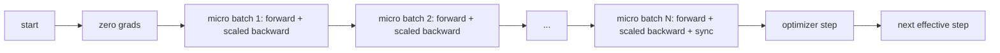
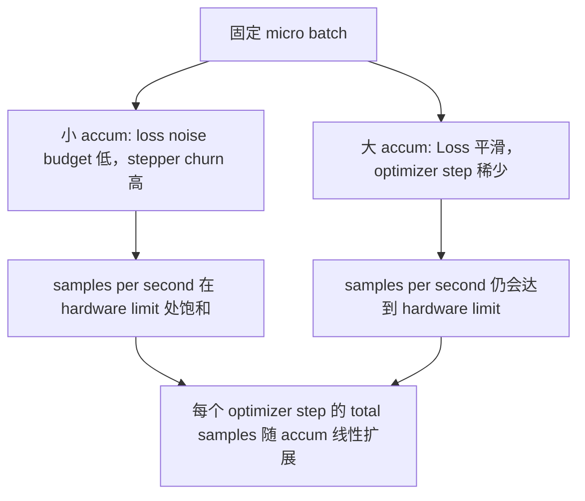

# التراكم المتدريج

> باستخدام مجموعة صغيرة، تدريبك على حملك على المجموعة الفعالة. فقدان النطاق، تدريج التحسين، دعم الدرجة

**Type:** Build
**Languages:** Python
**Prerequisites:** Phase 19 lessons 42 to 45
**Time:** ~90 minutes

## أهداف التعلم

- 推导 الحزمة الفعالة 恒等式:`effective_batch = micro_batch * accum_steps`.
- 实现 per-micro-batch loss scaling, جعل تراكم الدرجة 匹配 مرة كاملة كاملة الارتباط للخلف.
- في آخر مجموعة صغيرة  قبل قفز التزامن المثالي
- 读取 التكامل ضد منحنى اللحظة الفعالة،并解释 انخفاض العائد

## المشكلة

هل تريد استخدام الجزمة الفعالة 512  التدريب، لأن منحنى الخسارة 更平滑، تحسين خطوة في هذا الحجم أكثر منطقية.

风险在于,Loss 不再是大批次 时的同数值──将16 迷你批次的交叉进化 直接相加,将是一个全批次 Loss 的16倍──没有扩展 时,Gradient 方向是正确的,但幅度是错误的,优化步骤会大16倍──修复方法只有一次除法──修复也很容易忘记──

## المفهوم



العقد 很短:

- كل خسرة من الميكرو-بارت`backward()`قبل الاختلاف`accum_steps`✿ الـ " بيتورش "默认会把" الـ " Gradient " 累加到`param.grad`في وسط، هذا التفصيل يُعدّ المبلغ الجاري إلى القياس الصحيح.
- خطوة التحسين كل حزمة فعالة 触发一次, في آخر حزمة صغيرة 后──中途步会扭曲后续整个运行所依赖的每个参数──
- حالة المحفز (مومنتم بوفر، لحظات آدم) كل خطوة فعالة، تقدم مرة واحدة، بدلا من كل مجموعة صغيرة تقدم مرة واحدة، وإلا فإن المتوسطات المتحركة المتعرضة سترى ارتفاعًا في التردد، وتفقد الموعد.
- في جهاز واحد، هذا مجرد الحسابات. في مجموعة متعددة الرتب، نفس النمط سوف تكون غير النهائية.`no_sync`في السياق، قفز على كل التخفيضات التدريجية؛ الحزمة الصغيرة الأخيرة سوف تخفيض مرة واحدة التخفيضات التدريجية المتراكمة بالكامل، بدلا من دفع N 次

### دليل التكافؤ في الرمز

```python
loss = criterion(model(x_full), y_full)
loss.backward()
opt.step()
```

等价格

```python
for x, y in chunks(x_full, y_full, n):
    scaled = criterion(model(x), y) / n
    scaled.backward()
opt.step()
```

ما عدا التباينات في ترتيب جمع نقاط العبور في نهاية الحلقة ، يتم تجميع خفازة التراجع مع دفعة كاملة مرة واحدة للخلف ، سيتم إنشاء تنسور مشابهة.`equivalence_check`متوسط استخدام أقل من 1e-4 من الفرق أقصى-abs 断言 هذا النقطة

### حيث تذهب التكلفة

كل مجموعة صغيرة تحتاج مرة واحدة للأمام و مرة أخرى للخلف.`outputs/accum-curve.json`منحنى الناتج الوسطى  تظهر ما يحدث في المجموعة الصغيرة الثابتة  الحزمة الفعالة  الزيادة الكبيرة:



لا يوجد طعام مجاني`accum_steps`翻倍, سوف يجعل كل خطوة تحسين الوقت الجدار 翻倍. التغير هو التقييم التقييم: في نفس ميزانية الجدار.


```figure
cc-grad-accumulation
```

## بناءها

`code/main.py`هو عمل أثاث يمكن أن يتم تحويله

### الخطوة الأولى: التحقق من المساواة

`equivalence_check()`باستخدام نفس البذور  بناء اثنين من نسخة نفس الشبكة ‬‬‬‬‬‬‬‬‬‬‬‬‬‬‬‬‬‬‬‬‬‬‬‬‬‬‬‬‬‬‬‬‬‬‬‬‬‬‬‬‬‬‬‬‬‬‬‬‬‬‬‬‬‬‬‬‬‬‬‬‬‬‬‬‬‬‬‬‬‬‬‬‬‬‬‬‬‬‬‬‬‬‬‬‬‬‬‬‬‬‬‬‬‬‬‬‬‬‬‬‬‬‬‬‬‬‬‬‬‬‬‬‬‬‬‬‬‬‬‬‬‬‬‬‬‬‬‬‬‬‬‬‬‬‬‬‬‬‬‬‬‬‬‬‬‬‬‬‬‬‬‬‬‬‬‬‬‬‬‬‬‬‬‬‬‬‬‬‬‬‬‬‬‬‬‬‬‬‬‬‬‬‬‬‬‬‬‬‬‬‬‬‬‬‬‬‬‬‬‬‬‬‬‬‬‬‬‬‬‬‬‬‬‬‬‬‬‬‬‬‬‬‬‬‬‬‬‬‬‬‬‬‬‬‬‬‬‬‬‬‬‬‬‬‬‬‬‬‬‬‬‬‬‬‬‬‬‬‬‬‬‬‬‬‬‬‬‬‬‬‬‬‬‬‬‬‬‬‬‬‬‬‬‬‬‬‬‬‬‬‬‬‬‬‬‬‬‬‬‬‬‬‬‬‬‬‬‬‬‬‬‬‬‬‬‬‬‬‬‬‬‬‬‬‬‬‬‬‬‬‬‬‬‬‬‬‬‬‬‬‬‬‬‬‬‬‬‬‬‬‬‬‬‬‬‬‬‬‬‬‬‬‬‬‬‬‬‬‬‬‬‬‬‬‬‬‬‬‬‬‬‬‬‬‬‬‬‬‬‬‬‬‬‬‬‬‬‬‬‬‬‬‬‬‬‬‬‬‬‬‬‬‬‬‬‬‬‬‬‬‬‬‬‬‬‬‬‬‬‬‬‬‬‬‬‬‬‬‬‬‬‬‬‬‬‬‬‬‬‬‬‬‬‬‬‬‬‬‬‬‬‬‬‬‬‬‬‬‬‬‬‬‬‬‬‬‬‬‬‬‬‬‬‬‬‬‬‬‬‬`max_abs_diff < 1e-4`.

### الخطوة الثانية: نمط التزامن على الخطوة الأخيرة

`train_one_optimizer_step`كلّ مجموعة صغيرة، باستثناء المجموعة الصغيرة الأخيرة، ستدخل كلّ واحدة`no_sync_context(model)`في عملية واحدة، هذا السياق هو لا-عمليات؛ في DDP، هنا سوف يقفز من التدريجية كل-تخفيض.`sync_counter`记录我们离开 no_sync scope 的次数; بالنسبة لـ N 个微批,عدد هو كل خطوة فعالة مرة واحدة, وليس N 次。

### الخطوة الثالثة: منحنى الانتقال

`sweep_effective_batches`استخدام المثبتة الميكرو-بث 和一组 خطوات التراكم 运行同一个模型──每个设置都会记录:

- `samples_per_sec`: 看到的 إجمالي العينات ما عدا في الوقت الحائط
- `median_step_ms`: كل خطوة فعالة من 50 الفصلية
- `sync_calls`: نقاط جماعية
- `avg_loss`: مسح من خطوات المحسنة 平均值

 الخروج ووضع في `outputs/accum-curve.json`,并可从笔记本 复用──

运行:

```bash
python3 code/main.py
```

脚本先打印等价差,再打印扫表,最后打印 JSON path──出口代码零──

## استخدمها

في تدريب الإنتاج، التراكم التدريجي 藏在一个扣 后面──`accumulation_steps = effective_batch // (micro_batch * world_size)`هنا لا يسمح باستخدام الإطار سوف يحتوي على نفس الحلقة، ولكن الخطوة هي نفسها: فقدان النطاق، قفز فوق الميكرو غير النهائي

في الممارسة هناك ثلاثة أنماط:

- حجم المجموعة الصغيرة 被选择为能满设备内存──更小会浪费加速器周期──更大会崩──
- المجموعة الفعالة من جدول معدل التعلم 中选择。 المجموعات الكبيرة الفعالة 需要 مقياس معدل التعلم 和 التدفئة؛ هذا هو قاعدة مقياس خطي تم مناقشتها منذ عام 2017‬‬‬‬‬‬‬‬‬‬‬‬‬‬‬‬‬‬‬‬‬‬‬‬‬‬‬‬‬‬‬‬‬‬‬‬‬‬‬‬‬‬‬‬‬‬‬‬‬‬‬‬‬‬‬‬‬‬‬‬‬‬‬‬‬‬‬‬‬‬‬‬‬‬‬‬‬‬‬‬‬‬‬‬‬‬‬‬‬‬‬‬‬‬‬‬‬‬‬‬‬‬‬‬‬‬‬‬‬‬‬‬‬‬‬‬‬‬‬‬‬‬‬‬‬‬‬‬‬‬‬‬‬‬‬‬‬‬‬‬‬‬‬‬‬‬‬‬‬‬‬‬‬‬‬‬‬‬‬‬‬‬‬‬‬‬‬‬‬‬‬‬‬‬‬‬‬‬‬‬‬‬‬‬‬‬‬‬‬‬‬‬‬‬‬‬‬‬‬‬‬‬‬‬‬‬‬‬‬‬‬‬‬‬‬‬‬‬‬‬‬‬‬‬‬‬‬‬‬‬‬‬‬‬‬‬‬‬‬‬‬‬‬‬‬‬‬‬‬‬‬‬‬‬‬‬‬‬‬‬‬‬‬‬‬‬‬‬‬‬‬‬‬‬‬‬‬‬‬‬‬‬‬‬‬‬‬‬‬‬‬‬‬‬‬‬‬‬‬‬‬‬‬‬‬‬‬‬‬‬‬‬‬‬‬‬‬‬‬‬‬‬‬‬‬‬‬‬‬‬‬‬‬‬‬‬‬‬‬‬‬‬‬‬‬‬‬‬‬‬‬‬‬‬‬‬‬‬‬‬‬‬‬‬‬‬‬‬‬‬‬‬‬‬‬‬‬‬‬‬‬‬‬‬‬‬‬‬‬‬‬‬‬‬‬‬‬‬‬‬‬‬‬‬‬‬‬‬‬‬‬‬‬‬‬‬‬‬‬‬‬‬‬‬‬‬‬‬‬‬‬‬‬‬‬‬‬‬‬‬‬‬‬‬‬‬‬‬‬‬‬‬‬‬‬‬‬
- عدد التراكم هو الجسر بينهما، و هو أيضاً الوحيد الذي يمكنه في وقت تشغيل الحرية دون إعادة كتابة زر محمول البيانات.

## أرسله

`outputs/skill-gradient-accumulation.md`استلم هذه الوصفة، وافق على أن يضعها زميلك في الاحتياطي الجديد`accum_steps`فقدان المقياس، في الميكرو غير النهائية 上跳过优化器同步, كل حزمة فعالة فقط خطوة优化器 一次,把吞吐量对抗有效的批量 以 JSON 记录,让交易可见――

## التمارين

1. استخدام`--num-steps 100`重新运行扫描,并绘制样本每秒 مقابل اللحظة الفعالة.
2. 添加一个错误扩展变化(不做除法),并展示步骤 1 时相对参考的参数差──
3. لتغيير SGD إلى AdamW، وتأكيد حالة التحسين كل خطوة فعالة مرة واحدة، بدلا من كل مجموعة صغيرة مرة واحدة.
4. 引入真实 `DistributedDataParallel`الملفوفة،并把 `no_sync_context`路由到它的方法── تأكد التزامن_النداءات كل دفعة فعالة  تقلل N-1──
5. 修改等效检查,对比两种不同的微分分 ((2 × 8 vs 4 × 4),并解释你需要放宽任何宽容──

## الشروط الرئيسية

| Term | What people say | What it actually means |
|------|-----------------|------------------------|
| Micro batch | 你 forward 的 batch | 单次 forward pass 中能放进 memory 的 slice |
| Accum steps | 每个 step 的 backward pass 数 | 在一次 optimizer step 前累加的 backward 数量 |
| Effective batch | 这个 batch | Micro batch 乘以 accum steps，再乘以 data parallel world size |
| Loss scaling | 除以 N | Per-micro-batch division，使 summed gradients 匹配 full batch |
| Sync on last | 跳过其余部分 | 只在 window 中最后一次 backward 上运行 Gradient collective |

## المزيد من القراءة

- وثائق بيتورش 中关于 `DistributedDataParallel.no_sync`技巧的制作 版本──
- جول وآخرون، 2017، حول التوسع الخطوي للتدريب على مجموعات كبيرة،
- تعقب قضية PyTorch 中 حول تراكم درجي مع تحديد مختلط عدم تحديد الحجم
- المرحلة 19 الدروس 42 إلى 45 覆盖本课所假设的模型、数据 loader、优化器 和教练架架――
- المرحلة 19 الدروس 47 تغطية نقطة التفتيش و استئناف، دع longtime تراكم تشغيل 能在壁表帽下存活──
