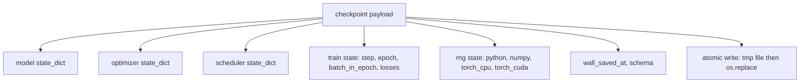
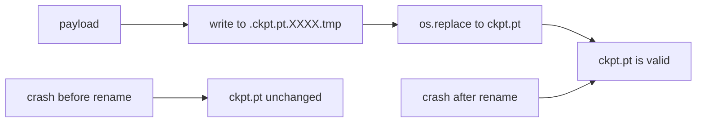
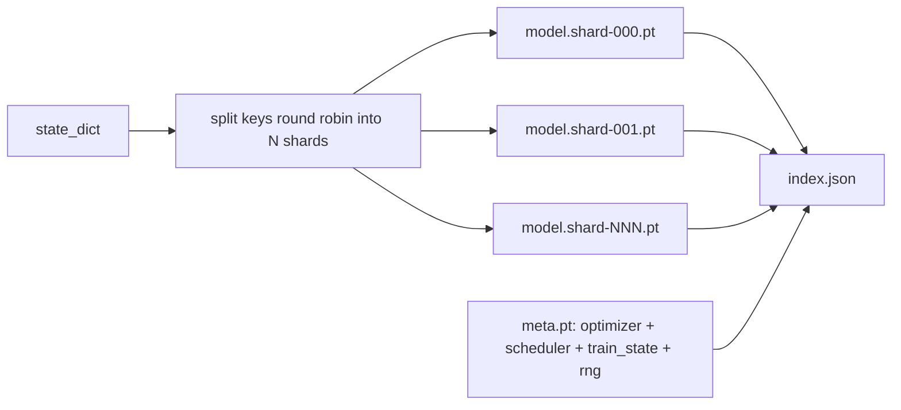

# نقطة تفتيش  حفظ و استرداد

> 訓練中断會殺死运行;checkpoint 让它们可以继续──原子化保存模型、优化、安排、Loss history、step counter 和 RNG state,这样任何时刻都被终止时,磁盘都会留下一个有效文件──

**Type:** Build
**Languages:** Python
**Prerequisites:** Phase 19 lessons 42 to 45
**Time:** ~90 minutes

## أهداف التعلم

- تمكن من إعادة تحميل كل حالة التدريب إلى عملية جديدة
- استخدام قبل كتابة وقت إعادة تسمية طريقة لتحقيق حفظ الذرة، ضمان حادث  أبدا لا يبقى مكتوب إلى نصف الملفات
- 恢复 Python、NumPy 和 PyTorch's RNG حالة، بحيث يستأنف 后的损失 匹配未中断的基线──
- لم يعد بإمكانهم وضع نموذج في ملف واحد بناء ترتيب نقطة التفتيش المقطوعة، يحتوي على شرائح التحقق من الاختبار والمعيار JSON.

## 问题

قمت بتعيين مهمة تدريبية، تتوقع أن تعمل 18 ساعات. ساعة الحائط العليا هو 4 ساعات. في 11 ساعات، تم إعادة تشغيل الكluster، لأن شخص ما أعلى من رتبة راتبك قد وافق على تحديث النواة.

الفن الصحي هو وثيقة واحدة، والتي تحتفظ بكل ما يلزم من التدريب: المعلمات النموذجية ‧ الحالة التمهيدية ‧ الحالة المجدولة ‧ للوضع في الخسارة تاريخ ‧ الخطوة الحالية و العصر و معدادات اللحظة في العصر، و هناك كل عشوائية مصدر حالة RNG‬ بدون حالة RNG، بعد الاسترداد منحنى الخسارة سوف يكون منحنى آخر‬ نفس النموذج‬ نفس البيانات‬ مختلفة التشويش‬ مختلفة نقاب التسرب‬

إنقاذ الذري هو نصف آخر هذا العقد. النسخة النهائية المكتوبة في الملف يعني حادث. حدث في طريق الكتابة. سيترك الملف الفاسد. سيرجمه سوف يقرأ إلى القمامة. كتابة الملف المؤقت في نفس الملف، ثم إعادة تسميته، يعني حادث. حدث في طريق الكتابة.

## 概念



### خمسة دولة

| Bucket | 为什么重要 |
|--------|------------|
| Model | Weights 和 buffers；也就是 model 本身。 |
| Optimizer | Momentum 和 adaptive moments；没有它们，下一步就是另一个 Optimization 问题。 |
| Scheduler | Learning rate 在 curve 上的位置；cosine schedules 尤其在意这一点。 |
| Train counters | Step、epoch、batch-in-epoch，以及绘制 dashboard 的 Loss history。 |
| RNG state | 为 dropout、data shuffling，以及 model 内部的任何 sampling 提供 determinism。 |

### الحفاظ الذري



两条规则──第一,文件临时必须位于目标所在的同一目录中,这样重命名才会停留在同一个文件系统内;跨设备重命名 不是原子的──第二,临时名称对每次尝试都必须唯一,避免两个作者 相互覆盖──

### نقاط التفتيش الممزقتة

عندما يتغير النموذج، فإن الحمل المفيد لملف واحد سوف يصبح كبير جدا، والحملة غير سريعة، والتحقق غير مريحة، وفي الشبكة المشتركة 读取中途动时非常痛苦── الحل هو وضع المعلمات 拆分碎片,并写入一个小索引把它们关联起来──



المرجح  سجل عدد الشظايا ‬ كل شظايا ‬ ‬ ‬ ‬ ‬ ‬ ‬ ‬ ‬ ‬ ‬ ‬ ‬ ‬ ‬ ‬ ‬ ‬ ‬ ‬ ‬ ‬ ‬ ‬ ‬ ‬ ‬ ‬ ‬ ‬ ‬ ‬ ‬ ‬ ‬ ‬ ‬ ‬ ‬ ‬ ‬ ‬ ‬ ‬ ‬ ‬ ‬ ‬ ‬ ‬ ‬ ‬ ‬ ‬ ‬ ‬ ‬ ‬ ‬ ‬ ‬ ‬ ‬ ‬ ‬ ‬ ‬ ‬ ‬ ‬ ‬ ‬ ‬ ‬ ‬ ‬ ‬ ‬ ‬ ‬ ‬ ‬ ‬ ‬ ‬ ‬ ‬ ‬ ‬ ‬ ‬ ‬ ‬ ‬ ‬ ‬ ‬ ‬ ‬ ‬ ‬ ‬ ‬ ‬ ‬ ‬ ‬ ‬ ‬ ‬ ‬ ‬ ‬ ‬ ‬ ‬ ‬ ‬ ‬ ‬ ‬ ‬ ‬ ‬ ‬ ‬ ‬ ‬ ‬ ‬ ‬ ‬ ‬ ‬ ‬ ‬ ‬ ‬ ‬ ‬ ‬ ‬ ‬ ‬ ‬ ‬ ‬ ‬ ‬ ‬ ‬ ‬ ‬ ‬ ‬ ‬ ‬ ‬ ‬ ‬ ‬ ‬ ‬ ‬ ‬ ‬ ‬ ‬ ‬ ‬ ‬ ‬ ‬ ‬ ‬ ‬ ‬ ‬ ‬ ‬ ‬ ‬ ‬ ‬ ‬ ‬ ‬ ‬ ‬ ‬ ‬ ‬ ‬ ‬ ‬ ‬ ‬ ‬ ‬ ‬ ‬ ‬ ‬ ‬ ‬ ‬ ‬ ‬ ‬ ‬ ‬ ‬ ‬ ‬ ‬ ‬ ‬ ‬ ‬ ‬ ‬ ‬ ‬ ‬ ‬ ‬ ‬ ‬ ‬ ‬ ‬ ‬ ‬ ‬ ‬ ‬ ‬ ‬ ‬ ‬ ‬ ‬ ‬ ‬ ‬ ‬ ‬

### المقالة من العصر Midway Continue

إعادة التأهيل إلى العصر القادم، سوف تستهلك من دقائق إلى يوم مختلف.`(epoch, batch_in_epoch)`إضافة إلى حالة RNG. بعد ذلك، سوف حلقة التدريب توليد الأرقام العشوائية بسرعة خلال العصر الحالي`batch_in_epoch`繼續──本课代码精确完成这一点;断言是恢复 后的损失轨迹会在 1e-4 范围内匹配未中断的基线──


```figure
cc-atomic-checkpoint
```

## بناءها

`code/main.py`-أعطنا أربعة أسباب ومدير تجريبي

### الخطوة الأولى: 捕获并恢复 RNG

`capture_rng_state`رجع إلى إشارة، يحتوي على Python `random.getstate`、NumPy `np.random.get_state`، وCPU PyTorch و CUDA RNG بايتس`restore_rng_state`عكس التمريض من أجل استعادة ذلك.

### الخطوة الثانية: الحفاظ على الذرات

`atomic_save`سوف يُحمل الملف المفيد  كتابة إلى دليل الهدف في ملف مؤقت، ثم استخدم `os.replace`أن يتم تبادلها إلى اسمها النهائي.`atomic_write_json`لـ "مؤشر شقق"

### الخطوة الثالثة: 完整ة نقطة التفتيش رحلة ذهاب وإياب

`save_checkpoint`سوف نضع نموذج ‧أوبيتيمر ‧جداول ‧حالة القطار 和 RNG 打包到一个命令中──`load_checkpoint`عكس الوضع، و يعود مرة أخرى`TrainState` حقل المخطط هو خط الترقية: futurformation变化会递增版本 string، بينما سيقوم محمول بإرسالها

### الخطوة الرابعة: النوع الممزق

`save_sharded_checkpoint`في طريقة دورية تقسيم مفاتيح المعلمات إلى N 个 شرائح ، باستخدام حفظ الذرية الخاصة بهم كتب في كل شرائح ، كتابة في ملف متي يحتوي على محفز المجدد ووضع القطار ، ومكتبة يحتوي على مؤشر JSON شرائح Sha256 ‬`load_sharded_checkpoint`سأقوم بالاندماج قبل التحقق من كل قطعة

### الخطوة 5: عرض استعادة

`run_resume_demo`سأقوم بتدريب النموذج الصغير`total_steps`, في`interrupt_at`保存檢查點,然后繼續运行──第二個過程 会恢复檢查點并运行剩余步步──此函数 返回中斷點 后两条 损失轨迹最大绝对差──有RNG恢复,差异为零或浮点噪声──

运行它:

```bash
python3 code/main.py
```

文件单和碎片演示 都断言最大差小于1e-4──摘要会写入 `outputs/resume-demo.json`.

## استخدمها

生产训练会把检查点 作为教练的一部分交付──形状相同:模型 +优化器 +安排器 +计数 + RNG,以原子方式写入,并按步骤命名,便于找到最新文件── 分享布局 通过并行阅读 支持大型模型加载;`index.json`هذا جزء من جعل هذا الأمر صحيحاً

يجب أن يتم إجبارها على تنفيذ ثلاثة أنماط:

- **Schema 是 payload 中的一个 string。**الهجرة 根据它分支. بدونها، أنت لا تستطيع أن تتطور في ظل عدم تدمير النظام القديم.
- **对每个 shard 计算 Sha256。**التنزيل الصامت هو أسوأ خطأ، محمول يجب أن يفشل بسرعة، أو يفشل في وقت لاحق.
- **让 checkpoint cadence 保持诚实。**كل خطوة  حفظ مرة واحدة، وكل عدة ساعات الجدار-دقيقة  حفظ مرة واحدة، تأخذ أصغر مُختصر.

## أرسله

`outputs/skill-checkpoint-save-resume.md`أي نص تدريب جديد: شكل تحميل الدفع كتب الذرية التقاط RNG  مؤشر محطم`save_checkpoint`, في البدء`load_checkpoint`، فان التشغيل يمكنه ان يقتل

## التمارين

1. 用 حسب مجموعة المعلمات 分片 استبدال شقق الدورية`.weight`آخر الطبقات vs`.bias`متى كل ترتيب سيكون أكثر ملائمة؟
2. 扩展保存循环,保留最后 K 个检查站,并清理更旧的点──当盘 很小时,合适的 K 是多少?
3. إضافة واحدة`--ckpt-every-seconds`العلم، على فترة الساعة الحائطية 触发保存، وليس فقط على حساب الخطوات
4. إضافة مسار للتحقق من المبلغ المحدد، في البدء 运行، كل نقطة تفتيش في دفتر التسجيل،并报告 أي شيء قد فاسد.
5. 实现 واحد `migrate_v1_to_v2`وظيفة، إلى الحمل المفيد اضافة حقل جديد،并递增 مخطط سلسلة──让载 同时兼容两个版本──

## الشروط الرئيسية

| Term | 人们常说 | 实际含义 |
|------|----------|----------|
| Atomic save | “写入然后祈祷” | 写入同一目录中的 temp file，然后用 os.replace 放入 target name |
| State dict | “Weights” | Model parameters 和 buffers，按 parameter name 作为 key |
| Sharded checkpoint | “大 model file” | 多个文件，每个 shard 一个，加上一个 meta file 和一个包含 sha256 的 JSON index |
| RNG state | “Random seed” | python random、numpy、torch CPU、torch CUDA 的捕获状态；不只是 seed |
| Mid-epoch resume | “Restart” | 快进 RNG，并从同一 epoch 中的下一个 batch 继续 |

## المزيد من القراءة

- البوسيكس`rename`النطقية، للمستخدمين`os.replace`دعوى الذرية التي تعتمد عليها
- بيتورش  حول `torch.save`和 `torch.load`الملفات، بما في ذلك المستخدمة في استعادة الأجهزة المتقاطعة`map_location`.
- المرحلة 19 الدروس 46 تغطي هذا الدروس تحميل نقطة التفتيش يمكن أن تمر عبر الحفاظ على تراكم التدرج.
- المرحلة 19 الدروس 48 تغطي هذا النظام المشترك في صيغة الحكم الحكومي على الملفات الموزعة المترتبة على التعاملات
- النواة لينكس `fsync`وثائق، لتوضيح إعادة تسمية الذرة 背后的耐久性保证──
