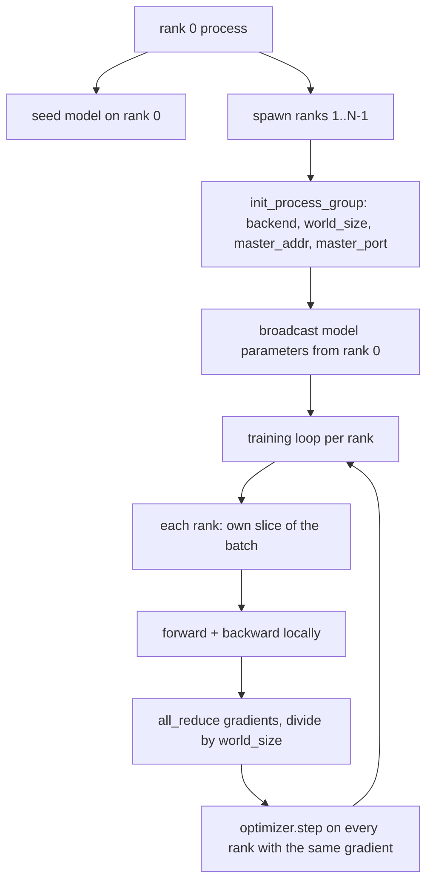
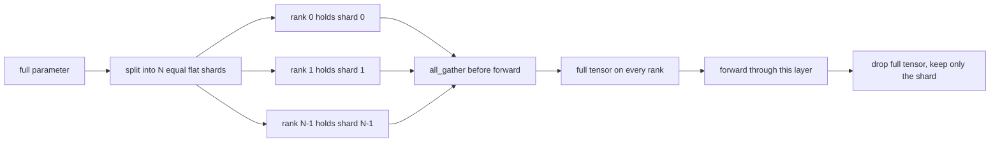

# من التكوين إلى التكوين المزدوج للمعلومات الموزعة و FSDP

> التدريب المتعدد المستويات هو اثنين من القواعد الجماعية 和一条规则.

**Type:** Build
**Languages:** Python
**Prerequisites:** Phase 19 lessons 42 to 45
**Time:** ~90 minutes

## أهداف التعلم

- استخدام `gloo`الخلفية 启动跨 N 个级的进程组,不需要特殊硬件──
- 实现 a أدنى غلاف DDP ، في البناء 时 البث المعلمات ، و و 后 كل تخفيض التدرجات
- 证明 per-rank gradients 的全减少匹配 连锁输入 上的单进程梯度──
- 勾勒 FSDP المعلمة شردة: كل صف 持 واحد شرائح، إلى الأمام مرّة 时 جمع كامل الجهاز، بعد الانقطاع

## 问题

模型能放进一台设备──数据设置 放不下── مطلوب ميزانية التحسين 要求你在每秒钟钟内看到N 倍样本──第一杆是数据平行:每个级别在批次的不同片段上运行同一个模型,然后在优化步骤之前的平均梯度──第二杆是FSDP:模型本身也放不进一个设备,所以每个级别都持有每个参数的一部分,并通过 期间逐步重建全 tensors──

痛点在会计管理──如果参数在排名 之间漂移,这次运行会静默损坏──如果是平均梯度但没有平均损失,仪表板就会撒谎──如果是集体后端 无法达成拓学,运行会永远挂──修复方法是亲手写一次集体,然后永远不要信任你无法复现的包装──

هذا هو المشكلة`gloo`الظهر مع كل بيكتورتش يبدأ يوفر،并接受 `torch.multiprocessing`العمال؛ نفس جزء من الكود تغيير إلى عقدة متعددة GPU `nccl`时, الهيكل لا يحتاج إلى تغيير

## 概念



### جماعات مهمة

| Collective | 做什么 | 何时使用 |
|------------|--------------|------|
| `broadcast` | 将一个 tensor 从一个 rank 复制到所有其他 rank | Parameter init、scheduler state、任何 one-to-all sync |
| `all_reduce` | 在所有 rank 间对一个 tensor 求和（或 mean、或 max），每个 rank 都得到结果 | Backward 后的 Gradient averaging |
| `all_gather` | 每个 rank 贡献一个 tensor，每个 rank 都得到 concatenation | Logits collection、FSDP parameter unshard |

عقد DDP هو بناء 时`broadcast`, خلفي 后 `all_reduce` رسم FSDP في كل طبقة إلى الأمام المرور 前加入 `all_gather`.

### متوسط التدريج 匹配 التدريج لعملية واحدة

في N 个级 上使用B 个样本的批量 训练模型,必须产生与单一过程在N*B 的批量 上训练相同的梯度──是对每级梯度 求和并除以N,会得到平均损失梯度,这正是平均减少的交叉 Entropy 在全批量 上会产生的结果──课程代码 会在手动中所有减少梯度和参考单进程梯度 之间断定`max-abs-diff < 1e-3`.

### رسم FSDP



فوز الذاكرة هو دقيقة: لكل رَكان ذِكْرُ المُعَيِّنِ ‬ ‬ ‬ ‬ ‬ ‬ ‬ ‬ ‬ ‬ ‬ ‬ ‬ ‬ ‬ ‬ ‬ ‬ ‬ ‬ ‬ ‬ ‬ ‬ ‬ ‬ ‬ ‬ ‬ ‬ ‬ ‬ ‬ ‬ ‬ ‬ ‬ ‬ ‬ ‬ ‬ ‬ ‬ ‬ ‬ ‬ ‬ ‬ ‬ ‬ ‬ ‬ ‬ ‬ ‬ ‬ ‬ ‬ ‬ ‬ ‬ ‬ ‬ ‬ ‬ ‬ ‬ ‬ ‬ ‬ ‬ ‬ ‬ ‬ ‬ ‬ ‬ ‬ ‬ ‬ ‬ ‬ ‬ ‬ ‬ ‬ ‬ ‬ ‬ ‬ ‬ ‬ ‬ ‬ ‬ ‬ ‬ ‬ ‬ ‬ ‬ ‬ ‬ ‬ ‬ ‬ ‬ ‬ ‬ ‬ ‬ ‬ ‬ ‬ ‬ ‬ ‬ ‬ ‬ ‬ ‬ ‬ ‬ ‬ ‬ ‬ ‬ ‬ ‬ ‬ ‬ ‬ ‬ ‬ ‬ ‬ ‬ ‬ ‬ ‬ ‬ ‬ ‬ ‬ ‬ ‬ ‬ ‬ ‬ ‬ ‬ ‬ ‬ ‬ ‬ ‬ ‬ ‬ ‬ ‬ ‬ ‬ ‬ ‬ ‬ ‬ ‬ ‬ ‬ ‬ ‬ ‬ ‬ ‬ ‬ ‬ ‬ ‬ ‬ ‬ ‬ ‬ ‬ ‬ ‬ ‬ ‬ ‬ ‬ ‬ ‬ ‬ ‬ ‬ ‬ ‬ ‬ ‬ ‬ ‬ ‬ ‬ ‬ ‬ ‬ ‬ ‬ ‬ ‬ ‬ ‬ ‬ ‬ ‬ ‬ ‬ ‬ ‬ ‬ ‬ ‬ ‬ ‬ ‬ ‬ ‬ ‬ ‬ ‬ ‬ ‬ ‬ ‬ ‬ ‬ ‬ ‬ ‬ ‬ ‬ ‬ ‬

### CPU مع الخلفية المظلمة

CUDA هو هدف الإنتاج، ولكن هناك نفس طرق الكود على CPU أيضاً`gloo`هو CPU الخرجيات الجماعية.`nccl`慢几个量级, ولكن سطح API 完全相同.`backend="gloo"`ابتدأت،并用 `torch.multiprocessing`صفوف النسل، بدلا من `torchrun`؛ كلتا الاخيرين سوف تستخدم نفسها`torch.distributed`في عقدة متعددة الجيبو فوق، التغير الوحيد هو`backend="nccl"`الجهاز الجهاز الجهاز الجهاز الجهاز الجهاز الجهاز الجهاز الجهاز الجهاز الجهاز الجهاز الجهاز الجهاز الجهاز الجهاز الجهاز الجهاز الجهاز الجهاز الجهاز الجهاز الجهاز الجهاز الجهاز الجهاز الجهاز الجهاز الجهاز الجهاز الجهاز الجهاز الجهاز الجهاز الجهاز الجهاز الجهاز الجهاز الجهاز الجهاز الجهاز الجهاز الجهاز الجهاز الجهاز الجهاز الجهاز الجهاز الجهاز الجهاز الجهاز الجهاز الجهاز الجهاز الجهاز الجهاز الجهاز الجهاز الجهاز الجهاز الجهاز الجهاز الجهاز الجهاز الجهاز الجهاز الجهاز الجهاز الجهاز الجهاز الجهاز الجهاز الجهاز الجهاز الجهاز الجهاز الجهاز الجهاز الجهاز الجهاز الجهاز`torchrun`-تبدأ


```figure
cg-allreduce-ring
```

## بناءها

`code/main.py`نعم يمكن أن يتم تشغيل القطع الأثرية

### الخطوة 1: مجموعة عملية بدء

```python
os.environ["MASTER_ADDR"] = "127.0.0.1"
os.environ["MASTER_PORT"] = str(port)
dist.init_process_group(backend="gloo", rank=rank, world_size=world_size)
```

`MASTER_ADDR`和 `MASTER_PORT`هو موعد: كل صف يصل إلى نفس المضيف فوق نفس الميناء.

### الخطوة الثانية: الإعلانات

`MinimalDDP.__init__`عبر كل معايير ومركز،并调用 `dist.broadcast(tensor, src=0)` تصبح قيمة الصف 0 القائمة على القوانين الأولى.

### الخطوة الثالثة: للخلف 后 كل تخفيض التدرج

```python
def all_reduce_grads_(module, world_size):
    for p in module.parameters():
        if p.grad is None:
            p.grad = torch.zeros_like(p.data)
        dist.all_reduce(p.grad.data, op=dist.ReduceOp.SUM)
        p.grad.data.div_(world_size)
```

كل صف في النهاية الحصول على نفس المتوسط التراجعية. مرحلة التحسين الآن في كل صف على أساس نفس المدخلات من وظيفة، وهذا هو السبب في الحفاظ على المزامنة في جميع الجولة.

### الخطوة الرابعة: إثبات التكافؤ

`manual_all_reduce_matches_single_process`في الصف 0 上构建同一个模型,并将后-全部降低梯度与单一过程在连接输入 上会计算出的梯度进行比较――最大-abs-diff 约为 1e-8――

### الخطوة 5: رحلة ذهاب وإياب من وراء الحكومة

`fsdp_round_trip_sketch`سطح كل مُعيار، إرفع إلى`world_size`تعدد,قطع,كل-جمع,再解pad── كل صف من إعادة بناء 都等于原始──这是 الخطوة غير المقطوعة؛ عكسها(إلى الأمام 后重新-شكل)就是 من الجهاز المتجمع 中取一片──

运行:

```bash
python3 code/main.py
```

默认 حجم العالم هو 2...`gloo`互通信,并以 صفر 退出──输出 `outputs/ddp-demo.json`捕获每个排列的参数总数、全部减少后的梯度规范、FSDP回路结果,以及手动对参考梯度差异──

## استخدمها

أكوام تدريب الإنتاج 调用相同原始ية──PyTorch 的 `DistributedDataParallel`增加了: post-backward gradient hooks,用于将多个小梯梯合并为一次集体;以及教学46 使用过的 `no_sync`السياق

زيادة FSDP PyTorch: في كل طبقة عرض معدل مسطح ، دع كل صفحة احتفاظ بمضخة متواصلة ؛ نزلة طبقة غير مقطوعة مع التداخل الحسابي المستوى الحالي ؛ فضلا عن خيارات شارت CPU خارج الحملة.

形状保持不变: انطلاق وقت البث، تراجع 后减少،

## أرسله

`outputs/skill-distributed-fsdp-ddp.md`携带新训练脚本的配方:用 `gloo`أنشئ مجموعة العمليات من CPU، استخدام `nccl`启动 GPU 的过程组,将模型包在DDP shell 中,在建设时播放并在后退 后减少,按需使用FSDP草图中的所有_集图对参数 分片──

## التمارين

1. استخدام `--world-size 4`运行,并确认整个运行 中参 spread 保持在 1e-3 以下。
2.  将 يدوي متوسط 替换为 `dist.all_reduce(op=dist.ReduceOp.AVG)`و التوقيت
3. عطاء غلاف DDP اضافة الرمز بعد الظهر، دع كل-تقلل مع بقية الجزء الظهر التداخل؛ قياس ساعة الحائط  تحسين.
4. 实现 FSDP re-shard step:forward pass 后, again with local shard بدل الاختراق الكامل.
5. في CUDA 机器上将后端 切换为 `nccl` تسجيل المتغيرات البيئية  تغير، والتي لا تتغير

## الشروط الرئيسية

| Term | 人们的说法 | 实际含义 |
|------|-----------------|------------------------|
| Backend | "gloo or nccl" | 实现 collective ops 的 library；gloo 是 CPU，nccl 是 GPU |
| World size | "Total ranks" | group 中的 process 数量；group 是 collectives 操作的 unit |
| Rank | "Worker id" | group 内的 process identifier，从零开始索引 |
| All-reduce | "Sum the grads" | 在所有 rank 间对一个 tensor 求和，每个 rank 最终得到相同结果 |
| Unshard | "Gather the params" | 通过 all_gather 从 per-rank slices 重建 full tensor |

## المزيد من القراءة

- بيتورش `torch.distributed`الوثائق، معرفة المعنى الجماعي
- `gloo`قائمة جماعية للمكتبة، شكلها مع دعم من قبل منظمة "كودا"`nccl`البدائية 相同──
- المرحلة 19 الدروس 46 ، معرفة DDP كل-حد من`no_sync`نمط تراكم التراجعية
- المرحلة 19 الدروس 47، معرفة ترتيب نقاط التفتيش البقاء في DDP و FSDP تشغيل
- تطبيقات PyTorch FSDP، تعرف هنا رسم شظاف المعلمات
