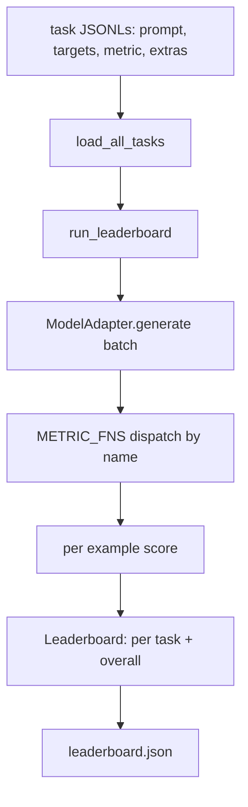
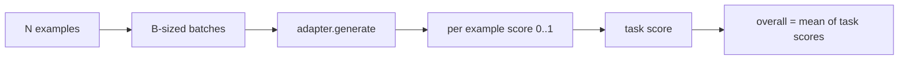

# 语言模型评测 الحزام

> إذا كان نموذج يعمل بشكل جيد على مهمة لا يمكنك تحديدها، فهو يعمل بشكل جيد فقط.

**Type:** Build
**Languages:** Python
**Prerequisites:** Phase 19 lessons 42 to 45
**Time:** ~90 minutes

## أهداف التعلم

- 将一个任务定义为 JSONL文件,每个例子包含`prompt`.`targets`.`metric`و الاختيارات`extras`.
- 实现五个指标:المتسابقة الدقيقة 红色-l F1 执行可行 选择多种 和 字符串含有
- 构建一个运行器,按任务 批处理示例,并分发给可替换的模型适配器──
- 输出 leaderboard JSON، يتضمن كل مهمة درجة التأخير، وكذلك المتوسط العام للعملية

## 问题

كل أسبوع سيكون هناك نموذج لغوي جديد يظهر  التسويق يقول أنه يعمل بشكل جيد  السؤال الحقيقي هو: في أي جانب يعمل بشكل جيد؟ الجواب الحقيقي هو قائمة اللائحة التي كتبتها بنفسك ، لأن قائمة اللائحة اللائحة من البائعين هي نفسها التي قاموا بتحسينها 

إذا كان repo 里 لا يوجد حزمة، يمكنك فقط بمعنى التشابه بين النماذجتين. إذا كان لديك حزمة، يمكنك أن تكون في مجموعة مهمة ثابتة، مقارنة المقاييس المثبتة، وتحصل على نتائج JSON مختلفة.

陷是让harness 过适合单个模型──修复方式是让所有模型特定的选择都留在harness 之外:harness 小到十五分钟能读完,任务小到可以随随随 repo 发布,计量从零编写以便同事审计,而适配器是唯一模型特定代码的地方──替换适配器,leaderboard 会变;替换任务,leaderboard 会变;.其他东西都不应该变──

## 概念



### تحديد المهام

كل مثال هو واحد صف JSONL:

```json
{"id": "arith-00", "prompt": "compute: 2 + 2", "targets": ["4"], "metric": "exact_match"}
```

للاستفادة من المساعدين`extras`حملة مفيدة للطريق:

```json
{
  "id": "code-00",
  "prompt": "python: write a function f that doubles its input",
  "targets": ["ok"],
  "metric": "code_exec",
  "extras": {"io_pairs": [[1, 2], [3, 6]]}
}
```

مهمة واحدة هي`outputs/tasks/`أسفل واحد `.jsonl`文件──文件名就是任务名── 一文件中的所有例子 共享同一个指标──

### 五个 وظائف المثبتة

| Task | Metric | 测试内容 |
|------|--------|---------------|
| arithmetic | exact_match | 对确定性答案的 Token 级正确性 |
| summary | rouge_l | 针对单行 reference summary 的 longest common subsequence F1 |
| code-exec | code_exec | 可执行测试：预测出的 function 必须满足一组 input-output pairs |
| multiple-choice | multiple_choice | prediction 的首字母必须匹配允许的 letter |
| generation | substring_contains | Free-form text 必须包含至少一个 target substring |

### العقد الميتر

كل متريك هو وظيفة:`(prediction, targets, extras) -> float in [0.0, 1.0]` الاستفادة من النتائج لكل مثال 取平均得到任务分,再对任务分数 取平均得到整体──

- `exact_match`:转小写、折叠 white space、判断 equality──
- `substring_contains`: نفس التطبيع،做 اختبار السباقات
- `multiple_choice`خذ الشخصية الأولى و غيرها للكتابة الكبيرة
- `rouge_l`: طول LCS خارج التنبؤ و طول المرجعية، دقة الحساب و استدعاء F1
- `code_exec`: في مساحة الأسماء المحدود في تنبؤ تنفيذ، لكل زوج المدخل-المخرج 调用 `f(x)`, الإحصائيات تتطابق

المقاييس code_exec 会在精简后的内置名字空间 中运行预测──本课的测试 断言 `import os`سأفشل، لأن`os` 不在 namespace 中;你不能从代码预测 访问文件系统──

### مُعدّل النموذج

```python
class ModelAdapter(Protocol):
    def generate(self, prompts: Sequence[str]) -> List[str]: ...
    @property
    def name(self) -> str: ...
```

المعدل هو 接点。本课提供 `ToyAdapter`، هو مُطابق نمط تحديد، سوف يُقسم إلى خمس مهام ثابتة من بين كل طلب عودة صحيحة جوابها‬‬‬‬‬‬‬‬‬‬‬‬‬‬‬‬‬‬‬‬‬‬‬‬‬‬‬‬‬‬‬‬‬‬‬‬‬‬‬‬‬‬‬‬‬‬‬‬‬‬‬‬‬‬‬‬‬‬‬‬‬‬‬‬‬‬‬‬‬‬‬‬‬‬‬‬‬‬‬‬‬‬‬‬‬‬‬‬‬‬‬‬‬‬‬‬‬‬‬‬‬‬‬‬‬‬‬‬‬‬‬‬‬‬‬‬‬‬‬‬‬‬‬‬‬‬‬‬‬‬‬‬‬‬‬‬‬‬‬‬‬‬‬‬‬‬‬‬‬‬‬‬‬‬‬‬‬‬‬‬‬‬‬‬‬‬‬‬‬‬‬‬‬‬‬‬‬‬‬‬‬‬‬‬‬‬‬‬‬‬‬‬‬‬‬‬‬‬‬‬‬‬‬‬‬‬‬‬‬‬‬‬‬‬‬‬‬‬‬‬‬‬‬‬‬‬‬‬‬‬‬‬‬‬‬‬‬‬‬‬‬‬‬‬‬‬‬‬‬‬‬‬‬‬‬‬‬‬‬‬‬‬‬‬‬‬‬‬‬‬‬‬‬‬‬‬‬‬‬‬‬‬‬‬‬‬‬‬‬‬‬‬‬‬‬‬‬‬‬‬‬‬‬‬‬‬‬‬‬‬‬‬‬‬‬‬‬‬‬‬‬‬‬‬‬‬‬‬‬‬‬‬‬‬‬‬‬‬‬‬‬‬‬‬‬‬‬‬‬‬‬‬‬‬‬‬‬‬‬‬‬‬‬‬‬‬‬‬‬‬‬‬‬‬‬‬‬‬‬‬‬‬‬‬‬‬‬‬‬‬‬‬‬‬‬‬‬‬‬‬‬‬‬‬‬‬‬‬‬‬‬‬‬‬‬‬‬‬‬‬‬‬‬‬‬‬‬‬‬‬‬‬‬‬‬‬‬‬‬‬‬‬‬‬‬‬‬‬‬‬‬‬‬‬‬‬‬‬‬‬‬‬‬‬‬‬‬‬‬‬‬‬‬‬‬‬‬

### الجاري

`run_task`كل عملية تجميع`batch_size`个提示,并分发给 метриك وظيفة`run_leaderboard`穿过每一个任务并求平均──`write_leaderboard`输出带 schema string 的 JSON,这样未来格式 变化不会静默破坏仪表板──




```figure
eval-harness-matrix
```

## بناءها

`code/main.py`نعم يمكن أن يتم تشغيل القطع الأثرية

### الخطوة الأولى: مهام إصلاح البذور

`seed_fixture_tasks(target_dir)`写入五个 `.jsonl`文件──第一次运行 `main.py`إذا كان المخطط فارغًا، فسوف يزرع هذه الملفات

### الخطوة 2: مهام الحمل

`load_all_tasks(task_dir)`读取 كل `.jsonl`,并返回 من اسم المهمة إلى `Example`سجلات 列表的 dict──以`#`سيتم نقلها من أول خطوط التعليقات والخطوط الفارغة، لذلك يمكن للمشاركين التعليق على هذه الملفات.

### الخطوة الثالثة: تنفيذ المعايير

كل متريك مدونة هي وظيفة صغيرة، ومضمنة اختبار وحدة. مجموعة اختبار هذا الدراسة تتضمن 13 حالة، تغطي التطبيع والتداخل الجزئي، تنفيذ الرمز، والرفض غير الآمن للرمز.

### الخطوة الرابعة: اكتب المدير

`run_task`代 دفعات،并生成一个 `TaskResult`، منها يتضمن النتيجة ‬العد الصحيح ‬العد الإجمالي و التأخير‬`run_leaderboard`遍历所有任务并生成带总体平均的 `Leaderboard`.

### الخطوة 5: إصدار JSON

`write_leaderboard`مجلس التنسيق`--include-per-example`ستصدر علامات على كل سجل من أوراق النتائج، حتى عندما تتغير النتائج، يمكنك أن تضع التنبؤات مختلفة عن المرة السابقة.

运行它:

```bash
python3 code/main.py
```

脚本第一次运行时会种子装置,用玩具适配器(它会对每个装置)打分,并写入 `outputs/leaderboard.json` استخدام مكيّف الألعاب 时 النتيجة العامة هي 1.0;`test_main.py`اختبار المعدل الوسطي  عرضت عندما المعدل  غير قادر على الإجابة، مع نفس الحبل سوف تنتج 0.0 ‬‬‬‬‬‬‬‬‬‬‬‬‬‬‬‬‬‬‬‬‬‬‬‬‬‬‬‬‬‬‬‬‬‬‬‬‬‬‬‬‬‬‬‬‬‬‬‬‬‬‬‬‬‬‬‬‬‬‬‬‬‬‬‬‬‬‬‬‬‬‬‬‬‬‬‬‬‬‬‬‬‬‬‬‬‬‬‬‬‬‬‬‬‬‬‬‬‬‬‬‬‬‬‬‬‬‬‬‬‬‬‬‬‬‬‬‬‬‬‬‬‬‬‬‬‬‬‬‬‬‬‬‬‬‬‬‬‬‬‬‬‬‬‬‬‬‬‬‬‬‬‬‬‬‬‬‬‬‬‬‬‬‬‬‬‬‬‬‬‬‬‬‬‬‬‬‬‬‬‬‬‬‬‬‬‬‬‬‬‬‬‬‬‬‬‬‬‬‬‬‬‬‬‬‬‬‬‬‬‬‬‬‬‬‬‬‬‬‬‬‬‬‬‬‬‬‬‬‬‬‬‬‬‬‬‬‬‬‬‬‬‬‬‬‬‬‬‬‬‬‬‬‬‬‬‬‬‬‬‬‬‬‬‬‬‬‬‬‬‬‬‬‬‬‬‬‬‬‬‬‬‬‬‬‬‬‬‬‬‬‬‬‬‬‬‬‬‬‬‬‬‬‬‬‬‬‬‬‬‬‬‬‬‬‬‬‬‬‬‬‬‬‬‬‬‬‬‬‬‬‬‬‬‬‬‬‬‬‬‬‬‬‬‬‬‬‬‬‬‬‬‬‬‬‬‬‬‬‬‬‬‬‬‬‬‬‬‬‬‬‬‬‬‬‬‬‬‬‬‬‬‬‬‬‬‬‬‬‬‬‬‬‬‬‬‬‬‬‬‬‬‬‬‬‬‬‬‬‬‬‬‬‬‬‬‬‬‬‬‬‬‬‬‬‬‬‬‬‬‬‬‬‬‬‬‬‬‬‬‬‬‬‬‬‬‬‬‬‬‬‬‬‬‬‬‬‬‬‬‬‬‬‬‬‬‬‬‬‬‬‬‬‬‬‬‬‬

## استخدمها

لكي تتواصل مع النموذج الحقيقي، اكتب مُعدل

```python
class HttpAdapter:
    name = "vendor.v1"

    def __init__(self, endpoint, api_key):
        self.endpoint = endpoint
        self.api_key = api_key

    def generate(self, prompts):
        out = []
        for prompt in prompts:
            response = http_post(self.endpoint, prompt, self.api_key)
            out.append(response["text"])
        return out
```

في`main()`أعلى`ToyAdapter`替换成 `HttpAdapter`✿تتغيرت المهام والمقاييس ومؤشرات المرتبات

في المشاريع الحقيقية، يجب إجبار التنفيذ على ثلاثة أنماط:

- **Pin task files。**leaderboard.json يجب أن تحمل محتوى مهمة محورقة بالهاش ، يجب أن تحمل JSONLs ، وإلا فصيلة المهمة تغير النتيجة سوف تتغير ، وأنت لا تستطيع أن تحكم على أي تغيرت.
- **Diff predictions，不只是 diff scores。** `--include-per-example`العلم يجعلك ترى النتيجة أسفل يوم ما قال النموذج
- **限制 batch size。**المعدلات الحقيقية لديها حدود السعر. حجم البطاقة الصغير يمكن أن يسمح للقائمة بموافقة مختلف البائعين.

## أرسله

`outputs/skill-lm-eval-harness.md`携带食谱:JSONL تحديد المهام 五个指标 可替换适配器 批发运行 带方案字符串的排行榜 JSON。`outputs/tasks/`ملفات المهام هي مصطلحات، قم بتنسخها في المشاريع الحقيقية كمنقطة البدء.

## التدريب

1. إضافة المهام السادسة، واستخدام المقاييس المخصصة التي كتبتها من الصفر مثل التداخل بين بليو مثل نقاط المرجعية بين بلورت، أو أي عقد 清晰的东西)
2. 扩展 `code_exec`, التقاط المشكلة ,并接受一组 المتوقع المشكلة 作为目标──
3. إضافة قائمة قائمة تفاصيل أمر:`leaderboard.json`الملفات، والطباعة، والمهام التي حدثت تغييرات ومدى التغييرات.
4. الحد من كل مثال من التأخيرات. استخدام وقت وقف التوصيلات التوصيلات التوصيلات التوصيلات التوصيلات التوصيلات التوصيلات التوصيلات التوصيلات التوصيلات التوصيلات التوصيلات التوصيلات التوصيلات التوصيلات التوصيلات التوصيلات التوصيلات التوصيلات التوصيلات التوصيلات التوصيلات التوصيلات التوصيلات التوصيلات التوصيلات التوصيلات التوصيلات التوصيلات التوصيلات التوصيلات التوصيلات التوصيلات التوصيلات التوصيلات التوصيلات التوصيلات التوصيلات التوصيلات التوصيلات التوصيلات التوصيلات التوصيلاتات`timeouts`العمود
5. في قائمة اللائحة باستخدام محتوى مهام Sha256 Pin، حتى يمكن للقراء في المستقبل التحقق من أن تقييمهم هو نفس المهام.

## 关键术语

| Term | 人们的说法 | 实际含义 |
|------|-----------------|------------------------|
| Task spec | “eval format” | JSONL 文件，每个 example 包含 prompt、targets、metric 和可选 extras |
| Metric | “你怎么打分” | 从 (prediction, targets, extras) 到 [0, 1] 内 float 的函数 |
| Adapter | “model client” | 带有 generate(prompts) -> list[str] method 的对象；唯一的模型特定代码 |
| Leaderboard | “scoreboard” | 包含 per-task scores、total counts、latency 和 overall average 的 JSON |
| Code exec metric | “运行它并检查” | 在受限 namespace 中执行 prediction，并与 input-output pairs 比较 |

## 延伸阅读

- المستخدمات المقدمة للقيام بتقييمات يمكن أن تكون مرجعية في فئة الإنتاج، الحجم أكبر بكثير، ولكن الشكل هو نفسه.
- إن إضاءة "تقبيل الوجه" هي نوع آخر من التحقق من نفس العقد
- المرحلة 19 الدروس 46  تغطي حربة 评测                                                                                                                                                                                                                                                       
- المرحلة 19 الدروس 47 تغطي نمط نقاط التفتيش المستهدفة لمجموعة تقييماتك؛ في قائمة الدرجات
- المرحلة 19 الدروس 48 تغطي مجموعة التدريب الموزعة من نموذج تم اختباره
