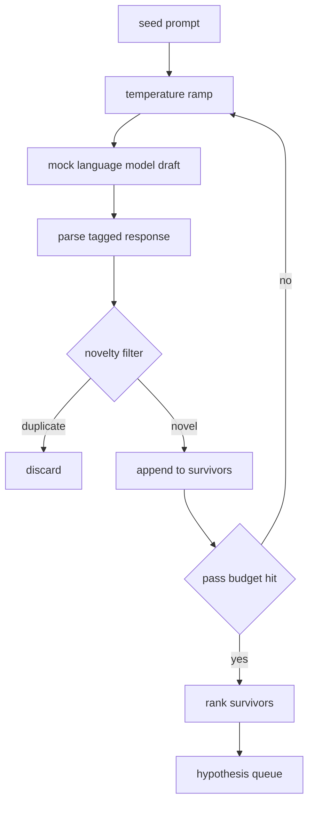

# مولد الفرضية

> إذا سأل وكيل البحث نفس السؤال مرتين، فهي في إضاعة القطع.

**Type:** Build
**Languages:** Python
**Prerequisites:** Phase 19 Track A lessons 20-29
**Time:** ~90 分钟

## أهداف التعلم
- من البذور على الفور  المحرك عينات، و سوف تنتجها 转成带类型 الافتراض السجل
- في كل مرسلة ارتفاع درجة حرارة العينات، دع مسودة التالية تتحرك أكثر من المخطط السابق.
- باستخدام نموذج إضافة صغير و عتبة المسافة الكوسينية
- استخدام مزيج من الابتكارات والخصوصية والتحقق من الاختبار وظيفة تسجيل لترتيبات النتائج
- 让每一步都保持确定性,使同一个种子 总是产生相同的排队──

## لماذا السيد؟

المخطط  دعوة نموذج مرة واحدة، سوف تحصل فقط على فرضية واحدة. هذا على المثال المعمل لتخطي أي مشكلة. ولكن على حلقة البحث لتخطي الشكل لا تخطي. الحلقة تحتاج إلى صف متسلسل بعمق، بحيث عندما يفشل الفرضية الأولى، يكون الجاري جاهزًا للآخر، دون الحاجة إلى دفع مرة أخرى تكلفة مرور العينات الكاملة.

دو أفكار تتجمع لتوليد هذا الصف. الأول هو ارتفاع درجة الحرارة: كل مرة تمر فيها العينات 时都把温度 提高一点,让后草更愿意游走.

هذا المرحلة يقدم نموذج لغة مزيفة، فإنه سوف تستهدف محاولة ثابتة عودة تسلسل رمزية من الكتابة ‬‬‬‬‬‬‬‬‬‬‬‬‬‬‬‬‬‬‬‬‬‬‬‬‬‬‬‬‬‬‬‬‬‬‬‬‬‬‬‬‬‬‬‬‬‬‬‬‬‬‬‬‬‬‬‬‬‬‬‬‬‬‬‬‬‬‬‬‬‬‬‬‬‬‬‬‬‬‬‬‬‬‬‬‬‬‬‬‬‬‬‬‬‬‬‬‬‬‬‬‬‬‬‬‬‬‬‬‬‬‬‬‬‬‬‬‬‬‬‬‬‬‬‬‬‬‬‬‬‬‬‬‬‬‬‬‬‬‬‬‬‬‬‬‬‬‬‬‬‬‬‬‬‬‬‬‬‬‬‬‬‬‬‬‬‬‬‬‬‬‬‬‬‬‬‬‬‬‬‬‬‬‬‬‬‬‬‬‬‬‬‬‬‬‬‬‬‬‬‬‬‬‬‬‬‬‬‬‬‬‬‬‬‬‬‬‬‬‬‬‬‬‬‬‬‬‬‬‬‬‬‬‬‬‬‬‬‬‬‬‬‬‬‬‬‬‬‬‬‬‬‬‬‬‬‬‬‬‬‬‬‬‬‬‬‬‬‬‬‬‬‬‬‬‬‬‬‬‬‬‬‬‬‬‬‬‬‬‬‬‬‬‬‬‬‬‬‬‬‬‬‬‬‬‬‬‬‬‬‬‬‬‬‬‬‬‬‬‬‬‬‬‬‬‬‬‬‬‬‬‬‬‬‬‬‬‬‬‬‬‬‬‬‬‬‬‬‬‬‬‬‬‬‬‬‬‬‬‬‬‬‬‬‬‬‬‬‬‬‬‬‬‬‬‬‬‬‬‬‬‬‬‬‬‬‬‬‬‬‬‬‬‬‬‬‬‬‬‬‬‬‬‬‬‬‬‬‬‬‬‬‬‬‬‬‬‬‬‬‬‬‬‬‬‬‬‬‬‬‬‬‬‬‬‬‬‬‬‬‬‬‬‬‬‬‬‬‬‬‬‬‬‬‬‬‬‬‬‬‬‬‬‬‬‬‬‬‬‬‬‬‬‬‬‬

## فرضية 形状

```text
Hypothesis
  id             : int           (monotonic within a run)
  text           : str           (the claim)
  variables      : list[str]     (what changes between conditions)
  metric         : str           (what the runner will measure)
  baseline_ref   : str | None    (which paper or run the comparison cites)
  draft_pass     : int           (which sampler pass produced this)
  temperature    : float         (the sampler setting at draft time)
  novelty_score  : float         (distance from prior survivors, 0..1)
  rank_score     : float         (weighted sum used for ordering)
```

`variables`和 `metric`ليس كتاباً حراً. سوف يقرأ الجواب من خلال علامة المشاركة.

`baseline_ref`هو اختياري، ولكن يقدم النصيحة. المقيّم في الدرجة الثالثة والخمسين يحتاج إلى خط أساسي.


```figure
cg-novelty-ramp
```

## المكونات



هذه الحلقة مباشرة جدا، وكل صندوق لديه عقد صارم

## ريمب الحرارة

من`t_min`开始, إلى `t_max`انتهى الخطوة`(t_max - t_min) / (n_passes - 1)` كل مرّة تستخدم درجة الحرارة الحالية   `GeneratorConfig.schedule()` تكوين `n_passes`个均间隔的值──模特 通过在一小组按 `(prompt, temp_bucket)`索引的脚本化反应 之间切换来遵守温度──桶是开区间,因此 التغيرات الصغيرة في درجة الحرارة ستختار سطل مختلفة, وتتولد مسودة مختلفة──`temperature=t`.

الموعد المُعتمد هو من`0.2`إلى`1.2`ست مرات تمر. ست مرات تملأ الصف، لا حاجة إلى الفيلتر الجديد.`0.2`时,model 会复述种子──高于 `1.2`时,رد فعل 往往偏离主题并导致 parser 失败──

## مرشحات الابتدائية

بعد كل مشروع يتم تحليله، يقوم المولّد بإدخال النص،并与每一个已接受的假设比较.`1 - dot(a, b)`إذا كان المسافة القصوى من أي من الناجين السابقين`novelty_threshold`، لقد تمت .`0.25`.

الإضافة المضغوطة ليست متقدمة. إنها تحديدية 零依赖,并足以捕捉显而易见的情况:

## درجة الرتب

```text
rank_score = w_novelty * novelty_score
           + w_specificity * specificity_score
           + w_testability * testability_score
```

ثلاث نقاط فرعية`novelty_score`هو أقصر مسافة إضافة مع الناجين السابقين`specificity_score`هي الفرضية في عدد المتغيرات المحددة مقسمة على عدد الهدف.`testability_score`في الفرضية مع الوقت المحدد الميترات 和 خط الأساس 时为一, فقط تحديد الميترات 时为二分之一,否则为零。

默认权重是 `0.4`.`0.3`.`0.3` الوزن يقع في إعداد المولد، لذلك يمكن للدروس التابعة تحويلها، دون الحاجة إلى تشكيل 代码‬

## نموذج اللغة المزيفة

```python
class MockLLM:
    def sample(self, prompt: str, temperature: float, seed: int) -> str:
        ...
```

- نعم`(prompt, temperature, seed)`ثلاث مرات، العينة هي مؤكدة.`(prompt_signature, temperature_bucket)`جدول الإجابة المكتوبة للمؤشرات  إذا لم يكن هناك مدخل مفتاح معين، فسوف يعود العينات إلى نظام يجعله يفشل في التخفيضات.

البذور سوف تتضارب في الاستجابة، لذلك نفس واحد `(prompt, temperature)`في تجربة، نضع البذور الثابتة، للحفاظ على النتيجة قابلة للرد. في عملية التنفيذ الحقيقية، تأتي البذور من ساعة النظام أو العداد.

## صف الخروج

输出是按 `rank_score`降序排序 `Hypothesis`سجل 列表──第五十二课中的跑者 弹出头,运行实验,第五十三课中的评价者 写回判决──如果判决说假设 错了,跑者就弹出下一个──

الصف محدود. عندما يكون فارغًا، يمكن للموسيقي توسيع زر البذور مرة أخرى، أو التوقف عن تقرير استنفاد الميزانية.

## كيف تقرأ ؟

`code/main.py`定义 `Hypothesis`.`MockLLM`.`HypothesisGenerator`وحدة تحديد التعبيرات`run(seed_prompt)`طريقة، عودة إلى ترتيب بعد الصف؛ إعداد المرور من `GeneratorConfig.n_passes`读取,而不是作为论点 传入──嵌入 是哈希袋的代币──新奇过 是单独函数──排名分数 是单独函数──没有任何东西依赖 `numpy`إضافة الرياضيات هي مجرد دراسة، لذلك فإن الدراسة تظل محمولة.

`code/tests/test_generator.py`تغطي مسار خطيّ ‧مسار رفض المضاعف ‧مسار فشل المُفصل ‧حدود الحافة ومرتبة الترتيب‬

## إنه يتواصل

第五十二课程生成队列――第五十一课程取队列的头并运行文学搜索来确认或反驳它――第五十二课程取同一个头并运行实际实验――第五十三课程读取两者的产品并写出判决―― 第五十一课程组合成一个没有人参与的研究循环;人可以在任何边界介入――
