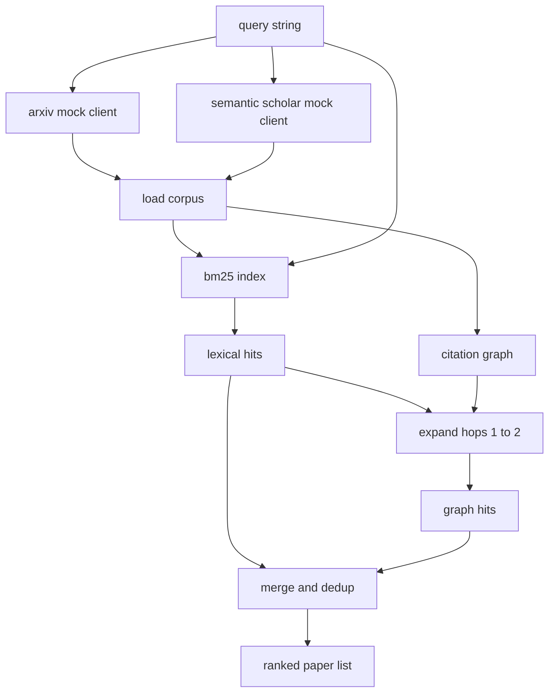

# 文献检索

> فرضية                                                                                                                                                                                                                                                                                                                                                                                                                                                                                                                            

**Type:** Build
**Languages:** Python
**Prerequisites:** Phase 19 Track A lessons 20-29
**Time:** ~90 分钟

## أهداف التعلم
- استخدام الحلقة أسفل، لـ سجل ورق صغير
- فقط باستخدام قاعدة بيانات، في المجردات 上构建 BM25 مؤشر
- 遍历 اقتباسات الرسم البياني,浮现 لغوي البحث 遗漏的论文──
- 通過 ثابتة الورق id,对 لغوي 和 الرسم البياني 两轮命中结果去重──
- إعداد اثنين من المزيفات الخارجية APIs  محمولة في واحد العميل  خلف ، مثل النقاط النهائية الحقيقية  وصل وقت ، موقع المكالمة 保持不变──

## لماذا تحتاجين إلى إعادة الإستعراض

على المجردات القيام باحث الكلمات الرئيسية، سوف يعود مع استفسار مشاركة الكلمات في ورق. هذا يغطي معظم حالات الطبقة العلوية. ولكن سوف يفوت نوعين من الحالات.

本课会构建这两轮──摘要 上的BM25 捕获词语 hits──引用图穿越从种子集 出发,向前和向后扩展一到两跳──二者的并集按纸 id 去重,并用一个小型组合分数排序──

## ورق 形状

```text
Paper
  id          : str           (稳定 identifier，mock corpus 中为 "p001")
  title       : str
  abstract    : str
  year        : int
  authors     : list[str]
  references  : list[str]     (这篇 paper 引用的 paper ids)
  citations   : list[str]     (引用这篇 paper 的 paper ids)
  source      : str           (提供它的 mock api，"arxiv" 或 "s2")
```

الإشارات والإقتباسات 字段形成有向引用图── اثنين من المزيفة APIs 返回的字段有重叠但不完全相同,因此 corpus loader 会按 `id`لتحقيقها


```figure
cg-citation-hops
```

## الهندسة المعمارية



العميل الاسترداد 拥有这两轮和 merge──المتصل 传入一个查询,并拿回一个排名列表; كل条目都携带每纸分数 字段(`bm25_score`.`graph_distance`.`recency_score`.`final_score`), للاستفسار

## من التحقق من BM25

实现使用标准 اوكابي BM25،默认参数为 `k1=1.5`.`b=0.75`الإندكس هو قاموسين:`term -> doc_frequency`和 `term -> list of (doc_id, term_count)`طول الوثيقة هو مجرد عدد الوهم. متوسط طول الوثيقة في المؤشر.`idf * tf_norm`، من بينهم`tf_norm`هو معيار BM25 长度归一化术语频率。

الـ " توكنيزر " هو الأول`lower`, ,再按非字母数字字符分化──它没有做成语音──生产系统会转换成一个小语音──接口保持不变──

```math
\begin{aligned}
\text{idf}(t) &= \log\!\left(\frac{N - \text{df} + 0.5}{\text{df} + 0.5} + 1.0\right) \\
\text{tf\_norm}(t) &= \frac{f \cdot (k_1 + 1)}{f + k_1 \cdot \left(1 - b + b \cdot \text{dl} / \text{avgdl}\right)} \\
\text{score}(d, q) &= \sum_{t \in q} \text{idf}(t) \cdot \text{tf\_norm}(t)
\end{aligned}
```

## التقاطع من الرسم البياني للمشاركات

الرسم البياني 会从 corpus 构建一次──前边 从一篇论文指向它的引用──后边 从一篇论文指向它的引用──横向是宽度第一搜索,以顶部BM25 hits为种子,最多两跳──

两跳是刻意设置的上限──一跳太浅;代理 常常需要直接祖先或后代──三跳会让连接图的结果规模膨胀,并且很容易偏离主题──本课把跳限 暴露为一个配置键,这样下游循环可以收紧它──

## التسجيلات

两轮会回归重叠集合―― merge استخدام هوية ورقة 作为关键── كل ورقة النتيجة النهائية هي إضافية الاختلاط──

```text
final_score = w_bm25 * bm25_score_norm
            + w_graph * graph_score
            + w_recency * recency_score
```

`bm25_score_norm`هو نتيجة BM25 خارج مجموعة دمج أكبر نتيجة BM25 في المجموعة ((لذلك فإن هذا الفصل في الصفر إلى الصفر))`graph_score`لضربات لغوية مباشرة`0.6`, دو跳为 `0.3`,إلا فمن أجل صفر`recency_score`هو من الجسم ، من الحد الأقصى للسنة إلى الحد الأقصى للسنة

الوزن المتوقع هو`0.5`.`0.3`.`0.2`الوزن هو التكوين، الموضوع القديم قد يقلل من الوعي، بينما الموضوع المتغير بسرعة سوف يزيد منه.

## المزيفة

هناك مئة ورقة من`build_corpus()`生成── كل مقالة تمتلك عنوان كتابة يدوية ومجرد، الموضوعات تأتي من 5 فئة واحدة: الاهتمام السريرة、التعافي زيادة、معدلات الرتب المنخفضة、قطاع التخلص والقيام بتقييم المجموعات البيانية── المراجع والمقالات 已连线, دع كل موضوع تم تشكيل رسمية فرعية متصلة,并带有少量跨 الموضوع حواف──

两个 عملاء API مزيفين(`ArxivMockClient`.`SemanticScholarMockClient`)读取同一个 corpus,但暴露不同字段──Arxiv 返回标题、摘要、年、作者──Semantic Scholar 增加引用 和引用──检索客户端 按 id 取并集;处理跨客户领域分歧 留到后续课程──

## الدروس 52 و 53 سوف تقرأ ماذا

الدروس 52 وسط الثانوية`paper.id`.`paper.title`، وبالإضافة إلى العبارات الأولى من المجرد، كسياق التجربة.`paper.year`和 `paper.references`، ستُصَدِّق خط الأساس إلى ورقة محددة

العميل الاسترداد  عودة إلى واحد `RetrievalResult`، ويحتوي أيضا على قائمة مرتبة و حسب المقاييس:عدد الاختبارات، متوسط النتيجة، أعلى النتيجة، إجمالي وقت الجدار.

## كيف تقرأ ؟

`code/main.py`تعريف`Paper`.`ArxivMockClient`.`SemanticScholarMockClient`.`BM25Index`.`CitationGraph`.`RetrievalClient`و و و و و و و و و و و و و و و و و و و و و و و و و و و و و و و و و و و و و و و و و و و و و و و و و و و و و و و و و و و و و و و و و و و و و و و و و و و و و و و و و و و و و و و و و و و و و و و و و و و و و و و و و و و و و و و و و و و و و و و و و و و و و و و و و و و و و و و و و و و و و و و و و و و و و و و و و و و و و و و و و و و و و و و و و و و و و و و و و و و و و و و و و و و و و و و و و و و و و و و و و و و و و و و و و و و و و و و و و و و و و و و و و و و و و و و و و و و و و و و و و و و و و و و و و و و و و و و و و و و و و و و و و و و و و و و و و و و و و و و و و و و و و و و و و و و و و و و و و و و و و و و و و و و و و و و و و و و و و و و و و و و و و و و و و و و و و و و و و و و و و و و و و و و و و و و و و و و و و و و و و و و و و و و و و و و و و و و و و و و و و و و و و و و و و و و و و و و و و و و و و و و و و و و و و و و و و و و و و و و و و و و و و و و و و و و و و و و و و و و و و و و و و و و و و و و و و و و و و و و و و و و و و و و و و و و و و و و و و و و و و و و و و و و و و و و و و و و و و و و و و و و و و و و و و و

`code/tests/test_retrieval.py`تغطي مسار اللغوي، مسار الرسم البياني، دمج، تمزيق، استفسار فارغ.

## ما هو الموقع الذي وضعه

الدرس الخمسين  خلق فرضية  الدرس الخمسين واحد  بحث الأدب، الحكم على الاعتبار هو أم لا يكون هناك تحديدات ‬‬‬‬‬‬‬‬‬‬‬‬‬‬‬‬‬‬‬‬‬‬‬‬‬‬‬‬‬‬‬‬‬‬‬‬‬‬‬‬‬‬‬‬‬‬‬‬‬‬‬‬‬‬‬‬‬‬‬‬‬‬‬‬‬‬‬‬‬‬‬‬‬‬‬‬‬‬‬‬‬‬‬‬‬‬‬‬‬‬‬‬‬‬‬‬‬‬‬‬‬‬‬‬‬‬‬‬‬‬‬‬‬‬‬‬‬‬‬‬‬‬‬‬‬‬‬‬‬‬‬‬‬‬‬‬‬‬‬‬‬‬‬‬‬‬‬‬‬‬‬‬‬‬‬‬‬‬‬‬‬‬‬‬‬‬‬‬‬‬‬‬‬‬‬‬‬‬‬‬‬‬‬‬‬‬‬‬‬‬‬‬‬‬‬‬‬‬‬‬‬‬‬‬‬‬‬‬‬‬‬‬‬‬‬‬‬‬‬‬‬‬‬‬‬‬‬‬‬‬‬‬‬‬‬‬‬‬‬‬‬‬‬‬‬‬‬‬‬‬‬‬‬‬‬‬‬‬‬‬‬‬‬‬‬‬‬‬‬‬‬‬‬‬‬‬‬‬‬‬‬‬‬‬‬‬‬‬‬‬‬‬‬‬‬‬‬‬‬‬‬‬‬‬‬‬‬‬‬‬‬‬‬‬‬‬‬‬‬‬‬‬‬‬‬‬‬‬‬‬‬‬‬‬‬‬‬‬‬‬‬‬‬‬‬‬‬‬‬‬‬‬‬‬‬‬‬‬‬‬‬‬‬‬‬‬‬‬‬‬‬‬‬‬‬‬‬‬‬‬‬‬‬‬‬‬‬‬‬‬‬‬‬‬‬‬‬‬‬‬‬‬‬‬‬‬‬‬‬‬‬‬‬‬‬‬‬‬‬‬‬‬‬‬‬‬‬‬‬‬‬‬‬‬‬‬‬‬‬‬‬‬‬‬‬‬‬‬‬‬‬‬‬‬‬‬‬‬‬‬‬‬‬‬‬‬‬‬‬‬‬‬‬
