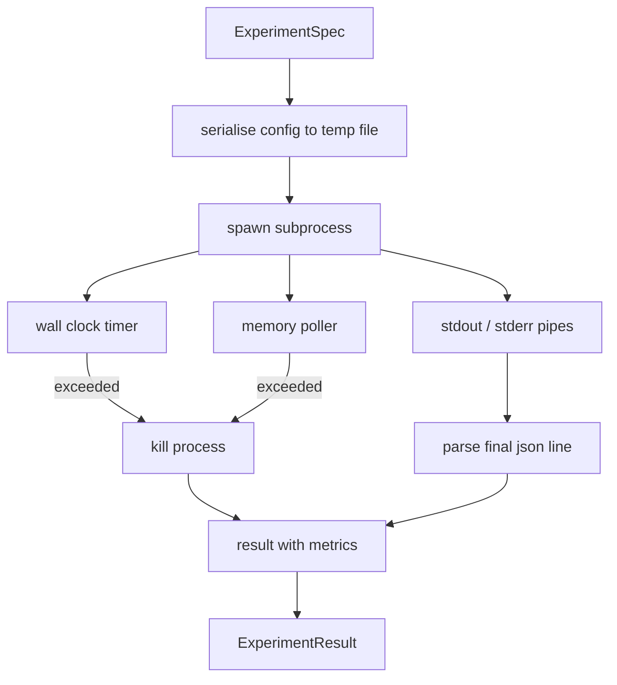

# "جريبه التجربة"

> يعتمد درجة الصدق على قياساتها.

**Type:** Build
**Languages:** Python
**Prerequisites:** Phase 19 Track A lessons 20-29
**Time:** ~90 分钟

## أهداف التعلم
- سوف تكتب التجربة على تحديد المميزة المطبوعة، ويمكن للمسير أن يسلسلها إلى العملية الفرعية
- إطلاق عملية إضافية مع توقيت ساعة الجدار الصلبة و كأس ذاكرة ناعمة، و سوف يُعرض الجميع للظروف النهائية
- ستقوم بتحقيق النتائج المتبقية و المقاييس المهيكلة
- 构建ablation table,在固定基 spec 上一次扫一个配置按──
- عندما تعطى البذور المحددة، دع كل نتيجة تبقى محددة، بحيث المقيّم في العديد من عمليات الرسومات نفسها.

## لماذا تستخدم العملية الفرعية

حلقة البحث 会运行 غير موثوق بها كود. الافتراضات من عينات، النص التجريبي أيضا من نفس الطريق.把任任任任任作为安全的过程中的代码,都在等待一次会拖管弦的崩.

هنا الجاري  لم تحقق الكاملة الساندبوكسنگ  لا وجود لـ cgroup، لا وجود لـ seccomp filter، ولا وجود لإعادة تخطيط مساحة الأسماء  لديها وقت الساعة الجدارية  لاستخدامها في فحص نمو الذاكرة حلقة استطلاع، فضلا عن طريق قتل في الحد العلوي لإنهاء عملية  هذا كل أكثر تعقيداً ساندبوكس مدينة توسيع عقد الوقت التشغيل  本课把 عقد 保持 إلى ما يكفي صغير، يمكن أن يقرأ مرة واحدة 

## التجربة

```text
ExperimentSpec
  spec_id        : str            (stable id，"exp_001")
  hypothesis_id  : int            (链接回 lesson 50 中的 queue)
  script_path    : str            (要运行的 python script 路径)
  config         : dict           (作为一个 json arg 传给 script)
  seed           : int            (experiment 的 deterministic seed)
  wall_timeout_s : float          (hard timeout，超出则 kill)
  memory_cap_mb  : int            (soft cap，轮询；超出则 kill)
  metric_keys    : list[str]      (evaluator 会读取的字段)
```

النص موجود على القرص؛ الجاري سوف يضع التشغيل في مسار ملف مؤقت، النص يجب أن يكون في الصفحة`metric_keys`سيتم القبض على المحتويات الأخرى ، ولكن المتحلل الميترات سوف يتجاهلها.


```figure
cg-runner-limits
```

## الهندسة المعمارية



الجاري هو فئة واحدة، مع طريقة رئيسية. بولر هو خيط صغير، كل فترة استطلاع الاختبار يقوم مرة واحدة، وفي وقت ممكن من نظام الملفات proc 读取 فرعي العملية `psutil`المُعادل؛ عندما لا تُفضحه المنصة، لا تُظهر.

## لماذا كأس ذاكرة ناعم

كوبات ذاكرة صلبة 需要 `resource.setrlimit`و فقط في POSIX 上工作──本课提供一种 ناقلة النهج: من منصة استفسار مقيم مجموعة الحجم، إذا تجاوزت الحد الأقصى، فإن قتل العملية الفرعية──الأسطوانة هي ناعمة، لأن المسح لديه فترة غير صفر؛ العملية قد ترتفع بين استفسارات اثنين إلى الحد الأقصى، ثم تنخفض إلى الوراء──الرقيب المراقب الحد الأقصى RSS، بحيث يمكن للمقيّر أن يرى أن هذا الجولة 离限 لديها أقرب إلى──

في نظام لا يدعم التفتيش العملي، سيقوم المستطلع بتسجيل التحذيرات المفروضة مرة واحدة ولم يمنع نفسه.

## 捕获 stdout 和 stderr

الجاري 会在完成时读取并排空两条管──Stdout 会逐行扫描; آخر قادر على تحديد كل ما يلزم`metric_keys`خط سوف يتم النظر إليه كمقاييس من قبل.`intermediate_metrics`يمكن للمقيّم أن يستخدمها في رسم منحنى التعلم

ستدر 会原样捕获到结果 中──runner 永远不会因为非零出口代码而提高;它将将代码记录在结果中──任何非零出口都标记为`"crash"`حتى لو كانت النصة قد طبعت المقاييس، لذلك المقيّم يقرّ أنّها تعمل جزئيّة عندما تكون فشلة.

## جدول التخلص

```python
def ablate(base: ExperimentSpec, knob: str, values: list[Any]) -> list[ExperimentSpec]:
    ...
```

给定基标 和按名称,该辅助会返回每个值对应一个标,并覆盖 `config[knob]`كل شخص يحصل على حياة`spec_id`(`f"{base.spec_id}_{knob}_{value}"`(―) الجاري  提供 واحد `AblationRunner`، حسب ترتيب عمل هذه المواصفات ، و عودة إلى واحد ب قيمة الزر ك مفتاح `AblationTable`.

لماذا مرة واحدة فقط تغيير زر واحد. المصفوفات الفاكتورية الكاملة 会指数级膨胀,并产生评估者 无法解释的结果. مرة واحدة واحدة واحدة سوف تسبب评估者 能绘制清晰轴.

## القرار

كل تحديد يحمل بذرة واحدة. الجاري سوف يمر عبر تشكيل القرار سوف يحمل بذرة.`config["__seed"] = spec.seed`(‬)`code/experiments/`دراسة 53 دراسة التقييمية وسط يعتمد على هذا النقطة، لا يوجد تحديد، ما يسمى "الانسحاب" قد يكون مجرد ابتكار عشوائي مختلفة。

## نص تجربة مزيفة

本课提供一个实验脚本:`code/experiments/sparsity_experiment.py` هو نص حقيقي، سوف تقرأ ملف تشكيل الخاص بك، باستخدام مرور عشوائي ضخم 模拟一个小型训练运行,并打印一个json metrics blob──script 支持 `sleep_s`الزر يستخدم لامتحان وقت الخروج، أيضا دعم `allocate_mb`الزر 用于测试 ذاكرة مسح

المحاكاة ليست تدريب حقا أي شيء. انها حساب عددي، مثل حلقة التدريب: شكل منحنى الخسارة.

## النتيجة 形状

```text
ExperimentResult
  spec_id              : str
  hypothesis_id        : int
  exit_code            : int
  terminal             : "ok" | "timeout" | "oom" | "crash"
  wall_time_s          : float
  peak_rss_mb          : float | None
  metrics              : dict
  intermediate_metrics : list[dict]
  stdout_tail          : str
  stderr_tail          : str
```

المقيّم 会先读取 `metrics`和 `terminal`إذا كان المحطة غير`"ok"`, التجربة حسابات للفشل , تقرير المقيّم سوف يتمّ تلقائيًا

## كيف تقرأ ؟

`code/main.py`تعريف`ExperimentSpec`.`ExperimentResult`.`ExperimentRunner`.`AblationRunner`和一个确定性演示──管理子进程 是一个类──记忆调试器 是一个小线──除除式辅助器 是一个单独的函数──

`code/experiments/sparsity_experiment.py`يختبر استخدام تجربة مزيفة. يقرأ من طريق ملف التكوين, و يكتب عند الانتهاء خط واحد من المقاييس json.

`code/tests/test_runner.py`تغطي مسار النجاح ‧مسار التوقف ‧مسار الإصطدام ‧جداول الإزالة، فضلا عن التحقق من التحديدات عبر الجريئين

## ما هو الموقع الذي وضعه

الدرس الخمسين 生成 فرضية. الدرس الخمسين واحد 过掉文学 已解决的内容. الدرس الخمسين و اثنان 针对剩余部分运行实验. الدرس الخمسين و ثلاثة 读取结果,运行意义测试,并写出管弦乐器 存储到假设 id 上的判决.
