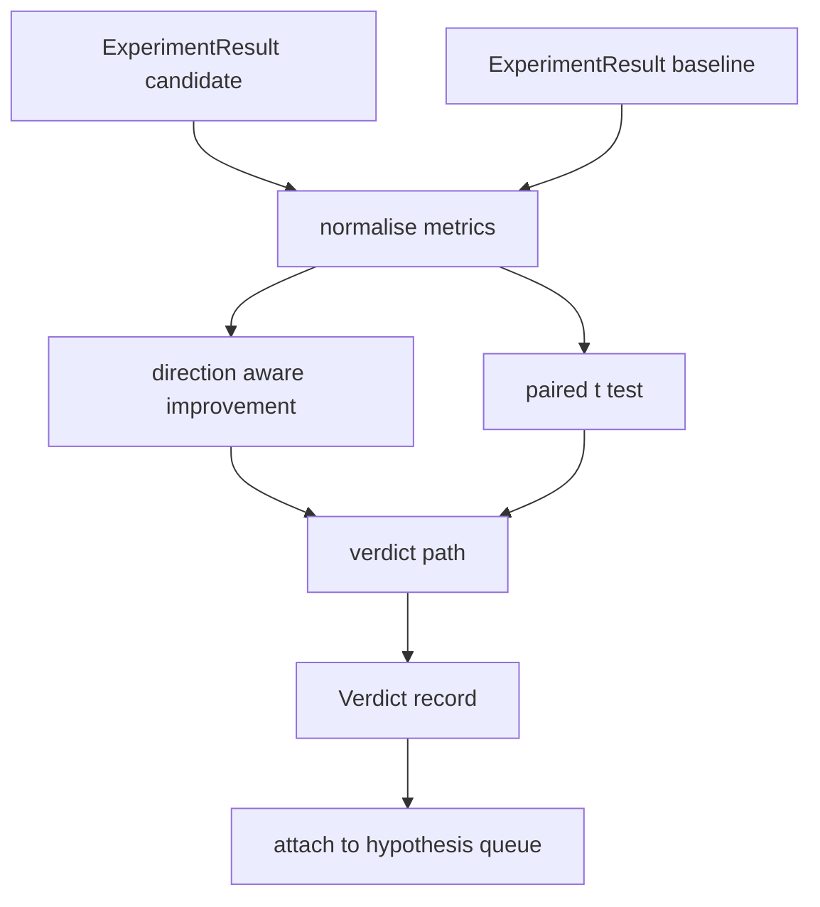

# 结果评估器

> المدير 產出数字──評估者 判断这些数字代表改进、退回,还是噪声──构建一条判决 路径,把 metrics 转换成一句结论──

**Type:** Build
**Languages:** Python
**Prerequisites:** Phase 19 Track A lessons 20-29
**Time:** ~90 minutes

## أهداف التعلم
- استخدامات التوجيهات والحد الثابتة، سيتم إجراء المرشحين في الجولة مع خط الأساس
- من رأس في كل بذرة من المقاييس فوق النشاط المزدوج اختبار،并读取得到 p قيمة
- لتحقيق المقاييس المقياسية في السجلات، قم بتطبيعها، دعم تقرير التسجيل يمكنك دمجها مع المقاييس الخطية.
- أخرج حكم كل فرضية، دع الموسيقي يضيفها إلى صف الـ50
- دع كل خطوة تبقى نقية، حتى نفس الإدخال دائما تصل إلى نفس الحكم.

## لماذا اختبار مزدوج

لا يمكن للمرّك ٍ واحد من الأرقام المقدمة أن يوضح ما إذا كان التغيير حقيقيّاً.

هذا هو الاختبار`scipy.stats`الرياضيات صغيرة جداً، ويمكنك أن تقرأها

```text
diffs    = [a_i - b_i for i in seeds]
mean     = sum(diffs) / n
variance = sum((d - mean) ** 2 for d in diffs) / (n - 1)
t_stat   = mean / sqrt(variance / n)
df       = n - 1
p_value  = two_sided_p(t_stat, df)
```

استخدام وظيفة بيتا غير كاملة منتظمة.

## تحسينات في الإرشاد

بعض المقاييس 变大时表示改进(دقة  throughput) 其他变小时表示改进(خسارة غموض  وقت الجدار) `direction`字段。

```text
if direction == "higher_is_better":
    improvement = (candidate - baseline) / abs(baseline)
elif direction == "lower_is_better":
    improvement = (baseline - candidate) / abs(baseline)
```

التحسن هو هناك علامات. للماقدمة أعلى هو أفضل المقاييس.

عتبة ثابتة`improvement_threshold=0.02`،百分之二) يقرر ما إذا كان التغير كبير بما فيه الكفاية، يمكن أن يُعطى حكم.


```figure
cg-paired-verdict
```

## الهندسة المعمارية



المقيّم 运行三个独立计算, و في الحكم 路径中把它们合并──每个计算都是没有共享状态的纯函数──

## تطبيع السجلات

الارتباك بالمقارنة مع الخسارة هي علاقة مؤشرية. الخسارة  تقلص 0.1 سوف تجعل الارتباك ينخفض كثيرا.

本课会对`scale`字段为 `"log"`أي مقياس في الحساب التحسينات السابقة الحصول على السجل الطبيعي. العدالة. ثم سوف تكون في الفضاء السجل. التطبيقات.`log(28) - log(32) = -0.133`، بعيد عن عتبة المئة الثانية

```text
if scale == "log":
    a = log(candidate)
    b = log(baseline)
else:
    a = candidate
    b = baseline
```

`scale="linear"`(默认) من المقاييس سوف يقفز هذا التحول.

## اختبار الزوجات لكل بذرة

第五十二课的跑者会为每次跑 输出一个最终 metrics blob――对于对测试,评估者 需要候选人 每种子 一种子,基线 每种子 一种子――乐团员会在一组种子上用两个配置运行同样实验,然后把两组`ExperimentResult`السجلات 交给评估者──

المقيّم 按种子 配对 种子 位于 `result.metrics["seed"]`إذا كانت البذور في المجموعتين لا تتطابقان ، فإن المقيّم سوف يرمي`PairingError`. . يجب أن يعيد تشغيلها

## شكل الحكم

```text
Verdict
  hypothesis_id          : int
  metric                 : str
  direction              : "higher_is_better" | "lower_is_better"
  scale                  : "linear" | "log"
  candidate_mean         : float
  baseline_mean          : float
  improvement            : float       (signed, fraction; see direction rules)
  p_value                : float | None  (None if n < 2)
  significance_threshold : float
  improvement_threshold  : float
  verdict                : "improved" | "regressed" | "noise" | "failed"
  rationale              : str
```

القرار 路径 هو جدول القرارات:

```text
1. If any candidate result has terminal != "ok": verdict = "failed"
2. else if |improvement| < improvement_threshold:  verdict = "noise"
3. else if p_value is None or p_value > significance: verdict = "noise"
4. else if improvement > 0:                          verdict = "improved"
5. else:                                             verdict = "regressed"
```

العقل هو جملة يمكن القراءة من قبل الإنسان، يمكن للمؤلف أن يضعها على أساس فرضية

## كيفية قراءة الرمز

`code/main.py`تعريف`MetricSpec`.`Verdict`.`Evaluator`、t إحصائيات 和 غير كاملة مساعدات بيتا، فضلا عن اختبار ديموتيرمينيستيكا ‬‬‬‬‬‬‬‬‬‬‬‬‬‬‬‬‬‬‬‬‬‬‬‬‬‬‬‬‬‬‬‬‬‬‬‬‬‬‬‬‬‬‬‬‬‬‬‬‬‬‬‬‬‬‬‬‬‬‬‬‬‬‬‬‬‬‬‬‬‬‬‬‬‬‬‬‬‬‬‬‬‬‬‬‬‬‬‬‬‬‬‬‬‬‬‬‬‬‬‬‬‬‬‬‬‬‬‬‬‬‬‬‬‬‬‬‬‬‬‬‬‬‬‬‬‬‬‬‬‬‬‬‬‬‬‬‬‬‬‬‬‬‬‬‬‬‬‬‬‬‬‬‬‬‬‬‬‬‬‬‬‬‬‬‬‬‬‬‬‬‬‬‬‬‬‬‬‬‬‬‬‬‬‬‬‬‬‬‬‬‬‬‬‬‬‬‬‬‬‬‬‬‬‬‬‬‬‬‬‬‬‬‬‬‬‬‬‬‬‬‬‬‬‬‬‬‬‬‬‬‬‬‬‬‬‬‬‬‬‬‬‬‬‬‬‬‬‬‬‬‬‬‬‬‬‬‬‬‬‬‬‬‬‬‬‬‬‬‬‬‬‬‬‬‬‬‬‬‬‬‬‬‬‬‬‬‬‬‬‬‬‬‬‬‬‬‬‬‬‬‬‬‬‬‬‬‬‬‬‬‬‬‬‬‬‬‬‬‬‬‬‬‬‬‬‬‬‬‬‬‬‬‬‬‬‬‬‬‬‬‬‬‬‬‬‬‬‬‬‬‬‬‬‬‬‬‬‬‬‬‬‬‬‬‬‬‬‬‬‬‬‬‬‬‬‬‬‬‬‬‬‬‬‬‬‬‬‬‬‬‬‬‬‬‬‬‬‬‬‬‬‬‬‬‬‬‬‬‬‬‬‬‬‬‬‬‬‬‬‬‬‬‬‬‬‬‬‬‬‬‬‬‬‬‬‬‬‬‬‬‬‬‬‬‬‬‬‬‬‬‬‬‬‬‬‬‬‬‬‬‬‬‬‬‬‬‬‬‬‬‬‬‬‬‬‬‬‬‬

`code/tests/test_evaluator.py`تغطية أفضل 路径、退缩 路径、噪音 路径(小改进)、噪音 路径(低 n)、 فشل المحطة 路径、log 路径、与已知参考值对比的 t测试,以及对对错──

## حيث هذه الفتحات في

第五十二课产出了假设队列──第五十一课过掉文学已有定论的内容──第五十二课在多种种子上用候选人和基线 配置运行实验──第五十三课读取这些运行并写出判决──乐团主持者 把四人一起:

```text
for hypothesis in queue:
    literature = retrieval.search(hypothesis.text)
    if literature_settles(hypothesis, literature):
        attach(hypothesis, verdict="settled")
        continue
    candidates = runner.run_all(specs_for(hypothesis))
    baselines  = runner.run_all(baseline_specs_for(hypothesis))
    metric_spec = MetricSpec("perplexity", direction=LOWER, scale=LOG)
    verdict = evaluator.evaluate(hypothesis.id, metric_spec, candidates, baselines)
    attach(hypothesis, verdict)
```

هذا الموسيقي ليس في هذه الدورة، هذه الدورة تمر عبر فئات البيانات المحددة من قبلهم، لا تحتاج إلى أي ملصق إضافي.
