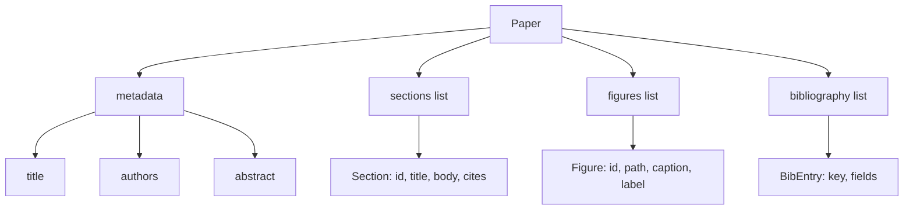
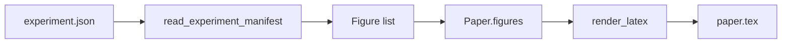
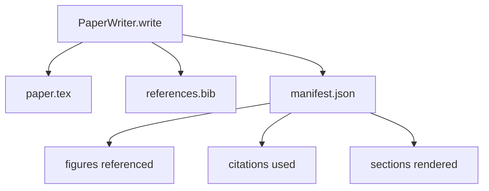

# 论文写作器

> العقد بين الباحث و المستخدم هو العقد. إذا تم تدمير العقد، فإن الوثيقة لن تتمكن من تجميعها، والفشل سيكون واضحا.

**Type:** Build
**Languages:** Python
**Prerequisites:** Phase 19 lessons 50-53
**Time:** ~90 minutes

## أهداف التعلم

- لن يكون ورقة البحث هي عبارة عن عبارة عن مخطط مهيكل لخط المقطع المعروف ، وليس وثيقة ذات شكل حر.
- قبل كتابة أي بروسة، إنشاء بيان تجريدي، أقسام، فتحات الأرقام و مفتاحات الكتابة.
- 通過 آلية فتحات تحديدية، سوف تخرج الخبرات ((مسارات و عنوانات) الأرقام داخل العظم
- إضافة إلى مولد النص المهزوم، فإنه من المخطط المهيكل ملء كل قسم، دع الحلوي يمكن أن تستخدم في حالة عدم وجود نموذج.
- 输出单个 `paper.tex`واحد`references.bib`, إضافة قائمة لكل رقم مرجع و كل مذكرة مستعملة


```figure
ch-paper-skeleton
```

## لماذا العظم أولاً

من النصوص  بداية مشروع 会积累结构债务──الاندراج 增长出三段本应放到相关作品的内容──某个数字 在定义之前就被引用──图书写 终于为同一篇论文产生三个钥匙──等作者注意到,重写成本 已经高于写成本──

العظام سوف تتحول إلى هذا النقطة. الهيكل أولاً باستخدام البيانات  صيغة الإعلانات. القسمات هي مع الأسماء و حوافز الترتيب. الأرقام هي مع أرقام و عنوانات.

هذا مع المرحلة السابقة من الدراسة تطبيق إلى الخطط، أدوات المكالمات و آثار التخصص العليا

## شكل الورق



كل حقل هو بيانات Python عادية.`Paper`إلى عمل نقي من سلسلة لاتكس. يمكن أن يتم في تقديم ورقة سابقة: أقسام إحصائية، قائمة ملفات الأرقام المفقودة، تحقق كل`\cite{key}`كل شيء متطابق`BibEntry`.

## عقد الإصدار

المُعَرِّف يُؤكدُ ثلاثة خصائصِ. أولاً، العظمِ في كل فتحةِ الرقمِ في وسطِهُمْ.`\begin{figure}`كتلة،并带有稳定标签,格式为 `fig:<id>`ثانياً، كل قسم يخرج واحد`\section{}`,并带有稳定标签,格式为 `sec:<id>`، مثل هذه المراجع المتقاطعة يمكن أن تعمل.`\bibliography`الكتلة`references.bib`精确包含 الورق 上声明的条目,不多也不少──

خلافاً لأي شيء، فهي خطأ، وليس تحذير. العظام هو العقد.

## حقن الرقم من التجارب

本 track 前面的课程把实验输出生成为 JSON manifestes──每个 manifest 携带一个文物列表,包含路径和简章──纸作家 读取该 manifest 并生成 `Figure`السجلات



الحقن هو تحديدية . . . . . . . . . . . . . . . . . . . . . . . . . . . . . . . . . . . . . . . . . . . . . . . . . . . . . . . . . . . . . . . . . . . . . . . . . . . . . . . . . . . . . . . . . . . . . . . . . . . . . . . . . . . . . . . . . . . . . . . . . . . . . . . . . . . . . . . . . . . . . . . . . . . . . . . . . . . . . . . . . . . . . . . . . . . . . . . . . . . . . . . . . . . . . . . . . . . . . . . . . . . . . . . . . . . . . . . . . . . . . . . . . . . . . . . . . . . . . . . . . . . . . . . . . . . . . . . . . . . . . . . . . . . . . . . . . . . . . . . . . . . . . . . . . . . . . . . . . . . . . . . . . . . . . . . . . . . . . . . . . . . . . . . . . . . . . . . . . . . . . . . . . . . . . . . . . . . . . . . . . . . . . . . . . . . . . . . . . . . . . . . . . . . . . . . . . . . . . . . . . . . . . . . . . . . . . . . . . . . . . . . . . . . . . . . . . . . . . . . . . . . . . . . . . . . . . . . . . . . . . . . . . . . . . . . . . . . . . . . . . . . . . . . . . . . . . . . . . . . . . . . .

## مولد النص المهزوم

هذا الدرس لن يستخدم النموذج`MockProseGenerator`读取 رسم الخط،并 deterministic 地输出散文── رسم الخط هو كل قسم 一条短字符串──生成器 会把这个字符串扩展成两个短段落,并把部分标题 编织进去──生成的散文 只会在概要 声明时名字-滴数字 和引用──

هذا يكفي لتجربة كل سلوك من كاتب. الواقع تحقيق سوف تغيير المولد إلى النموذج. دعوة. الحلويات المحيطة بها لا تحتاج إلى تغيير.

## الخروج المبين

كاتب 会向输出目录 输出三个文件。



يُمكن أن يُظهر هذا المظهر كدخل، ويُولد قائمة ردود الفعل. هذا هو السبب في أن المظهر هو جزء من العقد، بينما لا يُظهر في المقطع.

## بوابات التحقق من المصادقة

كاتب في كتابة أي ملف قبل أن تعمل أربعة بوابات

1. في كل ورقة من هذه الأرقام هو واحد
2. كل قسم من`cites`字段引用的图书馆关键都已在纸上声明──
3. لا يوجد شيء
4. عنوان غير空。

بوابة الفشل ستخرج`PaperValidationError`،并给出精确原因. . . . . . . . . . . . . . . . . . . . . . . . . . . . . . . . . . . . . . . . . . . . . . . . . . . . . . . . . . . . . . . . . . . . . . . . . . . . . . . . . . . . . . . . . . . . . . . . . . . . . . . . . . . . . . . . . . . . . . . . . . . . . . . . . . . . . . . . . . . . . . . . . . . . . . . . . . . . . . . . . . . . . . . . . . . . . . . . . . . . . . . . . . . . . . . . . . . . . . . . . . . . . . . . . . . . . . . . . . . . . . . . . . . . . . . . . . . . . . . . . . . . . . . . . . . . . . . . . . . . . . . . . . . . . . . . . . . . . . . . . . . . . . . . . . . . . . . . . . . . . . . . . . . . . . . . . . . . . . . . . . . . . . . . . . . . . . . . . . . . . . . . . . . . . . . . . . . . . . . . . . . . . . . . . . . . . . . . . . . . . . . . . . . . . . . . . . . . . . . . . . . . . . . . . . . . . . . . . . . . . . . . . . . . . . . . . . . . . . . . . . . . . . . . . . . . . . . . . . . . . . . . . . . . . . . . . . . . . . . . . . . . . . . . . . . . . . . . . . . . . . .

## كيفية قراءة الرمز

`code/main.py`تعريف`Paper`.`Section`.`Figure`.`BibEntry`.`PaperValidationError`.`MockProseGenerator`.`PaperWriter`، وواحد`render_latex`وظيفة`write`طريقة 接收 الإصدار الإداري،并输出 `paper.tex`.`references.bib`和 `manifest.json`.`read_experiment_manifest`المساعد 会将 تجربة يظهر قائمة 转换为 `Figure`السجلات

`code/tests/test_paper_writer.py`تغطية: لا قسم 时的骨格 render、带两个部分 和两个数字的完整 render、missing-citation gate、duplicate-figure-id gate、manifest content,以及 LaTeX-string contract(كل قسم 输出一个 `\section{}`، كل رقم 输出 واحد `\begin{figure}`(‬)

## الذهاب إلى أبعد

حقاً سوف تحتاج إلى إضافة اثنين.`Paper`يمكن تجميع الشكل لتدوين المقالة، وكذلك المشاهدة المسبقة المستخدمة في HTML.`Paper`استراتيجية 上的战略──二, إثراء الاقتباسات:给定本地 DOI cache,writer from the quote key 获取 BibTeX entries── كل منهما له قيمة,也可以在不触摸骨架合同的情况下添加──

العظام هو هذا التالي: الإشارة إلى القسمات والأرقام والإقتباسات على البيانات والإعلانات، والنطق النصي إلى الفواح، والإبداع مع لا تيكس على الانخراط.
