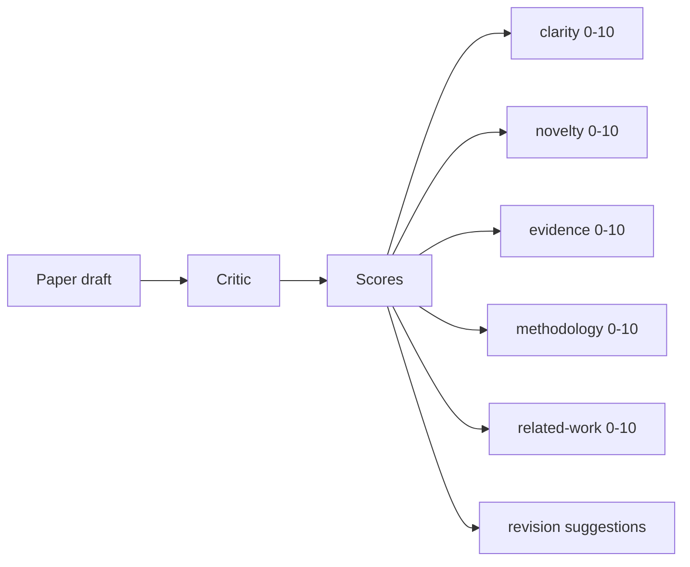
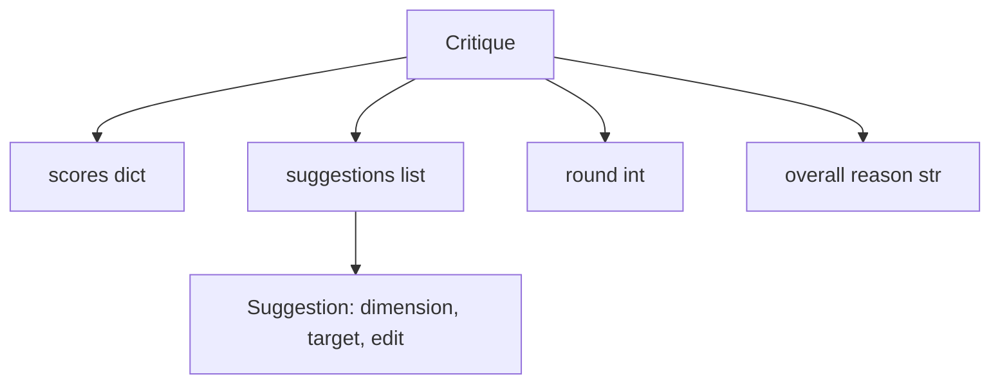
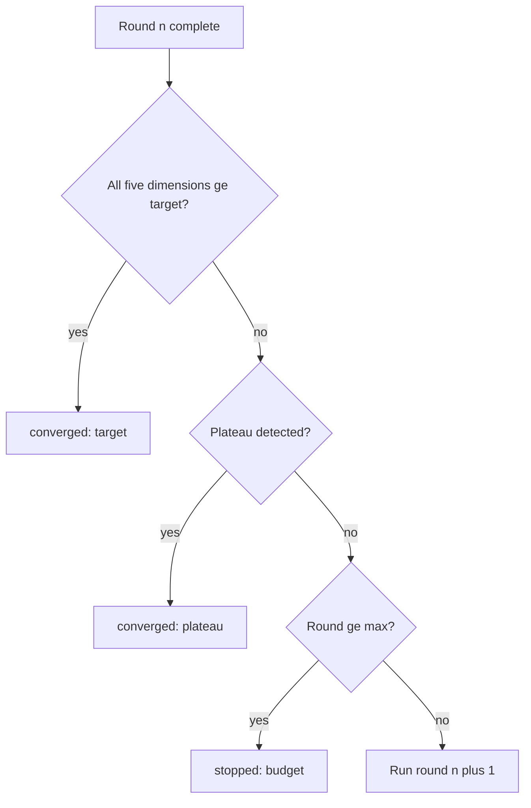
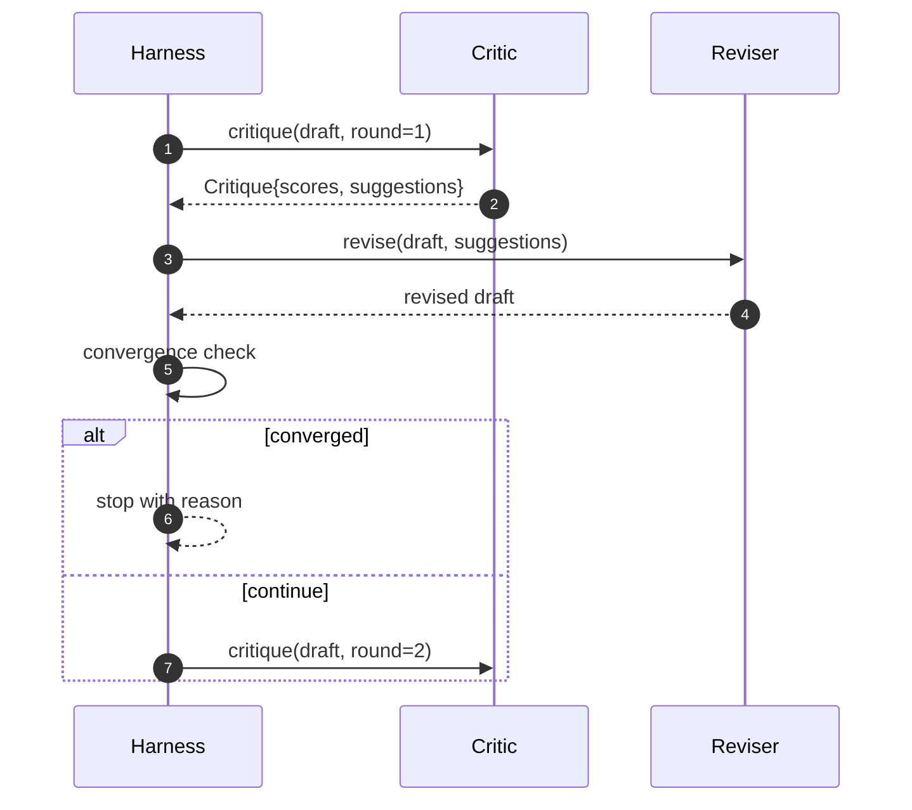

# حلقة النقد

> أول مرة على العودة إلى "يبدو جيدا" النقاد هو خراب  دائما على العودة إلى "حاجات العمل" النقاد هو أيضا خراب  المنتقد المقصود هو من سوف يحصل، وأنت يجب أن تكون مُهَجَّرًا لتحقيق هذا الإستجابة 

**Type:** Build
**Languages:** Python
**Prerequisites:** Phase 19 lessons 50-53
**Time:** ~90 minutes

## أهداف التعلم


```figure
ch-critic-converge
```

- 按五个固定维度为论文草稿打分:وضوحة،جديد،دليل،طريقة العمل،عمل ذي صلة
- تطبيق كل دورة من النقد على إعادة كتابة إصلاحات هيكلية مختلفة، بدلاً من إعادة كتابة في شكل حر.
-                                                                                                                                                                                                                                                               
- استخدام أقصى إطلاع  ميزانية الحد من عدد الجولات، تجنب عدم استقبال النقاد 永远运行。
- 输出轮到轮,让仪表板或下一阶段可以染分数轨迹──

## لماذا تستخدم خمسة مستوى ثابتة

النقد الحر هو نموذج للرد على المقالة. الجولة التالية من المراجعة سوف تعتبر هذه المقالة على البيئة.

خمسة أبعاد أعطني القناع



النسبة هي متجهة. الحشد سوف يلاحظ كل درجة من التغيرات في الدورات المتعددة. تحسين من وضوح ولكن دع الأدلة كبيرة الانخفاض من مراجعة، هو دليل الرجعة العليا، تحقق التقارب سوف ترى ذلك. فقط من خلال النموذج النقدي لا يمكن تقديم هذا اليقين.

## النقد 结构



كل اقتراح يحمل تحسينات في الدرجة والقسم المستهدف، وكذلك المراجعة يمكن تطبيقها`edit`التعليم. المراجع هو أيضا قابلة للدعوة. هذا الصف يوفر مراجعة تحديد، وهو يعد التعليم لتفسير المرفق إلى المقطع.

## قواعد التقارب، حسب ترتيب تنفيذ

حلقة النقدي سوف تكون في أي من الشروط الثلاثة



الهدف هو الحالة الأكثر صرامة: كل من خمسة أبعاد (الوضوح والابتكار والأدلة والأسلوب والعمل المتعلق) يجب أن تتم تحقيقها`>= target_score`(默认 `8.0`),الدورة 才会回归成功── متوسط القيمة عالية جدا ولكن هناك درجة ضعيفة لا تكفي──`plateau_epsilon`(默认 `0.1`- ، حلقة`plateau`الميزانية هي الحد الأقصى للجولة`5`),并以 `budget`إبتعد

順序很重要──目標 优先高原,高原 优先预算──如果第三轮在同一时间代中既达到目标又会触发高原,结果是`target`، ليس`plateau`.

## لماذا اكتشاف المرتفعات عبر دو轮运行

المنحدر الواحد هو الضجيج‬‬‬‬‬‬‬‬‬‬‬‬‬‬‬‬‬‬‬‬‬‬‬‬‬‬‬‬‬‬‬‬‬‬‬‬‬‬‬‬‬‬‬‬‬‬‬‬‬‬‬‬‬‬‬‬‬‬‬‬‬‬‬‬‬‬‬‬‬‬‬‬‬‬‬‬‬‬‬‬‬‬‬‬‬‬‬‬‬‬‬‬‬‬‬‬‬‬‬‬‬‬‬‬‬‬‬‬‬‬‬‬‬‬‬‬‬‬‬‬‬‬‬‬‬‬‬‬‬‬‬‬‬‬‬‬‬‬‬‬‬‬‬‬‬‬‬‬‬‬‬‬‬‬‬‬‬‬‬‬‬‬‬‬‬‬‬‬‬‬‬‬‬‬‬‬‬‬‬‬‬‬‬‬‬‬‬‬‬‬‬‬‬‬‬‬‬‬‬‬‬‬‬‬‬‬‬‬‬‬‬‬‬‬‬‬‬‬‬‬‬‬‬‬‬‬‬‬‬‬‬‬‬‬‬‬‬‬‬‬‬‬‬‬‬‬‬‬‬‬‬‬‬‬‬‬‬‬‬‬‬‬‬‬‬‬‬‬‬‬‬‬‬‬‬‬‬‬‬‬‬‬‬‬‬‬‬‬‬‬‬‬‬‬‬‬‬‬‬‬‬‬‬‬‬‬‬‬‬‬‬‬‬‬‬‬‬‬‬‬‬‬‬‬‬‬‬‬‬‬‬‬‬‬‬‬‬‬‬‬‬‬‬‬‬‬‬‬‬‬‬‬‬‬‬‬‬‬‬‬‬‬‬‬‬‬‬‬‬‬‬‬‬‬‬‬‬‬‬‬‬‬‬‬‬‬‬‬‬‬‬‬‬‬‬‬‬‬‬‬‬‬‬‬‬‬‬‬‬‬‬‬‬‬‬‬‬‬‬‬‬‬‬‬‬‬‬‬‬‬‬‬‬‬‬‬‬‬‬‬‬‬‬‬‬‬‬‬‬‬‬‬‬‬‬‬‬‬‬‬‬‬‬‬‬‬‬‬‬‬‬‬‬‬‬‬‬‬‬‬‬‬‬‬‬‬‬‬‬‬‬‬‬‬‬‬‬

## في هذا الصف نقاد

本课不调用模型── المقدمة النقد هو واحد قابلة للدعوة، وسوف تستند إلى ثلاثة إشارات إلى مشروع 打分: متوسط القسم 正文长度(وضوح) 、عدد الأرقام 和 عدد الاقتباسات(الدليل) ، فضلا عن بيانات الورقية 上的`originality_tag`字段(خبرة) ――مراجعة 知道如何把每个分数向上推──

```text
clarity      在平均 section 正文长度增加时增长
novelty      在 originality_tag 设置为 "high" 时增长
evidence     在某个 section 的 figure_refs 非空时增长
methodology  在存在标题为 "Method" 且有正文的 section 时增长
related-work 在存在标题为 "Related Work" 且有正文的 section 时增长
```

بعد الجولة الأولى، يمكن ملاحظة ارتفاع النسبة المحددة.

## 完整循环 契约



الاستعمال  امتلاك العداد الجردي  تتبع و التقارير  المراقبة  النقد  امتلاك النتيجة  المراجعة  امتلاك اختلاف 

## التتبع 输出

كل دورة ستخرج حدثًا متبقيًا ، يحتوي على عدد مستديرة ، عدد النقاط المتبقي ، عدد الاقتراحات ، وحكم التقارب.

## 防止坏批评的预算

من المنتقدين الذين لا يستطيعون إصدار اقتراحات لا تزيد من عدد النقاط، سوف يضعون الحلقة مقفلة إلى أقصى حد للتطابق.`budget` يقرأ المستخدم ذلك كخطأ نقدي، وليس خطأ مشروع. البديل هو فقط الكشف عن مسودة نهائية، ولكن هذا سوف يخفي التشخيص.

## كيف تقرأ ؟

`code/main.py`تعريف`Critique`.`Suggestion`.`Critic`البروتوكول`Reviser`البروتوكول`CriticLoop`، وواحد`make_deterministic_critic_pair`المصنع، فإنه سوف يعود إلى المنتقدة والمتطابقة المراجعة.`Paper`结构,让本课可以独立运行.

`code/tests/test_critic_loop.py`تغطية: الأول من الجولة الأخيرة التغييرات المتغيرة، المخطط المنسق فوق التقارب المستهدف، وارتفاع المرحلة الأخيرة للكشف عن المرحلة المتدنية، لا يوجد اقتراح يمكن تحسينه، استنفاد الميزانية، والمراجعة لتطبيق الاقتراح، وكذلك التركيبات.

##  المزيد من البحث

1- الوزن الابعالي: ورشة العمل 论文会更重视新品而不是方法; جريدة 则相反――تحقق التكافؤ سوف يصبح متوسط الوزن  الثاني ، النقاد المزدوج: منتقد 负责打分, الثاني منتقد في مراجعة 看到建议 之前做出裁决`Critique`على الهيكل

关键注是分数向量──一旦 النقد تم تصميمه، كل التحسينات الأخرى، قاعدة التقارب، لوحة المعلومات، النقد المزدوج، يمكن أن يتم إدخالها في حالة لا تغير الحلقة──
