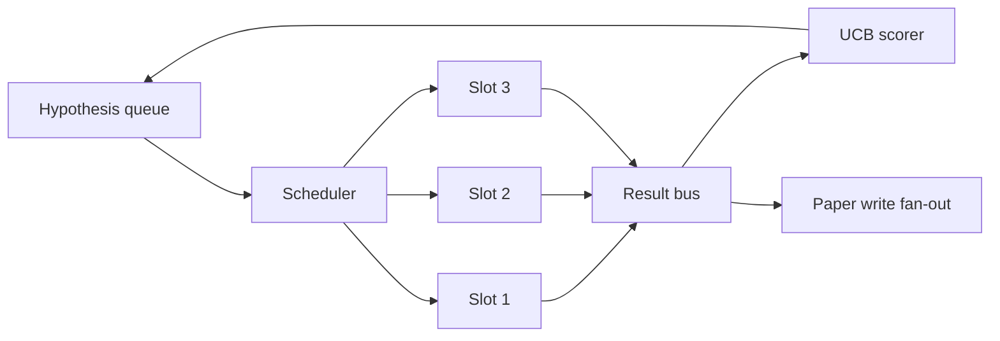
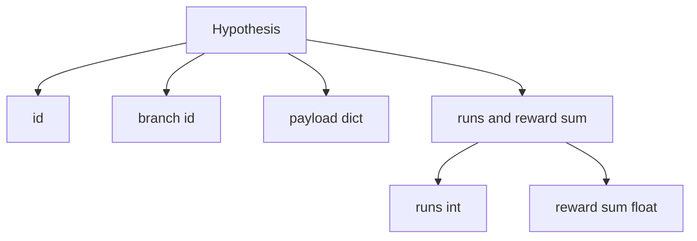
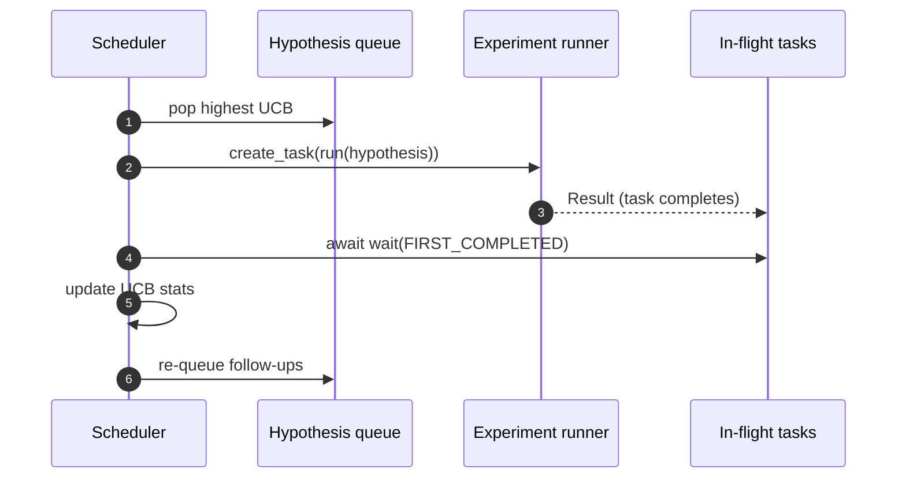

# المخطط التكراري

> لا يوجد حلقة بحثية بدون خريط المواعيد، إنها قطار مع وهم.

**Type:** Build
**Languages:** Python
**Prerequisites:** Phase 19 lessons 50-53
**Time:** ~90 minutes

## أهداف التعلم


```figure
ch-ucb-scheduler
```

- لنقوم بتحقيق تدفق العمل على طابور فرضية، فإنه سوف يمنحنا أماكن تجريبية، والنتيجة ستعود إلى المُعَبِّر.
- وذلك ليس من أجل أن تقوم بتجربة متعددة، ويمكن للمخطط أن يبقي كل المواقع مشغولة
- باستخدام UCB لكل فرع فرضية 打分، دع المخطط يمكن أن يكون في حالة لا تتخلّى عن الاستكشاف
- سوف تنتشر النتائج المكتملة إلى مرحلة الكتابة الورقية و مرحلة التسلسل، فجعلها تنتج فروع وتنتج فرضيات متابعة
- 暴露逐代代,包含分分、占用和剪裁决定

## لماذا هو الجدول، وليس قائمة العمل

平 قائمة العمل سوف يتم تقديمها حسب الترتيب وتشغيل الوظائف. عندما يكون كل عمل مستقل، فليس هناك مشكلة. البحث ليس مستقلًا: نتائج التجربة الثلاثة ستغير التجربة الأربعة والخمسة من الأولويات.

有意思的设计选择是得分规则──贪心得分者总是选择当前领导,永远不探索──平均得分者永远不利用──UCB(上层信心限) 是中间路径:利用领导,同时为尝试较少的分支保留容量──

## 系统结构



صف  حفظ الفرضيات── المجدد في فتحة  الإطلاق  اختيار أفضل فرضات UCB‬ كل فتحة  مختلفة مرحلة تشغيل تجربة‬ التجارب المكتملة سوف تحويل النتيجة إلى حافلة 上。 الحافلة سوف تحديث مصدر إحصاءات UCB فوق الفرع، وفي فرع واحد عوائد  عبور العدالة  وقت الترويج إلى مرحلة الكتابة الورقية‬‬‬‬‬‬‬‬‬‬‬‬‬‬‬‬‬‬‬‬‬‬‬‬‬‬‬‬‬‬‬‬‬‬‬‬‬‬‬‬‬‬‬‬‬‬‬‬‬‬‬‬‬‬‬‬‬‬‬‬‬‬‬‬‬‬‬‬‬‬‬‬‬‬‬‬‬‬‬‬‬‬‬‬‬‬‬‬‬‬‬‬‬‬‬‬‬‬‬‬‬‬‬‬‬‬‬‬‬‬‬‬‬‬‬‬‬‬‬‬‬‬‬‬‬‬‬‬‬‬‬‬‬‬‬‬‬‬‬‬‬‬‬‬‬‬‬‬‬‬‬‬‬‬‬‬‬‬‬‬‬‬‬‬‬‬‬‬‬‬‬‬‬‬‬‬‬‬‬‬‬‬‬‬‬‬‬‬‬‬‬‬‬‬‬‬‬‬‬‬‬‬‬‬‬‬‬‬‬‬‬‬‬‬‬‬‬‬‬‬‬‬‬‬‬‬‬‬‬‬‬‬‬‬‬‬‬‬‬‬‬‬‬‬‬‬‬‬‬‬‬‬‬‬‬‬‬‬‬‬‬‬‬‬‬‬‬‬‬‬‬‬‬‬‬‬‬‬‬‬‬‬‬‬‬‬‬‬‬‬‬‬‬‬‬‬‬‬‬‬‬‬‬‬‬‬‬‬‬‬‬‬‬‬‬‬‬‬‬‬‬‬‬‬‬‬‬‬‬‬‬‬‬‬‬‬‬‬‬‬‬‬‬‬‬‬‬‬‬‬‬‬‬‬‬‬‬‬‬‬‬‬‬‬‬‬‬‬‬‬‬‬‬‬‬‬‬‬‬‬‬‬‬‬‬‬‬‬‬‬‬‬‬‬‬‬‬‬‬‬‬‬‬‬‬‬‬‬‬‬

## الفرضية 结构



`branch`هي مفتاح إحصاءات UCB. العديد من الفرضيات يمكن أن تشارك فرع واحد.`runs`هو عدد التجارب التي تم الانتهاء من هذا الفروع`reward_sum`هو مكافأة تجميعية.

## تسجيلات UCB

本课使用的 UCB公式是经典 UCB1──

```math
\text{ucb}(\text{branch}) = \text{mean\_reward}(\text{branch}) + c \sqrt{ \frac{\ln(\text{total\_runs})}{\text{runs}(\text{branch})} }
```

`total_runs`هو كل الفروع 上已完成的实验的总数──`c`هو وزن الاستكشاف ؛ 本课默认值为 `sqrt(2)`◊ يدير 为零 من الفرع سوف تحصل `+inf`، لذلك لم تحاول الفرع 总是先被调调度── متوسط الجائزة فرع عالي سوف تبقى عالية النتيجة ، حتى الفرع الأخرى 追上؛ تعمل مرات كثيرة ولكن الجائزة فرع لا عالية سوف يتم تشغيل عدد أقل من البدائل 超过──

بوابة القصص مع المختار تمزقها`prune_after_runs`التجارب التالية`3`) بعد متوسط المكافأة 低于绝对 floor`0.2`) ، عندما ، الحصص سوف تحويل هذا الفرع من الموعد المستقبلي إلى التحويل.

## استخدام أوسينشيو

المخطط استخدام `asyncio.create_task`驱动实验──每个任务 运行实验运行`async def`(مُستدعي) ،并返回一个 `Result` الحلقة الرئيسية استخدام `asyncio.wait(..., return_when=asyncio.FIRST_COMPLETED)`إنتظروا مهام الطيران و تجمعوا و تحديثوا درجاتهم في كل مرة يتم فيها



ثلاث فتحات و أطلق تشغيلها. الحلقة الرئيسية لا تعيق أبدا في تجربة واحدة.

## التشغيل: محفزات الورق

عندما يكون أحد الفروع متوسط المكافأة`paper_threshold`(默认 `0.7`), وذلك الفرع  لم يظهر على الورق  , المخطط سوف يضع واحد `paper.trigger`المُعجبين بالحدث إلى قائمة الإخراجات.

## التوسع: فرضيات متابعة

عندما يصل النتيجة المرتفعة، يمكن للمخطط أن يستخدم المستخدم المقدمة`expander`في نفس الفروع، وخلق واحد أو أكثر من الفرضيات المتابعة.`Result`إلى`list[Hypothesis]`يقدم هذا الدروس مكاسبًا محددة، ويتم إعطاء أي مكافأة تتجاوز عتبة الورق.

## الميزانيات

الميزانيات ستحمي المخططات لتجنب الحلقات الهربية

```text
max_experiments    : 跨所有 branches 运行的 experiments 总数
max_seconds        : wall-clock cap (asyncio time)
```

عندما يبدأ أي شيء، سوف يتوقف المخطط عن ضبط المهام الجديدة، ينتظر المهام في الطائرة  اكتمال،并返回 التتبع النهائي.`stop_reason`.

## التتبع والرأي النهائي

كل قرار في الجدول التجاري ((اختيار، إرسال، نتيجة، التمرير، المروحة)) سيتم إصدار تقرير حدثي.

## كيف تقرأ ؟

`code/main.py`تعريف`Hypothesis`.`Result`.`BranchStats`.`IterationScheduler`، وواحد`make_deterministic_runner`المصنع، سوف يعود مع مكافآت يمكن التنبؤ بها من الجاري تجربة غير متوافقة. الجاري سوف ينام ثابت.`delay_ms`(默认 `5ms`),让同步可观察──

`code/tests/test_scheduler.py`覆盖:UCB 优先选择未尝试分支、

##  المزيد من البحث

الواقع يحتاج إلى ثلاثة توسعات. أولا، عبر الجلسات من إحصاءات UCB: الحسابات الحالية 存在内存里; المخطط الحقيقي 会 checkpoint 它们,让重启保留已经花掉的探索预算.

المجدول هو مكان البحث 超越工作清单的地方── بمجرد أن يتوفر UCB 接好、 slots و يذهب إلى العمل، يمكن أن يتم إضافة كل التحسينات الأخرى فوقها──
