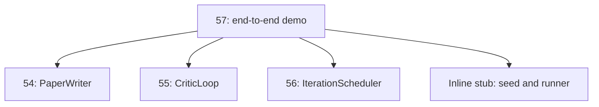
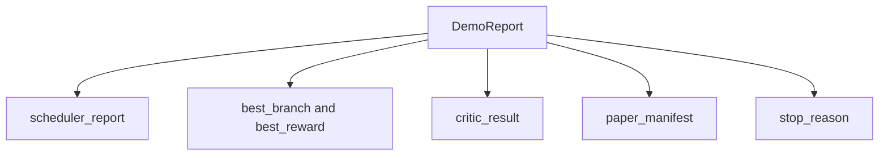

# اختتام إلى نهاية دراسة الادموكاتيكية

> الديمو هو المكان الذي يجب أن يتم جمع كل عقد كتبته من قبل.

**Type:** Build
**Languages:** Python
**Prerequisites:** Phase 19 lessons 50-53
**Time:** ~90 minutes

## أهداف التعلم


```figure
ch-research-pipeline
```

-                                                                                                                                                                                                                                                               
- 通過普通 Python واردات 组合前四节 Track D  درجة البدائية، وليس من خلال الإطار.
- حلقة التشغيل حتى نهاية الذاتية، ومصدر قائمة لكل مرحلة
- 保持 ديمو تحديدية، جعل مجموعة الاختبار يمكن أن يقرر النهائي
- عندما أي مرحلة من العقود تدمير، وتعرض واضحة وضع الفشل، وتجنب المرحلة التالية استخدام الخسارة المدخل  مواصلة التشغيل

## ماذا يوجد هنا؟


ست مراحل. البذور هي قائمة من ثلاثة فرضيات. المخطط باستخدام ثلاث فتحات متوازية بينها. تنفيذ ست تجارب.

## لماذا الاستيراد بدلا من النسخة

كل فصل من المرحلة السابقة سوف يتم تسليمها مع وجود المعلومات العامة و الدورات`main.py`✿ التجربة                                                                                                                                                                                                                                                                                                                                                                                                                                                                                                                        `sys.path`إلى كل فصل من الكتيبات الأبدية لتستوردهم. هذا ليس التشبيع الإطارية. انها مع الملفات الاختبارية في الدورة السابقة.



المواد المترتبة على الوصول إلى الدرجة 53: مولد فرضيات البذور الصغيرة و وظيفة مكافأة متزامنة. المستخدمين يمكن أن تمر من خلال ضبط اثنين من الواردات، وسوف تبدل المواد المترتبة على الوصول إلى تلك المواد البدائية الحقيقية في الدورة.

## التحرر 保证

في المقام الأول، كان هناك إعدادات من المخططات المختلفة، والتي تتمثل في إعدادات المخططات المختلفة، والتي تتمثل في إعدادات المخططات المختلفة.

给定相同种子,Demo 会输出相同报告――测试 通过运行Demo 两次并比较显现 来断这一属性――

## وضع تقرير الاكتشاف



كل حقل يأتي من مرحلة الصعود.

## وضع الفشل 处理

كل مرحلة يجب أن تنجح، يجب أن يرفع خطأ في النص

```text
Scheduler ........ returns SchedulerReport with stop_reason
                   in {queue_empty, max_experiments, deadline}
Best-result pick . raises NoTriggerError if no paper trigger fired
Critic loop ...... returns LoopResult with status converged or stopped
Paper writer ..... raises PaperValidationError on contract break
```

فشل أي مرحلة مدينة مع طباعة استثناء الدائرة القصيرة التجربة التجربة`test_no_triggers_raises_typed_error`和 `test_best_picker_raises_when_no_triggers`عندما لا يوجد فرع يطلق الزناد ويقوم الاختيار`NoTriggerError`- لا ، لا`BestResultError`و الكاتب لن يتم استخدامه أبداً

## أفضل نتيجة

المخطط 会按分支 输出纸引发器──picker 选择所有引发器 中中平均奖励最高的分支──ties 按分支 id的字母顺序打破,使Demo deterministic──picker 是一个小型纯函数;test 使用固定的时间表报告 固定它的行为──

## 串接 حلقة النقد

第 55 课中的批判循环 作用于`MiniPaper`✿ تمثيل                                                                                                                                                                                                                                                                                                                                                                                                                                                                                                                         `MiniPaper`: استخدام اسم الفرع ملء ملخص،بذرة دو أقسام  مقدمة ونتائج) ،并根据 الفرع متوسط مكافأة 设置 `originality_tag`(إذا `>= 0.8`لأعلى، إذا `>= 0.6`لـ متوسط، وإلا لـ منخفض)

بعد ذلك المراجع سوف يخطط 代到 التقارب.

## صناع ورق

المادة 54   作用 على تضمين الأرقام و كتابة الكتابة كاملة `Paper`الشكل:`mini_to_full_paper`升级 متقاربة `MiniPaper`، فإنه سوف يضيف لفرع مختارة  إضافة شخصية، وفقا للمنتقد  توصية مفاتيح الاقتباس  المجموعة بناء كتابة صناعية صغيرة.

## كيف تقرأ ؟

`code/main.py`تعريف`BestResultError`.`NoTriggerError`.`DemoReport`.`pick_best_branch`.`build_mini_paper`.`mini_to_full_paper`和 `run_demo` أعلى مستوى من الواردات سيتم تعديلها مرة واحدة`sys.path`, و أخذها من دروسهم`PaperWriter`.`CriticLoop`和 `IterationScheduler`.

`code/tests/test_e2e.py`覆盖:Demo 端到端运行并输出一个五个字段 全部填充的报告;两次运行之间的确定性;没有分支 过了门 时的NoTriggerError;作者合同 破坏时的 PaperValidationError;纸质表包含选定的分支的数字;以及安排器停止原因是预期值之一――

## واصل توسيع

عندما يغير التجربة الخضراء بعد ذلك، هناك ثلاثة قيمة للاشتراك في التوسع. أولا، حالة ثابتة: النتيجة لكل مرحلة كتب إلى مخزن JSON صغير، حتى إعادة تشغيل يمكن عدم إعادة تشغيل في مراحل رخيصة.

مهمة التجربة هي إثبات التركيب هو الهندسة المعمارية.
