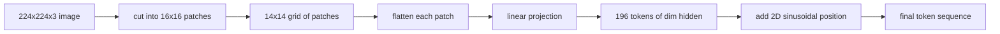

# 视觉编码器 معطفات

> 读取像素的视觉模型需要像素分词器──补丁嵌入就是那个分词器──将图像切割成正方形网格,展平每正方形,投影到线性层,然后添加2D 位置信号,以便Transformer知道每正方形在原始图像中的位置──

**Type:** Build
**Languages:** Python
**Prerequisites:** 第19期第30-37课（B轨基础）
**Time:** ~90 分钟

## 學习目标

- تحويل الصورة إلى سلسلة إضافة ذات طول ثابت
- 实现 على أساس `Conv2d`الصورة المتحركة، والصورة المتحركة مع المتحركة ثم التوافق الرياضي.
- 构建确定性 2D 正弦位置嵌入,以便token顺序编码空间位置──
- 验证 تركيب الوصول فوق اللصقة عدد`Conv2d`/展开等效性

## 问题

المحول قبل سلسلة من الجهازات. الصورة هي 3通道网格. ستؤدي كل صورة كرقم إلى قراءة الجهازات إلى ارتفاع طول الجهازات. 224x224 RGB 图像 هي 150,528 个 Token, هذا هو 12 مستوى.

补丁嵌入通过线性投影解决这个问题──将224x224 图像切割成16x16块会生成包含196块的14x14网格──每个补丁都从`(3, 16, 16) = 768`像素值展平为一个向量,然后线性层将其映射到模型的隐藏维度──变形器 见 196 维度为`hidden`رمز (عادة تصل إلى 768) بالإضافة إلى رمز CLS.

## 概念



### لماذا هو إصلاح، وليس تصميم

الانتباه هو الرفع الثاني لعدد المسلسلات. 196 رمز من المسلسلات لكل طبقة في كل رأس.`196 * 196 = 38,416`                                                                                                                                                                                                                                                              `150,528 * 150,528 = 22.6 billion` يمكن أن يقلل الإضافات من حجم حساب الاهتمام بنسبة 590,000 مرة ، ويمكن للمنطقة الواحدة 16 × 16 أن تحمل إشارة كافية لتنفيذ مهام الرؤية المتقدمة.

### لماذا الإشارة الإلكترونية كافية

كل إصلاح يعتبر كقطعة مستقلة.`768 * 768 = 589,824`参数) و التدريب السرعة سريعة جدا. هناك المزيد من الكولومات الدقيقة. ولكن الصور الخطية المُسطحة هي معيار، ومعظم أجهزة التدوين الثقيلة المفتوحة الحديثة لها هذا الشكل الدقيق.

### `Conv2d`技巧

لا يوجد ملء`Conv2d(in_channels=3, out_channels=hidden, kernel_size=patch_size, stride=patch_size)`إعطاء نفس النتيجة العددية مع التفريغ ثم الخطية، لأن كل موقع خروج سوف تصفيف الصورة مع جهاز التشغيل إجراء نقطة تجميع.

### الموقع

الـ 2D 正弦嵌入为每一个代币提供一个固定信号,用于编码它 `(row, col)`位置── إدخال نصف الامتدادات باستخدام الصنود / الصنود الأخرى لترتيب الموقع على الخط تحت ترددات متعددة ؛ نصف ترتيب صف الموقع── الترتيب هو مؤكد ، لذلك يمكنك تبادل القرار دون الحاجة إلى إعادة التدريب ، ويمكن أن يضيفها بشكل صاف إلى النموذج شبكة لم يسبق لها أن رأى أثناء التدريب.

|组件|形状|参数|
|-----------|-------|------------|
|补丁投影（`Conv2d`）| `(hidden, 3, patch, patch)` | `3 * P * P * hidden + hidden` |
|位置嵌入（固定）| `(num_patches, hidden)` | 0（计算，未学习）|
| CLS token（已学习）| `(1, hidden)` | `hidden` |

بالنسبة لـ 224 بقرار ViT-Base/16: في الصورة 590,592 参数، في رموز CLS 768 参数، موقع الصندوق هو صفر.

###  كمساوية للتفتيش الصحي

هناك نوعان من النصوص:`Conv2d`投影和显式展开然后线性──它们必须产生 نفس الناتج بنفس الوزن── إذا لم يتم ذلك، فإن الرياضيات المفتوحة هي خاطئة، والباقي من المعدات المعدنية هي مبنية على الرمال── في هذا المرحلة التجارب تمارس هذه التساوي──


```figure
ch-patch-tokenizer
```

## بناءها

`code/main.py`实现:

- `PatchEmbed`،`nn.Module`包装 `Conv2d`تستخدم لإصلاح الصور
- `sinusoidal_2d(grid_h, grid_w, dim)`، تكوين 2D  موقع جدول  بدون حالة وظيفة 
- `VisionFrontEnd`، سوف تُضيف إضافة إضافية إلى CLS قبل وضعها وموقعها إضافة إلى مجموعة واحدة في إضافة إضافة إضافية
- واحد`synthesize_image(seed)`مساعد، يمكن أن`numpy.random`تكوين تحديد 224x224x3
- عرض، من خلال رمزية نهاية الأمامية 运行一张固定 图像,并印出形状、CLS رمز 范数和一行位置嵌入──

运行它:

```bash
python3 code/main.py
```

输出: 24x224 مقياس مصممة على شكل`(1, 197, 768)`تسلسلها. الرمز الأول هو CLS. التالي 196 هو رمز إضافة.

## استخدمها

مشابهة الإصلاحات التي تظهر في كل نموذج لغة المشاهدة الحديثة: CLIP ViT-L/14、SigLIP、DINOv2、Qwen-VL 系列和InternVL 堆都从`Conv2d`补丁投影加上位置信号开始──下游 各系列之间的差异(CLS 与无 CLS 池化、注册代码、不同的补丁大小 14 和 16、通过插值位置进行动态分辨率)──本课程中的前端是每个模型所依赖的基础──

## 测试

`code/test_main.py`تغطي:

-  عدد المزاد`(image_size / patch_size) ** 2`
- 输出形状匹配`(batch, num_patches + 1, hidden)`
- `Conv2d`الصور تشبه الصور الصغيرة
- العرض الموضعي بين المستخدمين
- رمز CLS عبر المجموعات التالية

运行它们:

```bash
python3 -m unittest code/test_main.py
```

## التدريب

1. مع التعلم حتى`nn.Parameter`换正弦位置,并比较小综合分类任务的第一纪元损失──学习位置以固定分辨率获胜;当你在训练后改变分辨率时,正弦曲线获胜──

2. ستعمل`Conv2d`替换为显式 `nn.Unfold`加 `nn.Linear`، ومثبت أن الناتج يتناسب في فترة التفاوت.

3. إضافة إلى دعم لمعالجات غير مربعة، على سبيل المثال، إدخال الشاشة الواسعة هو 32 × 16 ، وموافقة معالجة الموقع المعدل غير مربع.

4. في الحجم الكبير 1、8、64  تحليل الخطوات الإصلاحية.

5. في 4 类合成形形数据集 ((圆形、正方形、三角形、星形) على将前端训练为结特征提取器── CLS رمز输出应线性分离──

## 关键术语

|术语 |这意味着什么 |
|------|---------------|
|补丁|图像的方形子区域，通常为 14x14 或 16x16 |
|补丁嵌入 |一个扁平面片到hidden dim区域的线性投影 |
|序列长度|补丁token化后的 token数量，通常加上 CLS |
|正弦位置 |修复了编码 2D 网格坐标的 sin/cos 信号 |
| CLS token |学习向量作为池化头添加到序列前面 |

##  المزيد阅读

- 对于原始补丁嵌入框架,图像值16x16 个字符(ViT,2021)。
- الانتباه هو كل ما تحتاجه (2017)
- باستخدام مقال DINOv2 للتسجيل، يمكنك إضافة توسيع كتمارين 6.
